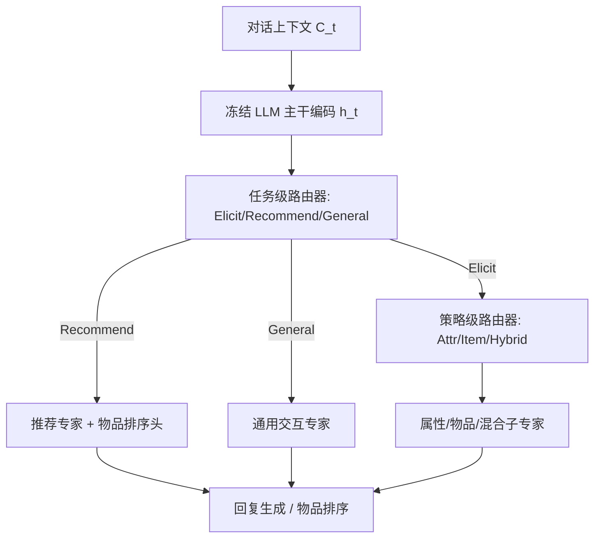
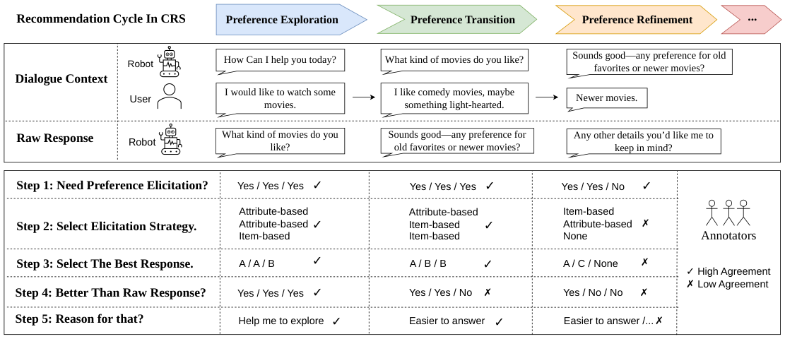
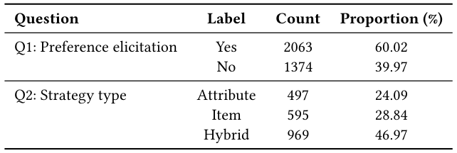
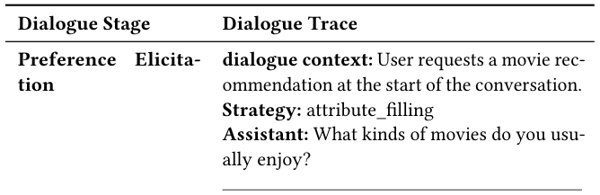
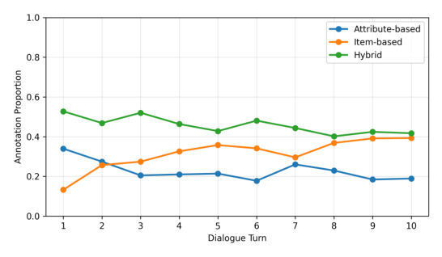
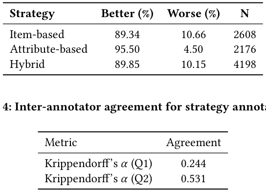
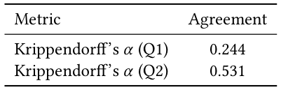
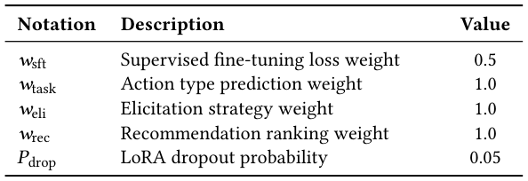
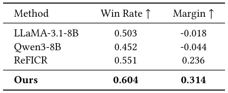

# When and How to Ask: Dynamic Preference Elicitation Strategies for Conversational Recommendation (何时与如何提问：对话推荐中的动态偏好引出策略)

- **会议/期刊**: SIGIR 2026
- **作者与机构**: Feng Xia, Xi Wang (University of Sheffield); Shuo Zhang (Bloomberg)
- **推荐链路定位**: 对话交互策略层（端到端生成式对话推荐）
- **研究方向**: 对话推荐与智能体仿真 / 大语言模型推荐
- **论文原文**: [论文原文链接](https://arxiv.org/abs/2607.06765v1)
- **开源代码**: [开源代码仓库链接](https://github.com/juanfacabian/InPE)

## TL;DR (1分钟核心速览)

现有对话推荐系统（CRS）普遍采用单一、静态的偏好引出策略（多为属性提问），忽视了"何时问、怎么问"随对话阶段动态变化这一核心问题。本文通过 328 人用户研究证实：早期阶段属性式提问占优（63%），后期物品式提问反超（65%），据此构建 InPE 细粒度标注数据集，并提出 COPE——基于冻结 LLM 主干 + 分层硬路由 MoE 的策略感知架构。在 InPE 上 Full-Ranking 协议下 Recall@10 达 0.314，较最强基线 ReFICR 相对提升 14.6%，成对胜率 0.604。

## Background & Motivation (背景与核心矛盾)

- **主流范式**: 现有 CRS 的偏好引出分为属性式（问类型/导演）与物品式（呈现具体物品供比较）两大类，但绝大多数系统在整段对话中固定使用单一策略，属性式常被当作默认选项。
- **前人局限**: 其一，静态策略无法适配用户偏好从"抽象"到"具体"的自然演化，早期有效的问题在后期变得低效；其二，现有主动式 CRS 多聚焦"是否提问"的二元决策，缺乏对"用哪种策略提问"的细粒度建模，且缺少带策略级标注的公开数据。
- **核心洞察 (Key Insight)**: 用户研究显示策略偏好呈显著阶段依赖——属性式在阶段 1 获 63% 选择率，物品式在阶段 8 升至 65%；且 54%/59% 用户认为单一策略仅在"多数情况"有效，仅 21%/25% 认为"始终"有效。
- **本文切入点**: 将对话推荐重构为结构化动作空间上的序贯决策，用 MoE 显式分离"决策执行通路"，让不同策略专家各司其职。

## Method (核心方法设计)

### 1. 整体框架 (Overall Architecture)

COPE 以冻结的 Qwen3-8B 为共享主干，在其旁挂载多个轻量 LoRA 适配器作为"专家"（偏好引出专家再细分为属性/物品/混合三个子专家，另有推荐专家与通用交互专家）。每轮对话先由共享主干编码上下文得到末位隐状态，再经两级路由器依次预测任务类型与引出策略，硬路由激活对应专家生成回复；推荐轮额外接物品排序头做对比学习。训练时用真值标签教师强制路由，推理时用预测路由，实现"决策—执行"解耦。

### 2. 关键设计拆解 (Key Designs)

1. **结构化动作空间与决策显式化**：传统 LLM-based CRS 仅优化 token 级似然 $\mathcal{L}_{LM}$，决策逻辑隐式埋在序列里。本文将系统动作定义为三元组 $A_t=\langle a_t,\sigma_t,\phi_t\rangle$（意图、引出策略、推荐目标），并将生成分解为 $P(s_t|C_t)=\sum_{A_t}P(s_t|C_t,A_t)P(A_t|C_t)$。直觉是：把"何时问/怎么问"提升为可监督的中间变量，使策略选择成为可学习、可解释的显式目标。

2. **分层硬路由 MoE**：常规 MoE 用于扩容，本文用于分离行为通路。输出为 $y_t=\Phi(C_t)+\sum_{k}\mathbb{I}(\gamma_t=k)\cdot\Delta\Psi_k(C_t)$，其中 $\gamma_t$ 由两级 Softmax 路由器给出：$P(a_t|C_t)=\text{Softmax}(W_{task}h_t+b_{task})$，仅当 $a_t=\text{Elicit}$ 时再算 $P(\sigma_t|C_t,a_t)$。硬路由保证各专家梯度互不干扰，避免多目标间的表征拉扯。

3. **多任务损失与推理效率**：总损失 $\mathcal{L}_{total}=w_{sft}\mathcal{L}_{sft}+w_{task}\mathcal{L}_{route}^{\alpha}+w_{eli}\mathcal{L}_{route}^{\sigma}+w_{rec}\mathcal{L}_{rec}$，其中推荐专家用 InfoNCE 对比损失（物品嵌入由预训练 LLM 文本表征初始化，负样本为批内负例）。LoRA 秩 $r=8$、$\alpha=16$，仅训练适配器与路由器，推理时单专家激活，开销与单适配器模型相当。

## Experimental Setup & Evaluation Protocol (实验设置与评估协议)

- **数据集与预处理**: InPE 由 INSPIRED 增强而来，LLM（Qwen3-32B）初筛 10,576 轮中的 3,437 轮（32.5%）为候选，人工确认 60.07% 确需引出，最终得 6,719 个轮级样本。

| 数据集 | #Dialogues | #Turn Samples | 任务分布 | 策略分布 | 标注说明 |
| :--- | :---: | :---: | :---: | :---: | :--- |
| InPE | 999 | 6,719 | 通用 46.3% / 引出 19.8% / 推荐 33.9% | 混合 46.97% / 物品 28.84% / 属性 24.09% | 三标注者多数投票，Krippendorff's $\alpha$: Q1=0.244, Q2=0.531 |

- **数据划分与防穿越 (Splitting Strategy)**: 轮级样本按 6:2:2 比例划分训练/验证/测试。
- **排名评测协议 (Ranking Protocol)**: 物品推荐采用 Recall@k（k=1/10/50）排序评测；决策质量用 Task Accuracy 与 Strategy Accuracy；回复质量用人工标注偏好对 $(y_w,y_l)$ 计算成对胜率与对数似然边际 $\Delta LL$。
- **对比基线与超参设置**: 基线含邻域法 NBCRS、KG 法 KBRD/KGSF/TREA、LLM 增强法 ReFICR、零样本 Qwen3-8B 与 LLaMA3-8B-Instruct。主干 Qwen3-8B，学习率 $2\times10^{-5}$，有效批大小 32，单卡 A100 80GB。

## Key Experimental Results (实验关键数据)

### 1. 主实验对比 (Main Results)

表 6 推荐性能（InPE，Recall@k）：

| Method | R@1 | R@10 | R@50 |
| :--- | :---: | :---: | :---: |
| NBCRS | 0.023 | 0.160 | 0.273 |
| KBRD | 0.056 | 0.145 | 0.210 |
| KGSF | 0.057 | 0.165 | 0.256 |
| TREA | 0.047 | 0.147 | 0.346 |
| ReFICR | 0.135 | 0.274 | 0.396 |
| Qwen3-8B (zero-shot) | 0.013 | 0.094 | 0.156 |
| LLaMA3-8B-Instruct | 0.031 | 0.086 | 0.148 |
| **COPE (Ours)** | **0.144** | **0.314** | **0.442** |
| Improv. vs ReFICR | +6.7% | +14.6% | +11.6% |

表 7 成对回复质量评估：

| Method | Win Rate↑ | Margin↑ |
| :--- | :---: | :---: |
| LLaMA-3.1-8B | 0.503 | -0.018 |
| Qwen3-8B | 0.452 | -0.044 |
| ReFICR | 0.551 | 0.236 |
| **COPE (Ours)** | **0.604** | **0.314** |

### 2. 消融实验 (Ablation Study)

表 8 专家移除消融：

| Variant | Task Acc | Eli Acc | Recall@10 | Win Rate |
| :--- | :---: | :---: | :---: | :---: |
| (1) Full | 0.618 | 0.711 | 0.314 | **0.604** |
| (2) w/o Rec | 0.566 | 0.623 | 0.303 | 0.598 |
| (3) w/o Eli | 0.602 | 0.586 | 0.315 | 0.628 |
| (4) w/o all | **0.639** | **0.756** | **0.335** | 0.525 |

表 9 路由干预实验：

| Router | Task Acc | ELI@1 | R@10 |
| :--- | :---: | :---: | :---: |
| Ground Truth | 1.0 | 1.0 | **0.342** |
| Prediction | 0.617 | 0.711 | 0.314 |
| Random | 0.333 | 0.333 | 0.051 |

### 3. 关键实验发现 (Key Findings)

1. **策略感知是主要增益来源，而非 LLM 规模**：零样本 Qwen3-8B 的 R@10 仅 0.094，远低于 COPE 的 0.314；同为 LLM 主干的 ReFICR 也落后 14.6%，说明显式建模引出策略比单纯依赖 LLM 隐能力更关键。
2. **路由精度是当前瓶颈，专家本身已足够强**：真值路由下 R@10 升至 0.342（较预测路由 +8.9%），而随机路由暴跌至 0.051，证明性能天花板由策略选择准确率（0.711）而非专家容量决定。
3. **统一单适配器"指标虚高但体验差"**：w/o all 变体在 Task Acc（0.639）与 Recall@10（0.335）上反而最高，但成对胜率仅 0.525，说明单一适配器倾向生成泛化回复，牺牲了策略感知的对话质量——这正是 MoE 分离通路的价值所在。

## Highlights, Limitations & Rating (亮点、对比与审稿评价)

- **与代表作对比 (vs. Prior Work)**: 相较 ReFICR 等 LLM 增强 CRS，本文不依赖 LLM 隐式习得策略，而是用显式动作空间 + 分层路由监督；相较 KBRD/KGSF 等 KG 法，本文不依赖外部知识图谱，转而挖掘对话内部的策略时序结构；相较传统 RL 主动式 CRS，本文用 MoE 硬路由替代策略梯度，训练更稳定。
- **可迁移亮点**: (1) "教师强制路由训练 + 预测路由推理"的解耦范式可迁移至任意多意图对话系统；(2) 用 LLM 初筛 + 人工验证的半自动标注流程，可低成本复用于其他策略级标注任务。
- **审稿级局限批判**: 其一，Q1 标注一致性仅 $\alpha=0.244$，偏好引出必要性判断主观性强，标签噪声可能传导至路由监督；其二，仅在单一 InPE 数据集（源自 INSPIRED 电影域）验证，跨域泛化与在线 A/B 效果未知；其三，路由准确率 0.617 距真值上限仍有明显差距，级联误差在多轮对话中可能累积。
- **四维评分**: 创新性 ⭐⭐⭐⭐ | 实验扎实度 ⭐⭐⭐⭐ | 方法清晰度 ⭐⭐⭐⭐⭐ | 落地价值 ⭐⭐⭐⭐

## 论文图表

<figure class="paper-figure" markdown="span">
  <figcaption>图1：对话各阶段偏好引出策略的用户选择比例。x轴表示从抽象偏好到具体偏好的推进过程（阶段1–8），y轴表示基于属性和基于物品的策略选择比例。</figcaption>
</figure>

<figure class="paper-figure" markdown="span">
  <figcaption>图2：逐步标注流程概览。</figcaption>
</figure>

<figure class="paper-figure" markdown="span">
  <figcaption>表1：偏好引出与策略选择的总体标注统计。</figcaption>
</figure>

<figure class="paper-figure" markdown="span">
  <figcaption>表2：案例研究：测试集中展示阶段感知策略使用的示例对话</figcaption>
</figure>

<figure class="paper-figure" markdown="span">
  <figcaption>图3：标注对话轮次中不同引出策略的比例。</figcaption>
</figure>

<figure class="paper-figure" markdown="span">
  <figcaption>表3：不同策略类型下人类对策略感知回复的偏好。</figcaption>
</figure>

<figure class="paper-figure" markdown="span">
  <figcaption>表4：策略标注的标注者间一致性。</figcaption>
</figure>

<figure class="paper-figure" markdown="span">
  <figcaption>图4：我们提出的对话推荐框架概览。</figcaption>
</figure>

<figure class="paper-figure" markdown="span">
  <figcaption>表5：关键超参数配置。</figcaption>
</figure>

<figure class="paper-figure" markdown="span">
  <figcaption>表7：在InPE数据集上的成对评估。</figcaption>
</figure>

