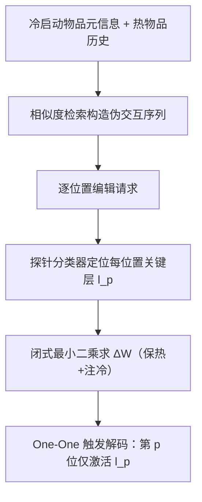
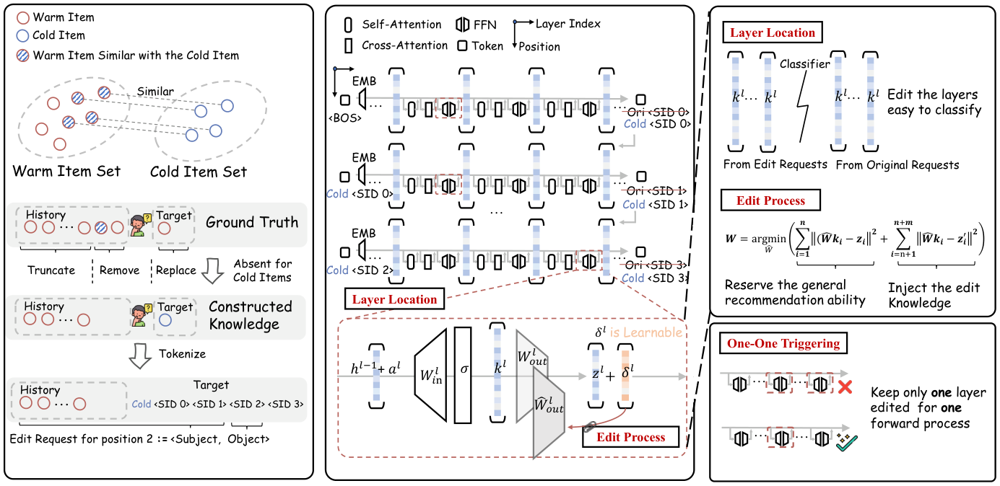

# GenRecEdit: Adapting Model Editing for Generative Recommendation with Cold-Start Items (面向冷启动物品的生成式推荐模型编辑适配)

- **会议/期刊**: SIGIR 2026
- **作者与机构**: Chenglei Shen, Teng Shi, Weijie Yu, Xiao Zhang, Jun Xu（中国人民大学高瓴人工智能学院、对外经济贸易大学）
- **推荐链路定位**: 端到端生成式（免训练在线知识注入）
- **研究方向**: 冷启动与长尾推荐 / 生成式推荐与离散语义 ID
- **论文原文**: [论文原文链接](https://arxiv.org/abs/2603.14259v2)
- **开源代码**: [开源代码仓库链接](https://github.com/Starrylay/GenRecEdit.git)

## TL;DR (1分钟核心速览)

生成式推荐（GR）存在严重的**冷启动坍缩**：训练后新引入物品的推荐精度可跌至近零。作者诊断出模型其实能生成冷启动物品的首个 SID token，但后续位置强烈偏向已见 SID 模式。为此提出 GenRecEdit，把冷启动物品的 SID 模式视为可编辑知识，通过「逐位置伪交互构造 + 探针定位关键层 + 闭式最小二乘权重更新 + One-One 触发」实现免训练注入。在 Amazon 三个类目上，冷子集 NDCG@10 相对最优基线提升约 7.9%–73.3%，热物品 NDCG@10 仅降 6.5%，更新耗时仅为重训的 9.5%。

## Background & Motivation (背景与核心矛盾)

- **主流范式**: GR 用 RQ-VAE/VQ 将物品量化为多 token 语义 ID（SID），以自回归方式生成下一物品的 SID 序列，理论上可借语义泛化到未见物品。
- **前人局限**: ① 冷启动物品的 SID 模式在训练中从未出现，模型几乎不生成冷启动物品（IID Ratio 极低）；② 补救手段（重训/增量微调）面临反馈稀疏、更新延迟与高昂算力，且微调易灾难性遗忘（Finetune 在热子集 NDCG@10 暴跌 87.0%）。
- **核心洞察 (Key Insight)**: 逐位置分析显示，冷启动物品**首位 SID token 的 NDCG 相对较高**，坍缩发生在后续位置——模型有潜力但"不敢"生成未见 SID 组合；即瓶颈是 SID 模式缺失而非表征能力缺失。
- **本文切入点**: 借鉴 NLP 模型编辑（ROME/MEMIT/α-Edit）的 locate-then-edit 范式，把冷启动 SID 模式当作可编辑事实，免训练地写入 FFN 权重。

## Method (核心方法设计)

### 1. 整体框架 (Overall Architecture)

GenRecEdit 分三步闭环：先为每个冷启动物品用元信息编码检索 top-$k$相似热物品，截取其真实历史构造伪交互序列，并按 SID 位置拆成逐位置编辑请求$\langle s_p, o_p\rangle$（$s_p$为历史+目标前缀，$o_p$为第$p$位目标 token）；再对每个位置训练线性探针分类器，在每层抽取 key 激活判别"冷/热"，取准确率最高层作为该位置的编辑层$l_p$；最后在该层用闭式最小二乘求权重增量$\Delta W$，推理时按当前解码位置仅激活对应层。

<figure class="paper-figure" markdown="span">
  <figcaption>图 4：GenRecEdit 的整体框架，包含三个主要模块：（1）逐位置知识准备。我们为冷启动物品构建伪交互数据，并用其形成编辑请求。（2）先定位后编辑框架。对于每个位置，我们首先使用分类器定位与该位置关联最强的关键层，然后对识别出的层执行定向编辑。（3）一对一触发策略。为防止不同位置的编辑之间相互干扰，我们在推理时采用自适应触发策略，其中相应的</figcaption>
</figure>

### 2. 关键设计拆解 (Key Designs)

1. **逐位置知识准备（Position-Wise Knowledge Preparation）**：GR 无稳定 token 共现（不像 "Donald-Trump"），单次编辑难以控制多 token 输出。作者将对象 $o$退化为**单个 SID token**、把整段历史+前缀作为 subject$s_p$、丢弃 relation，把一次多 token 编辑拆成 4 次单 token 编辑。伪历史由$\mathcal{N}_k(c)=\text{TopK}_{j\in\mathcal{I}_{warm}}\cos(\boldsymbol{e}_c,\boldsymbol{e}_j)$ 检索热物品后截取其前序交互得到，使冷物品获得"像真实用户会怎么点"的上下文。

2. **定位-编辑与闭式权重更新（Locate-Then-Edit）**：不同层对知识存储敏感度不同，随机/最差层编辑会破坏原能力。作者对每层 key 激活 $k^l_{p,i}$训练线性探针$Cls(k)=\text{Sigmoid}(\langle\theta,k\rangle)$ 区分冷/热样本，取 top-1 准确率层。随后在编辑层求解同时保热与注冷的最小二乘：
$$\hat{W}=\arg\min_{\hat{W}}\ \|\hat{W}K_0-Z_0\|_F^2+\|\hat{W}K_1-Z_1'\|_F^2$$
其闭式解为 $\Delta W=RK_1^\top(\lambda C_0+K_1K_1^\top)^{-1}$，其中$C_0=K_0K_0^\top$是原数据 key 协方差（保热压力），$R=Z_1'-W_0K_1$是冷知识残差，$\lambda$ 显式调节"注入 vs 保留"权衡——这是本文相对 ROME/MEMIT 的关键增量：把保热项写成协方差正则而非零空间投影。

3. **One-One 触发与训练目标**：若所有编辑层同时激活，跨位置编辑互相干扰（消融中 IID Ratio 从 0.7359 崩到 0.0030）。推理时第 $p$位解码仅触发$l_p$层编辑，其余层保持原权重。作者给出定理 4.1：在跨层干扰有界假设$\|\Delta W_q\cdot k_p\|_2\le\varepsilon$下，概率偏差$|p_{actual}-p_{ideal}|\le\frac{1}{4}(e^{6\varepsilon}-1)\approx1.5\varepsilon$，从理论上保证逐位置编辑的稳定性。编辑目标为交叉熵$\mathcal{L}_{edit}=\mathcal{L}_{CE}(\text{onehot}(o_{p,i}),p_\theta(\cdot|s_{p,i};z_i+\delta_i))$，全程**免负采样、免梯度反传训练**，仅需求解一次线性系统。

## Experimental Setup & Evaluation Protocol (实验设置与评估协议)

- **数据集与预处理**: Amazon 2023 Review 三个类目，按官方时间戳划分，剔除训练集中未出现在测试集的冷启动用户：

| 数据集 | 冷子集占比 | 特征/场景说明 |
| :--- | :---: | :--- |
| Video Games | 65.6% | 长尾极重，冷物品主导测试集 |
| Software | 24.3% | 热物品为主，检验保热能力 |
| Cell Phones & Accessories | 75.5% | 冷物品占比最高 |

- **数据划分与防穿越 (Splitting Strategy)**: 官方**全局时间戳切分**（train/valid/test 无时间重叠），并额外按"目标物品是否出现在训练集"切出 cold / warm / overall 三个测试子集。
- **排名评测协议 (Ranking Protocol)**: 生成式 **Full-Ranking**（自回归生成 top-$K$物品，$K\in\{10,20,50\}$），指标为 Recall@K、NDCG@K 及自定义 IID Ratio@K（衡量生成物品落在当前子集的比例）。
- **对比基线与超参设置**: 基线含 ID-based（SASRec、BERT4Rec）、Semantic ID-based（VQ-Rec、TIGER、LC-Rec）与冷启动专用（Retrain、Finetune、SpecGR）；RQ-VAE 用 $M=3$码本、$K=256$、$d=32$，T5 解码器 6 层、gated-silu 激活（ReLU 会导致 key 低秩、矩阵求逆病态）；$\lambda\in\{3000,3000,1000\}$；显著性用 paired$t$-test，$p<0.05$。

## Key Experimental Results (实验关键数据)

### 1. 主实验对比 (Main Results)

以最具代表性的 Video Games 与 Cell Phones 为例（Overall / Cold 双列，NDCG@10）：

| 方法 | Video Overall | Video Cold | Phone Overall | Phone Cold |
| :--- | :---: | :---: | :---: | :---: |
| SASRec | 0.0014 | – | 0.0006 | – |
| BERT4Rec | 0.0019 | – | 0.0010 | – |
| VQ-Rec | 0.0027 | 0.0000 | 0.0005 | 0.0000 |
| TIGER | 0.0070 | 0.0020 | 0.0037 | 0.0014 |
| LC-Rec | 0.0055 | 0.0012 | 0.0028 | 0.0004 |
| Retrain | 0.0083 | 0.0044 | 0.0045 | 0.0033 |
| Finetune | 0.0076 | 0.0103 | 0.0035 | 0.0041 |
| SpecGR | **0.0114** | 0.0051 | 0.0030 | 0.0018 |
| **GenRecEdit** | **0.0118** | **0.0123** | **0.0064** | **0.0052** |
| Improv. (Cold vs 次优) | – | **+19.4%** | – | **+26.8%** |

热子集保真（Phone，Table 2）：TIGER 为 0.0108，GenRecEdit 0.0101（仅 **-6.5%**），而 Retrain -25.9%、SpecGR -38.0%、Finetune -87.0%。

### 2. 消融实验 (Ablation Study)

Phone 数据集，冷子集指标：

| 配置 | IID R.@10 | N.@10 | N.@20 | R.@10 | R.@20 |
| :--- | :---: | :---: | :---: | :---: | :---: |
| GenRecEdit 完整 | **0.7359** | **0.0064** | **0.0078** | **0.0108** | **0.0165** |
| w/o position-wise | 0.0220 | 0.0002 | 0.0002 | 0.0004 | 0.0005 |
| w/o classifier (random) | 0.7339 | 0.0059 | 0.0072 | 0.0100 | 0.0150 |
| w/o classifier (worst) | 0.6865 | 0.0055 | 0.0066 | 0.0094 | 0.0137 |
| w/o one-one triggering | 0.0030 | 0.0000 | 0.0001 | 0.0001 | 0.0002 |

### 3. 关键实验发现 (Key Findings)

1. **逐位置拆解与 One-One 触发是"生死线"而非"锦上添花"**：去掉任一模块，IID Ratio@10 从 0.7359 分别跌至 0.0220 与 0.0030（降幅 >97%），NDCG@10 近乎归零——说明 GR 的多 token 编辑若不做位置解耦，编辑信号会被跨位置干扰完全淹没。
2. **探针定位优于随机/最差层，但收益量级小于前两者**：worst 层选择使 NDCG@10 从 0.0064 降至 0.0055（-14%），random 仅 -7.8%，印证"中间偏浅层更适合编辑"（图 8），与 NLP 中 MEMIT 的层偏好一致。
3. **保热-注冷存在可调权衡**：$\lambda$ 增大持续提升热物品、削弱冷物品；注入知识数量增加时冷子集 NDCG 单调上升，但整体测试集先升后降，说明每冷物品注入条数需按冷/热比例调参（Video 冷占比 65.6% 时最优注入量偏大）。

## Highlights & Limitations (亮点、对比与审稿批判)

- **与代表作对比 (vs. Prior Work)**: 相比 ROME/MEMIT 的零空间投影保真，本文把保真项写成原数据 key 协方差 $C_0$ 正则，天然适配"序列上下文→下一 token"的 GR 结构；相比 SpecGR 的 draft-then-verify 推理期干预，本文直接改权重、无额外候选生成开销；相比 Retrain/Finetune，更新耗时仅 9.5%/52%（相对 Finetune 的 18.1% 基准）。
- **可迁移亮点**: ① "探针分类器选层"可迁移到任何需要最小副作用注入新知识的生成式检索/推荐；② 逐位置解耦+按解码位置门控触发的思路，可直接用于多 token 语义 ID 的可控生成。
- **审稿级局限批判**: ① 伪交互依赖元信息检索热物品，冷物品若元信息缺失（纯 ID 新品）则知识质量骤降，图 5 显示与 Upper Bound 仍有明显 Quality Gap；② 每个位置需独立训练探针+求解线性系统，冷物品批量达万级时矩阵求逆 $O(d^3)$ 与存储开销未充分讨论；③ 仅在 Amazon 三个类目验证，缺少新闻/短视频等高频更新场景与线上 A/B。

## Rating (四维评分)

- **方法创新性 (Novelty)**: ⭐⭐⭐⭐ （首次将模型编辑系统迁移至 GR，逐位置解耦+One-One 触发有定理支撑，但核心算子沿用 MEMIT 闭式解框架）
- **评估协议与实验扎实度 (Protocol & Experiments)**: ⭐⭐⭐⭐ （三数据集+冷/热/整体三视角+8 基线+完整消融，但缺线上验证与更大规模冷物品压力测试）
- **写作与数学规范度 (Clarity & Rigor)**: ⭐⭐⭐⭐ （问题诊断实验（逐位置 NDCG、IID Ratio）设计精巧，定理 4.1 证明完整，符号略密）
- **工业落地与复现价值 (Industrial & Practical Value)**: ⭐⭐⭐⭐⭐ （免训练、9.5% 重训耗时、代码开源，对高频更新目录场景落地价值极高）

