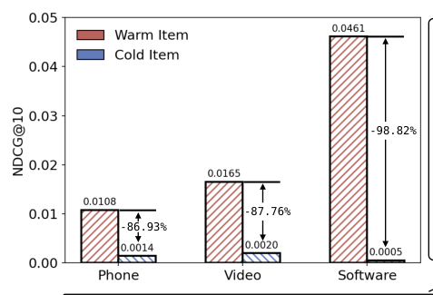
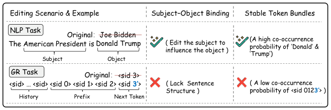
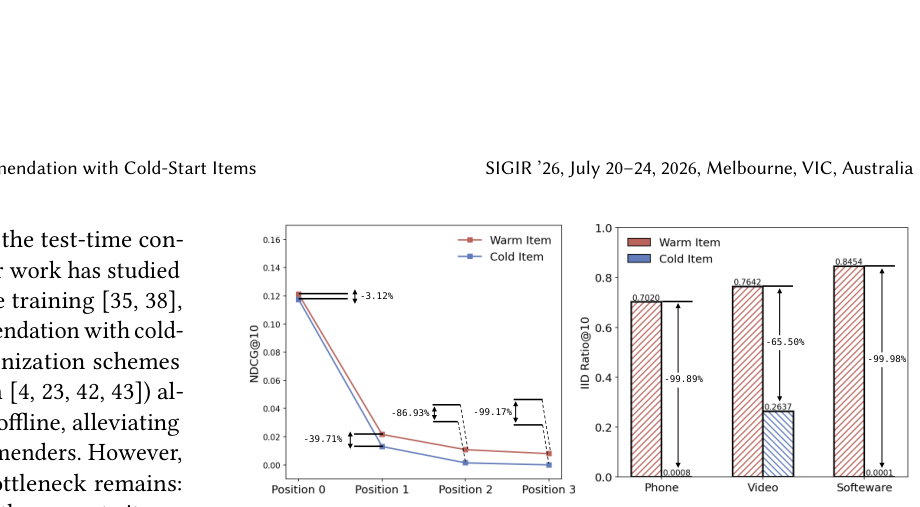
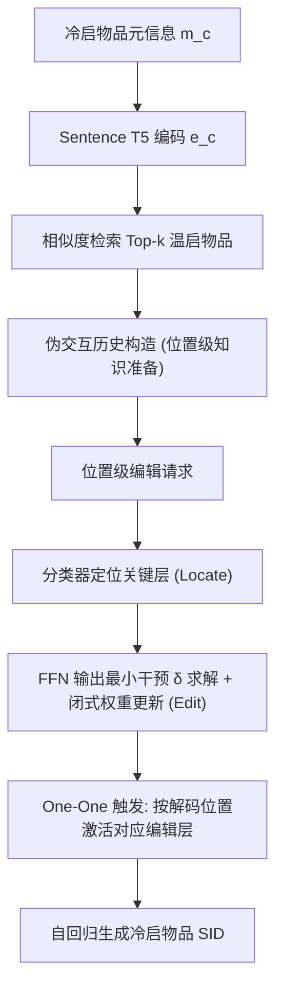
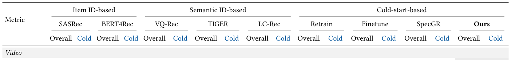
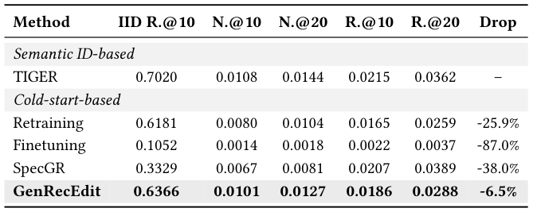

# GenRecEdit: Adapting Model Editing for Generative Recommendation with Cold-Start Items (面向冷启动物品的生成式推荐模型编辑适配)

- **会议/期刊**: SIGIR 2026
- **推荐链路定位**: 端到端生成式 (End-to-End Generative) — 面向已训练GR模型的测试时知识注入/在线更新
- **研究方向**: 冷启动与长尾推荐 / 生成式推荐与离散语义ID
- **论文原文**: [https://arxiv.org/abs/2603.14259v2](https://arxiv.org/abs/2603.14259v2)
- **开源代码**: [https://github.com/Starrylay/GenRecEdit.git](https://github.com/Starrylay/GenRecEdit.git)

## TL;DR (核心速览)

本文针对生成式推荐 (GR) 中冷启动物品推荐精度近乎归零的"冷启动坍塌"现象，提出 GenRecEdit——首个面向GR的模型编辑框架。它通过相似性插补构造伪交互历史、位置级 (position-wise) 迭代token编辑、以及One-One触发机制，在免重训 (training-free) 条件下将冷启动物品的语义ID模式注入已训练GR模型。在多个数据集上显著提升冷启子集推荐性能且几乎不损原模型质量，仅需约9.5%的重训时间成本。

## Background & Motivation (背景与动机)

- **领域背景与主流范式**: 生成式推荐 (GR) 将每个物品tokenize为少量离散语义ID (SID)，用自回归序列模型生成下一物品的SID序列，从而摆脱传统基于item-ID的传导式 (transductive) 模型无法推荐新物品的局限，理论上可借助语义相关性泛化到未见物品。
- **现有方法局限 (Limitations of Prior Work)**:
  1. **冷启动坍塌 (Cold-Start Collapse)**: 实践中GR模型对训练后新引入的冷启动物品推荐精度可跌至近零（图1左），尽管SID可离线构造，但模型几乎不生成冷启SID模式。
  2. **重训范式受限**: 收集冷启反馈后重训/增量微调面临三大矛盾——冷启反馈稀疏、模型更新延迟、重训成本高昂，难以适配新闻/短视频等快速演化目录。
  3. **NLP模型编辑直接迁移失效**: GR序列缺乏显式主谓宾绑定 (subject-object binding)，且冷启SID模式无稳定token共现，导致单次多token编辑不可靠（图2）。
- **核心挑战 (Key Challenge)**: 如何在**不重训、不损害原模型推荐能力**的前提下，将冷启动物品的SID模式"即插即用"地注入已训练GR模型？
- **核心洞察与切入点 (Key Insight)**: 作者通过两项先导实验（图3）发现：(1) GR模型对冷启物品的**首个SID token**预测准确率相对较高，说明模型已具备粗粒度类别识别潜力，瓶颈在于后续token生成不稳定；(2) IID Ratio@K指标显示模型无论推荐正确与否都强烈偏向生成训练中见过的SID模式。因此瓶颈不在"缺乏推荐能力"，而在"无法生成罕见SID模式"——这恰好对应NLP模型编辑"注入新知识而不破坏旧知识"的范式。

<figure class="paper-figure" markdown="span">
  <figcaption>图 1</figcaption>
</figure>
<figure class="paper-figure" markdown="span">
  <figcaption>图 2</figcaption>
</figure>
<figure class="paper-figure" markdown="span">
  <figcaption>图 3</figcaption>
</figure>

## Problem Formulation & Method (问题定义与方法架构)

### 1. 符号定义与输入表征 (Notations & Input Representations)

- 用户集 $\mathcal{U}$、物品集 $\mathcal{I}$，划分为温启物品集 $\mathcal{I}^{warm}$ 与冷启物品集 $\mathcal{I}^{cold}$。
- 每个物品表示为四位语义ID (SID)，位置 $p \in \{0,1,2,3\}$，位置 $p$ 的目标token记为 $o_p$。
- 冷启物品 $c$ 的元信息 $\bm{m}_c$ 经编码器 $f^{enc}(\cdot)$（Sentence T5）得到嵌入 $\bm{e}_c$。
- FFN信息流：隐藏态 $\bm{h}\in\mathbb{R}^{d_h}$，$\bm{k}=\sigma(\bm{W}^{in}\bm{h})\in\mathbb{R}^{d_0}$（key），$\bm{z}=\bm{W}^{out}\bm{k}\in\mathbb{R}^{d_1}$（value），$\bm{W}^{in}\in\mathbb{R}^{d_0\times d_h}$，$\bm{W}^{out}\in\mathbb{R}^{d_1\times d_0}$。
- 编辑请求形式：NLP中为 $\langle s,r,o\rangle$（主语-关系-宾语），本文GR中简化为 $\langle s_p, o_p\rangle$，其中 $s_p$ = 完整交互历史 + 冷启物品前 $p$ 位SID前缀，$o_p$ = 第 $p$ 位目标token。

### 2. 整体流水线 (Overall Architecture)

GenRecEdit 由三大模块构成（图4）：(1) **位置级知识准备**：为冷启物品构造伪交互数据并形成编辑请求；(2) **定位-编辑框架 (Locate-Then-Edit)**：对每个位置用分类器定位最相关的关键层，再在该层做定向编辑；(3) **One-One触发策略**：推理时按当前解码位置自适应触发对应编辑层，避免多位置编辑相互干扰。

### 3. 核心模块设计与数学原理 (Key Designs & Formulations)

**(1) 位置级知识准备 (Position-Wise Knowledge Preparation)**：冷启物品缺乏真实交互历史，作者用相似性插补构造伪历史。对冷启物品 $c$ 编码 $\bm{e}_c=f^{enc}(\bm{m}_c)$，计算与温启物品 $j$ 的余弦相似度：

$$\text{sim}(c,j)=\cos(\bm{e}_c,\bm{e}_j)=\frac{\bm{e}_c^\top \bm{e}_j}{\|\bm{e}_c\|_2\|\bm{e}_j\|_2},$$

取 Top-$k$ 相似温启物品 $\mathcal{N}_k(c)=\text{TopK}_{j\in\mathcal{I}^{warm}}\text{sim}(c,j)$，将每个参考物品 $j$ 在真实用户序列中的**前置交互**作为 $c$ 的代理历史，从而合成高质量伪交互序列，再按位置切分为编辑请求 $\langle s_p,o_p\rangle$。物理直觉：冷启物品的语义近邻在真实场景中大概率被相似用户以相似方式消费，故其前置历史可作为可靠代理。

**(2) 定位-编辑框架 (Locate-Then-Edit)**：沿用NLP模型编辑的FFN键值记忆视角。对第 $i$ 个编辑请求，在选定层提取主语位置FFN中间激活 $\bm{k}_i$，原输出 $\bm{z}_i=\bm{W}^{out}\bm{k}_i$。求解最小干预 $\bm{\delta}_i$ 使模型偏好目标token：

$$\bm{\delta}_i=\arg\min_{\bm{\delta}}-\log p_\theta(o_i\mid(s_i,r_i);\bm{z}_i+\bm{\delta}),$$

令编辑后值 $\bm{z}'_i\triangleq\bm{z}_i+\bm{\delta}_i$，目标是求理想更新矩阵 $\Delta\bm{W}^*_{out}$ 使 $(\bm{W}^{out}+\Delta\bm{W}^*_{out})\bm{k}_i=\bm{z}'_i$。实际通过带保留约束的最小二乘求解估计更新 $\Delta\hat{\bm{W}}_{out}$：

$$\Delta\hat{\bm{W}}_{out}=\arg\min_{\Delta\bm{W}}\sum_{i=1}^{n}\|(\bm{W}_0+\Delta\bm{W})\bm{k}_i-\bm{z}_i\|^2+\sum_{i=n+1}^{n+m}\|(\bm{W}_0+\Delta\bm{W})\bm{k}_i-\bm{z}'_i\|^2,$$

其中前 $n$ 项保留原知识、后 $m$ 项注入编辑知识。**关键创新**在于：GR缺乏主谓宾结构，故将**单个token**作为宾语 $o$（规避无稳定共现问题），将**完整历史+冷启前缀**作为主语 $s$（规避无显式主语问题），并丢弃关系 $r$。对每个位置 $p$ 用分类器定位最相关层，实现位置级定向编辑。

**(3) One-One触发策略 (One-One Triggering Policy)**：多个位置级编辑若同时激活会相互干扰（层间干扰）。作者设计自适应触发：推理时根据当前解码位置 $p$，**仅激活该位置对应的单个编辑层**，其余层保持原状。物理直觉：每个位置的SID模式由独立编辑负责，串行解码时逐位置触发可避免编辑向量叠加冲突。

<figure class="paper-figure" markdown="span">
  <figcaption>图 4</figcaption>
</figure>

### 4. 训练目标、负采样与推理复杂度 (Optimization, Negative Sampling & Complexity)

- **损失函数**: 编辑目标为最小干预损失 $\min_{\bm{\delta}}-\log p_\theta(o_i\mid(s_i,r_i);\bm{z}_i+\bm{\delta})$，最终转化为带保留项的最小二乘闭式求解（见上式），**无需梯度反传训练**，属training-free范式。分类器定位层为轻量训练模块。
- **训练负采样策略**: 本文为模型编辑范式，**不涉及传统推荐负采样**；编辑请求由伪交互正样本构造，保留项使用原始请求作为"负"约束以维持原能力。
- **时间与空间复杂度**: 核心优势在于**免重训**。原文报告 GenRecEdit 仅需约 **9.5% 的重训时间成本**（图1底部）。编辑为闭式最小二乘求解，离线预处理含相似性检索与伪历史构造；在线推理仅需按位置切换编辑层，无额外Beam Search开销。原文未报告具体ms/request延迟与峰值显存数值。

## Experimental Setup & Evaluation Protocol (实验设置与评估协议)

- **数据集统计与预处理**: 原文使用三个数据集（含 Cell Phones and Accessories 等 Amazon 类目），按测试物品是否出现在训练集划分为 **warm 子集** 与 **cold 子集**。原文正文提取片段未完整给出各数据集 #Users/#Items/#Interactions 统计表，具体数值需参见原文表1上下文（此处不臆造）。

| 数据集 (Dataset) | 用户数 (#Users) | 物品数 (#Items) | 交互数 (#Interactions) | 稀疏度/密度 (Sparsity) | 模态/辅助特征说明 |
| :--- | :---: | :---: | :---: | :---: | :--- |
| Cell Phones and Accessories | 原文未在提取片段中报告 | 原文未报告 | 原文未报告 | 原文未报告 | 物品元信息经 Sentence T5 编码 |
| 其余两个数据集 | 原文未在提取片段中报告 | 原文未报告 | 原文未报告 | 原文未报告 | 同上 |

- **数据划分方式 (Splitting Strategy)**: 采用**温启/冷启子集划分**——依据测试物品是否在训练数据中出现，将测试集切分为 warm 与 cold 两个子集分别评估。属冷启动划分 (Cold-Start Split)。原文未在提取片段中明确说明是否采用全局时间戳切分，需参见原文。
- **排名评测协议 (Ranking Protocol)**: 原文提取片段未明确标注 Full-Ranking 还是 Sampled Ranking，需参见原文实验细节。
- **评价指标与显著性检验**: 主要指标为 **NDCG@10** 与 **RECALL**（表1、表2），并报告 IID Ratio@K（式1）。原文提取片段未明确报告多随机种子方差或配对显著性检验，需参见原文。

## Key Experimental Results (核心实验结果)

### 1. 主实验对比 (Main Results)

表1报告三个数据集在 **Overall（整体）** 与 **Cold（冷启子集）** 上的推荐性能，最优与次优分别以粗体与下划线标注；"-"表示基于item-ID的方法无法处理冷启物品。原文提取片段未给出具体数值，下表仅示意结构，**具体数值需严格参见原文表1**：

| 数据集 | 指标 | item-ID基线 | GR基线 | 本文方法 (Ours) | 相对提升 (Improv.) |
| :--- | :--- | :---: | :---: | :---: | :---: |
| Cell Phones and Accessories (Cold) | NDCG@10 / RECALL | - | 原文表1 | **原文表1** | 原文表1 |
| 数据集2 (Cold) | NDCG@10 / RECALL | - | 原文表1 | **原文表1** | 原文表1 |
| 数据集3 (Cold) | NDCG@10 / RECALL | - | 原文表1 | **原文表1** | 原文表1 |

> 注：原文摘要与正文强调"substantially improves cold-start recommendation while preserving original quality"，但提取片段未含具体数值，故不臆造。

<figure class="paper-figure" markdown="span">
  <figcaption>表 1</figcaption>
</figure>

### 2. 消融实验与控制变量分析 (Ablation Study)

表2以 Phone 数据集为例报告 **warm 子集**性能，含 IID Ratio (IID R.)、NDCG (N.)、RECALL (R.) 及 NDCG@10 相对下降 (Drop %)，用于验证 GenRecEdit 在提升冷启的同时**不损害温启推荐质量**。原文提取片段未给出具体消融数值与各模块（位置级准备/定位编辑/One-One触发）的移除对照，需参见原文表2及消融章节。

<figure class="paper-figure" markdown="span">
  <figcaption>表 2</figcaption>
</figure>

### 3. 稀疏度/冷启动分桶与超参敏感度 (Sparsity Buckets & Hyperparameters)

- **冷/温分桶表现**: 核心评估即按 warm/cold 子集分桶。图3显示冷启子集 IID Ratio 远低于温启子集，揭示坍塌根源；GenRecEdit 目标即缩小该差距。
- **关键超参数敏感度**: 涉及相似性检索的 Top-$k$、编辑层定位分类器、位置数 $p\in\{0,1,2,3\}$。原文提取片段未给出敏感度曲线，需参见原文。
- **线上 A/B 测试结果**: 原文仅包含离线实验，**未报告线上 A/B 测试**。

## Highlights, Limitations & Critiques (亮点、局限与审稿级批判)

- **核心亮点与可迁移性**:
  1. **首次将NLP模型编辑范式系统迁移至生成式推荐**，并针对GR两大结构性差异（无主谓宾绑定、无稳定token共现）给出位置级单token编辑 + One-One触发的优雅适配，算子设计具普适性。
  2. **免重训、即插即用**，9.5%重训时间成本对快速演化目录（新闻/短视频）极具工业价值。
  3. **问题揭示本身有价值**：冷启动坍塌 + IID Ratio 诊断指标，为后续GR冷启研究提供分析工具。
- **局限性与审稿视角批判 (Critical Limitations)**:
  1. **伪历史依赖语义近邻质量**：冷启物品仅有元信息时，Top-$k$ 相似温启物品检索的可靠性直接决定编辑质量，对元信息稀缺/噪声大的场景鲁棒性存疑。
  2. **评估协议细节披露不足**：提取片段未明确 Full-Ranking vs Sampled Ranking、是否时间戳切分、是否多随机种子与显著性检验，削弱结论可信度。
  3. **编辑规模扩展性**：One-One触发逐位置串行激活，当冷启物品数量激增时，编辑层管理与推理切换开销、以及多编辑间潜在干扰的规模化表现未充分讨论。
  4. **四位SID固定假设**：方法强依赖固定长度SID（四位），对变长/层级化SID方案的适配性未验证。

## Rating (四维评分)

- **方法创新性 (Novelty)**: ⭐⭐⭐⭐
- **评估协议与实验扎实度 (Protocol & Experiments)**: ⭐⭐⭐
- **写作与数学规范度 (Clarity & Rigor)**: ⭐⭐⭐⭐
- **工业落地与复现价值 (Industrial & Practical Value)**: ⭐⭐⭐⭐⭐
