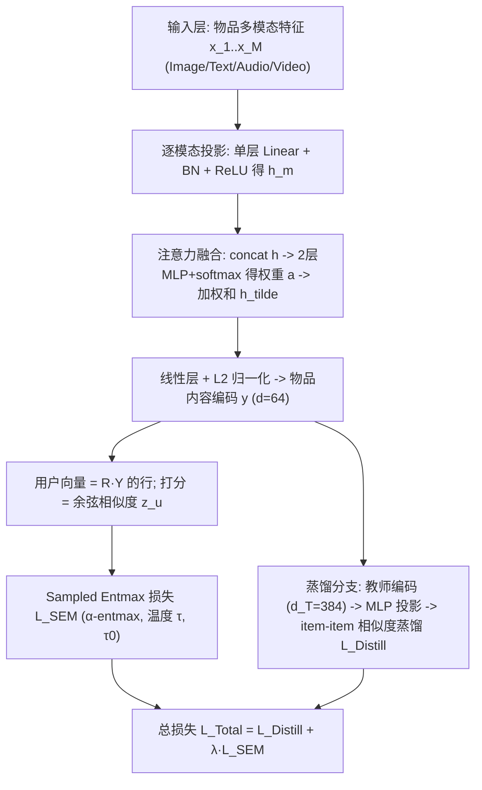
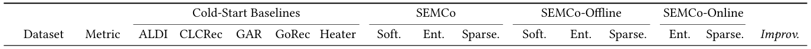

# Sparse Contrastive Learning for Content-Based Cold Item Recommendation (基于稀疏对比学习的纯内容冷物品推荐)

- **会议/期刊**: SIGIR 2026 (第 49 届国际 ACM SIGIR 会议，Melbourne, VIC, Australia)
- **推荐链路定位**: 召回 (Retrieval) — 冷物品内容编码与物品-物品相似度打分
- **研究方向**: 冷启动与长尾推荐 (Cold-Start & Long-Tail) / 自监督对比学习与交互去噪 (Self-Supervised & Contrastive)
- **论文原文**: [https://arxiv.org/abs/2604.12990v1](https://arxiv.org/abs/2604.12990v1)
- **开源代码**: [https://github.com/gmeehan96/SEMCo](https://github.com/gmeehan96/SEMCo)

## TL;DR (核心速览)

针对冷物品推荐中"内容特征与 CF 嵌入存在信息鸿沟"这一痛点，本文放弃与 CF 空间对齐，改为**纯内容建模**：训练内容编码器使物品-物品相似度直接相关于用户偏好，并用 **α-entmax 稀疏化的 sampled softmax (SEMCo)** 对无信息负例置零梯度，再以**内容空间知识蒸馏**（离线/在线）精炼相似度结构。在 4 个多模态数据集冷测试集上，Sparsemax SEMCo-Online 相对最强冷启动基线在 Recall@20 上最高提升 39.7%（Electronics），MDG@20 最高提升 133.7%，且 Gini 多样性最高提升 148.7%。

## Background & Motivation (背景与动机)

- **领域背景与主流范式**: 冷物品推荐的主流做法是"内容→CF 空间映射"：DropoutNet 类方法在训练中随机在 CF 与内容嵌入间切换以模拟冷启动；生成式方法（ALDI、GAR、GoRec、Heater）训练内容编码器去**生成**预训练 CF 模型的物品嵌入，从而把冷物品接入 CF 打分体系。
- **现有方法局限 (Limitations of Prior Work)**:
  1. **信息鸿沟 (Information Gap)**：CF 嵌入刻画行为共现模式，内容特征刻画语义属性，二者本质不同；强行对齐会让冷启动模型"用内容去猜流行度"，产生不稳定的预测行为（作者前作 [26] 已实证）。
  2. **流行度偏置继承**：生成式冷启动模型模仿 CF 教师，连带继承其流行度偏置，导致冷物品曝光高度集中，违反 Max-Min 公平原则。
  3. **稠密 softmax 的监督稀释**：标准 sampled softmax 输出概率全非零，大对比 batch 下大量无关负例仍产生梯度，而内容表征受多模态特征约束、灵活性低，噪声相似度会进一步污染训练信号。
- **核心挑战 (Key Challenge)**: 只要模型仍以"对齐 CF 嵌入"为目标，鸿沟与偏置就无法从根源消除；而若改为纯内容对比学习，稠密 softmax 又无法在大量负例中聚焦真正有信息量的物品。
- **核心洞察与切入点 (Key Insight)**: 借鉴浅层线性自编码器 (shallow LAE) 的 $B=YY^\top$ 分解思想——用户偏好可由**物品-物品相似度矩阵**表达，因此冷启动预测可完全在内容空间内以 item-item 相似度完成；而 α-entmax 的 Fenchel-Young 梯度 $\nabla = \alpha\text{-entmax}(z)-p$ 天然对低于阈值的 logits **置零梯度**，恰好实现"只对最相关物品更新"的稀疏监督。

## Problem Formulation & Method (问题定义与方法架构)

### 1. 符号定义与输入表征 (Notations & Input Representations)

- 用户集 $\mathcal{U}$、物品集 $\mathcal{I}$，二值交互矩阵 $R\in\{0,1\}^{|\mathcal{U}|\times|\mathcal{I}|}$。
- 每个物品 $i$ 有 $M$ 个模态的内容特征向量 $x_1,\dots,x_M$（由预训练模型生成，训练与推理阶段均假设全模态可用）。
- 编码输出 $Y=f(X_1,\dots,X_M)\in\mathbb{R}^{|\mathcal{I}|\times d}$，$d=64$，每行 L2 归一化。
- 输出：用户偏好分数矩阵 $RY$ 与物品编码 $Y$ 的内积。

### 2. 整体流水线 (Overall Architecture)

数据流：多模态特征逐模态单层投影 + BN + ReLU → 注意力融合 → 线性层 + L2 归一化得物品编码 $y$ → 与用户向量（$RY$ 的行）做余弦相似度 → 以 α-entmax 稀疏化 sampled softmax 训练；蒸馏分支中教师编码器（$d_T=384$）向学生（$d=64$）传递 item-item 相似度结构。

### 3. 核心模块设计与数学原理 (Key Designs & Formulations)

**(1) 纯内容偏好预测（避开 CF 对齐）**
沿用 LAE 的 $RB$ 形式，将 $B$ 分解为 $B=YY^\top$，则
$$RB=R(YY^\top)=(RY)Y^\top$$
其中 $RY$ 即用户嵌入矩阵。冷物品无需查询全量 warm 物品集来"追加列"，只需将其内容编码 $y$ 与 $RY$ 的行做点积即可打分——这是纯内容建模在工程上的关键便利，也避免了 CF 教师带来的流行度偏置。

**(2) 内容编码器与注意力融合**
每个模态 $x_m$ 经单层线性 + BN + ReLU 得 $h_m$；拼接 $h=[h_1;\dots;h_M]$ 后经两层 MLP（隐层 ReLU、输出 softmax）得注意力权重 $a\in\mathbb{R}^M$；融合表示 $\tilde h=\sum_{m=1}^{M}a_m h_m$，再经线性层与 L2 归一化得 $y$。物理直觉：不同模态对冷物品判别力的贡献不同（如 Clothing 中视觉特征反而有害，作者直接剔除），注意力提供数据驱动的模态加权。

**(3) Sampled Entmax (SEM) 损失**
α-entmax 定义为
$$\alpha\text{-entmax}(z)=\big[(\alpha-1)z-\eta\mathbf{1}\big]_+^{\frac{1}{\alpha-1}}$$
$\alpha=1$ 退化为 softmax，$\alpha=2$ 为 sparsemax。其 Fenchel-Young 损失（含温度 $\tau$）为
$$\mathcal{L}_{\alpha,\tau}(z,p)=(\hat p-p)^\top z+H_\alpha(\hat p),\quad \hat p=\alpha\text{-entmax}(z/\tau)$$
梯度为 $\nabla_z\mathcal{L}=\alpha\text{-entmax}(z)-p$，当 $\alpha>1$ 时**低于阈值 $\eta/(\alpha-1)$ 的 logits 梯度为零**。对用户 $u$（batch 索引 $j$），目标为指示向量 $e_j$，logits 为用户向量与 batch 内各物品的余弦相似度：
$$\mathcal{L}_{\text{SEM}}(u)=\mathcal{L}_{\alpha,\tau}(z_u/\tau_0,e_j)$$
其中 $\tau_0=\tau$（$\alpha>1$ 时提升稳定性），$\alpha=1$ 时 $\tau_0=1$ 即标准 sampled softmax。

**(4) 内容空间知识蒸馏**
教师编码 $Y_T\in\mathbb{R}^{d_T}$ 经两层 MLP 投影到 $d$；对 batch 物品集 $C$ 中物品 $c$，计算教师/学生与其他物品的余弦相似度 $z_{c,T},z_{c,S}$：
$$\mathcal{L}_{\text{Distill}}(c)=\mathcal{L}_{\alpha,\omega}\Big(\frac{z_{c,S}}{\omega_0},\ \alpha\text{-entmax}\big(\frac{z_{c,T}}{\omega_0}\big)\Big)$$
注意教师 logits 也先经 α-entmax 稀疏化，使蒸馏信号聚焦于教师认为最相关的 item-item 相似度。$C$ 由从 batch $B$ 中抽样用户、每用户取若干正例构成（intra-user 对更具信息量）。支持离线（预训练教师）与在线（教师与学生同步训练，教师输出用 EMA 平滑，类似 early-exit 自蒸馏）两种模式。

### 4. 训练目标、负采样与推理复杂度 (Optimization, Negative Sampling & Complexity)

- **总损失**: $\mathcal{L}_{\text{Total}}=\mathcal{L}_{\text{Distill}}+\lambda\,\mathcal{L}_{\text{SEM}}$，$\lambda$ 控制 SEM 权重；蒸馏温度 $\omega$、$\omega_0$；SEM 温度 $\tau$、$\tau_0$。
- **负采样策略**: **In-batch 负采样**（batch 内其他物品作为负例），batch size 2048；无显式 hard negative 挖掘，稀疏性由 α-entmax 在概率层面实现（等价于对无信息负例"软性丢弃梯度"）。
- **优化细节**: Adam，输出维度 64，隐层 192，cosine 学习率 0.001→0 共 15 epochs；教师隐层/输出 384；在线蒸馏学生学习率 0→0.001 线性 warm-up；超参搜索：SEMCo 用 grid search（$\tau$、L2 系数），SEMCo-Offline 教师 grid + 学生 random search，SEMCo-Online 用 TPE。
- **复杂度**: α-entmax 在 $\alpha\in\{1,1.5,2\}$ 时有 $O(d\log d)$ 的阈值求解算法（softmax 为 $O(d)$），实测训练时间仅增加 **10–20%**。推理时用户嵌入需对全物品集做矩阵乘，作者指出可通过只考虑"活跃" batch 物品改善大规模目录的可扩展性（引 [48]）。原文未报告具体 ms/request 延迟与峰值显存。

## Experimental Setup & Evaluation Protocol (实验设置与评估协议)

- **数据集统计与预处理**（表 1）：

| 数据集 (Dataset) | 用户数 (#Users) | 物品数 (#Items) | 交互数 (#Interactions) | 稀疏度/密度 (Density) | 模态/辅助特征说明 |
| :--- | :---: | :---: | :---: | :---: | :--- |
| Clothing | 39,387 | 23,033 | 278,677 | 0.031% | Text (384)；视觉特征被剔除 |
| Electronics | 192,403 | 63,001 | 1,689,188 | 0.014% | Image (4096), Text (384) |
| M4A-Onion | 8,807 | 43,886 | 1,510,034 | 0.391% | Audio (1024), Text (768) |
| Microlens | 98,129 | 17,228 | 705,174 | 0.042% | Image (1024), Text (1024), Video (768) |

  - Clothing/Electronics 为 Amazon 5-core 过滤子集，特征来自 MMRec；M4A-Onion 额外做了跳过歌曲剔除（下一首 30 秒内开始）、仅保留 2018 年与 10–80 岁用户、剔除单次交互、5-core 过滤，文本用 BERT、音频用 MusicFM 提取；Microlens 为微视频数据集。
- **数据划分方式 (Splitting Strategy)**: **冷启动划分**——随机选 20% 物品从训练中排除，按 50/50 分给冷验证/冷测试；剩余交互按 80/10/10 分为 warm 训练/验证/测试（供基线 warm backbone 使用）。属于标准 cold-item split，未见时间戳切分，存在随机划分下的未来信息泄露风险（原文未讨论）。
- **排名评测协议 (Ranking Protocol)**: 原文未明确说明是 Full-Ranking 还是 Sampled Ranking，仅报告 Recall@20、NDCG@20 与 Item MDG@20（物品导向排序精度）及 Gini 多样性；从方法描述看应对冷测试物品集做排序打分，但候选集构造细节原文未报告。
- **评价指标与显著性检验**: Recall@20、NDCG@20、MDG@20、Gini；所有结果为 **5 次运行平均**（最优超参下）；采用 **paired t-test，$p<0.05$**，除 Clothing 的 Softmax SEMCo 与 Entmax SEMCo-Offline 的 R@20 外，所有 SEMCo 变体在全部数据集上的排序指标提升均统计显著。所有模型输出维度统一为 64。

## Key Experimental Results (核心实验结果)

### 1. 主实验对比 (Main Results)

表 2 给出冷测试集结果（<figure class="paper-figure" markdown="span">
  <figcaption>表2：冷启动测试集上的 Recall@20（R@20）、NDCG@20（N@20）和 MDG@20（M@20）。每组中最佳模型以下划线标出，整体最佳模型以粗体标出。Improv. 为 Sparsemax SEMCo-Online 相对表现最佳的冷启动基线计算所得。</figcaption>
</figure>）。以最强冷启动基线为参照，Sparsemax SEMCo-Online 的提升如下：

| 数据集 | 指标 | 最强冷启动基线 (多为 GoRec) | 本文方法 (Sparsemax SEMCo-Online) | 相对提升 (Improv.) |
| :--- | :--- | :---: | :---: | :---: |
| Clothing | R@20 / N@20 / M@20 | 0.1389 / 0.0638 / 0.0495 | **0.1486 / 0.0717 / 0.0582** | +7.0% / +12.4% / +17.7% |
| Electronics | R@20 / N@20 / M@20 | 0.0376 / 0.0171 / 0.0092 | **0.0526 / 0.0236 / 0.0214** | +39.7% / +38.0% / +133.7% |
| M4A-Onion | R@20 / N@20 / M@20 | 0.0577 / 0.0557 / 0.0159 | **0.0910 / 0.0887 / 0.0267** | +57.7% / +59.3% / +67.9% |
| Microlens | R@20 / N@20 / M@20 | 0.1294 / 0.0562 / 0.0448 | **0.1455 / 0.0629 / 0.0524** | +12.5% / +11.9% / +16.8% |

- **公平性/多样性**: Gini 指标上 SEMCo 系列显著高于基线（Electronics 0.6201 vs. GoRec 0.1523，M4A-Onion 0.5010 vs. 0.1667），即预测曝光更均衡；Clothing 上 CLCRec 的 Gini (0.6185) 与 SEMCo 接近但排序精度远低，说明 SEMCo 在公平与精度间取得更好平衡。
- **图 1**（<figure class="paper-figure" markdown="span">
  ![图1：Electronics 数据集中冷物品总体上的物品 MDG@20 与预测次数。每个点代表一个物品，MDG 或预测次数为零的物品未绘出。MS 表示幅度缩放 \[26\]。](../../../../assets/papers/2604.12990v1/figure_1.png)<figcaption>图1：Electronics 数据集中冷物品总体上的物品 MDG@20 与预测次数。每个点代表一个物品，MDG 或预测次数为零的物品未绘出。MS 表示幅度缩放 [26]。</figcaption>
</figure>）在 Electronics 冷物品总体上对比 SEMCo-Online、GoRec 与 GoRec+MS：所有方法对至少 60% 物品无成功推荐，但 SEMCo-Online 的物品精度分布更均衡，预测次数几乎覆盖全部物品（多数 ≥10 次），而 GoRec 存在少数物品尖峰且 10% 物品从未被推荐，违反 Max-Min 公平原则；即便加入 magnitude scaling 偏置缓解，GoRec+MS 仍不及 SEMCo。

### 2. 消融实验与控制变量分析 (Ablation Study)

原文未设传统"逐模块移除"消融表，而是以**变体对照**形式呈现（表 2 内分组）：

- **α 取值**: 基础 SEMCo 中 Entmax (α=1.5) 或 Sparsemax (α=2) 在全部数据集上优于 Softmax (α=1)，验证稀疏监督本身有效；离线蒸馏组同样由 Entmax/Sparsemax 主导，且多数情况略优于基础 SEMCo。
- **蒸馏模式**: 在线蒸馏让教师与学生共同演化，形成课程式监督；Sparsemax 从在线模式获益更大，M4A-Onion N@20 上较基础 Sparsemax SEMCo 提升 **14.9%**。作者观察到训练中 Sparsemax 师生概率矩阵非零项通常 **<10%**，而 Entmax 超过 **70%**，说明更稀疏的监督让蒸馏聚焦关键相似度。
- **控制变量说明**: 所有模型（含基线）输出维度统一 64，超参均按原论文范围 grid search 于冷验证 NDCG@20；原文未报告参数量对齐或图度数匹配类消融（本方法无图结构）。

### 3. 稀疏度/冷启动分桶与超参敏感度 (Sparsity Buckets & Hyperparameters)

- **物品级长尾分析**: 图 1 显示 SEMCo 在物品总体的 MDG@20 分布更平坦、预测计数更均匀，长尾冷物品受益明显大于头部（GoRec 的 10% 零推荐物品被 SEMCo 基本覆盖）。
- **关键超参**: 温度 $\tau$（及 $\tau_0$）、L2 正则、蒸馏温度 $\omega$、正例数、$\lambda$ 均经搜索确定；α 的稀疏程度存在"过稀疏则丢失监督信号"的平衡点，Sparsemax 在在线蒸馏下平衡最佳。原文未给出逐超参的敏感度曲线。
- **线上 A/B 测试**: 原文仅包含离线实验，未报告线上 A/B 结果。

## Highlights, Limitations & Critiques (亮点、局限与审稿级批判)

- **核心亮点与可迁移性**:
  1. **"不对齐 CF"的范式转向**：以 item-item 相似度为目标、完全在内容空间建模，天然规避信息鸿沟与流行度偏置继承，且无需显式公平正则即获得更均衡的物品曝光——这一思路可迁移到多模态召回、跨域冷启动与生成式推荐的语义 ID 构建。
  2. **α-entmax 作为稀疏对比损失**：把 Fenchel-Young 损失的梯度稀疏性引入 sampled softmax，实现"对无信息负例零梯度"，是一个轻量（训练开销 +10–20%）、即插即用的损失替换，可推广到任意 in-batch 对比召回训练。
  3. **内容空间蒸馏**：教师-学生均在内容空间，蒸馏的是 item-item 相似度这一"原子"结构，避免 CF 教师偏置传导，且在线蒸馏呈现课程学习效应。
- **局限性与审稿视角批判**:
  1. **评估协议披露不足**：未明确候选集是 Full-Ranking 还是 Sampled Ranking，也未报告负例比例，削弱结果可比性；随机 20% 冷物品划分未做时间切分，存在潜在信息泄露。
  2. **可扩展性隐忧**：用户嵌入 $RY$ 需对全物品集矩阵乘，大目录下推理成本高；作者仅给出"只考虑活跃 batch 物品"的方向性建议，未做大规模实证或延迟测量（无 ms/request、无显存报告）。
  3. **蒸馏调参成本**：在线蒸馏需联合调优师生超参、存在训练稳定性问题，作者自承最优选择依赖数据属性与训练成本；离线/在线/基础三档的取舍缺乏系统性指导。
  4. **模态假设过强**：假设训练与推理阶段全模态可用，缺失模态场景仅列为未来工作；Clothing 剔除视觉特征的做法也提示模态选择需人工先验。
  5. **公平性论证**：Gini 与 MDG 的提升有说服力，但未与显式公平约束方法做正面对照，公平-精度权衡的边界仍待厘清。

## Rating (四维评分)

- **方法创新性 (Novelty)**: ⭐⭐⭐⭐ （"纯内容 + 稀疏 entmax 对比 + 内容空间蒸馏"组合新颖，单点技术非全新但范式转向有洞察）
- **评估协议与实验扎实度 (Protocol & Experiments)**: ⭐⭐⭐ （4 数据集 + 5 次运行 + 配对 t 检验扎实，但候选集协议未披露、无时间切分、无线上验证）
- **写作与数学规范度 (Clarity & Rigor)**: ⭐⭐⭐⭐ （α-entmax 与 Fenchel-Young 梯度推导清晰，符号规范，复杂度分析到位）
- **工业落地与复现价值 (Industrial & Practical Value)**: ⭐⭐⭐⭐ （代码开源、损失即插即用、训练开销低；但全物品矩阵乘的可扩展性与蒸馏调参成本需工程折中）
