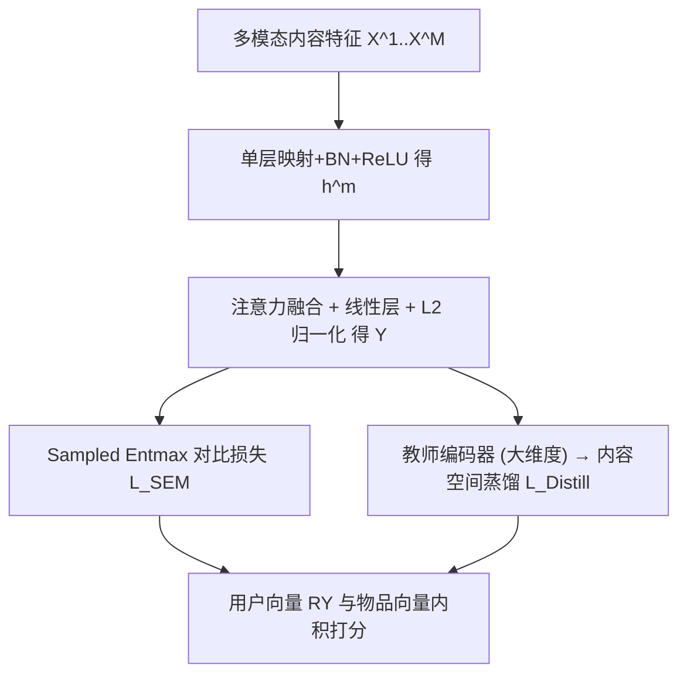

# Sparse Contrastive Learning for Content-Based Cold Item Recommendation (面向内容冷物品推荐的稀疏对比学习)

- **会议/期刊**: SIGIR 2026
- **作者与机构**: Gregor Meehan, Johan Pauwels (Queen Mary University of London)
- **推荐链路定位**: 召回（冷物品内容侧召回）
- **研究方向**: 冷启动与长尾推荐 / 自监督对比学习与交互去噪
- **论文原文**: [https://arxiv.org/abs/2604.12990v1](https://arxiv.org/abs/2604.12990v1)
- **开源代码**: [https://github.com/gmeehan96/SEMCo](https://github.com/gmeehan96/SEMCo)

## TL;DR (1分钟核心速览)

现有内容冷启动方法把图文特征映射进 CF 嵌入空间，但 CF 行为信号与内容语义之间存在根本信息鸿沟，导致冷物品预测失真并继承流行度偏置。本文彻底放弃 CF 对齐，改为纯内容空间建模：以 item-item 相似度刻画用户偏好，并用 α-entmax 将 sampled softmax 稀疏化（SEMCo），进一步在内容空间做离线/在线蒸馏。在 4 个多模态数据集、20% 物品冷启动划分、全库排序协议下，Sparsemax SEMCo-Online 相对最强基线 Recall@20 最高提升 39.7%，MDG@20 提升 133.7%，Gini 多样性提升 148.7%。

## Background & Motivation (背景与核心矛盾)

- **主流范式**: DropoutNet 类方法在训练中随机用内容嵌入替换 CF 嵌入模拟冷启动；生成式方法（ALDI/GAR/GoRec/Heater）训练内容编码器去"生成"预训练 CF 模型的物品嵌入。
- **前人局限**: ① CF 嵌入编码的是行为共现模式，内容特征编码的是语义属性，二者信息空间本质不同，强行对齐使冷物品预测不可靠；② 生成式方法以 CF 模型为监督，会把 CF 的流行度偏置原样"抄"进内容模型，冷物品曝光极度不均（GoRec 下 10% 物品从未被推荐）。
- **核心洞察 (Key Insight)**: 用户对物品的偏好本质上可由 item-item 相似度承载——只要内容空间中的相似度与用户偏好相关，就无需任何 CF 嵌入参与。同时，内容表征受多模态特征约束、灵活性低，item-item 相似度噪声大，密集 softmax 会把梯度浪费在大量无信息负例上。
- **本文切入点**: 用 α-entmax 稀疏化 sampled softmax，把梯度集中到最相关物品上；并把蒸馏从"CF→内容"搬到"大内容模型→小内容模型"，彻底绕开信息鸿沟。

## Method (核心方法设计)

### 1. 整体框架 (Overall Architecture)

沿用浅层线性自编码器思路，把偏好矩阵写成 $\mathbf{R}\mathbf{B}$，并将 $\mathbf{B}$ 分解为 $\mathbf{B}=\mathbf{Y}\mathbf{Y}^\top$，其中 $\mathbf{Y}=f(\mathbf{X}^1,\dots,\mathbf{X}^M)$ 为内容编码器输出的 L2 归一化物品向量。于是用户偏好变为 $\mathbf{R}\mathbf{Y}\mathbf{Y}^\top$，新物品只需编码内容后与用户向量 $\mathbf{R}\mathbf{Y}$ 做内积即可打分，无需查询全量热物品。训练采用 batch 内负采样的对比目标，并用 α-entmax 替换 softmax 产生稀疏概率；可选地叠加内容空间蒸馏（离线预训练教师 / 在线 EMA 教师）精炼 item-item 相似度结构。

### 2. 关键设计拆解 (Key Designs)

1. **Sampled Entmax 损失（SEM）**：标准 sampled softmax 输出稠密概率，batch 达 2048 时大量无关负例仍获非零梯度，稀释监督信号。本文用 Fenchel-Young 形式的 α-entmax 交叉熵替代：$\mathcal{L}_{\alpha,\tau}(\mathbf{z},\mathbf{p})=(\hat{\mathbf{p}}-\mathbf{p})^\top\mathbf{z}+H_\alpha(\hat{\mathbf{p}})$，其梯度恰为 $\nabla\mathcal{L}=\alpha\text{-entmax}(\mathbf{z})-\mathbf{p}$。当 $\alpha>1$ 时，低于阈值 $\eta/(\alpha-1)$ 的 logit 梯度被直接置零，模型更新只聚焦最相关物品——这正是内容相似度噪声大时所需要的"锐化"监督。$\alpha=1$ 退化为标准 softmax，$\alpha=2$ 即 sparsemax。

2. **Item-Item 相似度蒸馏**：SEMCo 中 item-item 相似度是"原子"知识，故蒸馏直接在内容空间进行：教师 $\mathbf{Y}_T$ 经两层 MLP 投影到学生维度，对 batch 内每个物品 $c$ 计算教师/学生对其余物品的余弦相似度，损失为 $\mathcal{L}_{Distill}(c)=\mathcal{L}_{\alpha,\omega}\big(\mathbf{z}_{c,S}/\omega_0,\ \alpha\text{-entmax}(\mathbf{z}_{c,T}/\omega_0)\big)$。关键细节是蒸馏集 $\mathcal{C}$ 不用 batch 用户构造，而是从 batch 中抽样用户、每用户取多个正例，使 intra-user 物品对提供更具信息量的监督；教师 logit 同样经 α-entmax 稀疏化，蒸馏信号聚焦教师认为最相关的相似度。

3. **训练目标、负采样与推理效率**：总损失 $\mathcal{L}_{Total}=\mathcal{L}_{Distill}+\lambda\mathcal{L}_{SEM}$，负采样为 in-batch 方式（batch=2048），无需额外负例池。在线蒸馏时教师用 $\mathcal{L}_{SEM}$ 监督、学生输入取教师输出的 EMA，类似 early-exit 自蒸馏。α-entmax 计算复杂度 $O(d\log d)$，实测仅增加 10–20% 训练时间；推理时新物品只需一次前向编码 + 内积检索，但用户向量 $\mathbf{R}\mathbf{Y}$ 需对全物品集做矩阵乘，大目录下可通过只保留"活跃" batch 物品缓解。

## Experimental Setup & Evaluation Protocol (实验设置与评估协议)

- **数据集与预处理**:

| 数据集 | #Users | #Items | #Interactions | 密度 | 特征/场景说明 |
| :--- | :---: | :---: | :---: | :---: | :--- |
| Clothing | 39,387 | 23,033 | 278,677 | 0.031% | Amazon 电商，5-core，仅文本(384)，视觉特征被剔除 |
| Electronics | 192,403 | 63,001 | 1,689,188 | 0.014% | Amazon 电商，5-core，图像(4096)+文本(384) |
| M4A-Onion | 8,807 | 43,886 | 1,510,034 | 0.391% | 音乐，BERT 歌词(768)+MusicFM 音频(1024) |
| Microlens | 98,129 | 17,228 | 705,174 | 0.042% | 微视频，图像(1024)+文本(1024)+视频(768) |

- **数据划分与防穿越**: 冷启动模拟——随机选 20% 物品从训练中剔除，其中 50/50 划为冷验证/冷测试；剩余交互按 80/10/10 划分热训练/验证/测试，用于训练基线所需的热骨干模型（FREEDOM）。
- **排名评测协议**: 用户侧 Recall@20 / NDCG@20，物品侧 MDG@20（Item Mean Discounted Gain），公平性用 Gini 多样性；均为全物品候选排序，结果取 5 次运行均值，配对 t 检验 $p<0.05$。
- **对比基线与超参**: 基线为 CLCRec（从零训练对比对齐）与 ALDI/GAR/GoRec/Heater（映射进预训练 CF 空间）；所有模型输出维度 $d=64$，SEMCo batch=2048、hidden=192、cosine 学习率 0.001 衰减 15 epoch，教师 hidden/output=384；离线蒸馏网格搜索、在线蒸馏用 TPE 调参。

## Key Experimental Results (实验关键数据)

### 1. 主实验对比 (Main Results)

| 数据集 | 指标 | 最佳基线 (GoRec) | SEMCo Softmax | SEMCo Sparsemax | SEMCo-Online Sparsemax | Improv. |
| :--- | :--- | :---: | :---: | :---: | :---: | :---: |
| Clothing | R@20 | 0.1389 | 0.1432 | 0.1457 | **0.1486** | 7.0% |
| Clothing | N@20 | 0.0638 | 0.0699 | 0.0701 | **0.0717** | 12.4% |
| Clothing | M@20 | 0.0495 | 0.0572 | 0.0562 | **0.0582** | 17.7% |
| Electronics | R@20 | 0.0376 | 0.0481 | 0.0514 | **0.0526** | 39.7% |
| Electronics | N@20 | 0.0171 | 0.0217 | 0.0230 | **0.0236** | 38.0% |
| Electronics | M@20 | 0.0092 | 0.0194 | 0.0211 | **0.0214** | 133.7% |
| M4A-Onion | R@20 | 0.0577 | 0.0806 | 0.0889 | **0.0910** | 57.7% |
| M4A-Onion | N@20 | 0.0557 | 0.0772 | 0.0854 | **0.0887** | 59.3% |
| M4A-Onion | Gini | 0.2014 | 0.4939 | 0.5010 | **0.5010** | 148.7% |
| Microlens | R@20 | 0.1294 | 0.1332 | 0.1387 | **0.1455** | 12.5% |
| Microlens | N@20 | 0.0562 | 0.0594 | 0.0615 | **0.0629** | 11.9% |
| Microlens | M@20 | 0.0448 | 0.0488 | 0.0499 | 0.0524 | 16.8% |

### 2. 消融实验 (Ablation Study)

| 配置 | Clothing N@20 | Electronics N@20 | M4A-Onion N@20 | Microlens N@20 |
| :--- | :---: | :---: | :---: | :---: |
| SEMCo Softmax ($\alpha=1$) | 0.0699 | 0.0217 | 0.0772 | 0.0594 |
| SEMCo Entmax ($\alpha=1.5$) | 0.0703 | 0.0223 | 0.0851 | 0.0615 |
| SEMCo Sparsemax ($\alpha=2$) | 0.0701 | 0.0230 | 0.0854 | 0.0615 |
| SEMCo-Offline Sparsemax | 0.0715 | 0.0223 | 0.0852 | 0.0607 |
| SEMCo-Online Sparsemax | **0.0717** | **0.0236** | **0.0887** | **0.0629** |

### 3. 关键实验发现 (Key Findings)

1. **稀疏化本身就是增益来源**：在基础 SEMCo 上，Entmax/Sparsemax 在全部 4 个数据集均优于 Softmax（如 M4A-Onion N@20 从 0.0772 升至 0.0854，+10.6%），说明把梯度从无信息负例上收回、聚焦最相关物品，对噪声较大的内容相似度建模尤为关键。
2. **在线蒸馏 + Sparsemax 是最优组合**：Sparsemax Online 在全部数据集取得最佳用户排序精度，M4A-Onion N@20 较基础 Sparsemax 再提升 14.9%；训练中 Sparsemax 师生概率矩阵非零项通常不足 10%，而 Entmax 超过 70%，印证"更稀疏的教师信号让学生更有效学到关键 item-item 相似度"。
3. **公平性与精度同向而非权衡**：Electronics 上 MDG@20 提升 133.7%、M4A-Onion 上 Gini 提升 148.7%；图 1 显示 GoRec 下 10% 冷物品从未被推荐、少数物品预测计数尖峰，而 SEMCo-Online 几乎全部物品至少被预测 10 次，且这一公平性提升未以精度为代价（与常规去偏方法相反）。

<figure class="paper-figure" markdown="span">
  ![图1：Electronics 数据集中冷物品群体上的 MDG@20 与预测计数。每个点代表一个物品，MDG 或预测计数为零的物品未在图中显示。MS 表示幅度缩放 \[26\]。](../../../../assets/papers/2604.12990v1/figure_1.png)<figcaption>图1：Electronics 数据集中冷物品群体上的 MDG@20 与预测计数。每个点代表一个物品，MDG 或预测计数为零的物品未在图中显示。MS 表示幅度缩放 [26]。</figcaption>
</figure>

## Highlights, Limitations & Rating (亮点、对比与审稿评价)

- **与代表作对比 (vs. Prior Work)**: 与 GoRec/ALDI/GAR/Heater 的本质区别在于**监督信号来源**——它们以预训练 CF 嵌入为目标，本文以内容空间 item-item 相似度为原子知识，从根上切断流行度偏置的传导；与 CLCRec 相比，本文不做内容-CF 对比对齐，而是纯内容对比 + 稀疏化；与常规 RS 蒸馏（用户-物品分数或排序列表）相比，本文蒸馏发生在内容空间，规避了 CF-内容信息鸿沟。
- **可迁移亮点**: ① α-entmax 稀疏化 sampled softmax 可直接移植到任何 in-batch 对比召回训练（含双塔），作为"梯度聚焦"正则；② "从 batch 中抽样用户、每用户取多正例构造蒸馏集"的技巧，可提升任何 item-item 蒸馏的监督信息量。
- **审稿级局限批判**: ① 用户向量 $\mathbf{R}\mathbf{Y}$ 需对全物品集矩阵乘，大目录下推理/更新成本高，文中仅给出"只保留活跃 batch 物品"的定性缓解，缺乏规模实验；② 在线蒸馏需联合调优师生超参、训练稳定性差（作者自认），且 α、温度 $\tau$、蒸馏温度 $\omega$、$\lambda$ 多个超参敏感，实际落地调参成本不低；③ 冷启动模拟为随机 20% 物品剔除，未覆盖"严格零样本 + 模态缺失"场景，泛化性有待验证。
- **四维评分**: 创新性 ⭐⭐⭐⭐ | 实验扎实度 ⭐⭐⭐⭐ | 方法清晰度 ⭐⭐⭐⭐⭐ | 落地价值 ⭐⭐⭐⭐

