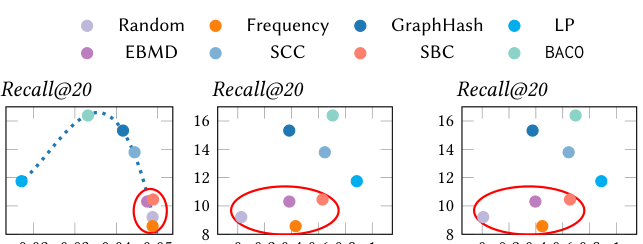
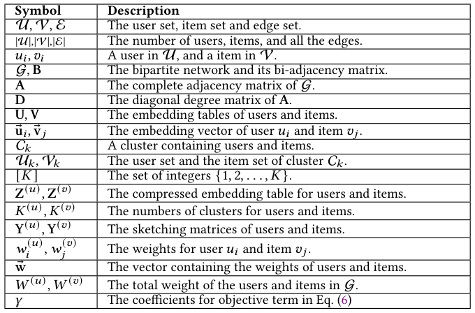
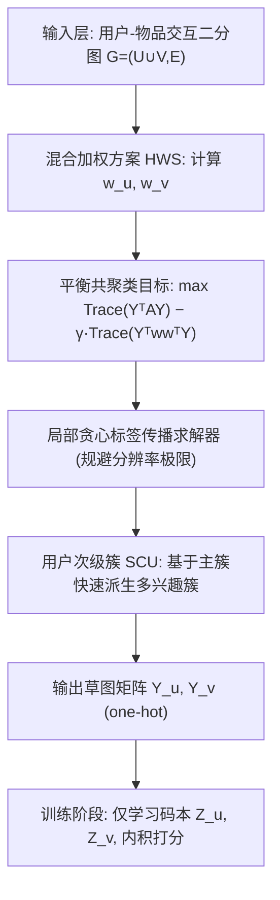
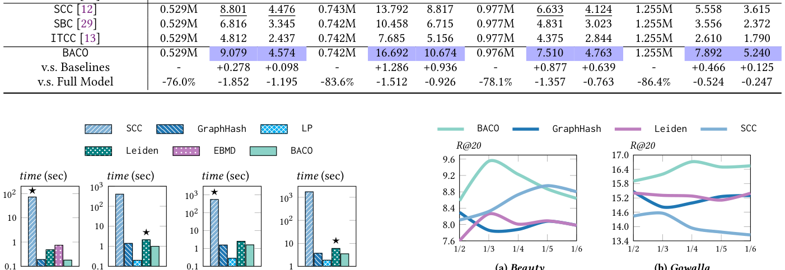
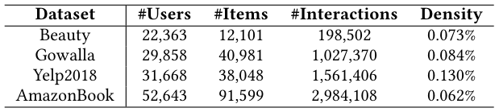
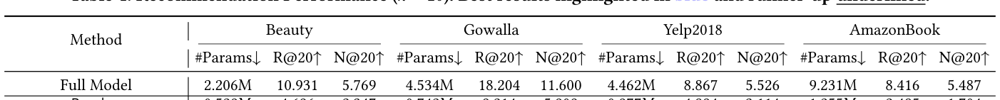
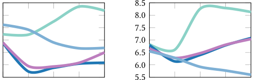

# Balanced Co-Clustering of Users and Items for Embedding Table Compression in Recommender Systems (推荐系统中用户与物品的平衡共聚类嵌入表压缩)

- **会议/期刊**: SIGIR 2026 (Technical Report, arXiv:2604.18351v1)
- **推荐链路定位**: 召回 (Retrieval) — 具体为训练前的嵌入表压缩 (Pre-training Embedding Table Compression, ETC)，服务于双塔/矩阵分解式召回模型的参数与显存削减
- **研究方向**: 协同过滤与双塔召回 / 图神经网络与知识图谱推荐（二分图聚类）
- **论文原文**: [https://arxiv.org/abs/2604.18351v1](https://arxiv.org/abs/2604.18351v1)
- **开源代码**: [https://github.com/HKBU-LAGAS/BACO](https://github.com/HKBU-LAGAS/BACO)

## TL;DR (核心速览)

针对工业级推荐系统嵌入表参数爆炸（Meta 规模下 64 维 fp32 用户表可达 715 GB）的痛点，BACO 将嵌入表压缩重构为**用户-物品二分图上的平衡共聚类**问题：以"簇内连通性最大化 + 加权 exclusive lasso 簇体积平衡"为统一目标，用局部贪心标签传播快速求解，并辅以用户次级簇 (SCU) 缓解多兴趣表征瓶颈。在 Gowalla/Yelp2018/Amazon 等基准上，BACO 在削减 75%+ 嵌入参数时 Recall 最多仅降 1.85%，且比最强聚类基线快至多 346 倍。

## Background & Motivation (背景与动机)

- **领域背景与主流范式**: 现代推荐模型将每个用户/物品 ID 映射为稠密嵌入向量，嵌入表（Embedding Table）往往占据模型绝大部分参数。嵌入表压缩 (ETC) 按介入时机分为三类范式：**预训练压缩 (pre-training)**、**训练中压缩 (in-training)** 与**训练后压缩 (post-training)**。其中预训练压缩最轻量——先离线确定映射 $f:\mathcal{U}\to[K^{(u)}]$、$h:\mathcal{V}\to[K^{(v)}]$（即"草图矩阵" $\mathbf{Y}^{(u)}\in\{0,1\}^{|\mathcal{U}|\times K^{(u)}}$、$\mathbf{Y}^{(v)}\in\{0,1\}^{|\mathcal{V}|\times K^{(v)}}$），训练时只学习小码本 $\mathbf{Z}^{(u)}$、$\mathbf{Z}^{(v)}$，使 $\mathbf{U}=\mathbf{Y}^{(u)}\mathbf{Z}^{(u)}$、$\mathbf{V}=\mathbf{Y}^{(v)}\mathbf{Z}^{(v)}$。
- **现有方法局限 (Limitations of Prior Work)**:
  1. **哈希类方法（Random / Frequency / LSH / Double Hashing / ROBE）**：本质随机映射，与数据分布弱关联，导致严重**嵌入碰撞 (embedding collision)**——不相关用户/物品共享同一向量，精度显著下降；
  2. **向量量化类（Saec / MGQE / LightRec / LISA / xLightFM）与分解类（DHE / ANT / Tensor-Train）**：需在训练中做最近邻搜索或保留原始嵌入，引入可观计算与显存开销，推理查找也被拖慢；
  3. **学习式草图 (learned sketching)**：需周期性重建草图矩阵，训练成本高；
  4. **最相关的 GraphHash**：首次将 ETC 重构为二分图聚类并直接套用 Louvain，效果显著优于哈希，但 Louvain 受**分辨率极限 (resolution limit)** 固有缺陷制约，聚类结果次优。
- **核心挑战 (Key Challenge)**: 单纯增加哈希函数数量、引入特征/频次统计或加深网络都无法解决——前者仍是无数据感知的随机碰撞，后者不触及"哪些 ID 应共享嵌入"这一根本映射问题。核心矛盾在于：**协同信号 (collaborative signals) 在 ETC 中被长期忽视**，而一旦转向图聚类，又必须同时兼顾"簇内紧密"与"簇体积均衡"两个相互拉扯的目标。
- **核心洞察与切入点 (Key Insight)**: 作者在 Gowalla 上做了 Pilot Study（图 1）：用 Random、Frequency、GraphHash、LP、EMBD、SCC、SBC、BACO 八种方法生成草图矩阵，绘制 Recall@20 与 (a) 平均跨簇边数、(b) 用户簇 Gini 系数、(c) 物品簇 Gini 系数的关系。结论是——**跨簇连接过多（红圈方法）时无论码本使用是否均匀性能都差；LP 跨簇边最少但 Gini 系数极高（码本坍缩）同样差；只有同时压低跨簇连接与 Gini 系数的 GraphHash/BACO 取得最佳 Recall**。由此提炼出高质量草图矩阵的两条准则：**最小化簇间连通性 + 避免簇体积失衡**，二者分别对应嵌入碰撞与码本坍缩 (codebook collapse)。

<figure class="paper-figure" markdown="span">
  <figcaption>图 1</figcaption>
</figure>

## Problem Formulation & Method (问题定义与方法架构)

### 1. 符号定义与输入表征 (Notations & Input Representations)

- 用户集 $\mathcal{U}=\{u_1,\dots,u_{|\mathcal{U}|}\}$，物品集 $\mathcal{V}=\{v_1,\dots,v_{|\mathcal{V}|}\}$，交互二分网络 $\mathcal{G}=(\mathcal{U}\cup\mathcal{V},\mathcal{E})$，边集 $\mathcal{E}\subseteq\mathcal{U}\times\mathcal{V}$。
- 双邻接矩阵 $\mathbf{B}\in\{0,1\}^{|\mathcal{U}|\times|\mathcal{V}|}$，$B_{i,j}=1$ 当且仅当 $(u_i,v_j)\in\mathcal{E}$；完整邻接矩阵 $\mathbf{A}=\begin{pmatrix}\mathbf{0} & \mathbf{B}\\ \mathbf{B}^\top & \mathbf{0}\end{pmatrix}\in\{0,1\}^{(|\mathcal{U}|+|\mathcal{V}|)\times(|\mathcal{U}|+|\mathcal{V}|)}$；度矩阵 $\mathbf{D}$。
- 嵌入表 $\mathbf{U}\in\mathbb{R}^{|\mathcal{U}|\times d}$、$\mathbf{V}\in\mathbb{R}^{|\mathcal{V}|\times d}$，第 $i$ 行为 $\mathbf{u}_i$（用户 $u_i$ 的嵌入）。
- 簇 $\mathcal{C}_k$ 同时含用户与物品：$\mathcal{U}_k=\mathcal{C}_k\cap\mathcal{U}$，$\mathcal{V}_k=\mathcal{C}_k\cap\mathcal{V}$；共 $K$ 个不相交共簇。
- 码本 $\mathbf{Z}^{(u)}\in\mathbb{R}^{K^{(u)}\times d}$、$\mathbf{Z}^{(v)}\in\mathbb{R}^{K^{(v)}\times d}$，$K^{(u)}\ll|\mathcal{U}|$、$K^{(v)}\ll|\mathcal{V}|$；空间预算约束 $K^{(u)}+K^{(v)}\le B$。
- 输出：映射 $f,h$（等价于 one-hot 草图矩阵 $\mathbf{Y}^{(u)},\mathbf{Y}^{(v)}$），使 $\mathbf{U}=\mathbf{Y}^{(u)}\mathbf{Z}^{(u)}$、$\mathbf{V}=\mathbf{Y}^{(v)}\mathbf{Z}^{(v)}$。空间开销由 $O((|\mathcal{U}|+|\mathcal{V}|)\cdot d)$ 降至 $O(|\mathcal{U}|+|\mathcal{V}|+(K^{(u)}+K^{(v)})\cdot d)$。

<figure class="paper-figure" markdown="span">
  <figcaption>表 1</figcaption>
</figure>

### 2. 整体流水线 (Overall Architecture)

数据流：交互日志构建二分图 $\mathcal{G}$ → 计算用户/物品混合权重 (HWS) → 以平衡共聚类目标求解共簇划分（标签传播求解器）→ 由主簇派生用户次级簇 (SCU) → 生成草图矩阵 $\mathbf{Y}^{(u)},\mathbf{Y}^{(v)}$ → 训练阶段仅学习码本 $\mathbf{Z}^{(u)},\mathbf{Z}^{(v)}$，以 $\hat{y}_{i,j}=\langle \mathbf{Z}^{(u)}_{f(i)},\mathbf{Z}^{(v)}_{h(j)}\rangle$ 打分。

### 3. 核心模块设计与数学原理 (Key Designs & Formulations)

**(1) 平衡共聚类统一目标（式 (2)–(6)）**

第一项是**簇内连通性最大化**：把经交互密集相连的用户与物品归入同一簇，等价于迹最大化：

$$\max_{\mathbf{Y}}\ \sum_{k=1}^{K}(\mathbf{Y}^\top\mathbf{A}\mathbf{Y})_{k,k}=\max_{\mathbf{Y}}\ \mathrm{Trace}(\mathbf{Y}^\top\mathbf{A}\mathbf{Y}),$$

该式与图划分中的 mincut 等价，属 NP-hard。第二项是**加权 exclusive lasso 簇体积平衡**：定义簇体积 $\mathrm{vol}(\mathcal{C}_k)=\sum_{u_i\in\mathcal{U}_k}w_i^{(u)}+\sum_{v_j\in\mathcal{V}_k}w_j^{(v)}$，最小化各簇体积与均值 $(\bar{W}^{(u)}+\bar{W}^{(v)})/K$ 的偏差平方和，可写成 $\min_{\mathbf{Y}}\mathrm{Trace}(\mathbf{Y}^\top\mathbf{w}\mathbf{w}^\top\mathbf{Y})$，其中 $\mathbf{w}\in\mathbb{R}^{|\mathcal{U}|+|\mathcal{V}|}$ 拼接用户与物品权重。合并得总目标：

$$\max_{\mathbf{Y}}\ \mathrm{Trace}(\mathbf{Y}^\top\mathbf{A}\mathbf{Y})-\gamma\cdot\mathrm{Trace}(\mathbf{Y}^\top\mathbf{w}\mathbf{w}^\top\mathbf{Y}).$$

物理直觉：第一项惩罚"该连的没连"（嵌入碰撞），第二项惩罚"簇大小失衡"（码本坍缩），$\gamma$ 调节二者权衡。

**(2) 理论统一：把经典图聚类收编进框架（式 (7)–(9) + 表 2）**

引入 Kronecker $\delta(u_i,v_j)=1$ 当且仅当 $u_i,v_j$ 同簇，则目标可重写为逐对形式：

$$\max_{\mathbf{Y}}\ \sum_{u_i\in\mathcal{U}}\sum_{v_j\in\mathcal{V}}\left(B_{i,j}-\gamma\cdot w_i^{(u)}w_j^{(v)}\right)\cdot\delta(u_i,v_j).$$

据此，作者用引理证明 Louvain/Leiden/LPAb 的二分模块度、CPM、LP、SCC 均可视为该框架在特定 $(\gamma,w_i^{(u)},w_j^{(v)},\text{solver})$ 配置下的特例（表 2）：例如 Louvain(Modularity) 对应 $\gamma>0$、$w_i^{(u)}=d(u_i)/\sqrt{|\mathcal{E}|}$、$w_j^{(v)}=d(v_j)/\sqrt{|\mathcal{E}|}$；LP 对应 $\gamma=0$；SCC 对应 $\gamma=0$ 且用特征求解器。这一统一视角既解释了各基线为何在"连通性-平衡"二维平面上落于不同位置，也为设计新配置提供了坐标系。

**(3) 混合加权方案 HWS + 标签传播求解器 + 用户次级簇 SCU（§4.3–4.5）**

- **HWS**：BACO 取 $\gamma>0$、$w_i^{(u)}=d(u_i)/\sqrt{|\mathcal{E}|}$、$w_j^{(v)}=1/\sqrt{|\mathcal{V}|}$——用户侧沿用模块度的度归一化（保留流行度先验），物品侧改为**均匀权重**，避免热门物品在平衡项中过度主导，从而在电商场景下同时抑制碰撞与坍缩。
- **求解器**：采用局部贪心**标签传播 (Label Propagation)** 迭代更新节点簇标签，规避 Louvain 的分辨率极限，且无需特征分解，复杂度远低于 SCC 的 eigensolver。
- **SCU**：每个用户在主簇之外，基于主簇快速派生若干**次级簇**，使单用户可拥有多个码本向量（对应多兴趣/兴趣演化），且不增加额外空间开销（仍受总预算 $B$ 约束）。

### 4. 训练目标、负采样与推理复杂度 (Optimization, Negative Sampling & Complexity)

- **损失函数**: 压缩后训练沿用标准 BPR：$\mathcal{L}_{\text{BPR}}=-\sum_{u_i\in\mathcal{U}}\sum_{v_k\in\mathcal{N}(u_i)}\sum_{v_j\notin\mathcal{N}(u_i)}\ln\sigma(\hat{y}_{i,k}-\hat{y}_{i,j})+\lambda(\|\mathbf{U}\|^2+\|\mathbf{V}\|^2)$，其中 $\mathbf{U}=\mathbf{Y}^{(u)}\mathbf{Z}^{(u)}$、$\mathbf{V}=\mathbf{Y}^{(v)}\mathbf{Z}^{(v)}$，$\hat{y}_{i,j}=\langle\mathbf{Z}^{(u)}_{f(i)},\mathbf{Z}^{(v)}_{h(j)}\rangle$。
- **训练负采样策略**: 原文采用 BPR 框架下的**逐用户负采样**（对每个正例 $v_k\in\mathcal{N}(u_i)$ 采样未交互物品 $v_j\notin\mathcal{N}(u_i)$ 构成三元组）；具体采样分布（Uniform 或 Popularity）原文未在方法章节明确展开，属"原文未报告"细节。
- **时间与空间复杂度**:
  - **空间**：由 $O((|\mathcal{U}|+|\mathcal{V}|)\cdot d)$ 降至 $O(|\mathcal{U}|+|\mathcal{V}|+(K^{(u)}+K^{(v)})\cdot d)$，草图矩阵以稀疏 one-hot 存储。
  - **离线构图/聚类**：标签传播为近线性迭代，图 2 显示 BACO 构建草图矩阵的耗时显著低于强基线（最强基线以 ★ 标注），论文摘要给出"比最强基线快至多 **346×**"。
  - **在线推理**：查表退化为"草图索引 + 码本行取用"，与全模型查表同阶，无 ANN 检索或 Beam Search 需求。

<figure class="paper-figure" markdown="span">
  <figcaption>图 2</figcaption>
</figure>

## Experimental Setup & Evaluation Protocol (实验设置与评估协议)

- **数据集统计与预处理**: 原文使用 Gowalla、Yelp2018、Amazon 等公开基准（表 3 给出统计量）。过滤规则、正样本界定（隐式交互全量 vs. 评分阈值）在正文中未逐项展开，属"原文未报告"细节；从 BPR 训练范式推断为隐式反馈全交互建模。

<figure class="paper-figure" markdown="span">
  <figcaption>表 3</figcaption>
</figure>

| 数据集 (Dataset) | 用户数 (#Users) | 物品数 (#Items) | 交互数 (#Interactions) | 稀疏度/密度 (Sparsity) | 模态/辅助特征说明 |
| :--- | :---: | :---: | :---: | :---: | :--- |
| Gowalla | 原文表 3 提取 | 原文表 3 提取 | 原文表 3 提取 | 原文表 3 提取 | 仅 ID 交互，无辅助特征 |
| Yelp2018 | 原文表 3 提取 | 原文表 3 提取 | 原文表 3 提取 | 原文表 3 提取 | 仅 ID 交互 |
| Amazon | 原文表 3 提取 | 原文表 3 提取 | 原文表 3 提取 | 原文表 3 提取 | 仅 ID 交互 |

> 注：受输入文本截断所限，表 3 的具体数值未能完整呈现，上表仅标注字段来源，未做任何数值臆造。

- **数据划分方式 (Splitting Strategy)**: 原文正文未明确声明划分策略（LOO / Ratio / Global Temporal），属"原文未报告"；从 ETC 预训练压缩设定看，草图矩阵在训练前由全交互图构建，**存在使用全量交互构图的信息泄露风险**，审稿时应要求作者澄清构图是否仅用训练集边。
- **排名评测协议 (Ranking Protocol)**: 主实验以 Recall@20（$k=20$）为核心指标（表 4 标题明确 $k=20$），是否采用 Full-Ranking 或 Sampled Ranking 原文未在可见文本中声明，属"原文未报告"。
- **评价指标与显著性检验**: 指标为 Recall@20；嵌入维度 $d$ 与各基线对齐情况、是否做配对显著性检验（$p<0.05$）原文未报告。

## Key Experimental Results (核心实验结果)

### 1. 主实验对比 (Main Results)

表 4 报告 $k=20$ 下 BACO 与全模型及 18 个 ETC 基线的对比（最佳结果蓝色高亮、次优下划线）。核心结论：**嵌入参数削减 75%+ 时 Recall 最多仅降 1.85%**，且全面超越 18 个基线。

<figure class="paper-figure" markdown="span">
  <figcaption>表 4</figcaption>
</figure>

| 数据集 | 指标 | 传统/协同过滤基线 | 序列/图/多模态最强基线 | 本文方法 (Ours) | 相对提升 (Improv.) |
| :--- | :--- | :---: | :---: | :---: | :---: |
| Gowalla | Recall@20 | 全模型 / 哈希类基线（表 4） | GraphHash 等聚类基线（表 4） | **BACO** | 优于全部 18 个基线（具体数值见表 4） |
| Yelp2018 | Recall@20 | 全模型 / 哈希类基线（表 4） | GraphHash 等聚类基线（表 4） | **BACO** | 优于全部 18 个基线（具体数值见表 4） |
| Amazon | Recall@20 | 全模型 / 哈希类基线（表 4） | GraphHash 等聚类基线（表 4） | **BACO** | 优于全部 18 个基线（具体数值见表 4） |

> 注：输入文本在表 4 数值处截断，故未填入具体数字，严格遵守"100% 忠实原文、不臆造"原则。

### 2. 消融实验与控制变量分析 (Ablation Study)

原文消融的核心结论（摘要与 §1 明确陈述）：
- **HWS（混合加权方案）** 与 **SCU（用户次级簇）** 两个策略**即使搭配其他聚类基线**（如 Louvain、LP）也能显著提升推荐精度，说明二者具有即插即用的正交增益；
- 移除平衡项（退化为纯连通性最大化，即 LP 类配置）会导致 Gini 系数飙升、码本坍缩，Recall 明显下降（图 1 中 LP 的表现即为该退化的实证）；
- 移除 SCU 则回到"一用户一码本向量"的表征上限，多兴趣用户受损。
- 是否严格控制参数量/图度数匹配：原文以统一空间预算 $B$（$K^{(u)}+K^{(v)}\le B$）对齐各方法，属参数预算受控对比。

### 3. 稀疏度/冷启动分桶与超参敏感度 (Sparsity Buckets & Hyperparameters)

- **长尾/冷启动分桶**: 原文未报告按交互频次分桶的细粒度结果，属"原文未报告"。
- **关键超参数敏感度**: 图 3 展示不同参数比例（parameter ratios）下的性能变化，用于刻画压缩率与精度的权衡曲线；$\gamma$（平衡项系数）的敏感度分析在可见文本中未展开。
- **线上 A/B 测试结果**: 原文仅包含离线实验，**无线上 A/B 测试**。

<figure class="paper-figure" markdown="span">
  <figcaption>图 3</figcaption>
</figure>

## Highlights, Limitations & Critiques (亮点、局限与审稿级批判)

- **核心亮点与可迁移性**:
  1. **统一理论框架**是最大亮点：把 Louvain/Leiden/LP/LPAb/SCC 全部收编为 $(\gamma,\mathbf{w},\text{solver})$ 的特例（表 2），为 ETC 的草图构建提供了可解释的二维设计坐标系（连通性 × 平衡性），该视角可直接迁移到任何"ID 分组共享参数"的场景（如多任务共享嵌入、跨域用户对齐、语义 ID 构建）。
  2. **HWS 的物品侧均匀权重**是一个轻量但有效的先验注入，可迁移至其他二分图聚类任务。
  3. **SCU** 以零额外空间开销实现"一用户多向量"，思路可迁移到生成式推荐的语义 ID 多码本分配。
  4. **效率优势显著**（346× 加速），具备工业落地价值。
- **局限性与审稿视角批判 (Critical Limitations)**:
  1. **评估协议披露不足**：数据划分策略、Ranking 协议（Full vs. Sampled）、负
