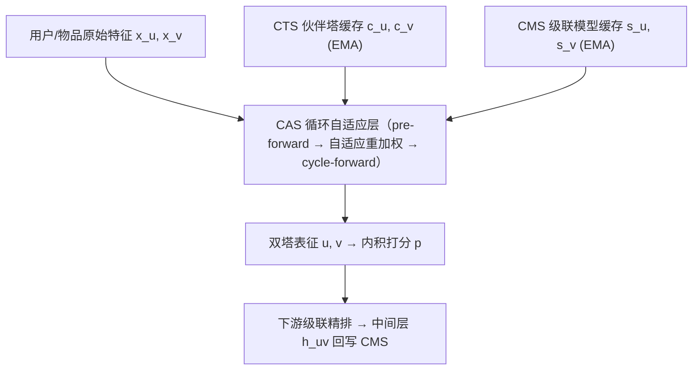
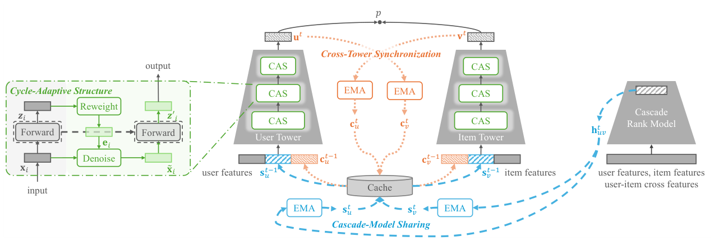

# CS3: Efficient Online Capability Synergy for Two-Tower Recommendation (面向双塔推荐的高效在线能力协同)

- **会议/期刊**: SIGIR 2026
- **作者与机构**: Lixiang Wang, Shaoyun Shi, Peng Wang, Wenjin Wu, Peng Jiang（快手科技）
- **推荐链路定位**: 召回（大规模候选检索）
- **研究方向**: 协同过滤与双塔召回 / 工业架构与在线学习
- **论文原文**: [https://arxiv.org/abs/2604.19269v1](https://arxiv.org/abs/2604.19269v1)
- **开源代码**: [https://github.com/lixiangwang/CS3Rec](https://github.com/lixiangwang/CS3Rec)

## TL;DR (1分钟核心速览)

双塔召回因两塔完全隔离，存在容量受限、用户-物品表征空间难对齐、与下游精排存在结构性断层三大痛点；晚交互与蒸馏方案又会抬高延迟、难以适配在线学习。本文提出 CS3，用塔内循环自适应去噪（CAS）、跨塔 EMA 同步（CTS）、级联模型共享（CMS）三个轻量模块协同增强双塔。在 TaobaoAd/KuaiRand/RecSys2017 三数据集上对 DSSM、IntTower、IHM-DAT、RCG 四种骨干均带来一致 AUC 提升（如 RCG 在 RecSys2017 上 0.7870→0.8676），线上广告系统收入最高 +8.36%，QPS 仅降 0.59%。

## Background & Motivation (背景与核心矛盾)

- **主流范式**: 工业多阶段推荐用轻量双塔（DSSM 类）做大规模召回，用户塔在线实时算、物品塔离线预计算 + FAISS 近邻检索，以毫秒级延迟换取候选池规模。
- **前人局限**: ① 容量受限——两塔各自独立、模块化设计压缩了表征能力；② 对齐困难——两塔在相似度计算前零交互，仅靠训练目标隐式对齐，在线学习中新物品与反馈持续漂移使对齐更脆弱；③ 跨阶段断层——召回无法建模精排惯用的用户-物品交叉特征与 target-aware 序列信号。
- **核心洞察 (Key Insight)**: 现有改进（IntTower 的隐式晚交互、蒸馏）都只沿单一轴线修补，且不提供统一机制同时解决「塔内精炼、塔间协调、精排→召回知识复用」三层能力缺口；而在线学习场景恰恰要求频繁更新 + 严格延迟预算。
- **本文切入点**: 把召回增强重构为**三层能力交换**——塔内自修正、塔间同步、级联知识共享，全部以 EMA 缓存向量实现，免梯度、可插拔、兼容在线学习。

## Method (核心方法设计)

### 1. 整体框架 (Overall Architecture)

CS3 保持标准双塔打分 $p=\mathbf{u}^\top\mathbf{v}$ 不变，在每塔内部用 CAS 替换普通 FC 层实现逐层自校正；两塔输入除原始特征 $\mathbf{x}_u^t,\mathbf{x}_v^t$ 外，额外拼接来自 CTS 的伙伴塔缓存向量 $\mathbf{c}_u^{t-1},\mathbf{c}_v^{t-1}$ 与来自 CMS 的级联模型缓存向量 $\mathbf{s}_u^{t-1},\mathbf{s}_v^{t-1}$，即 $\mathbf{u}^t=U_{\theta_u}(\mathbf{x}_u^t,\mathbf{c}_u^{t-1},\mathbf{s}_u^{t-1})$。训练侧用参数服务器（ParSvr）承载梯度更新的稀疏 embedding、以自定义梯度实现 CTS 的 EMA 更新；CMS 向量因双塔与精排常走不同数据流，单独存入高 QPS 的 Embedding Server（EmbSvr，p99 < 5ms），训练与 serving 均并行拉取。

<figure class="paper-figure" markdown="span">
  <figcaption>图1：所提出的CS3框架概览。</figcaption>
</figure>

### 2. 关键设计拆解 (Key Designs)

1. **CAS 循环自适应结构（塔内自修正去噪）**：普通 FC 直接令 $\mathbf{x}_{i+1}=\mathbf{z}_i$，缺乏对输入特征的可靠性甄别。CAS 先做 pre-forward $\mathbf{z}_i=\sigma(\mathbf{W}_i\mathbf{x}_i+\mathbf{b}_i)$，再由 $\mathbf{z}_i$ 反推特征级重要性 $\mathbf{e}_i=\text{Sigmoid}(\mathbf{W}'_i\mathbf{z}_i+\mathbf{b}'_i)$，以 $\tilde{\mathbf{x}}_i=\mathbf{x}_i\odot 2\mathbf{e}_i$ 重加权（乘 2 使权重落在 $(0,2)$、期望为 1，避免激活过小与梯度消失），最后用**共享参数**重算 $\mathbf{z}'_i=\sigma(\mathbf{W}_i\tilde{\mathbf{x}}_i+\mathbf{b}_i)$。直觉：让每层先"看一眼输出"再回头修正输入，等价于一次轻量去噪自编码，且不引入新特征、不增加参数量。

2. **CTS 跨塔同步（显式塔间对齐）**：隐式晚交互不直接利用伙伴塔表征，在线漂移下对齐不足。CTS 为每个用户/物品维护伙伴塔正样本表征的 EMA 缓存，仅当 $y=1$ 时更新：
$$\mathbf{c}_u^t=\alpha\mathbf{c}_u^{t-1}+(1-\alpha)\mathbf{v}^t,\quad \mathbf{c}_v^t=\alpha\mathbf{c}_v^{t-1}+(1-\alpha)\mathbf{u}^t \ \ (y=1)$$
负样本不更新，保证缓存刻画的是"被偏好的对方表征"。EMA 免梯度、可实时刷新，使两塔在输入层面就感知对方，显著缓解 embedding 空间错位。

3. **CMS 级联模型共享（跨阶段一致性）**：蒸馏只迁移软标签、未利用精排架构能力。CMS 直接把精排模型倒数第二层输出 $\mathbf{h}_{uv}^t$ 以 EMA 回写为双塔输入：$\mathbf{s}_u^t=\beta\mathbf{s}_u^{t-1}+(1-\beta)\mathbf{h}_{uv}^t$，$\mathbf{s}_v^t$ 同理。与 CTS 不同，CMS **正负样本均更新**，因精排中间表征本身编码了丰富的交叉特征知识。这相当于把精排的"计算"部分前移到召回，而非仅迁移"结论"。

4. **训练目标与效率**：总损失沿用双塔原有点击/偏好损失（各骨干自带，如 BCE/BPR），三模块均为免梯度 EMA 或轻量重加权，不新增监督项。CAS 使单塔计算略增，但召回延迟由大规模相似度检索主导且物品 embedding 可预计算，实测仅对输入层以外的 FC 施加 CAS，召回服务 QPS 下降 < 1%。

## Experimental Setup & Evaluation Protocol (实验设置与评估协议)

- **数据集与预处理**: 三个跨领域公开数据集，均含用户与物品侧特征：

| 数据集 | 领域 | 特征/场景说明 |
| :--- | :---: | :--- |
| TaobaoAd | 电商广告 | 淘宝展示广告点击日志，含用户/物品/上下文特征 |
| KuaiRand | 短视频 | 快手推荐日志，用户/物品特征丰富，利于 CAS 去噪 |
| RecSys2017 | 竞赛/电商 | RecSys Challenge 2017 数据，含用户-物品交互特征 |

- **数据划分与防穿越 (Splitting Strategy)**: 采用随机划分训练/测试（原文未显式声明时间戳切分），结果在 5 个随机种子上取均值与标准误。
- **排名评测协议 (Ranking Protocol)**: 以 **AUC↑ / LogLoss↓** 作为排序质量指标（点估计排序能力，非 Full-Ranking 或 Sampled Ranking 的 Top-K 召回指标），并做 $p<0.05$ 显著性检验（表中 `*` 标注）。
- **对比基线与超参设置**: 四种双塔骨干——DSSM、IntTower（晚交互）、IHM-DAT（多任务双塔）、RCG（Transformer 双塔）；CMS 的级联模型用 4 隐层前馈网络与双塔联合训练。EMA 平滑系数 $\alpha,\beta\in[0,1]$ 为超参。

## Key Experimental Results (实验关键数据)

### 1. 主实验对比 (Main Results)

各骨干 + CS3 相对自身基线的核心结果（AUC↑，括号内为相对提升）：

| 骨干 | 数据集 | Base AUC | +CS3 AUC | Improv. |
| :--- | :---: | :---: | :---: | :---: |
| DSSM | TaobaoAd | 0.6194 | **0.6855** | +10.67% |
| DSSM | KuaiRand | 0.6646 | **0.7484** | +12.61% |
| DSSM | RecSys2017 | 0.6855 | **0.8380** | +22.25% |
| IntTower | TaobaoAd | 0.6507 | **0.6895** | +5.96% |
| IntTower | KuaiRand | 0.7503 | **0.7615** | +1.49% |
| IntTower | RecSys2017 | 0.8178 | **0.8657** | +5.86% |
| IHM-DAT | RecSys2017 | 0.7694 | **0.8660** | +12.55% |
| RCG | KuaiRand | 0.7814 | **0.8304** | +6.27% |
| RCG | RecSys2017 | 0.7870 | **0.8676** | +10.24% |

关键对照：**DSSM+CS3 在 TaobaoAd 上达 0.6855，反超 IntTower(0.6507) 与 IHM-DAT(0.6302)**，说明统一能力协同可让朴素骨干超越专门优化的双塔结构。

### 2. 消融实验 (Ablation Study)

以 DSSM 为骨干，逐模块叠加（AUC）：

| 配置 | TaobaoAd | KuaiRand | RecSys2017 |
| :--- | :---: | :---: | :---: |
| DSSM (Base) | 0.6194 | 0.6646 | 0.6855 |
| + CAS | 0.6378 | **0.7416** | 0.7093 |
| + CTS | 0.6506 | 0.7095 | 0.7752 |
| + CMS | 0.6632 | 0.7100 | 0.7417 |
| + CS3 (三者) | **0.6855** | **0.7484** | **0.8380** |

线上分阶段消融（Scenario A，10% 流量 7 天+）：

| 配置 | Revenue | DAC |
| :--- | :---: | :---: |
| BASE | 0.000% | 0.000% |
| + CAS | +1.677% | +0.144% |
| + CAS&CMS | +7.880% | +0.435% |
| + CAS&CMS&CTS (CS3) | **+8.356%** | **+0.468%** |

### 3. 关键实验发现 (Key Findings)

1. **单模块均有效但互补，叠加增益超线性**：DSSM 上 CAS/CTS/CMS 单独使用在 RecSys2017 分别提升至 0.7093/0.7752/0.7417，三者合并达 0.8380，远超任一单模块，验证"三层能力交换"框架设计的必要性——单点 trick 只能拿到增量收益。
2. **CMS 是线上收益主引擎**：线上 Scenario A 中 CAS 单独仅 +1.677% 收入，加入 CMS 后跃升至 +7.880%，最终加 CTS 达 +8.356%，说明精排→召回的知识复用对端到端一致性贡献最大；而 CAS 在 KuaiRand 离线增益最大（0.6646→0.7416），因其特征丰富、去噪收益高，体现模块收益随数据特性分化。
3. **跨骨干、跨场景强泛化且延迟可控**：CS3 对 DSSM/IntTower/IHM-DAT/RCG 四类架构（含 Transformer 骨干）均带来显著提升；线上三场景收入分别 +8.356%/+1.366%/+2.177%，QPS 仅降 0.589%/0.388%/0.456%，证明毫秒级约束下仍可落地。

## Highlights, Limitations & Rating (亮点、对比与审稿评价)

- **与代表作对比 (vs. Prior Work)**: 相比 IntTower 的隐式晚交互（仅塔间特征交叉、无显式伙伴表征），CTS 直接注入伙伴塔 EMA 表征；相比传统蒸馏（只迁移软标签、不解决架构容量瓶颈），CMS 复用精排中间层计算而非结论；相比单一轴线改进，CS3 首次统一塔内/塔间/跨阶段三层能力交换。
- **可迁移亮点**: ① 用 EMA 缓存 + 自定义梯度在参数服务器上实现免梯度跨塔/跨阶段信号注入，可直接迁移到任何在线学习双塔系统；② 独立 EmbSvr 解耦双塔与精排数据流，解决联合训练难以对齐采样策略的工程难题。
- **审稿级局限批判**: ① 离线仅报告 AUC/LogLoss 点估计指标，缺少 Top-K 召回（Recall@K/NDCG@K）与 Full-Ranking 协议，与召回任务真实目标存在偏差；② 未给出 CAS 循环次数、EMA 系数 $\alpha/\beta$ 的敏感性分析，且 CMS 依赖精排中间层，精排模型迭代时缓存需同步重建，存在运维耦合风险。
- **四维评分**: 创新性 ⭐⭐⭐⭐ | 实验扎实度 ⭐⭐⭐⭐ | 方法清晰度 ⭐⭐⭐⭐⭐ | 落地价值 ⭐⭐⭐⭐⭐

