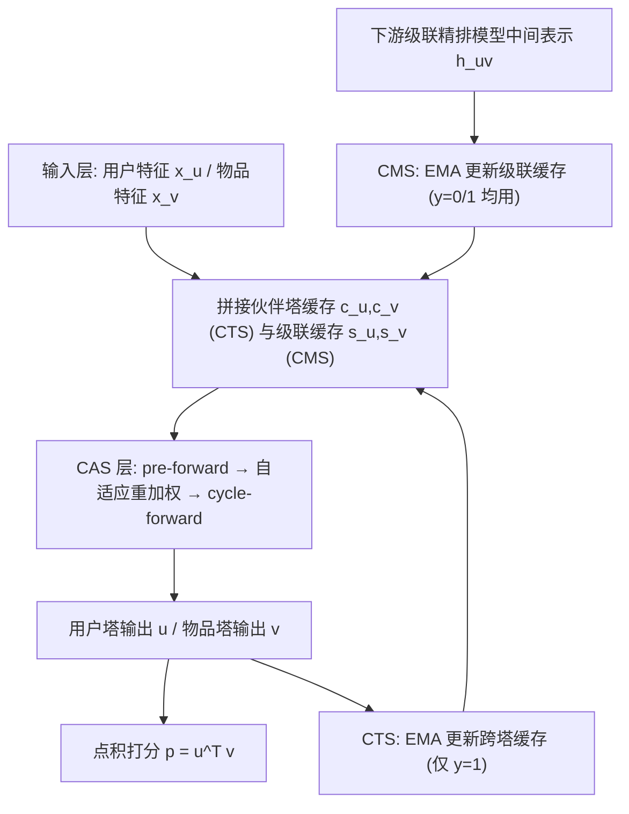
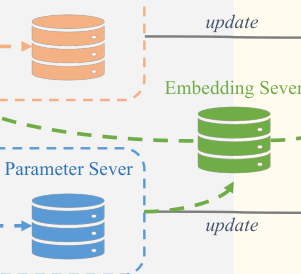
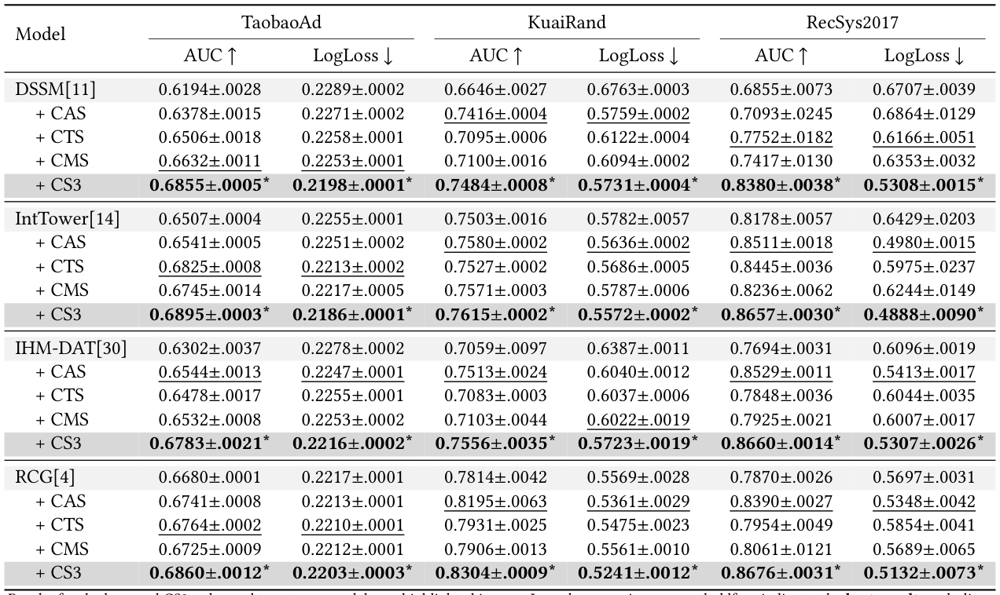
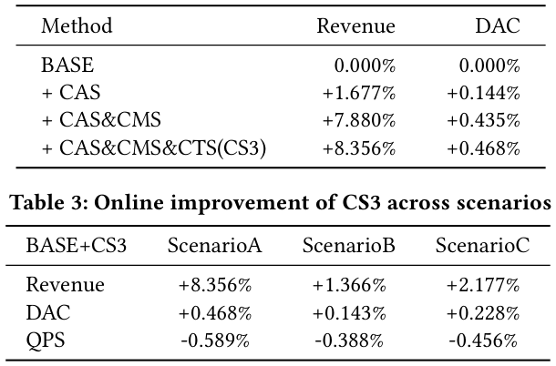
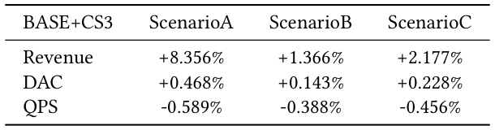

# CS3: Efficient Online Capability Synergy for Two-Tower Recommendation (面向双塔推荐的高效在线能力协同)

- **会议/期刊**: SIGIR 2026 (49th International ACM SIGIR Conference)
- **推荐链路定位**: 召回 (Retrieval) —— 大规模候选召回的双塔模型增强，同时涉及与下游精排/级联模型的跨阶段协同
- **研究方向**: 协同过滤与双塔召回 / 多任务学习与列表级重排（跨阶段一致性）
- **论文原文**: [https://arxiv.org/abs/2604.19269v1](https://arxiv.org/abs/2604.19269v1)
- **开源代码**: [https://github.com/lixiangwang/CS3Rec](https://github.com/lixiangwang/CS3Rec)

## TL;DR (核心速览)

针对工业多阶段推荐中双塔召回"容量受限、双塔表征难对齐、与下游精排存在结构性鸿沟"三大痛点，本文提出 CS3 框架，以三个轻量模块——塔内循环自适应去噪 (CAS)、跨塔同步 (CTS)、级联模型共享 (CMS)——在保持毫秒级延迟与在线学习兼容的前提下增强双塔。离线在 TaobaoAd/KuaiRand/RecSys2017 三数据集上对 DSSM、IntTower、IHM-DAT、RCG 四种骨干均带来一致 AUC 提升；线上大规模广告系统三场景收入最高提升 8.36%，QPS 仅下降 <1%。

## Background & Motivation (背景与动机)

- **领域背景与主流范式**: 工业推荐系统采用多阶段级联流水线，早期召回需在严格延迟预算下运行。双塔模型（DSSM 及其变体）因用户塔可在线计算一次复用、物品塔可离线预计算缓存、并可用 FAISS 等 ANN 库加速，成为大规模候选召回的事实标准。
- **现有方法局限 (Limitations of Prior Work)**:
  1. **容量受限 (Capacity)**: 双塔的轻量模块化设计限制了单塔表征能力；
  2. **对齐困难 (Alignment)**: 双塔在相似度计算前完全不交互，仅靠训练目标隐式对齐，在工业规模与在线学习下（新物品/新反馈持续漂移数据分布）尤为不足；
  3. **跨阶段一致性弱 (Cross-stage Consistency)**: 召回无法建模下游精排常用的丰富 user–item 交叉特征与 target-aware 序列信号，形成结构性鸿沟，阻碍端到端优化。
- **核心挑战 (Key Challenge)**: 已有工作（如 IntTower 的隐式跨塔交互、RankDistil/Ranking Distillation 的知识蒸馏）通常只沿单一轴线改进，且引入额外开销；更关键的是缺乏一个**统一机制**同时解决 (i) 塔内精炼、(ii) 显式跨塔协调、(iii) 精排到召回的知识复用——这在更新频繁、服务预算紧张的在线学习系统中尤为致命。
- **核心洞察与切入点 (Key Insight)**: 作者将召回增强重新表述为**三层"能力交换" (capability exchange)**：塔内自我修正、塔间同步、以及从下游级联模型向召回的知识共享。该框架与具体双塔骨干解耦（plug-and-play），且所有跨塔/跨阶段信号均以 EMA 缓存向量形式注入，天然适配在线学习。

## Problem Formulation & Method (问题定义与方法架构)

### 1. 符号定义与输入表征 (Notations & Input Representations)

- 用户集 $\mathcal{U}$、物品集 $\mathcal{V}$；用户 $u\in\mathcal{U}$ 与物品 $v\in\mathcal{V}$ 的偏好分 $p=\mathbf{u}^\top\mathbf{v}$（点积）。
- 第 $i$ 层输入 $\mathbf{x}_i\in\mathbb{R}^{d_i}$；层参数 $\mathbf{W}_i\in\mathbb{R}^{d_{i+1}\times d_i}$、$\mathbf{b}_i\in\mathbb{R}^{d_{i+1}}$。
- 原始塔特征 $\mathbf{x}^t_u,\mathbf{x}^t_v$；跨塔缓存向量 $\mathbf{c}^t_u,\mathbf{c}^t_v$（CTS）；级联缓存向量 $\mathbf{s}^t_u,\mathbf{s}^t_v$（CMS），均初始化为 $\mathbf{0}$。
- 交互标签 $y\in\{0,1\}$；EMA 平滑系数 $\alpha,\beta\in[0,1]$。

### 2. 整体流水线 (Overall Architecture)

数据流：原始 user/item 特征分别进入用户塔与物品塔；每层 FC 被 CAS 替换（前向→自适应重加权→循环前向）；塔输入额外拼接来自 CTS 的伙伴塔缓存向量与来自 CMS 的下游级联模型缓存向量；两塔输出做点积得 $p$；CTS/CMS 缓存向量在训练与服务中通过 EMA 实时更新（CTS 仅用正样本，CMS 正负样本均用）。

<figure class="paper-figure" markdown="span">
  <figcaption>图1：所提出的CS3框架概览。</figcaption>
</figure>

### 3. 核心模块设计与数学原理 (Key Designs & Formulations)

**(1) Cycle-Adaptive Structure (CAS，塔内自我修正)**
受 RecycleNet 循环精炼与扩散模型去噪思想启发，CAS 用一个"精炼循环"替换标准 FC 层：
- **Pre-Forward**: $\mathbf{z}_i=f_{\boldsymbol{\theta}_i}(\mathbf{x}_i)=\sigma(\mathbf{W}_i\mathbf{x}_i+\mathbf{b}_i)$，其中 $f_{\boldsymbol{\theta}_i}:\mathbb{R}^{d_i}\to\mathbb{R}^{d_{i+1}}$。
- **Adaptive Reweighting**: 由 $\mathbf{z}_i$ 反推输入特征重要性 $\mathbf{e}_i=g_{\boldsymbol{\phi}_i}(\mathbf{z}_i)=\mathrm{Sigmoid}(\mathbf{W}'_i\mathbf{z}_i+\mathbf{b}'_i)$，$\mathbf{W}'_i\in\mathbb{R}^{d_i\times d_{i+1}}$，即把维度从 $d_{i+1}$ 投回 $d_i$；随后 $\tilde{\mathbf{x}}_i=\mathbf{x}_i\odot 2\mathbf{e}_i$。乘 2 使权重落在 $(0,2)$ 且期望为 1，避免激活过小、缓解梯度消失（借鉴 LHUC）。
- **Cycle-Forward**: 用共享参数重算 $\mathbf{z}'_i=f_{\boldsymbol{\theta}_i}(\tilde{\mathbf{x}}_i)=\sigma(\mathbf{W}_i\tilde{\mathbf{x}}_i+\mathbf{b}_i)$，并令 $\mathbf{x}_{i+1}=\mathbf{z}'_i$。
- **物理直觉**: 相当于在每层做一次"特征级软门控去噪 + 参数复用重算"，不引入新特征、不增加参数矩阵规模（仅多一组 $\mathbf{W}'_i,\mathbf{b}'_i$），实现逐层自校正。作者仅用单循环以平衡效果与效率。

**(2) Cross-Tower Synchronization (CTS，跨塔显式同步)**
维护跨向量 $\mathbf{c}^t_u,\mathbf{c}^t_v$ 缓存伙伴塔的正向表征。给定 $t$ 时刻交互 $(u,v,y)$：
$$\mathbf{u}^t=U_{\boldsymbol{\theta}_u}(\mathbf{x}^t_u,\mathbf{c}^{t-1}_u,\mathbf{s}^{t-1}_u),\quad \mathbf{v}^t=V_{\boldsymbol{\theta}_v}(\mathbf{x}^t_v,\mathbf{c}^{t-1}_v,\mathbf{s}^{t-1}_v)$$
随后以 EMA 更新（**仅当 $y=1$**）：
$$\mathbf{c}^t_u=\alpha\mathbf{c}^{t-1}_u+(1-\alpha)\mathbf{v}^t,\quad \mathbf{c}^t_v=\alpha\mathbf{c}^{t-1}_v+(1-\alpha)\mathbf{u}^t$$
否则保持不变。**设计直觉**: 把伙伴塔表征显式注入本塔输入，突破"相似度计算前零交互"的结构限制；EMA 为无梯度更新，在线学习中可实时适应伙伴塔输出分布漂移。

**(3) Cascade-Model Sharing (CMS，跨阶段知识共享)**
维护级联向量 $\mathbf{s}^t_u,\mathbf{s}^t_v$，缓存下游级联精排模型对 $(u,v)$ 的中间表示 $\mathbf{h}^t_{uv}$（如最终预测层前的倒数第二层 FC 输出）：
$$\mathbf{s}^t_u=\beta\mathbf{s}^{t-1}_u+(1-\beta)\mathbf{h}^t_{uv},\quad \mathbf{s}^t_v=\beta\mathbf{s}^{t-1}_v+(1-\beta)\mathbf{h}^t_{uv}$$
与 CTS 不同，CMS **正负样本的 $\mathbf{h}^t_{uv}$ 均视为有用**（级联模型编码更丰富知识）。**设计直觉**: 不做传统知识蒸馏（蒸馏不解决架构限制且常低估级联模型），而是直接复用级联模型中间输出作为召回塔的额外输入，实现跨阶段计算共享与流水线一致性。

### 4. 训练目标、负采样与推理复杂度 (Optimization, Negative Sampling & Complexity)

- **损失函数**: 原文未显式给出总损失公式，实验以 AUC / LogLoss 为评估指标，可推断为点击/交互的二元交叉熵（BCE）类目标；CAS 的 $\mathbf{e}_i$ 由 Sigmoid 产生、CTS/CMS 缓存为 EMA 无梯度更新，故可训练参数仅为塔网络与 CAS 重加权矩阵。**原文未报告**温度系数 $\tau$ 或显式损失权重（因非对比学习范式）。
- **训练负采样策略**: 原文未显式描述负采样方案（离线实验基于带 user/item 特征的工业数据集，正负样本由真实交互标签 $y$ 给出）；CMS 明确正负样本均参与缓存更新。**原文未报告**具体负采样比例或 hard negative 挖掘细节。
- **时间与空间复杂度**:
  - CTS/CMS 仅增加两个额外输入向量，计算开销可忽略；CTS 跨向量与稀疏特征一同在 ParSvr 中更新同步，服务时本地存储，无可观测延迟影响。
  - CMS 级联向量存于独立 Embedding Server (EmbSvr)，p99 延迟 <5 ms，且与其他特征处理并行，端到端开销可忽略。
  - CAS 增加单塔计算，但召回延迟由大规模相似度检索主导（不变），且物品 embedding 预计算缓存，主要开销在实时用户塔；部署中对除输入层外所有 FC 层加 CAS，召回服务 QPS 下降 <1%。

<figure class="paper-figure" markdown="span">
  <figcaption>图2：我们系统中在线学习框架的概览。</figcaption>
</figure>

## Experimental Setup & Evaluation Protocol (实验设置与评估协议)

- **数据集统计与预处理**: 原文使用三个来自不同工业领域的公开数据集（均含 user 与 item 特征），但**未在正文报告**用户数/物品数/交互数/稀疏度等统计量（仅给出下载链接）：

| 数据集 (Dataset) | 用户数 (#Users) | 物品数 (#Items) | 交互数 (#Interactions) | 稀疏度/密度 (Sparsity) | 模态/辅助特征说明 |
| :--- | :---: | :---: | :---: | :---: | :--- |
| TaobaoAd | 原文未报告 | 原文未报告 | 原文未报告 | 原文未报告 | 含 user/item 特征（阿里天池） |
| KuaiRand | 原文未报告 | 原文未报告 | 原文未报告 | 原文未报告 | 含丰富 user/item 特征（快手） |
| RecSys2017 | 原文未报告 | 原文未报告 | 原文未报告 | 原文未报告 | 含 user/item 特征（RecSys Challenge） |

- **数据划分方式 (Splitting Strategy)**: 原文仅说明在测试集上报告结果，**未明确**采用 Leave-One-Out、Ratio Split 还是 Global Temporal Split，亦未讨论数据泄露风险。**原文未报告**具体划分比例。
- **排名评测协议 (Ranking Protocol)**: 本文为点击/交互预估式评估，报告 **AUC** 与 **LogLoss**，**未采用** Full-Ranking 或 Sampled Ranking 的召回排序协议（原文未报告 Recall@K / NDCG@K）。
- **评价指标与显著性检验**: 指标为 AUC↑ 与 LogLoss↓，在测试集上对 **5 个随机种子**报告均值与标准误；表中星号 (*) 表示相对基座模型在 **$p<0.05$** 下统计显著。Embedding 维度 $d$ 原文未报告。CMS 的级联向量由一个 **4 隐层级联前馈网络**（对 user/item 特征建模）与双塔联合训练生成。

## Key Experimental Results (核心实验结果)

### 1. 主实验对比 (Main Results)

CS3 作为插件应用于四种双塔骨干（DSSM、IntTower、IHM-DAT、RCG），下表摘取各骨干基座与其 +CS3 版本的关键结果（AUC，5 种子均值±标准误）：

| 数据集 | 指标 (AUC) | 基座骨干 (Base) | 基座 + CS3 (Ours) | 相对提升 (Improv.) |
| :--- | :--- | :---: | :---: | :---: |
| TaobaoAd | AUC | DSSM 0.6194 | **0.6855*** | +10.67% |
| TaobaoAd | AUC | IntTower 0.6507 | **0.6895*** | +5.96% |
| TaobaoAd | AUC | IHM-DAT 0.6302 | **0.6783*** | +7.63% |
| TaobaoAd | AUC | RCG 0.6680 | **0.6860*** | +2.69% |
| KuaiRand | AUC | DSSM 0.6646 | **0.7484*** | +12.61% |
| KuaiRand | AUC | IntTower 0.7503 | **0.7615*** | +1.49% |
| KuaiRand | AUC | IHM-DAT 0.7059 | **0.7556*** | +7.04% |
| KuaiRand | AUC | RCG 0.7814 | **0.8304*** | +6.27% |
| RecSys2017 | AUC | DSSM 0.6855 | **0.8380*** | +22.25% |
| RecSys2017 | AUC | IntTower 0.8178 | **0.8657*** | +5.86% |
| RecSys2017 | AUC | IHM-DAT 0.7694 | **0.8660*** | +12.55% |
| RecSys2017 | AUC | RCG 0.7870 | **0.8676*** | +10.24% |

关键结论：1) 三模块在全部数据集与骨干上均一致提升；2) KuaiRand 上 CAS 增益最大（其自校正/去噪更好利用该数据集丰富特征）；3) **DSSM+CS3 超过 IntTower 与 IHM-DAT 基座**，说明 CS3 优于强双塔优化基线；4) CTS 对 IHM-DAT 的额外提升说明显式跨塔交换优于其隐式对齐；5) CMS 对 IntTower 的提升说明下游信号在双塔交互建模之外仍有增益；6) 对 transformer 骨干 RCG 同样有效，泛化性强。

<figure class="paper-figure" markdown="span">
  <figcaption>表1：离线实验的整体性能</figcaption>
</figure>

### 2. 消融实验与控制变量分析 (Ablation Study)

原文以"基座 + 单模块 (CAS / CTS / CMS) / + CS3 全模块"形式做逐模块消融（见表 1 各组）。以 DSSM 为例：
- TaobaoAd：CAS 0.6378 / CTS 0.6506 / CMS 0.6632 / CS3 0.6855（基座 0.6194），**CMS 单模块增益最大**，全模块叠加最优；
- KuaiRand：CAS 0.7416 单模块增益最大（+0.0770），CTS 0.7095、CMS 0.7100；
- RecSys2017：CTS 0.7752 单模块增益最大（+0.0897），CMS 0.7417、CAS 0.7093。
- 线上（表 2，场景 A）：CAS +1.677% → CAS&CMS +7.880% → 全 CS3 +8.356% 收入，**CMS 贡献最大**（提升召回与下游精排一致性）。
- **控制变量说明**: 原文未报告参数量对齐或图度数匹配等严格控制变量消融；各模块为增量叠加，未做"等参数量"对照。

### 3. 稀疏度/冷启动分桶与超参敏感度 (Sparsity Buckets & Hyperparameters)

- **用户/物品交互频次分桶表现**: **原文未报告**长尾/冷启动分桶实验。
- **关键超参数敏感度**: 原文未报告 $\alpha$、$\beta$ 平滑系数、CAS 循环次数等超参的敏感度分析（仅说明 CAS 采用单循环以平衡效果与效率）。
- **线上 A/B 测试结果 (Online A/B Test)**: 在大规模广告推荐系统（日活超 4 亿）上进行，覆盖三个业务场景，均针对各场景中提供最大候选池的双塔召回模型。测试用 **10% 真实流量、持续 7 天以上**，随后全量替换 BASE；各场景日峰值 QPS 超 200k。

| 场景 | Revenue 提升 | DAC 提升 | QPS 变化 |
| :--- | :---: | :---: | :---: |
| Scenario A | +8.356% | +0.468% | -0.589% |
| Scenario B | +1.366% | +0.143% | -0.388% |
| Scenario C | +2.177% | +0.228% | -0.456% |

场景 A 的分步上线（表 2）：BASE 0% → +CAS +1.677% → +CAS&CMS +7.880% → 全 CS3 +8.356%（DAC 同步 +0.144% → +0.435% → +0.468%）。QPS 轻微下降主要来自 CAS 的额外用户塔计算，延迟影响极小且被效果增益抵消。

<figure class="paper-figure" markdown="span">
  <figcaption>表2：CS3在场景A上的在线性能</figcaption>
</figure>

<figure class="paper-figure" markdown="span">
  <figcaption>表3：CS3在各场景下的在线提升</figcaption>
</figure>

## Highlights, Limitations & Critiques (亮点、局限与审稿级批判)

- **核心亮点与可迁移性**:
  1. **统一"能力交换"视角**：将召回增强拆为塔内/塔间/跨阶段三层，避免"单点技巧"的边际收益递减，且与骨干解耦（plug-and-play），可直接迁移到其他双塔/预排模型。
  2. **EMA 缓存 + 自定义梯度**的工程实现巧妙：CTS/CMS 缓存向量以无梯度 EMA 更新，既规避在线学习中梯度传播的复杂性，又通过 ParSvr/EmbSvr 实现跨进程共享，是工业在线学习系统的可复用范式。
  3. **CMS 的"复用而非蒸馏"**：直接复用级联精排中间表示作为召回输入，比传统知识蒸馏更直接地弥合跨阶段鸿沟，且正负样本均利用，信息利用更充分。
  4. **工业级验证扎实**：4 亿 DAU、三场景、7 天以上 10% 流量 A/B、QPS 下降 <1%，落地价值明确。

- **局限性与审稿视角批判 (Critical Limitations)**:
  1. **评估协议偏弱**：仅报告 AUC/LogLoss 的点击预估指标，**未采用召回场景标准的 Full-Ranking Recall@K / NDCG@K**，也未报告数据集统计量与划分策略，难以判断是否存在数据泄露或与召回文献公平对比；缺少长尾/冷启动分桶分析。
  2. **消融不够严格**：各模块为增量叠加，未做参数量对齐或计算量匹配的对照，CAS 引入的额外参数（$\mathbf{W}'_i$）与计算是否被公平计入基线存疑；CMS 依赖一个 4 层前馈级联模型，其容量对结果的影响未做敏感性分析。
  3. **超参与理论分析缺失**：$\alpha,\beta$、CAS 循环次数等关键超参无敏感度曲线；CAS 的"去噪"缺乏理论或可视化证据支撑其物理直觉。
  4. **在线学习动态性论证不足**：虽强调兼容在线学习，但未报告在线学习 vs 离线训练的对比、缓存冷启动（$\mathbf{c}^0=\mathbf{0}$）阶段的影响，以及分布漂移下的收敛行为。
  5. **可复现性细节**：损失函数、负采样、Embedding 维度等训练细节在正文缺失，需依赖开源代码补全。

## Rating (四维评分)

- **方法创新性 (Novelty)**: ⭐⭐⭐⭐ （三层能力交换框架统一且工程巧妙，但各模块单独看均为已有思想的组合迁移）
- **评估协议与实验扎实度 (Protocol & Experiments)**: ⭐⭐⭐ （离线多骨干多数据集 + 5 种子显著性 + 大规模线上 A/B 扎实，但召回排序协议缺失、消融控制不严、统计量与超参报告不足）
- **写作与数学规范度 (Clarity & Rigor)**: ⭐⭐⭐⭐ （公式与模块表述清晰、图示完整，但损失函数与训练细节留白）
- **工业落地与复现价值 (Industrial & Practical Value)**: ⭐⭐⭐⭐⭐ （4 亿 DAU 三场景上线、QPS 仅降 <1%、代码开源，落地与复现价值极高）
