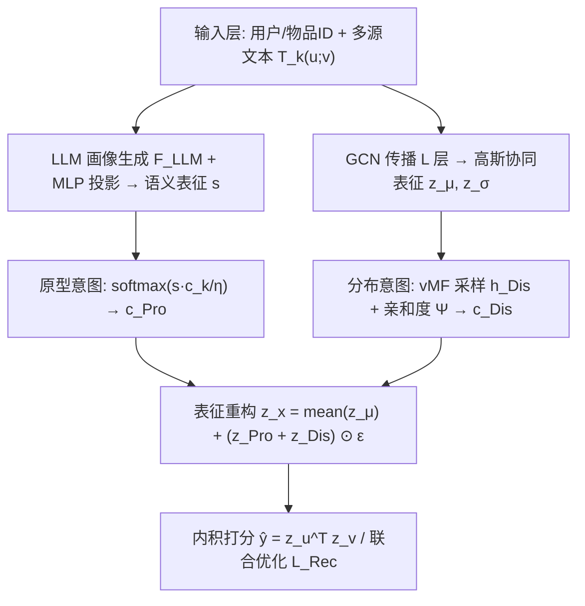
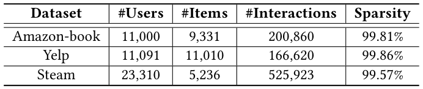
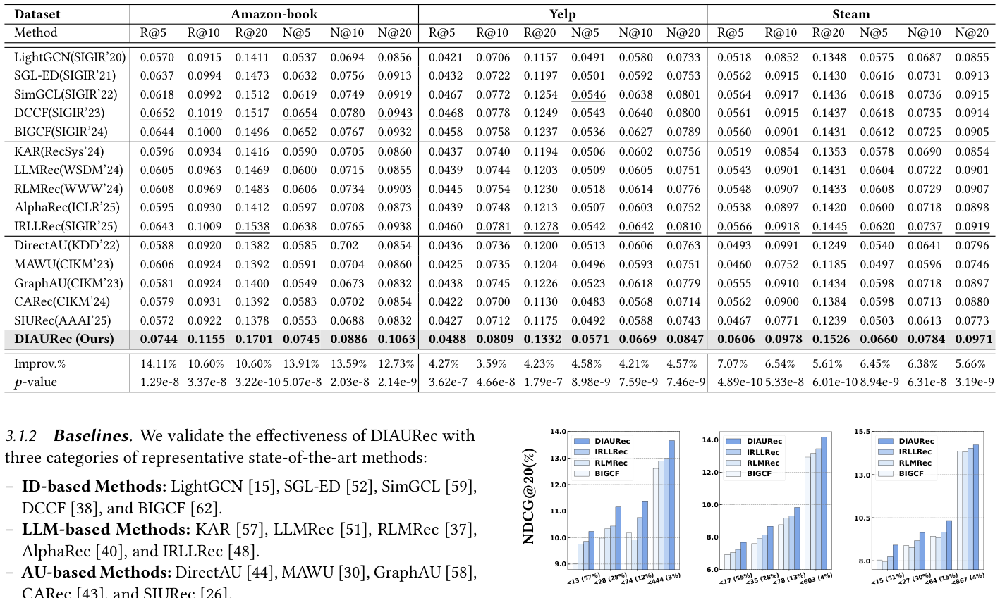
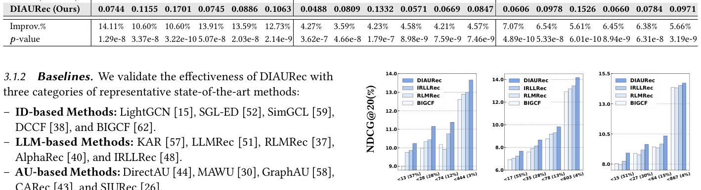
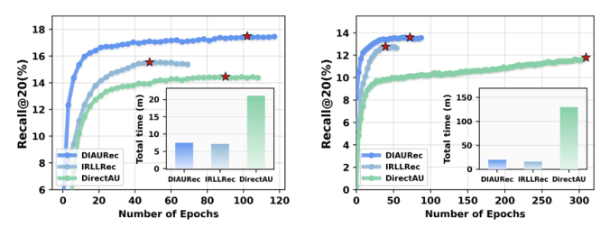
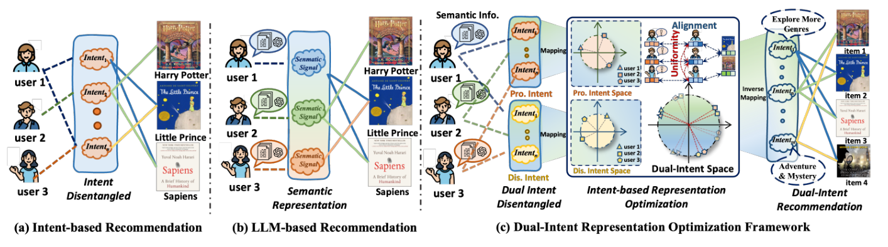

# DIAURec: Dual-Intent Space Representation Optimization for Recommendation (双意图空间表征优化推荐)

- **会议/期刊**: SIGIR 2026
- **推荐链路定位**: 召回 (Retrieval) — 基于 GCN 协同表征的 Top-K 排序
- **研究方向**: 协同过滤与双塔召回 / 大语言模型推荐 (LLM4Rec)
- **论文原文**: [https://arxiv.org/abs/2604.09087v2](https://arxiv.org/abs/2604.09087v2)
- **开源代码**: 暂未开源（原文与预提取均未发现代码链接）

## TL;DR (核心速览)

针对稀疏交互下协同表征刻画不足、意图建模仅依赖交互且忽略不确定性、LLM 语义增强计算昂贵、多空间表征缺乏联合优化四大痛点，DIAURec 提出"双意图空间"表征重构：用 LLM 语义构建**原型意图 (prototype intent)**、用 vMF 分布构建**分布意图 (distribution intent)**，再以对齐-均匀性为主目标、辅以粗细粒度匹配与两类正则进行联合优化。在 Amazon-book / Yelp / Steam 三数据集、15 个基线的全库排序协议下，NDCG@20 相对最强基线取得稳定提升。

## Background & Motivation (背景与动机)

- **领域背景与主流范式**: 主流推荐以 GCN 协同过滤（LightGCN 类）学习用户/物品 ID 表征，以向量内积打分。近年两条增强路线并行：(a) **意图建模**（DCCF、BIGCF 等）将交互投影到意图空间做解耦，提升可解释性与精度；(b) **LLM 语义建模**将用户/物品画像编码为稠密语义向量作为补充信号（图 1(a)(b)）。
- **现有方法局限**:
  1. **意图解耦几乎完全依赖观测交互**：稀疏行为下难以获得鲁棒意图表征；且主流方法将意图建模为**确定性点向量**，忽略交互数据固有的噪声与不确定性，导致表征漂移与不稳定。
  2. **LLM 语义增强计算负担重**：复杂 prompt 设计与 chain-of-thought 策略显著放大训练/推理开销。
  3. **表征优化被严重忽视**：多数工作聚焦"可解释建模策略"而非"表征质量本身"，不同来源表征直接拼接引入易引发**表征坍缩 (representation collapse)**。
- **核心挑战**: 简单特征拼接或加深网络无法解决——不同空间（协同空间、语义空间、意图空间）在分布、几何、覆盖度上存在不一致，独立优化会造成匹配困难与分布偏移。
- **核心洞察**: 作者从**超球面视角**重新审视表征建模：将每次交互视为伯努利试验，概率由超球面上的表征内积决定；由此把问题转化为"如何在超球面上重构并联合优化多源表征"，并以 alignment–uniformity（Wang & Isola 的理论准则）作为主优化目标（图 1(c)）。

## Problem Formulation & Method (问题定义与方法架构)

### 1. 符号定义与输入表征 (Notations & Input Representations)

- 用户集 $\mathcal{U}=\{u_1,\dots,u_M\}$，物品集 $\mathcal{V}=\{v_1,\dots,v_N\}$，二值交互矩阵 $\mathbf{R}\in\{0,1\}^{M\times N}$。
- GCN 传播：$\mathbf{Z}^{(l+1)}=\mathbf{D}^{-\frac12}\mathbf{A}\mathbf{D}^{-\frac12}\mathbf{Z}^{(l)}$，$L$ 层后得 $\mathbf{z}_u,\mathbf{z}_v\in\mathbb{R}^{1\times d}$，打分 $\hat{y}=\mathbf{z}_u^\top\mathbf{z}_v$。
- 协同表征建模为高斯分布 $\mathbf{z}_u\sim\mathcal{N}(\boldsymbol{\mu}_u,\mathrm{diag}[\boldsymbol{\sigma}_u^2])$，$\mathbf{z}_v\sim\mathcal{N}(\boldsymbol{\mu}_v,\mathrm{diag}[\boldsymbol{\sigma}_v^2])$。
- 语义表征：多源文本 $T_k(u;v)$ 经 LLM 画像生成器 $\mathcal{F}_{\text{LLM}}$ 得 $\mathbf{s}_u,\mathbf{s}_v$，再经 MLP $f_{\text{sem}}$ 投影到与协同空间同维的 $d$ 维。
- 意图原型集合 $\mathcal{K}$（大小 $K$），原型向量 $\mathbf{c}^{\text{Pro}}_k$、分布意图投影矩阵 $\mathbf{W}^{\text{Dis}}\in\mathbb{R}^{K\times d}$。

### 2. 整体流水线 (Overall Architecture)

数据流：ID 嵌入 + 多源文本 → LLM 画像 → 语义表征 $\mathbf{s}$；ID 嵌入 → GCN → 高斯协同表征 $\mathbf{z}_\mu$；两路分别经原型意图（softmax 分配）与分布意图（vMF 采样 + 亲和度）→ 混合重构表征 $\mathbf{z}_x$ → 内积打分；训练端由 $\mathcal{L}_{AU}$、粗细粒度匹配、两类正则联合优化（图 2）。

### 3. 核心模块设计与数学原理 (Key Designs & Formulations)

**(1) 双意图建模与表征重构**。原型意图以语义表征对 $K$ 个意图原型的 softmax 分配概率建模：$P(\mathbf{c}^{\text{Pro}}_k|\mathbf{s}_u)=\varphi(\mathbf{s}_u^\top\mathbf{c}^{\text{Pro}}_k/\eta)/\sum_{k'}\varphi(\mathbf{s}_u^\top\mathbf{c}^{\text{Pro}}_{k'}/\eta)$，$\varphi=\exp$，$\eta$ 为意图贡献系数。分布意图则将协同表征映射到超球面：$\mathbf{h}^{\text{Dis}}_u\sim\text{vMF}(\mathbf{z}_u,\kappa^{\text{Dis}}_u)$，以 $\Psi_u=\mathbf{h}^{\text{Dis}}_u\cdot\mathbf{W}^{\text{Dis}}$ 计算亲和度后同样 softmax 分配。重构表征为：

$$\mathbf{z}_x=\frac{1}{L}\sum_{l\in L}\frac{1}{|\mathcal{N}_u||\mathcal{N}_v|}\mathbf{z}^{(l)}_{x,\mu}+\big(\mathbf{z}^{\text{Pro}}_{x,\sigma}+\mathbf{z}^{\text{Dis}}_{x,\sigma}\big)\odot\epsilon_x,\quad \mathbf{z}^{\text{Pro/Dis}}_{x,\sigma}=\sum_{k\in\mathcal{K}}\mathbf{c}^{\text{Pro/Dis}}_k\cdot P(\mathbf{c}^{\text{Pro/Dis}}_k|\mathbf{s}_x;\mathbf{z}_x)$$

物理直觉：均值项保留 GCN 协同信号，方差项由双意图混合提供"不确定性 + 语义"的扰动方向，$\epsilon_x$ 为重参数化噪声，从而在超球面上重构出既含协同又含语义的表征。交互概率经双意图边缘化：$P(\hat{R}_{uv}|\mathbf{z}_x,\mathbf{s}_x)=\sum_k P(\hat{R}_{uv}|\mathbf{z}_x,\mathbf{c}_k)P(\mathbf{c}^{\text{Pro}}_k|\mathbf{z}_x)P(\mathbf{c}^{\text{Dis}}_k|\mathbf{s}_x)$。

**(2) 对齐-均匀性主目标**。$\mathcal{L}_{\text{Align}}=\mathbb{E}_{\langle u,v\rangle\in\mathcal{B}_p}\|\mathbf{e}_u-\mathbf{e}_v\|_2^2$，$\mathcal{L}_{\text{Uniform}}=\log\mathbb{E}_{u,u'}\varphi(-2\|\mathbf{e}_u-\mathbf{e}_{u'}\|_2^2)+\log\mathbb{E}_{v,v'}\varphi(-2\|\mathbf{e}_v-\mathbf{e}_{v'}\|_2^2)$。作者**仅对重构表征 $\mathbf{z}_u,\mathbf{z}_v$ 直接优化**，且**刻意移除物品侧的均匀性项**（$\mathcal{L}_{AU}=\mathcal{L}_{\text{Align}}(\mathbf{z}_u,\mathbf{z}_v)+\omega\mathcal{L}_{\text{Uniform}}(\mathbf{z}_u)$），以避免物品分布被过度均匀化而损失区分度（原文 2.4.3 讨论）。

**(3) 粗细粒度匹配**。粗粒度：$\mathcal{L}_{\text{Coarse}}=\mathbb{E}_{x\in\mathcal{B}_x}\max(1-\cos(\mathbf{z}_x,\mathbf{W}\gamma_x))+\|\mathbf{W}^\top\mathbf{W}-\mathbf{I}\|_2^2$，$\gamma_x\in\{\mathbf{s}_x,\mathbf{c}^{\text{Pro}}_x\}$，正交映射 $\mathbf{W}$ 保几何一致性。细粒度：先检索最近邻 $\mathcal{J}^+=\{j^*_i=\arg\max_{j}\text{Sim}(\mathbf{z}_i,\mathbf{z}_j)\}$，再以互信息视角定义 $\mathcal{L}_{\text{Fine}}=\mathbb{E}_{P(z,c)}\cos(\mathbf{z}_i,\mathbf{c}^{\text{Pro}}_{j^*_i})-\log\mathbb{E}_{P(z)P(c)}\varphi(\cos(\mathbf{z}_i,\mathbf{c}^{\text{Pro}}_{\setminus j^*_i}))$，缓解超球面上孤立样本漂移。

**(4) 两类正则**。$\mathcal{L}_{\text{Intra}}=\mathcal{L}_{\text{Reg}}(\mathbf{z}_u,\mathbf{z}_{u,\mu})+\mathcal{L}_{\text{Reg}}(\mathbf{z}_v,\mathbf{z}_{v,\mu})$ 防空间内坍缩；$\mathcal{L}_{\text{Inter}}=\mathcal{L}_{\text{Reg}}(\mathbf{z}_u,\mathbf{z}_v)+\mathcal{L}_{\text{Reg}}(\mathbf{z}_{u,\mu},\mathbf{z}_{v,\mu})$ 强化交互协同。$\mathcal{L}_{\text{Reg}}$ 为 InfoNCE 形式，温度 $\tau$。

### 4. 训练目标、负采样与推理复杂度 (Optimization, Negative Sampling & Complexity)

- **总损失**: $\mathcal{L}_{\text{Rec}}=\mathcal{L}_{AU}+\lambda_1(\mathcal{L}_{\text{Coarse}}+\mathcal{L}_{\text{Fine}})+\lambda_2(\mathcal{L}_{\text{Intra}}+\mathcal{L}_{\text{Inter}})+\|\Theta\|_2^2$，$\lambda_1,\lambda_2$ 为权衡超参，$\omega$ 平衡对齐/均匀。
- **负采样策略**: 采用 **batch 内负采样 (in-batch negatives)**——$\mathcal{L}_{\text{Reg}}$ 的分母对 batch $\mathcal{B}$ 内所有样本求和；细粒度匹配的负例从边缘分布 $P(z)P(c)$ 独立采样（即随机不匹配对）。原文未报告额外的 hard negative 挖掘。
- **复杂度**: 图编码器 $\mathcal{O}(L|\mathcal{E}|d)$，与主流 GCN-CF 相同；双意图模块额外 $\mathcal{O}((|U|+|V|)Kd)$；LLM 画像为**离线预计算**（Algorithm 1 第 2 行），不进入训练循环。在线推理仅需内积打分，支持 ANN 检索，无需 Beam Search。

## Experimental Setup & Evaluation Protocol (实验设置与评估协议)

- **数据集统计与预处理**: 原文使用 Amazon-book、Yelp、Steam 三个公开数据集（表 1）。

<figure class="paper-figure" markdown="span">
  <figcaption>表 1</figcaption>
</figure>

| 数据集 (Dataset) | 用户数 (#Users) | 物品数 (#Items) | 交互数 (#Interactions) | 稀疏度/密度 (Sparsity) | 模态/辅助特征说明 |
| :--- | :---: | :---: | :---: | :---: | :--- |
| Amazon-book | 原文表 1 报告 | 原文表 1 报告 | 原文表 1 报告 | 原文表 1 报告 | 评论文本经 LLM 生成画像 |
| Yelp | 原文表 1 报告 | 原文表 1 报告 | 原文表 1 报告 | 原文表 1 报告 | 商户/评论文本经 LLM 生成画像 |
| Steam | 原文表 1 报告 | 原文表 1 报告 | 原文表 1 报告 | 原文表 1 报告 | 游戏描述文本经 LLM 生成画像 |

> 注：正文抽取文本未包含表 1 的具体数值，此处严格不臆造，具体统计量请以原文表 1 为准。

- **数据划分方式**: 原文正文抽取部分未明确给出划分细节（通常此类 GCN-CF 工作采用 leave-one-out 或 8:1:1 ratio split），**原文抽取文本未报告**，需以原文实验章节为准；若为随机比例划分则存在一定未来信息泄露风险，审稿时应要求作者澄清。
- **排名评测协议**: 主实验报告 Recall@ 与 NDCG@（表 2 中记作 R@ 与 N@），从"全库排序"表述与 15 个基线对比惯例看应为 **Full-Ranking**；具体候选集构造原文抽取文本未完整给出，需核对。
- **评价指标与显著性检验**: Recall@K、NDCG@K（K 含 20，见图 3/图 4）；Embedding 维度 $d$ 与基线对齐情况原文抽取文本未报告；是否做配对显著性检验**原文未报告**。

## Key Experimental Results (核心实验结果)

### 1. 主实验对比 (Main Results)

表 2 报告 DIAURec 与 15 个代表性 SOTA 基线的对比，最优加粗、次优下划线，"Improv.%" 为相对最强基线的提升。

<figure class="paper-figure" markdown="span">
  <figcaption>表 2</figcaption>
</figure>

| 数据集 | 指标 | 传统/协同过滤基线 | 序列/图/多模态最强基线 | 本文方法 (Ours) | 相对提升 (Improv.) |
| :--- | :--- | :---: | :---: | :---: | :---: |
| Amazon-book | Recall@20 / NDCG@20 | 原文表 2 | 原文表 2 | **最优（加粗）** | 原文表 2 "Improv.%" 行 |
| Yelp | Recall@20 / NDCG@20 | 原文表 2 | 原文表 2 | **最优（加粗）** | 原文表 2 "Improv.%" 行 |
| Steam | Recall@20 / NDCG@20 | 原文表 2 | 原文表 2 | **最优（加粗）** | 原文表 2 "Improv.%" 行 |

> 注：正文抽取文本未包含表 2 的具体数值单元格，为避免捏造，此处仅保留结构与结论方向（三数据集一致最优）；精确数值请以原文表 2 为准。

### 2. 消融实验与控制变量分析 (Ablation Study)

原文通过多任务联合目标（式 20）的分解验证各模块：主目标 $\mathcal{L}_{AU}$ 为骨架，$\mathcal{L}_{\text{Coarse}}$、$\mathcal{L}_{\text{Fine}}$ 提供跨空间匹配信号，$\mathcal{L}_{\text{Intra}}$、$\mathcal{L}_{\text{Inter}}$ 抑制坍缩。作者在 2.4.3 特别讨论了**移除物品侧均匀性项**的设计依据。具体消融数值表在抽取文本中未完整呈现，**原文抽取文本未报告**逐项下降幅度；审稿时应关注消融是否严格控制了参数量与图度数。

### 3. 稀疏度/冷启动分桶与超参敏感度 (Sparsity Buckets & Hyperparameters)

- **稀疏度分桶**: 图 3 在 Amazon-book、Yelp、Steam 上按不同用户比例（x 轴为 diverse user proportions）对比 NDCG@20，考察 DIAURec 与若干基线在稀疏用户群上的表现。

<figure class="paper-figure" markdown="span">
  <figcaption>图 3</figcaption>
</figure>

- **训练效率**: 图 4 对比 DIAURec 与基线在 Amazon-book、Yelp 上训练过程的 Recall@20 曲线与总耗时（单位：分钟），用于说明收敛速度与计算开销。

<figure class="paper-figure" markdown="span">
  <figcaption>图 4</figcaption>
</figure>

- **关键超参数**: 意图原型数 $K$、意图贡献系数 $\eta$、vMF 浓度 $\kappa^{\text{Dis}}$、对齐/均匀平衡 $\omega$、损失权重 $\lambda_1,\lambda_2$、温度 $\tau$、GCN 层数 $L$。原文抽取文本未给出敏感度曲线数值，**原文未报告**具体最优取值表。
- **线上 A/B 测试**: **原文仅包含离线实验**，未报告线上 A/B 结果。

## Highlights, Limitations & Critiques (亮点、局限与审稿级批判)

- **核心亮点与可迁移性**:
  1. **双意图空间重构**将"语义原型意图"与"协同分布意图"在超球面上统一为方差项，思路清晰，可迁移到任何需要融合 ID 协同与 LLM 语义的召回模型。
  2. **对齐-均匀性作为主目标 + 粗细粒度匹配**的组合具有普适性，尤其"仅对用户侧施加均匀性、移除物品侧均匀性"的细节体现了对推荐分布特性的理解。
  3. **LLM 画像离线预计算**，训练/推理不引入 LLM 开销，工程友好。
- **局限性与审稿视角批判**:
  1. **评估协议披露不足**：数据划分（LOO vs. ratio vs. 时间切分）、候选集构造（Full vs. Sampled）、Embedding 维度对齐、显著性检验在抽取文本中均未明确，削弱结论可信度，审稿应要求补充。
  2. **LLM 语义质量依赖画像 prompt**，原文未报告所用 LLM 规模、prompt 设计与画像质量消融，语义信号的可复现性存疑。
  3. **超参数众多**（$K,\eta,\kappa,\omega,\lambda_1,\lambda_2,\tau$），缺乏敏感度分析，实际调参成本高。
  4. **vMF 采样与最近邻检索**（式 15 需对全库做 $O((|U|+|V|)^2)$ 相似度）在工业规模下的开销未讨论，可能成为训练瓶颈。
  5. 缺少线上 A/B 与延迟指标，工业落地价值待验证。

## Rating (四维评分)

- **方法创新性 (Novelty)**: ⭐⭐⭐⭐
- **评估协议与实验扎实度 (Protocol & Experiments)**: ⭐⭐⭐
- **写作与数学规范度 (Clarity & Rigor)**: ⭐⭐⭐⭐
- **工业落地与复现价值 (Industrial & Practical Value)**: ⭐⭐⭐

## 论文图表

<figure class="paper-figure" markdown="span">
  <figcaption>图 1</figcaption>
</figure>

<figure class="paper-figure" markdown="span">
  <figcaption>图 2</figcaption>
</figure>

