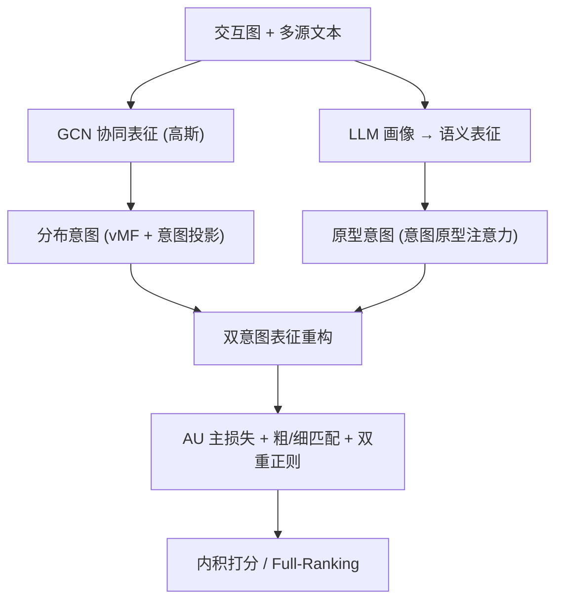
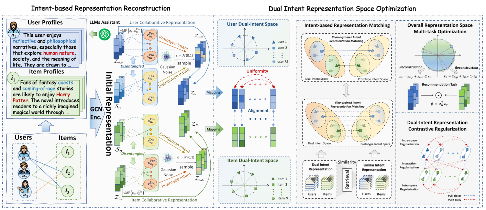

# DIAURec: Dual-Intent Space Representation Optimization for Recommendation (双意图空间表征优化推荐)

- **会议/期刊**: SIGIR 2026
- **作者与机构**: Yu Zhang, Yiwen Zhang (通讯), Yi Zhang, Lei Sang — 安徽大学
- **推荐链路定位**: 召回（图协同过滤表征学习）
- **研究方向**: 协同过滤与双塔召回 / 大语言模型推荐
- **论文原文**: [论文原文链接](https://arxiv.org/abs/2604.09087v2)
- **开源代码**: 暂未开源

## TL;DR (1分钟核心速览)

现有意图建模与 LLM 语义增强方法只关注"造出更丰富的表征"，却忽视了不同表征空间之间的联合优化，导致表征漂移与坍缩。DIAURec 将协同信号建模为 vMF 分布意图、LLM 语义建模为原型意图，重构出双意图表征，再以对齐-均匀性为主目标，辅以粗细粒度匹配与双重正则。在 Amazon-book/Yelp/Steam 三个高稀疏数据集、3:1:1 划分、Full-Ranking 协议下，Recall@20 相对最强基线提升 10.60%/4.23%/5.61%。

## Background & Motivation (背景与核心矛盾)

- **主流范式**: 图协同过滤（LightGCN 系）学 ID 表征；意图类方法（DCCF/BIGCF）把交互投影到意图空间做解耦；LLM 类方法（RLMRec/IRLLRec）用大模型生成语义画像补充协同信号。
- **前人局限**: 其一，意图解耦几乎完全依赖观测交互，稀疏场景下表征不稳健，且意图被建模为确定性点向量，忽略交互噪声与不确定性；其二，LLM 类方法把重心放在"语义抽取"（复杂 prompt、多阶段建模），算力开销大，却很少处理语义空间与协同空间之间的分布/几何不一致。
- **核心洞察 (Key Insight)**: 表征质量的关键不只是"表达力"，而是"优化"——若把异构空间表征直接拼接而不联合优化，会引发表征坍缩；且均匀性损失对用户有益、对物品有害（物品近邻本就语义一致，强行推开会破坏细粒度聚类）。
- **本文切入点**: 用"原型意图（语义）+ 分布意图（协同）"重构表征，并把对齐-均匀性、多粒度匹配、正则统一进一个多任务目标。

## Method (核心方法设计)

### 1. 整体框架 (Overall Architecture)

输入为交互图与多源文本。协同侧用 GCN 传播得到均值/方差，经 vMF 采样得到分布意图；语义侧用 LLM 生成画像并投影为语义向量，经意图原型注意力得到原型意图。二者与协同均值表征加权重构出最终用户/物品向量，再进入由对齐-均匀性主损失、粗/细粒度匹配、空间内/交互正则组成的联合优化闭环，最终以内积打分做全库排序。

<figure class="paper-figure" markdown="span">
  <figcaption>图 2：所提出的 DIAURec 的完整框架。DIAURec 包含两个主要组件：(i) 面向表示的原型意图和分布意图重构；(ii) 通过对齐—均匀性目标、细粒度和粗粒度匹配以及正则化技术对表示空间进行综合优化以用于推荐。</figcaption>
</figure>

### 2. 关键设计拆解 (Key Designs)

1. **双意图表征重构（Prototype + Distribution Intent）**：点向量意图无法表达交互不确定性。协同侧令 $\mathbf{h}^{Dis}_{u}\sim\mathrm{vMF}(\mathbf{z}_u,\kappa^{Dis}_u)$在超球面上采样方向，再经投影$\Psi_u=\mathbf{h}^{Dis}_u\cdot\mathbf{W}^{Dis}$做 softmax 分配；语义侧以可学习原型$\mathbf{c}^{Pro}_k$ 做注意力分配。重构式为
$$\mathbf{z}_x=\frac{1}{L}\sum_{l\in L}\frac{1}{|\mathcal{N}_u||\mathcal{N}_v|}\mathbf{z}^{(l)}_{x,\mu}+\left(\mathbf{z}^{Pro}_{x,\sigma}+\mathbf{z}^{Dis}_{x,\sigma}\right)\odot\boldsymbol{\epsilon}_x$$
即"确定性均值 + 双意图混合方差"的再参数化，直觉是让稀疏交互下的表征由语义先验补足方差，抑制漂移。

2. **粗粒度匹配（Coarse-grained Matching）**：跨空间存在分布鸿沟。用正交映射 $\mathbf{W}$把语义/意图锚点投到双意图空间做余弦对齐，并以$\|\mathbf{W}^\top\mathbf{W}-\mathbf{I}\|_2^2$ 约束保几何：
$$\mathcal{L}_{Coarse}=\mathbb{E}_{x\in\mathcal{B}}\max\left(1-\cos(\mathbf{z}_x,\mathbf{W}\gamma_x)\right)+\|\mathbf{W}^\top\mathbf{W}-\mathbf{I}\|_2^2$$
正交约束保证跨空间等距，避免"对齐即塌缩"。

3. **细粒度匹配 + 双重正则 + 总目标**：均匀性只把高相似对推开，孤立样本仍漂移。细粒度匹配先检索最近邻 $j^*_i=\arg\max_j \mathrm{Sim}(\mathbf{z}_i,\mathbf{z}_j)$，再以互信息式目标拉近相似对、用$\log\mathbb{E}\,\varphi(\cos(\mathbf{z}_i,\mathbf{c}^{Pro}_{j^*\!\!\!/}))$ 做归一化。总损失
$$\mathcal{L}_{Rec}=\mathcal{L}_{AU}+\lambda_1(\mathcal{L}_{Coarse}+\mathcal{L}_{Fine})+\lambda_2(\mathcal{L}_{Intra}+\mathcal{L}_{Inter})+\|\Theta\|_2^2$$
其中 $\mathcal{L}_{AU}=\mathcal{L}_{Align}(\mathbf{z}_u,\mathbf{z}_v)+\omega\mathcal{L}_{Uniform}(\mathbf{z}_u)$**刻意只对用户做均匀性**（作者用拉普拉斯二次型$\mathrm{tr}(\mathbf{Z}^\top\mathbf{L}\mathbf{Z})$证明均匀性是"反平滑算子"，对物品会破坏语义簇）。训练采用批内正样本 + 最近邻挖掘，无随机负采样；复杂度$O(L|\mathcal{E}|d+(|\mathcal{U}|+|\mathcal{V}|)Kd+B^2d)$，与 GCN 系同阶。

## Experimental Setup & Evaluation Protocol (实验设置与评估协议)

- **数据集与预处理**: Amazon-book/Yelp 保留评分 $\ge 3$，Steam 无评分直接使用；均做$k$-core 过滤并保留最大连通分量。

| 数据集 | #Users | #Items | #Interactions | 稀疏度 | 说明 |
| :--- | :---: | :---: | :---: | :---: | :--- |
| Amazon-book | 11,000 | 9,331 | 200,860 | 99.81% | 图书评论 |
| Yelp | 11,091 | 11,010 | 166,620 | 99.86% | 本地商户 |
| Steam | 23,310 | 5,236 | 525,923 | 99.57% | 游戏平台 |

- **数据划分与防穿越**: 按 **3:1:1 比例划分** train/valid/test（非时间戳切分，存在轻度未来信息泄漏风险）。
- **排名评测协议**: **Full-Ranking 全库未交互排序**，指标 Recall@$\{5,10,20\}$与 NDCG@$\{5,10,20\}$，五次独立运行取均值。
- **对比基线与超参**: 15 个基线分三类——ID 类（LightGCN/SGL-ED/SimGCL/DCCF/BIGCF）、LLM 类（KAR/LLMRec/RLMRec/AlphaRec/IRLLRec）、AU 类（DirectAU/MAWU/GraphAU/CARec/SIURec）。嵌入维度 $d=32$、batch 4096、GCN 3 层（本文最优为 2 层）、$\tau=0.2$、$\eta=1.0$、意图维度 128、$\lambda_1,\lambda_2\in[0.1,0.3]$，$t$-test$p<0.05$。

## Key Experimental Results (实验关键数据)

### 1. 主实验对比 (Main Results)

| 方法 | Amazon R@20 | Amazon N@20 | Yelp R@20 | Yelp N@20 | Steam R@20 | Steam N@20 |
| :--- | :---: | :---: | :---: | :---: | :---: | :---: |
| LightGCN (SIGIR'20) | 0.1411 | 0.0856 | 0.1157 | 0.0733 | 0.1348 | 0.0855 |
| SimGCL (SIGIR'22) | 0.1512 | 0.0919 | 0.1254 | 0.0801 | 0.1436 | 0.0915 |
| DCCF (SIGIR'23) | 0.1517 | 0.0943 | 0.1249 | 0.0800 | 0.1437 | 0.0914 |
| BIGCF (SIGIR'24) | 0.1496 | 0.0932 | 0.1237 | 0.0789 | 0.1431 | 0.0905 |
| RLMRec (WWW'24) | 0.1483 | 0.0903 | 0.1230 | 0.0776 | 0.1433 | 0.0907 |
| IRLLRec (SIGIR'25) | 0.1538 | 0.0938 | 0.1278 | 0.0810 | 0.1445 | 0.0919 |
| DirectAU (KDD'22) | 0.1382 | 0.0854 | 0.1200 | 0.0763 | 0.1249 | 0.0796 |
| **DIAURec** | **0.1701** | **0.1063** | **0.1332** | **0.0847** | **0.1526** | **0.0971** |
| Improv.% | +10.60% | +12.73% | +4.23% | +4.57% | +5.61% | +5.66% |

### 2. 消融实验 (Ablation Study)

| 变体 | Amazon R@20 | Yelp R@20 | Steam R@20 | Steam N@20 |
| :--- | :---: | :---: | :---: | :---: |
| w/o FM（去细粒度匹配） | 0.1619 | 0.1311 | 0.1497 | 0.0957 |
| w/o CM（去粗粒度匹配） | 0.1654 | 0.1298 | 0.1487 | 0.0948 |
| w/o BothM（去两种匹配） | 0.1606 | 0.1289 | 0.1454 | 0.0929 |
| w/o DIIR（去双意图重构+空间内正则） | 0.1662 | 0.1215 | 0.1341 | 0.0835 |
| w/o IR（去交互正则） | 0.1679 | 0.1304 | 0.1516 | 0.0961 |
| w/o BothR（去两种正则） | 0.1615 | 0.1048 | 0.1340 | 0.0834 |
| **DIAURec** | **0.1701** | **0.1332** | **0.1526** | **0.0971** |

### 3. 关键实验发现 (Key Findings)

1. **正则比匹配更"保命"**：去掉两种正则后 Yelp R@20 从 0.1332 暴跌至 0.1048（−21.3%），远超去掉两种匹配的 0.1289（−3.2%）；作者指出 $\lambda_2$ 降到 0.1 时表征空间直接坍缩，说明正则不是锦上添花而是防崩底线。
2. **均匀性必须"只给用户"**：把均匀性同时施加到物品（DIAURec$_{u,i}$）后 Amazon R@20 从 0.1701 降至 0.1672，仅施加于物品（DIAURec$_i$）降至 0.1657；与拉普拉斯反平滑分析一致——物品近邻语义本就一致，推开即破坏细粒度相似性。
3. **稀疏用户与浅层图最受益**：在最稀疏用户分组上三数据集分别取得约 4%/6%/8% 相对提升；GCN 层数在 $L=2$时最优（Amazon R@20 0.1701），$L=3$ 即回落至 0.1669，说明一阶邻域信息已足够，高阶带来过平滑。此外 BPR 替换 AU 主损失后 Amazon R@20 掉到 0.1565，验证随机负采样假阴性对表征优化的伤害。

## Highlights & Limitations (亮点、对比与审稿批判)

- **与代表作对比 (vs. Prior Work)**: 相比 DCCF/BIGCF 的纯交互意图解耦，本文引入 LLM 语义原型补足稀疏方差；相比 RLMRec/IRLLRec 只做"语义抽取"，本文把重心放在跨空间联合优化；相比 DirectAU/CARec 的朴素 AU 对齐，本文用正交映射 + 细粒度最近邻匹配 + 双重正则解决"对齐即坍缩"。
- **可迁移亮点**: ①"均匀性只施于用户侧"的拉普拉斯反平滑论证，可直接迁移到任何 AU 类召回模型做低成本调优；②用 vMF 采样替代点向量意图，是稀疏场景下表征不确定建模的通用轻量插件。
- **审稿级局限批判**: ①数据划分采用 3:1:1 随机比例而非全局时间戳切分，存在未来交互泄漏，离线指标可能偏乐观；②LLM 画像需离线预计算，论文未报告该部分构建成本与画像质量敏感性，且 $d=32$ 的极小嵌入下结论能否外推到工业千维场景存疑。

## Rating (四维评分)

- **方法创新性 (Novelty)**: ⭐⭐⭐⭐ （双意图重构 + 拉普拉斯视角解释均匀性非对称性，理论直觉扎实，但组件多为已有模块的组合式创新）
- **评估协议与实验扎实度 (Protocol & Experiments)**: ⭐⭐⭐⭐ （15 基线三分类覆盖全面、Full-Ranking + 显著性检验 + 稀疏分桶充分，扣分在随机比例划分而非时间切分）
- **写作与数学规范度 (Clarity & Rigor)**: ⭐⭐⭐⭐ （公式与复杂度分析清晰，Eq.9 边缘化推导略跳步，符号 $\mathbf{z}_{x,\sigma}$与$\mathbf{c}_x$ 混用稍显含糊）
- **工业落地与复现价值 (Industrial & Practical Value)**: ⭐⭐⭐ （复杂度与 GCN 同阶、训练效率优于 DirectAU，但依赖 LLM 离线画像且未开源，复现门槛中等）
