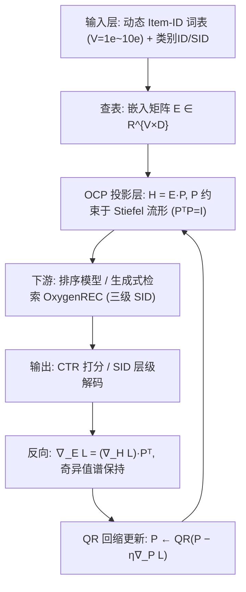
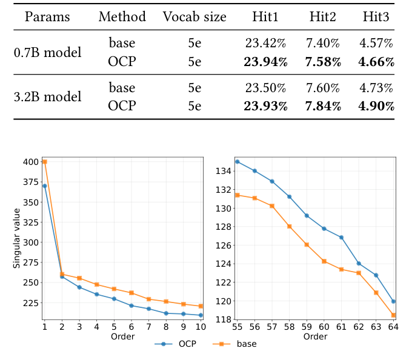
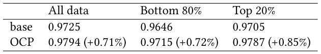
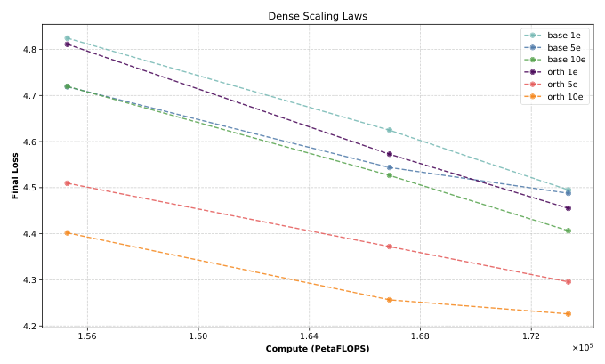
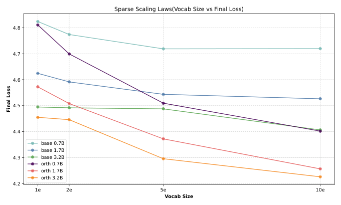

# OCP: Orthogonal Constrained Projection for Sparse Scaling in Industrial Commodity Recommendation (面向工业商品推荐稀疏扩展的正交约束投影)

- **会议/期刊**: SIGIR 2026（原文 PDF 页眉为占位符 "Conference acronym 'XX"，据任务给定目录标识归入 SIGIR 2026）
- **推荐链路定位**: 召回 (Retrieval) 与精排 (Ranking) 共用的 Item-ID 表征层（生成式检索 OxygenREC + 电商排序模型双场景验证）
- **研究方向**: 协同过滤与双塔召回 / CTR 预估与特征交叉
- **论文原文**: [https://arxiv.org/abs/2603.18697v1](https://arxiv.org/abs/2603.18697v1)
- **开源代码**: 暂未开源（原文与正则预提取均未发现代码链接）

## TL;DR (核心速览)

针对工业推荐中 Item-ID 词表从百万级扩展到十亿级（sparse scaling）时，长尾低频 ID 梯度更新不足导致嵌入空间有效秩退化（embedding collapse）的痛点，本文提出 OCP：将 Item-ID 嵌入到交互层的投影矩阵 $\mathbf{P}$ 约束在 Stiefel 流形上（$\mathbf{P}^\top\mathbf{P}=\mathbf{I}$），用 QR 回缩更新，使前向等距、反向梯度奇异值谱不被侵蚀。以奇异熵 (SE) 量化各向同性，在京东 OxygenREC 生成式检索（0.7B/3.2B）与线上排序模型上验证：SE 提升 0.71%~0.85%，线上 5 天 A/B 取得 UCXR +12.97%、GMV +8.95%。

## Background & Motivation (背景与动机)

- **领域背景与主流范式**: 工业推荐系统的物品特征通常包含类别 ID、Item-ID 与语义 ID (SID)。Item-ID 与类别实体通过可训练查找表映射为高维向量，与推荐目标端到端联合优化（YouTube DNN、DeepFM、DIN 范式）。SID 由预训练编码器 + 量化得到，可让语义相近物品共享统计强度，利于冷启动与长尾；但要捕捉细粒度偏好（如某品牌-型号组合的用户亲和度），仍需高基数、最细粒度的 Item-ID。
- **现有方法局限 (Limitations of Prior Work)**:
  1. **稀疏扩展下的分布失衡**：词表 $V$ 从百万扩到十亿级覆盖长尾库存，但用户-物品交互高度偏斜，热门物品获得稠密更新，绝大多数长尾 Item-ID 极少被更新，优化信号集中到少数主导方向，嵌入空间有效秩下降。
  2. **无约束投影加剧几何畸变**：常规 $\mathbf{H}=\mathbf{E}\mathbf{P}$ 中 $\mathbf{P}$ 无方向约束，反向传播时投影权重会进一步"挤压"梯度流形，使低频物品更新方向单一。
  3. **现有正交手段覆盖不足**：正交码本正则、正交残差量化、正交旋转变换等已被用于推荐，但主要作用于低基数静态特征（类别 ID），未覆盖基数最高、最细粒度的 Item-ID；缺少约束时模型倾向于记忆稀疏长尾 ID 而非学习可迁移模式。
- **核心挑战 (Key Challenge)**: 单纯扩大词表或加深稠密网络并不能解决该问题——容量增加反而让更多 ID 坍缩到噪声化的低秩方向；而简单加正则/对比学习并不直接作用于"投影层导致的梯度秩侵蚀"这一具体病理环节。
- **核心洞察与切入点 (Key Insight)**: 作者用奇异熵 SE 量化坍缩程度（SE 越接近 1 越各向同性），观察到稀疏扩展模型嵌入矩阵奇异值谱高度集中。关键洞察是：若把投影矩阵约束为列正交（等距映射），则前向不丢失相对几何关系，反向时 $\nabla_{\mathbf{E}}\mathcal{L}=(\nabla_{\mathbf{H}}\mathcal{L})\mathbf{P}^\top$ 的奇异值谱被完整保留（式 4），从而"拉伸"表征空间、迫使低频物品沿多样正交方向更新。

## Problem Formulation & Method (问题定义与方法架构)

### 1. 符号定义与输入表征 (Notations & Input Representations)

- 物品词表大小 $V$（工业场景 1.78 亿 → 10 亿），嵌入维度 $D$（SE 分析使用 $d=64$ 的 Item-ID 嵌入切片），投影后交互空间维度 $D'$。
- Item-ID 嵌入矩阵 $\mathbf{E}\in\mathbb{R}^{V\times D}$；投影矩阵 $\mathbf{P}\in\mathbb{R}^{D\times D'}$；投影表征 $\mathbf{H}\in\mathbb{R}^{V\times D'}$。
- 输入：Item-ID（及类别 ID、SID 等辅助特征）；输出：生成式检索的 SID 层级预测或排序模型的 CTR/CVR 打分。
- 稀疏扩展定义：词表 $V$ 随长尾库存扩张而增大（1e = $10^8$，实验覆盖 1e~10e）。

### 2. 整体流水线 (Overall Architecture)

数据流：动态词表查表得到 $\mathbf{E}$ → 经 Stiefel 流形约束的投影层 $\mathbf{P}$ 得到 $\mathbf{H}=\mathbf{E}\mathbf{P}$ → 送入排序模型或生成式检索模型（OxygenREC，三级 SID 自回归检索）→ 输出打分/解码。训练时对 $\mathbf{P}$ 做 QR 回缩更新，反向梯度经 $\mathbf{P}^\top$ 回传至 $\mathbf{E}$。

图 1 给出了 OCP 的整体示意：动态词表经 $\mathbf{P}\in\mathcal{V}^{D'}(\mathbb{R}^D)$ 正交约束投影进入排序模型与生成式检索，前向 $\mathbf{H}=\mathbf{E}\mathbf{P}$、反向 $\nabla_{\mathbf{E}}\mathcal{L}=\nabla_{\mathbf{H}}\mathcal{L}\mathbf{P}^\top$。

<figure class="paper-figure" markdown="span">
  <figcaption>图 1</figcaption>
</figure>

### 3. 核心模块设计与数学原理 (Key Designs & Formulations)

**(1) 奇异熵 SE：坍缩程度的量化指标。** 对 $\mathbf{E}\in\mathbb{R}^{V\times D}$，奇异值 $\{\sigma_1,\dots,\sigma_k\}$（$k=\min(V,D)$），能量 $e_i=\sigma_i^2$，归一化能量 $p_i=e_i/\sum_{j=1}^{k}e_j$，定义

$$\mathrm{SE}(\mathbf{E})=-\frac{1}{\log(k)}\sum_{i=1}^{k}p_i\log(p_i).$$

SE 越接近 1 表示嵌入空间越各向同性、容量利用越充分；越低表示能量集中于少数主导维度、坍缩越严重。该指标把"表征坍缩"从定性描述转为可分层（全体/底部 80% 低频/顶部 20% 高频）度量的诊断工具。

**(2) Stiefel 流形上的正交约束投影。** 将 $\mathbf{P}$ 约束在 Stiefel 流形

$$\mathcal{V}_{D'}(\mathbb{R}^{D})=\{\mathbf{P}\in\mathbb{R}^{D\times D'}\mid \mathbf{P}^\top\mathbf{P}=\mathbf{I}_{D'}\},$$

采用投影式（QR 回缩）更新：$\mathbf{P}\leftarrow\mathrm{QR}(\mathbf{P}-\eta\nabla_{\mathbf{P}}\mathcal{L})$。物理直觉：前向中 $\mathbf{P}$ 是等距映射，把高基数物品嵌入潜空间而不丢失相对几何关系；反向中梯度继承上游任务梯度的奇异值谱，迫使模型为低频物品探索更广的表征空间。

**(3) 奇异值保持定理（核心理论支撑）。** 因 $\mathbf{P}$ 列正交，对 $i\le\mathrm{rank}(\nabla_{\mathbf{H}}\mathcal{L})$ 有

$$\sigma_i(\nabla_{\mathbf{E}}\mathcal{L})=\sigma_i\big((\nabla_{\mathbf{H}}\mathcal{L})\mathbf{P}^\top\big)=\sigma_i(\nabla_{\mathbf{H}}\mathcal{L}),$$

即投影权重不再造成额外的秩侵蚀。这解释了为何 OCP 能同时"压低过大的头部奇异值、抬升底部奇异值"（图 2）：既保留列正交投影下的非零奇异值，又正则化过度主导的高频物品方向。

<figure class="paper-figure" markdown="span">
  <figcaption>图 2</figcaption>
</figure>

### 4. 训练目标、负采样与推理复杂度 (Optimization, Negative Sampling & Complexity)

- **损失函数**: 原文未显式给出总损失公式，OCP 作为"唯一额外组件"叠加在基线目标之上（生成式检索沿用 OxygenREC 的 SID 层级预测损失，排序模型沿用生产 CTR/CVR 损失）；OCP 本身不引入额外损失项，而是通过流形约束改变优化几何。
- **训练负采样策略**: 原文未报告（生成式检索为 SID 层级自回归/检索范式，排序模型为生产基线配置），负采样细节未披露。
- **时间与空间复杂度**: OCP 仅增加一个 $D\times D'$ 投影矩阵及每步 QR 回缩。作者在 3.4.4 节说明：QR 回缩开销相对整体训练（由大嵌入查表与 Transformer 交互层主导）很小，是"计算换质量"的有利折衷；原文未报告具体 ms/step 或峰值显存数值。推理阶段仅多一次 $\mathbf{E}\mathbf{P}$ 矩阵乘（可离线预计算融合进嵌入表），不改变检索/排序的在线复杂度量级。

## Experimental Setup & Evaluation Protocol (实验设置与评估协议)

- **数据集统计与预处理**: 全部实验基于京东生产环境数据，原文未给出公开基准数据集，也未报告用户数/物品数/交互数等标准统计表。可提取的关键规模信息如下：

| 数据集/场景 | 规模与配置 | 训练预算 | 模态/辅助特征说明 |
| :--- | :---: | :---: | :--- |
| 生成式检索 (OxygenREC) | 6.4B 样本；Item-ID 词表 0.5B（主实验）；稀疏扩展实验词表 1e~10e | 196K steps | 三级 SID；稠密模型 0.7B / 1.7B / 3.2B |
| 排序模型 (京东线上生产) | 2.9B 样本；四个月交互日志；词表 1B（SE 实验）/ 线上 1.78 亿→10 亿 | 720K steps | Item-ID + 类别 ID + SID；多层 self-attention |
| SE 分析切片 | $d=64$ Item-ID 嵌入矩阵 | - | 分层：全体 / 底部 80% 低频 / 顶部 20% 高频 |

- **数据划分方式 (Splitting Strategy)**: 原文仅说明"离线指标在 held-out 数据上计算"，未明确是留一法、比例划分还是全局时间戳切分；排序实验使用四个月交互日志，存在时间维度的天然先后，但原文未披露具体切分边界，**无法排除数据穿越风险，属评估协议披露不足**。
- **排名评测协议 (Ranking Protocol)**: 生成式检索报告 Top1 hit@k（$k=1,2,3$，分别对应正确预测一级 SID、前两级 SID、完整三级 SID）；排序报告 AUC/GAUC。原文未说明是 Full-Ranking 还是 Sampled Ranking，也未给出负例采样比例。
- **评价指标与显著性检验**: 指标为 Hit@1/2/3、AUC、GAUC、奇异熵 SE；基线/OCP 共享相同骨干、数据划分、优化器族与训练步数（控制变量较严格）；**原文未报告多随机种子方差或配对显著性检验**。线上为 5 天受控 A/B 测试。

## Key Experimental Results (核心实验结果)

### 1. 主实验对比 (Main Results)

表 1 为 OxygenREC 生成式检索主结果（词表 0.5B）：

<figure class="paper-figure" markdown="span">
  <figcaption>表 1</figcaption>
</figure>

| 模型 | 方法 | 词表 | Hit1 | Hit2 | Hit3 |
| :--- | :--- | :---: | :---: | :---: | :---: |
| 0.7B | base | 5e | 23.42% | 7.40% | 4.57% |
| 0.7B | **OCP** | 5e | **23.94%** | **7.58%** | **4.66%** |
| 3.2B | base | 5e | 23.50% | 7.60% | 4.73% |
| 3.2B | **OCP** | 5e | **23.93%** | **7.84%** | **4.90%** |

相对提升（本文计算）：0.7B 上 Hit1 +0.52pp（+2.22%）、Hit2 +0.18pp（+2.43%）、Hit3 +0.09pp（+1.97%）；3.2B 上 Hit1 +0.43pp（+1.83%）、Hit2 +0.24pp（+3.16%）、Hit3 +0.17pp（+3.59%）。值得注意的是 3.2B base 的 Hit1（23.50%）仅略高于 0.7B base（23.42%），而 OCP 在 3.2B 上把 Hit2/Hit3 提升到 7.84%/4.90%，说明稠密扩展的收益在 OCP 下才被更充分释放。

排序模型侧（表 3，词表访问阈值消融，阈值越高词表越小）：

| 访问阈值 | clk AUC | clk GAUC | ord AUC | ord GAUC |
| :---: | :---: | :---: | :---: | :---: |
| 15 | 0.7701 | 0.6281 | 0.8158 | 0.6491 |
| 10 | 0.7738 | 0.6376 | 0.8179 | 0.6519 |
| 5 | 0.7761 | 0.6404 | 0.8195 | 0.6539 |
| 3 | **0.7764** | **0.6432** | **0.8199** | **0.6562** |

阈值从 15 收紧到 3，词表缩小，AUC/GAUC 单调下降（clk GAUC 0.6281→0.6432，ord GAUC 0.6491→0.6562），佐证"保留高秩 Item-ID 表征对大词表至关重要"。原文未在表 3 中并列 base 与 OCP 的同阈值对照，属对照披露不足。

### 2. 消融实验与控制变量分析 (Ablation Study)

原文未设置传统意义上的模块消融表（如去掉 QR 回缩、换成无约束线性投影的逐项对照），其"消融"以**几何诊断 + 规模消融**形式呈现：

- **奇异值谱对照（图 2）**：OCP 降低过大的头部奇异值（order 1–10），同时抬升底部奇异值（order 55–64），空间更各向同性、坍缩更轻。
- **奇异熵分层（表 2）**：全体 0.9725→0.9794（+0.71%），底部 80% 低频 0.9646→0.9715（+0.72%），顶部 20% 高频 0.9705→0.9787（+0.85%）。**高频组提升幅度最大**，说明 OCP 的主要作用之一是正则化过度主导的高频方向，而非仅扶持长尾。

<figure class="paper-figure" markdown="span">
  <figcaption>表 2</figcaption>
</figure>

- **稠密扩展（图 3）**：参数从 0.7B→1.7B→3.2B，OCP 在各词表规模（1e/5e/10e）下均取得更低 final loss，且不阻断稠密容量增益。
- **稀疏扩展（图 4）**：词表 1e→2e→5e→10e，OCP 在 0.7B/1.7B/3.2B 三档稠密规模下均降低 final loss，说明大词表被"用起来"而非坍缩成噪声低秩方向。

<figure class="paper-figure" markdown="span">
  <figcaption>图 3</figcaption>
</figure>

<figure class="paper-figure" markdown="span">
  <figcaption>图 4</figcaption>
</figure>

### 3. 稀疏度/冷启动分桶与超参敏感度 (Sparsity Buckets & Hyperparameters)

- **频次分桶表现**: 表 2 的底部 80% 低频 / 顶部 20% 高频分层是本文唯一的频次分桶分析，两组 SE 均有提升（+0.72% / +0.85%），但**未报告分桶的 Hit/AUC 指标**，无法直接判断长尾物品的排序收益是否显著大于头部。
- **关键超参数敏感度**: 原文未报告 QR 回缩步长、投影维度 $D'$、流形优化器变体等超参的敏感度曲线；作者在 3.6 节将"比较更低开销的替代流形优化器"列为未来工作。
- **线上 A/B 测试结果**: 京东线上 5 天受控 A/B，Item-ID 词表从 1.78 亿扩展到 10 亿，配合多层 self-attention 架构：**UCXR +12.97%、订单量 +13.07%、GMV +8.95%**（摘要写 8.9%，正文 8.95%）。原文未报告实验流量占比、置信区间与显著性水平。

## Highlights, Limitations & Critiques (亮点、局限与审稿级批判)

- **核心亮点与可迁移性**:
  1. **问题定位精准**：把"稀疏扩展下的表征坍缩"归因到投影层对梯度秩的侵蚀，而非泛泛的容量不足，并用式 (4) 给出等距保持的严格论证，理论与实现高度自洽。
  2. **算子极轻、即插即用**：仅一个 $D\times D'$ 投影矩阵 + QR 回缩，可无缝嵌入任意含 Item-ID 查表的召回/精排模型，且推理可离线融合，工业迁移成本极低。
  3. **SE 作为诊断指标**具有普适性，可用于监控任何大词表嵌入的健康度，并支持频次分层归因。
  4. **双场景 + 线上闭环验证**：生成式检索与排序模型同时受益，线上 UCXR/GMV 双位数/近双位数提升，工业说服力强。
- **局限性与审稿视角批判 (Critical Limitations)**:
  1. **评估协议披露严重不足**：无公开数据集、无数据划分细节（是否时间切分、是否防穿越）、无 Full-Ranking vs Sampled Ranking 说明、无负采样策略、无多随机种子方差与显著性检验。对 SIGIR 这类重视可复现性的会议，这是最容易被质疑的点。
  2. **缺少严格消融**：没有"无约束线性投影 / 仅权重衰减 / 正交初始化 / 其他流形优化器"的逐项对照，无法分离"正交约束"与"额外参数/额外正则"的贡献；表 3 也未并列 base 与 OCP 同阈值结果。
  3. **理论假设偏理想**：式 (4) 的奇异值保持依赖 $\mathbf{P}$ 严格列正交与 $i\le\mathrm{rank}(\nabla_{\mathbf{H}}\mathcal{L})$，而 QR 回缩是离散近似、实际训练中 $\mathbf{P}^\top\mathbf{P}=\mathbf{I}$ 仅近似成立；原文未量化正交性偏离程度及其对增益的影响。
  4. **长尾收益缺乏直接证据**：SE 分层显示高频组提升更大，与"扶持长尾"的叙事存在张力；缺少分桶 Hit/AUC 使长尾主张停留在间接证据。
  5. **线上结果缺统计细节**：5 天 A/B 未给流量占比、置信区间、新奇效应排除，+12.97% UCXR 的幅度在推荐工业界偏大，审稿人会要求更严谨的实验设计说明。
  6. **超参与开销报告缺失**：QR 回缩的实际耗时、峰值显存、$D'$ 取值与敏感度均未报告。

## Rating (四维评分)

- **方法创新性 (Novelty)**: ⭐⭐⭐⭐（把 Stiefel 流形正交约束精确落到 Item-ID 投影层并给出奇异值保持论证，思路干净但正交约束本身非全新）
- **评估协议与实验扎实度 (Protocol & Experiments
