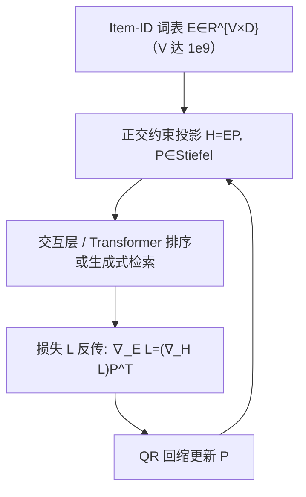
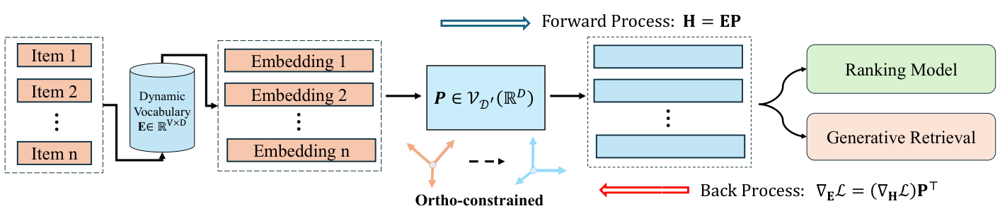

# OCP: Orthogonal Constrained Projection for Sparse Scaling in Industrial Commodity Recommendation (面向工业商品推荐稀疏缩放的正交约束投影)

- **会议/期刊**: SIGIR 2026
- **作者与机构**: Chen Sun, Beilin Xu, Boheng Tan, Jiacheng Wang, Yuefeng Sun, Rite Bo, Ying He, Yaqiang Zang, Pinghua Gong（京东）
- **推荐链路定位**: 召回（生成式检索）+ 精排（排序模型）双场景
- **研究方向**: 协同过滤与双塔召回 / 工业架构与可信推荐
- **论文原文**: [https://arxiv.org/abs/2603.18697v1](https://arxiv.org/abs/2603.18697v1)
- **开源代码**: 暂未开源

## TL;DR (1分钟核心速览)

工业推荐把 Item-ID 词表从亿级扩到十亿级（稀疏缩放）时，长尾 ID 梯度稀疏、优化集中在少数主方向，导致嵌入矩阵有效秩退化（嵌入坍缩），扩容反而收益停滞。本文提出 OCP：把 Item-ID 投影矩阵 $P$约束在 Stiefel 流形$P^\top P=I$ 上，用 QR 回缩更新，使前向等距、反向梯度奇异值不被投影权重侵蚀，从而抬高奇异熵、保留各向同性泛化特征。在京东 OxygenREC（0.7B/3.2B）与线上排序模型上，Top1 Hit@3 由 4.73% 升至 4.90%，线上 5 天 A/B 取得 UCXR +12.97%、GMV +8.95%。

## Background & Motivation (背景与核心矛盾)

- **主流范式**: Item-ID 经可训练查找表映射为稠密向量，再经投影层 $H=EP$ 送入交互层（YouTube DNN / DeepFM / DIN 一脉）；SID 提供中粒度语义，但细粒度品牌-型号偏好仍依赖高基数 Item-ID。
- **前人局限**: ① 交互长尾极度倾斜，高频物品获得稠密更新、绝大多数长尾 ID 几乎不被更新，优化信号塌缩到少数主导维度；② 正交约束此前只用于低基数类别特征的正交旋转或码本/残差量化，**最高基数的 Item-ID 投影层反而无约束**，模型倾向记忆稀疏长尾而非学习可迁移模式。
- **核心洞察 (Key Insight)**: 坍缩可用奇异熵 $\mathrm{SE}(E)=-\frac{1}{\log k}\sum_i p_i\log p_i$（$p_i=\sigma_i^2/\sum_j\sigma_j^2$）量化；无约束$P$会在反向传播中进一步"挤压"梯度流形，使$\nabla_E\mathcal{L}=(\nabla_H\mathcal{L})P^\top$ 的秩被二次侵蚀。
- **本文切入点**: 只改投影层这一个算子——把 $P$ 放到 Stiefel 流形上做等距映射，让梯度奇异值谱原样传回嵌入矩阵。

## Method (核心方法设计)

### 1. 整体框架 (Overall Architecture)

模型主干完全沿用基线（OxygenREC 生成式检索 / 线上排序模型），OCP 仅替换 Item-ID 嵌入与交互层之间的投影层：前向 $H=EP$中$P$为列正交等距映射，把高基数物品嵌入到不丢失相对几何关系的隐空间；反向按$\nabla_E\mathcal{L}=(\nabla_H\mathcal{L})P^\top$回传，因$P^\top P=I$使上游梯度的非零奇异值被完整保留，长尾物品得以沿多样正交方向更新；每次参数更新后对$P-\eta\nabla_P\mathcal{L}$做 QR 回缩拉回流形。训练目标、数据管线、优化器与步数均与基线一致，推理阶段$P$为常量矩阵，仅多一次$D\times D'$ 矩阵乘。

<figure class="paper-figure" markdown="span">
  <figcaption>图1：OCP 概览。</figcaption>
</figure>

### 2. 关键设计拆解 (Key Designs)

1. **Stiefel 流形正交投影（核心算子）**：痛点是无约束 $P$让梯度流形继续降秩。做法是把投影矩阵约束在$\mathcal{V}_{D'}(\mathbb{R}^D)=\{P\in\mathbb{R}^{D\times D'}\mid P^\top P=I_{D'}\}$，更新采用回缩$P\leftarrow \mathrm{QR}(P-\eta\nabla_P\mathcal{L})$。直觉：$P$ 成为等距算子，前向不压缩物品间相对几何，反向不额外" squeezing "梯度，等价于给长尾 ID 强行撑开表示空间。
2. **奇异值保持定理（理论支撑）**：对 $i\le \mathrm{rank}(\nabla_H\mathcal{L})$有$\sigma_i(\nabla_E\mathcal{L})=\sigma_i((\nabla_H\mathcal{L})P^\top)=\sigma_i(\nabla_H\mathcal{L})$。即投影层不再造成秩侵蚀，梯度谱健康度由上游任务决定而非被随机初始化的$P$ 扭曲——这是"高频主导方向被正则、低频方向被拉伸"的数学来源。
3. **训练目标、负采样与推理效率**：损失与基线完全一致（生成式检索用下一 SID 自回归交叉熵，排序用 CTR/CVR 主目标），**不引入额外负采样**；唯一新增开销是每步对 $D\times D'$ 矩阵做 QR 回缩，作者称其相对十亿级 embedding lookup 与 Transformer 交互层可忽略，推理期零额外延迟。

## Experimental Setup & Evaluation Protocol (实验设置与评估协议)

- **数据集与预处理**: 工业私有数据，无公开统计表；排序实验用京东 4 个月交互日志（29 亿样本、720K 步），生成式检索用 64 亿样本、196K 步；Item-ID 词表通过访问频次阈值（15/10/5/3）控制规模，线上从 1.78 亿扩至 10 亿。

| 场景 | 模型 | 词表规模 | 训练样本 | 训练步数 | 特征/场景说明 |
| :--- | :--- | :---: | :---: | :---: | :--- |
| 生成式检索 | OxygenREC 0.7B / 3.2B | 5e ($5\times10^8$) | 6.4B | 196K | 三级 SID 自回归检索 |
| 精排 | 线上排序模型 | 1e ($10^8$) | 2.9B | 720K | 多层 self-attention，4 个月日志 |
| 线上 A/B | 生产排序模型 | 1.78e8 → 1e9 | — | — | 京东 5 天对照实验 |

- **数据划分与防穿越 (Splitting Strategy)**: 离线指标在 held-out 数据上计算；线上采用与生产基线对照的受控 A/B，未披露具体时间切分细节。
- **排名评测协议 (Ranking Protocol)**: 生成式检索报告 Top1 Hit@k（$k=1,2,3$，分别对应命中一级 SID、前两级、完整三级 SID）；排序报告 AUC / GAUC（点击与下单两目标）。均为工业全量日志上的离线评估，非采样排序。
- **对比基线与超参设置**: 基线为同骨干、同数据划分、同优化器族、同步数的 OxygenREC 与线上生产模型，OCP 是唯一增量组件；SE 分析使用 $d=64$ 的 Item-ID 嵌入切片；稀疏缩放实验词表从 1e 扫到 10e。

## Key Experimental Results (实验关键数据)

### 1. 主实验对比 (Main Results)

| 模型 | 方法 | 词表 | Hit1 | Hit2 | Hit3 |
| :--- | :--- | :---: | :---: | :---: | :---: |
| 0.7B | base | 5e | 23.42% | 7.40% | 4.57% |
| 0.7B | **OCP** | 5e | **23.94%** | **7.58%** | **4.66%** |
| 3.2B | base | 5e | 23.50% | 7.60% | 4.73% |
| 3.2B | **OCP** | 5e | **23.93%** | **7.84%** | **4.90%** |
| Improv. (3.2B, Hit3) | — | — | +1.83% | +3.16% | **+3.59%** |

线上 5 天 A/B（词表 1.78e8→1e9）：**UCXR +12.97%、订单量 +13.07%、GMV +8.95%**。

### 2. 消融实验 (Ablation Study)

| 配置 | 全量 SE | 底部 80% 低频 SE | 顶部 20% 高频 SE | 说明 |
| :--- | :---: | :---: | :---: | :--- |
| base | 0.9725 | 0.9646 | 0.9705 | 无约束投影 |
| **OCP** | **0.9794 (+0.71%)** | **0.9715 (+0.72%)** | **0.9787 (+0.85%)** | 正交约束投影 |
| 词表阈值 15（最小词表） | clk AUC 0.7701 | clk GAUC 0.6281 | ord AUC 0.8158 | ord GAUC 0.6491 |
| 词表阈值 3（最大词表） | **0.7764** | **0.6432** | **0.8199** | **0.6562** |

### 3. 关键实验发现 (Key Findings)

1. **正交约束直接改写奇异值谱形状**：图 2 显示 OCP 压低前 10 阶过强奇异值、抬升第 55–64 阶弱奇异值，全量/低频/高频三档 SE 分别提升 0.71%/0.72%/0.85%，且**低频段增益不低于高频段**，说明收益并非只来自对热门物品的正则，而是真正"撑开"了长尾方向。
2. **稠密与稀疏缩放可叠加而非互斥**：图 3 中 0.7B→1.7B→3.2B 参数增长下 OCP 始终取得更低最终 loss；图 4 中词表 1e→2e→5e→10e 扩张下同样单调更低，证明 OCP 不阻塞稠密容量收益，同时让大词表"可用"而非坍缩成噪声低秩方向。
3. **词表越大收益越明显**：表 3 中访问阈值从 15 收紧到 3（词表扩大），clk GAUC 由 0.6281 升至 0.6432、ord GAUC 由 0.6491 升至 0.6562，与线上扩词表后 UCXR +12.97% 方向一致——OCP 的价值随稀疏缩放强度放大。

## Highlights & Limitations (亮点、对比与审稿批判)

- **与代表作对比 (vs. Prior Work)**: 相比正交旋转（仅作用于低基数类别特征）与正交码本/残差量化（作用于 SID 量化阶段），OCP 首次把正交约束下沉到**最高基数的 Item-ID 投影层**；相比常规 embedding 正则（L2 / Dropout），它约束的是梯度流形的秩而非参数幅值，因而能同时解释"为何扩容失效"与"为何扩容重新有效"。
- **可迁移亮点**: ① 用奇异熵作为嵌入健康度的在线监控指标，可直接接入训练看板做坍缩预警；② QR 回缩是即插即用算子，任何含 $H=EP$ 投影层的双塔/排序模型均可零改架构接入。
- **审稿级局限批判**: ① 实验全部基于京东私有数据，无公开数据集与开源代码，复现性与公平对比存疑；② 仅比较 QR 一种回缩方式，未给出与 Cayley 变换、Householder 等流形优化器的开销-收益对比，也未分析 QR 在超大 $D$ 下的分布式训练同步成本；③ 线上 A/B 仅 5 天，未覆盖季节性与冷启动突增等分布漂移场景。

## Rating (四维评分)

- **方法创新性 (Novelty)**: ⭐⭐⭐⭐ （把流形正交约束精准落在 Item-ID 投影层，并用奇异值保持定理给出清晰理论解释，但正交约束本身非全新）
- **评估协议与实验扎实度 (Protocol & Experiments)**: ⭐⭐⭐ （覆盖生成式检索+精排+线上 A/B 三场景且含缩放律分析，但无公开数据集、无显著性检验、划分细节缺失）
- **写作与数学规范度 (Clarity & Rigor)**: ⭐⭐⭐⭐ （SE 定义、梯度推导与奇异值保持命题简洁自洽，5 页短文信息密度高，部分符号与实验细节略简）
- **工业落地与复现价值 (Industrial & Practical Value)**: ⭐⭐⭐⭐ （线上 GMV +8.95% 的实打实收益与零推理延迟极具吸引力，但闭源与 QR 开销分析不足削弱复现价值）

