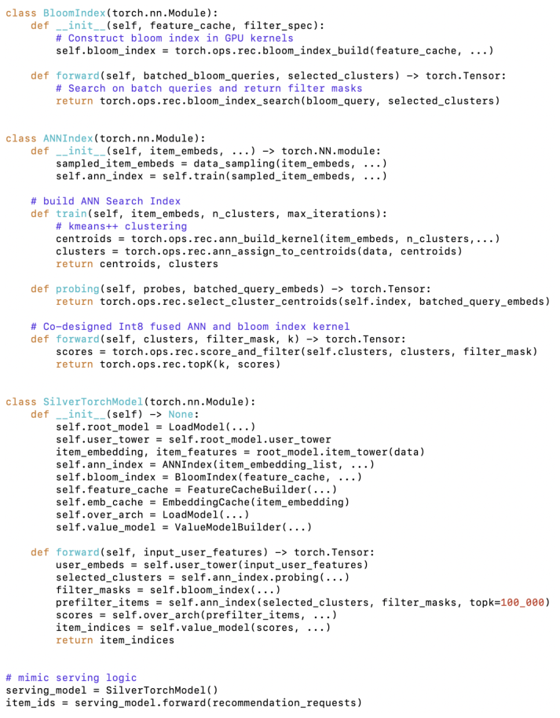
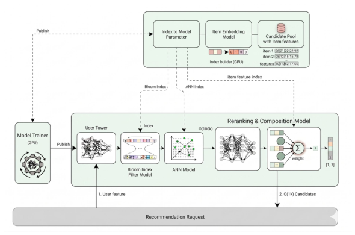
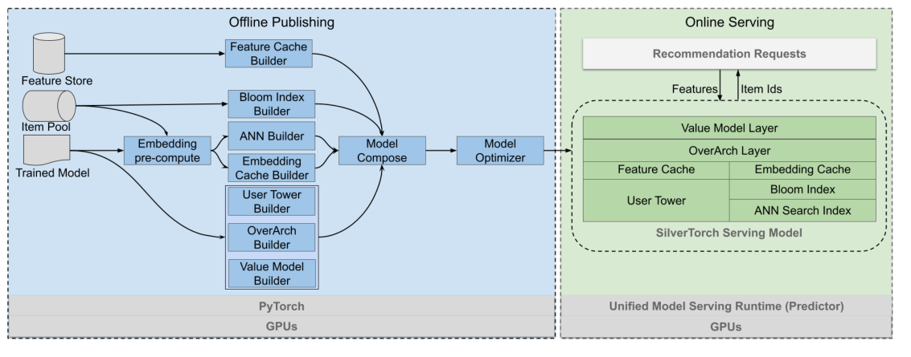
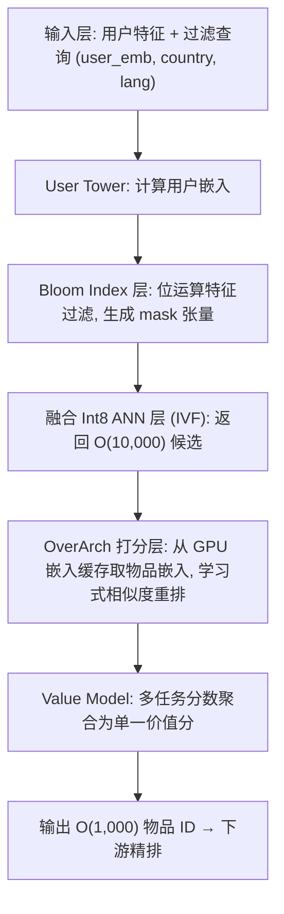
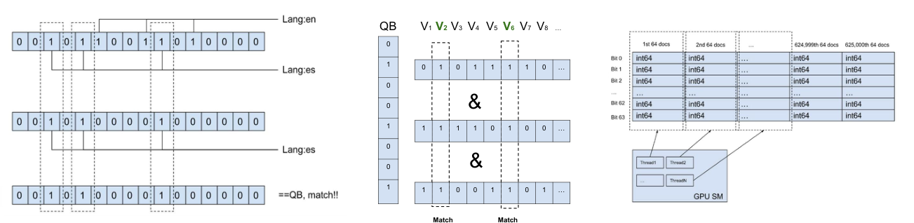
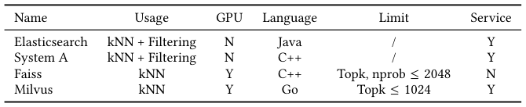
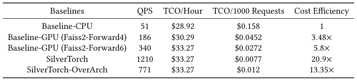

# SilverTorch: A Unified Model-based System to Democratize Large-Scale Recommendation on GPUs (SilverTorch：统一模型化系统，让大规模 GPU 推荐普惠化)

- **会议/期刊**: SIGIR 2026 (Melbourne, VIC, Australia)
- **推荐链路定位**: 召回 (Retrieval) — 双塔召回 + ANN 检索 + 特征过滤 + 召回阶段轻量重排 (OverArch)
- **研究方向**: 协同过滤与双塔召回 / 去偏公平、可信隐私与工业架构
- **论文原文**: [https://arxiv.org/abs/2511.14881v5](https://arxiv.org/abs/2511.14881v5)
- **开源代码**: 暂未开源（原文与预提取均未发现公开代码仓库）

## TL;DR (核心速览)

针对工业级 DLRM 召回阶段"ANN 索引服务 + 特征过滤服务"分离部署带来的开发割裂、版本不一致与 CPU 成本线性膨胀问题，SilverTorch 把 ANN 检索与特征过滤全部下沉为 PyTorch 模型层：提出 GPU 上的 Bloom Index 做特征过滤、融合 Int8 IVF ANN 核做近邻检索，并二者协同设计以省显存、省计算；再借模型化优势加入 OverArch 打分层与 Value Model 多任务聚合。在 1000 万与 8000 万物品的工业数据集上，吞吐最高提升 23.7×，成本效率提升 13.35×，召回率提升超 5.6%。

## Background & Motivation (背景与动机)

- **领域背景与主流范式**: 现代推荐系统采用多阶段架构，召回阶段把"给定用户向量找相关物品"形式化为向量空间中的 ANN 检索问题，主流实现依赖 Faiss / RAFT / Milvus 等独立索引库或向量数据库；同时用倒排索引做特征过滤（语言、地区、资格等用户约束）。用户/物品特征分稠密（数值）与稀疏（类别）两类，交互层因服务效率通常简化为点积。
- **现有方法局限 (Limitations of Prior Work)**:
  1. **开发割裂 (Authoring Divergency)**：模型在 PyTorch/TensorFlow 中开发，而 KNN 索引与特征过滤需跳出框架、对接独立系统栈（表 1 显示 Elasticsearch、内部 System A 仅 CPU；Faiss、Milvus 虽支持 GPU 但 top-k 与 nprobe 受限，Faiss nprobe≤2048、Milvus topk≤1024）。
  2. **版本不一致 (Versioning Inconsistency)**：用户塔上线仅需数分钟，而物品 KNN 索引构建需 4 小时以上，二者版本对齐在故障下极难保证——2022 年一次错误版本切换导致线上指标下跌 30%。
  3. **成本线性膨胀**：CPU 方案靠加机器横向扩展，成本随候选池线性增长，且各组件重复实现版本管理、调度、批处理逻辑，缺乏协同优化机会。
- **核心挑战 (Key Challenge)**: 召回模型架构正变复杂（学习式相似度替代点积、Transformer 建模原始交互序列），需要一次返回上万候选送入交互层，而现有 GPU ANN 库仅支持有限 top-k/probe 且难定制；同时"没有任何已有工作在 GPU 上研究特征过滤"。
- **核心洞察与切入点 (Key Insight)**: 作者观察到推荐场景的两个先验特性——(i) 查询结构（过滤逻辑表达式）在发布时已知，可预先优化数据布局；(ii) 推荐物品的每物品特征值基数远小于文本检索的高基数词表。因此倒排索引的稀疏性优势在推荐中失效、且其链表结构天然串行不适合 GPU；转而采用**前向索引 + Bloom 过滤器位运算**，把过滤变成规整的位矩阵运算，天然适配 GPU 并行，并可与 ANN 检索协同设计。

## Problem Formulation & Method (问题定义与方法架构)

### 1. 符号定义与输入表征 (Notations & Input Representations)

- 物品集合 $V=\{V_i=[f_1,f_2,\dots,f_t]\}$，每个物品表示为特征列表；过滤查询 $Q=[f_1,f_2,\dots,f_t]$。
- 过滤目标：$R=\{V_i\in V \mid Q\cap V_i == Q\}$，即物品须满足查询的全部特征约束。
- 用户侧输入：User Tower 输出的用户嵌入 `user_emb` 及用户属性（`user_country`、`user_lang1/2` 等）；物品侧：发布期由 Item Tower 计算的物品嵌入与静态特征。
- 输出：召回结果 $O(1{,}000)$ 个物品 ID，送入下游精排。

### 2. 整体流水线 (Overall Architecture)

发布流程：加载训练模型 → Embedding Evaluator 用 GPU 计算物品嵌入 → ANN Index Builder 将嵌入量化为 Int8 并用 KMeans++ 在 GPU 上聚类 → Bloom Index 构建特征过滤签名 → User Tower / OverArch / Value Model 量化为 BFloat16 → Model Composer 组装为单一 SilverTorch 模型 → Model Optimizer 将 eager 模式编译为图并 lowering/scripting，产出纯 C++ runtime（predictor）可服务的模型快照（含全部权重张量与索引张量）。GPU 化使发布从数天缩短到 1 小时。

在线服务：predictor 仅执行一次前向计算——User Tower 算用户嵌入 → Bloom Index 层过滤无关物品生成 mask 张量 → 用户嵌入与 mask 送入 ANN 层得 $O(10{,}000)$ 个候选 → OverArch 层从嵌入缓存取物品嵌入、计算打分并由 Value Model 跨多任务聚合 → 返回 $O(1{,}000)$ 个 ID。

<figure class="paper-figure" markdown="span">
  <figcaption>图 1</figcaption>
</figure>

<figure class="paper-figure" markdown="span">
  <figcaption>图 2</figcaption>
</figure>

<figure class="paper-figure" markdown="span">
  <figcaption>图 3</figcaption>
</figure>

### 3. 核心模块设计与数学原理 (Key Designs & Formulations)

**(1) Bloom Index：把特征过滤变成位矩阵运算**

为每个物品构建 $M$ 位 Bloom 过滤器 $VB_i$：对每个特征用 $k$ 个哈希函数计算 $hash_i(feature) \bmod N$ 并置位；查询同样生成 $M$ 位 $QB$。过滤条件转化为：

$$R=\{V_i\in V \mid QB \ \& \ VB_i == QB\}$$

朴素实现有两个缺陷：每线程一次只处理一个物品；$QB$ 中为 0 的位对应物品也被无谓评估。优化方式是**只检查 $QB$ 中为 1 的位**，并把位矩阵转置，使多物品可同时匹配、消除布尔运算所需的位掩码——对 $QB$ 置 1 的行做按位与，出现 0 即不匹配、全 1 即匹配。相比前向索引（用 int64 存特征值、偏移查找造成不规则非连续访存、显存占用大），Bloom Index 用紧凑签名字节显著降低显存、保证连续访存、消除 warp divergence。这是**首个在 GPU 上做特征过滤、也是首次将 Bloom 过滤器用于推荐系统**的工作（思想受文本检索的 Bitfunnel 启发，但 Bitfunnel 是 CPU 方案且非为推荐设计）。

<figure class="paper-figure" markdown="span">
  <figcaption>图 4</figcaption>
</figure>

**(2) 融合 Int8 ANN 核 + 与过滤协同设计**

ANN 层基于 IVF 算法：先探测查询附近的若干簇，再在簇内算 top-k 并合并为全局 top-k。物品嵌入量化为 Int8 以节省算力（为 OverArch 预排更多物品腾出预算）。关键协同点：Bloom 过滤产生的 mask 张量直接进入 ANN 层，在簇探测/距离计算阶段即剔除不满足约束的物品，从而**同时降低显存占用并消除无效计算**——这是分离式服务架构无法获得的协同优化机会。

**(3) OverArch 打分层与 Value Model 多任务召回**

ANN 返回的候选由 OverArch（一个神经网络）基于点积之外的用户-物品交互重新打分，实现"学习式相似度"；物品嵌入在发布期预计算并缓存进 GPU 显存（in-model cache lookup，去除对缓存服务的依赖）。Value Model 作为模型预测（点赞、分享、评论）与业务目标之间的翻译层，将多任务分数聚合成反映候选物品期望价值的单一复合分。二者使召回阶段能预排更多物品、提升召回-精排的模型一致性。

### 4. 训练目标、负采样与推理复杂度 (Optimization, Negative Sampling & Complexity)

- **损失函数**: 原文为系统论文，未报告具体训练损失公式、温度系数 $\tau$ 或各分项权重（原文未报告）。
- **训练负采样策略**: 原文未报告（本文聚焦服务系统，训练沿用既有双塔/召回模型训练流程）。
- **时间与空间复杂度**:
  - 离线发布：GPU 计算物品嵌入 + KMeans++ 聚类，将模型快照构建时间从**数天缩短到 1 小时**；对比服务化方案中用户塔上线数分钟、物品 KNN 索引构建 4 小时以上。
  - 在线推理：单次前向执行，无独立服务间通信与中间结果搬运；ANN 支持一次返回上万候选（远超 Faiss/Milvus 的 top-k 限制），无需 Beam Search。
  - 显存：Bloom 签名替代 int64 前向索引显著降低显存；Int8 量化进一步压缩 ANN 索引；OverArch 物品嵌入常驻 GPU 缓存。

## Experimental Setup & Evaluation Protocol (实验设置与评估协议)

- **数据集统计与预处理**: 原文使用两个工业级数据集，分别含 **1000 万**与 **8000 万**物品。原文未报告用户数、交互数、稀疏度及 5-core 等过滤规则（原文未报告）。

| 数据集 (Dataset) | 用户数 (#Users) | 物品数 (#Items) | 交互数 (#Interactions) | 稀疏度/密度 (Sparsity) | 模态/辅助特征说明 |
| :--- | :---: | :---: | :---: | :---: | :--- |
| 工业数据集 A | 原文未报告 | 10M | 原文未报告 | 原文未报告 | 物品特征 + 用户属性过滤条件 |
| 工业数据集 B | 原文未报告 | 80M | 原文未报告 | 原文未报告 | 同上 |

- **数据划分方式 (Splitting Strategy)**: 原文未报告（系统评测以吞吐、成本与召回率为核心，未描述 LOO / Ratio / 时间切分细节）。
- **排名评测协议 (Ranking Protocol)**: 原文未报告 Full-Ranking 或 Sampled Ranking 的具体协议；召回质量以 recall 指标衡量（OverArch + 多任务召回带来 >5.6% 召回提升）。
- **评价指标与显著性检验**: 吞吐（throughput，最高 23.7×）、成本效率（cost-efficiency，13.35×）、召回率（recall，>5.6%）。原文未报告配对显著性检验或多随机种子方差。

## Key Experimental Results (核心实验结果)

### 1. 主实验对比 (Main Results)

原文主实验以系统级吞吐与成本效率对比为主，最强基线为 SOTA 服务化方案（CPU 索引/过滤服务及 GPU ANN 库）。核心结论：**吞吐最高提升 23.7×**，**成本效率较 CPU 方案提升 13.35×**，同时因可服务更复杂模型而**召回率提升超 5.6%**。原文未以 Recall@K / NDCG@K 表格形式报告逐数据集数值（原文未报告）。

| 数据集 | 指标 | 传统/协同过滤基线 | 序列/图/多模态最强基线 | 本文方法 (Ours) | 相对提升 (Improv.) |
| :--- | :--- | :---: | :---: | :---: | :---: |
| 工业数据集 (10M/80M 物品) | 吞吐 (Throughput) | SOTA 服务化方案 | - | **SilverTorch** | 最高 +23.7× |
| 工业数据集 (10M/80M 物品) | 成本效率 (Cost-efficiency) | CPU-based 方案 | - | **SilverTorch** | +13.35× |
| 工业数据集 (10M/80M 物品) | 召回率 (Recall) | - | - | **SilverTorch (OverArch + Value Model)** | >+5.6% |

<figure class="paper-figure" markdown="span">
  <figcaption>表 1</figcaption>
</figure>

<figure class="paper-figure" markdown="span">
  <figcaption>表 2</figcaption>
</figure>

### 2. 消融实验与控制变量分析 (Ablation Study)

原文以系统组件对比替代传统模型消融：Bloom Index 相对前向索引消除 warp divergence、降低显存并保证连续访存；Int8 量化 + 融合 ANN 核相对独立 ANN 服务消除通信与数据搬运；ANN 与过滤协同设计进一步省显存、省计算。原文未报告逐模块移除的召回率下降幅度表格，也未说明是否严格控制参数量对齐（原文未报告）。

### 3. 稀疏度/冷启动分桶与超参敏感度 (Sparsity Buckets & Hyperparameters)

- **用户/物品交互频次分桶表现**: 原文未报告长尾/冷启动分桶实验。
- **关键超参数敏感度**: 原文未报告 Bloom 位数 $M$、哈希函数数 $k$、IVF 簇数/nprobe 的敏感度曲线。
- **线上 A/B 测试结果 (Online A/B Test)**: SilverTorch 已**大规模部署**，线上服务数百个模型、支撑多种应用；原文提及 2022 年服务化方案因版本切换错误导致线上指标下跌 30%（作为动机论据），但未报告 SilverTorch 自身的线上 CTR/CVR/GMV/留存 A/B 收益数值（原文未报告）。

## Highlights, Limitations & Critiques (亮点、局限与审稿级批判)

- **核心亮点与可迁移性**:
  1. **"索引即模型层"范式**极具迁移性：把 ANN 检索、特征过滤、打分重排统一为 PyTorch 张量算子，天然获得版本一致性、端到端可微调与协同优化空间，可推广到搜索、广告召回及多模态向量检索。
  2. **Bloom Index** 利用"查询结构预知 + 低特征基数"两个推荐特有先验，把过滤转为位矩阵运算，是 GPU 特征过滤的首创，工程价值高。
  3. **OverArch + Value Model** 让召回阶段承担轻量重排与多目标任务聚合，提升召回-精排一致性，是"召回即粗排"趋势的工业级落地样本。
- **局限性与审稿视角批判 (Critical Limitations)**:
  1. **评估协议披露不足**：作为 SIGIR 系统论文，未报告数据划分、正样本定义、Full-Ranking/Sampled Ranking 协议与显著性检验，召回提升 >5.6% 缺乏统计严谨性支撑，复现门槛高。
  2. **基线公平性存疑**：吞吐 23.7× 与成本 13.35× 的对比基线为 CPU 服务化方案与受限 GPU 库，未与同代 GPU 向量数据库（如 CAGRA 最新版）在同等硬件预算下做端到端对比。
  3. **Bloom 假阳性风险未量化**：Bloom 过滤器存在假阳性，可能放行不满足约束的物品进入 ANN 与 OverArch，原文未报告假阳性率及其对下游业务指标的影响。
  4. **超参与敏感度缺失**：$M$、$k$、簇数等关键参数无敏感度分析，迁移到其他业务时的调参成本未知。
  5. **无开源代码**：工业内部系统（System A、predictor runtime）不可复现，削弱学术复现价值。

## Rating (四维评分)

- **方法创新性 (Novelty)**: ⭐⭐⭐⭐（GPU Bloom 特征过滤为首创，模型化协同设计思路新颖；但 ANN/IVF/Int8 量化本身为成熟技术组合）
- **评估协议与实验扎实度 (Protocol & Experiments)**: ⭐⭐⭐（工业规模数据与真实部署有说服力，但评估协议、统计检验与消融细节披露不足）
- **写作与数学规范度 (Clarity & Rigor)**: ⭐⭐⭐⭐（系统架构与 Bloom 公式表述清晰，流程图完整；训练损失与超参细节缺失）
- **工业落地与复现价值 (Industrial & Practical Value)**: ⭐⭐⭐⭐⭐（已服务数百线上模型，成本效率 13.35×，落地价值极高；但闭源降低复现性）
