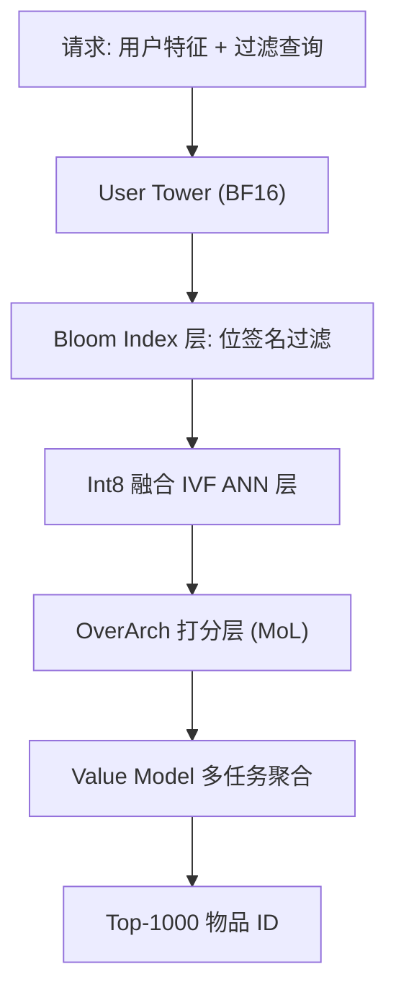

# SilverTorch: A Unified Model-based System to Democratize Large-Scale Recommendation on GPUs (SilverTorch：统一模型化系统，让大规模 GPU 推荐普惠化)

- **会议/期刊**: SIGIR 2026
- **作者与机构**: Bi Xue, Hong Wu, Lei Chen, Chao Yang 等（Meta Platforms）
- **推荐链路定位**: 召回（Retrieval / 粗排前置）
- **研究方向**: 协同过滤与双塔召回 / 工业级全链路架构
- **论文原文**: [https://arxiv.org/abs/2511.14881v5](https://arxiv.org/abs/2511.14881v5)
- **开源代码**: [https://github.com/rapidsai/raft](https://github.com/rapidsai/raft)（底层 ANN 算子依赖 RAFT）

## TL;DR (1分钟核心速览)

工业级 DLRM 召回长期依赖 CPU 上的独立 ANN 索引服务与倒排过滤服务，导致版本不一致、跨服务数据搬运开销大、且无法支撑学习型相似度与多任务召回。SilverTorch 把 ANN 检索与特征过滤全部改写为 PyTorch 模型层：提出 GPU 上的 Bloom Index 做特征过滤、Int8 融合 IVF 算子做近邻检索，并将二者协同设计（Probe-then-Filter）。在 80M/10M 工业候选池、200ms P99 约束下，端到端吞吐较 CPU 基线提升 23.7×，成本效率提升 13.35×，同时通过 OverArch 打分层带来 E-Task Recall@20 相对提升 28.2%。

## Background & Motivation (背景与核心矛盾)

- **主流范式**: 两塔模型 + 独立 ANN 索引服务（Faiss/Milvus）+ 倒排索引过滤服务，客户端编排多次请求并合并中间结果。
- **前人局限一（版本不一致）**: 用户塔发布仅需分钟级，而物品侧 KNN 索引重建需 4 小时以上，二者版本错配在 2022 年曾造成线上指标 30% 下跌。
- **前人局限二（协同设计缺失）**: 各组件独立实现 versioning/scheduling/batching，冗余逻辑割裂优化；且 Faiss-GPU 限制 top-k≤2048、probes≤2048，无法支撑现代召回模型动辄 $O(10^4)$ 的候选下推。
- **核心洞察 (Key Insight)**: 推荐场景的特征过滤基数远低于文本检索（每物品仅数个特征值），倒排索引的稀疏性红利消失；而查询结构在发布期已知，可用前向索引/位运算实现无状态并行评估。
- **本文切入点**: 把索引与过滤变成模型参数张量，让检索退化为一次前向算子执行，从而获得 GPU 并行与跨组件协同设计的机会。

## Method (核心方法设计)

### 1. 整体框架 (Overall Architecture)

发布阶段：物品塔在 GPU 上算出物品 embedding，ANN 构建器做 Int8 量化与 KMeans++ 聚类，Bloom 构建器生成位签名，二者与用户塔、OverArch、Value Model 一并编译为含权重张量与索引张量的模型快照，由纯 C++ predictor 加载。在线阶段：单次请求进入 predictor，用户塔产出 user embedding，Bloom Index 层生成 1-bit/物品掩码，ANN 层返回 $O(10^4)$候选，OverArch 从 GPU embedding cache 取物品向量重排，Value Model 聚合多任务分数，最终输出$O(10^3)$ 物品给精排。

### 2. 关键设计拆解 (Key Designs)

1. **GPU Bloom Index（把过滤变成位矩阵与运算）**：倒排索引的链表结构在 GPU 上 warp 发散且内存不连续。本文为每个物品构造 $M$位签名$VB_i$，查询构造$QB$，匹配条件改写为$R=\{V_i \in V \mid QB \,\&\, VB_i = QB\}$。关键优化是**转置位矩阵**：只遍历$QB$ 中为 1 的行，用一条 `and.b64` 指令同时处理 64 个物品，结果用一个 Int64 存储，彻底消除逐物品布尔存储与 warp 发散。1024 位配置下假阳率仅 0.067%，内存 5GB，比精确倒排（19.8GB）小 4.21×。

2. **Int8 融合 ANN 算子（消除 gather 临时张量）**：IVF 三步中"索引选择"会物化大临时张量。本文提出 fused index-matmul，让每个 warp 处理连续物品 tile，直接从 embedding table 流式读取并与批量查询做点积，避免中间张量构造；发布期按全局 min/max 做 Int8 量化，乘加单指令完成，显存减半。释放出的显存反过来供养 OverArch 对更多候选打分。

3. **Probe-then-Filter 协同设计与训练/推理开销**：标准流水线先全库 Bloom 过滤再 ANN，但未被 probe 的簇内物品过滤纯属浪费。由于两个谓词是合取关系，交换顺序不改变结果集，故先选 $n_p$ 个簇、仅对簇内物品算 Bloom 掩码，再在单 kernel 内完成过滤+打分。81M 物品/9000 簇、256 probes 时仅处理 2.3M 物品（2.8%），过滤计算与 scratch 显存均降 30×。总损失沿用两塔 BPR/交叉熵训练（论文未改训练目标），负采样沿用工业 in-batch 策略；推理侧无额外服务调用，P99 稳定在约 15ms。

## Experimental Setup & Evaluation Protocol (实验设置与评估协议)

- **数据集与预处理**: 生产采样候选池，embedding 维度 $d=128$，A100-40G；用户塔用 HSTU，OverArch 用 Mixture of Logits。

| 数据集 | #Items | 索引分片 | 显存构成 | 场景说明 |
| :--- | :---: | :---: | :---: | :--- |
| 80M | 80,000,000 | 2 GPU | Bloom 5GB + ANN 5GB + Emb Cache 10GB(FP16) + OverArch 12GB | 主生产规模，多任务 12 头 |
| 10M | 10,000,000 | 1 GPU | 同上按比例缩减 | 单卡不切分对照 |
| 20M (ANN 微基准) | 20,000,000 | 1 GPU | 128 维 float/Int8 | ANN 延迟-召回曲线 |

- **数据划分与防穿越**: 离线回放 5,000 条真实生产请求，非随机划分；召回评估以真实用户-物品交互行为为 ground truth。
- **排名评测协议**: 端到端以 **最大吞吐 QPS（200ms P99 约束下逐步加压至饱和）** 为主指标；召回侧报告 Recall@20/100/200/500/1000，属全库候选池下的 Top-K 召回（非采样排序）。
- **对比基线与超参设置**: Baseline-CPU（Faiss-CPU IVF + 内部倒排，2+4 分片）、Baseline-GPU（Faiss-GPU + GPU 前向索引，多种分片）、SilverTorch-Retrieval（FilterThenProbe / ProbeThenFilter）、SilverTorch-OverArch；ANN 微基准对比 Faiss-CPU/GPU IVFFlat 与 HNSW；每组实验重复 5 次取均值，top-k 固定 1024、生产 probes=24。

## Key Experimental Results (实验关键数据)

### 1. 主实验对比 (Main Results)

端到端吞吐与成本（80M 数据集，probes=24，top-k=1024）：

| 方法 | QPS | TCO/小时 | TCO/1000 请求 | 成本效率 |
| :--- | :---: | :---: | :---: | :---: |
| Baseline-CPU | 51 | $28.92 |$0.158 | 1× |
| Baseline-GPU (Faiss2-Forward4) | 186 | $30.29 |$0.0452 | 3.48× |
| Baseline-GPU (Faiss2-Forward6) | 340 | $33.27 |$0.0272 | 5.8× |
| SilverTorch-Retrieval | **1210** | $33.27 | **$0.0077** | **20.9×** |
| SilverTorch-OverArch | 771 | $33.27 |$0.0121 | **13.35×** |

召回对比（probes=32）：

| 任务 | 方法 | R@20 | R@100 | R@200 | R@500 | R@1000 | QPS |
| :--- | :--- | :---: | :---: | :---: | :---: | :---: | :---: |
| E-Task | Baseline | 0.0824 | 0.1918 | 0.2913 | 0.4295 | 0.4413 | 51 |
| E-Task | SilverTorch | 0.0716 | 0.2031 | 0.2892 | 0.4237 | 0.4465 | 1210 |
| E-Task | +OverArch (Low Bits) | 0.0851 | **0.2539 (+25.04%)** | 0.3202 | 0.4430 | 0.4489 | 768 |
| E-Task | +OverArch | **0.0918 (+28.2%)** | 0.2419 | **0.3315 (+14.6%)** | **0.4476 (+5.6%)** | **0.4573 (+2.4%)** | 771 |
| C-Task | Baseline | 0.0964 | 0.2522 | 0.3551 | 0.4971 | 0.5162 | 51 |
| C-Task | +OverArch | 0.0971 (+0.6%) | **0.2573 (+1.7%)** | **0.3601 (+2.3%)** | 0.5074 | **0.5256 (+1.12%)** | 771 |

### 2. 消融实验 (Ablation Study)

| 配置 | 关键指标 | 变化 |
| :--- | :--- | :--- |
| FilterThenProbe（全库先过滤） | 80M QPS | 基准 |
| ProbeThenFilter（协同设计） | 80M QPS | **+17%~25%** |
| ANN+Bloom 分离执行 | 延迟 1.55ms / scratch 35.6MB | 基准 |
| ANN+Bloom 协同（probe=32） | 延迟 **0.72ms** / scratch **18.2MB** | **1.79×–2.15× 加速** |
| Bloom 1024 bit | 假阳率 0.067% / 5GB | 基准 |
| Bloom 768 bit | 假阳率 3.89% / 3.84GB | 端到端召回**不降反略升** |
| Bloom 4096 bit | — | 显存 OOM |

### 3. 关键实验发现 (Key Findings)

1. **协同设计是吞吐主增益之一**：Probe-then-Filter 相比 Filter-then-Probe 在 80M 上带来 17%–25% QPS 提升，根因是 scratch 显存从 35.6MB 降至 18.2MB，在显存受限场景下允许更大 batch，而非计算量本身。
2. **Int8 量化的精度损失被 OverArch 完全"赚回"**：SilverTorch-INT8 在 top-k=2048 时延迟比 Faiss-GPU 低 2.2×–14.7×，但召回上限约 0.92；然而释放的算力用于 OverArch 后，E-Task Recall@20 从 0.0716 升至 0.0918（+28.2%），说明"粗检索+强重排"优于"精检索+点积"。
3. **Bloom 假阳率对端到端召回几乎无害**：位宽从 1024 降到 768 使假阳率从 0.00173% 飙至 3.89%，端到端召回却未下降甚至略升——因为过滤是训练外的后验守卫，假阳物品仍可被后续精排剔除，这为显存预算提供了可观的弹性空间。

## Highlights & Limitations (亮点、对比与审稿批判)

- **与代表作对比 (vs. Prior Work)**: 相比 LiNR（同样做 GPU 模型化召回，但无协同索引、无 GPU 过滤方案、未讨论成本），SilverTorch 补齐了过滤侧并给出 TCO 账本；相比 Faiss-GPU/Milvus/CAGRA，突破了 top-k≤2048、probes≤2048 的硬限制，支持 $O(10^4)$ 候选下推；相比 Bitfunnel（CPU 文本检索的 Bloom 签名），本文针对推荐场景低基数特征重新设计了转置位矩阵并行方案。
- **可迁移亮点**: (1) 把"过滤谓词与 ANN 谓词合取可交换"这一性质用于算子重排，任何"先粗筛后精算"的级联检索都可复用；(2) 用 1-bit 掩码替代 PyTorch 原生 8-bit bool 传递过滤结果，节省 8× 带宽，是低成本高回报的工程技巧。
- **审稿级局限批判**: (1) 召回评估仅在两个内部生产任务上报告，缺少公开数据集（如 MovieLens/Amazon）与开源基线复现，可复现性受限；(2) 强依赖 A100-40G 显存预算，Bloom 4096 bit 即 OOM，且 fresh index 流式更新仅给出设计概念、细节留待未来工作，物品新鲜度这一召回核心需求尚未闭环验证。

## Rating (四维评分)

- **方法创新性 (Novelty)**: ⭐⭐⭐⭐ （Bloom Index 转置位矩阵与 Probe-then-Filter 协同设计思路清晰，但本质是系统级算子重写而非新学习范式）
- **评估协议与实验扎实度 (Protocol & Experiments)**: ⭐⭐⭐⭐ （80M/10M 双规模 + 端到端 QPS/延迟/TCO/召回四维评估完整，但缺公开数据集与开源基线复现）
- **写作与数学规范度 (Clarity & Rigor)**: ⭐⭐⭐⭐ （查询形式化与算法伪代码严谨，复杂度与显存账本清晰；部分公式偏工程描述、缺理论界）
- **工业落地与复现价值 (Industrial & Practical Value)**: ⭐⭐⭐⭐⭐ （已在 Meta 线上服务数百模型，23.7× 吞吐与 13.35× 成本效率有真实 TCO 支撑，工程迁移价值极高）
