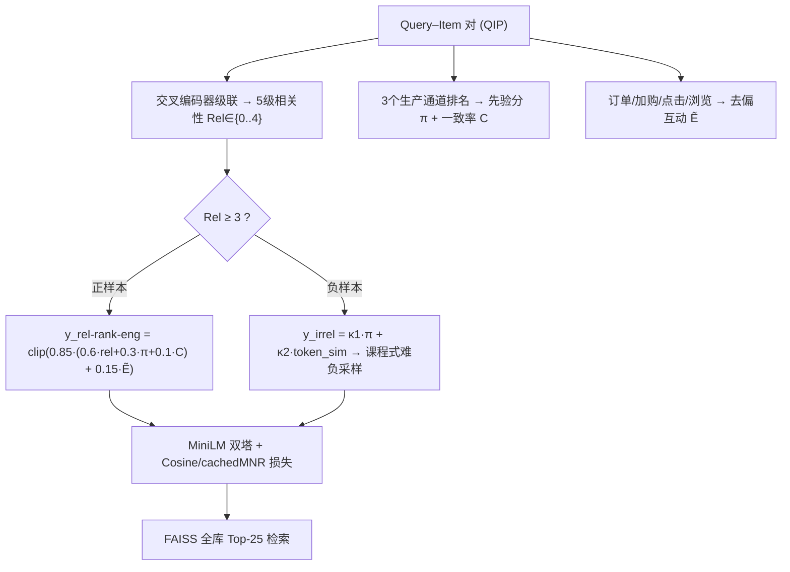
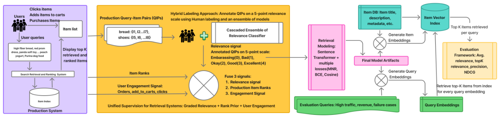

# Unified Supervision for Walmart's Sponsored Search Retrieval via Joint Semantic Relevance and Behavioral Engagement Modeling (沃尔玛赞助搜索检索的统一监督：语义相关性与行为互动的联合建模)

- **会议/期刊**: SIGIR 2026 (Industry Track)
- **作者与机构**: Shasvat Desai, Md Omar Faruk Rokon, Jhalak Nilesh Acharya, Isha Shah, Hong Yao, Utkarsh Porwal, Kuang-chih Lee（Walmart Global Tech）
- **推荐链路定位**: 召回（赞助搜索第一阶段双塔检索）
- **研究方向**: 协同过滤与双塔召回 / 去偏公平与工业架构
- **论文原文**: [https://arxiv.org/abs/2604.07930v5](https://arxiv.org/abs/2604.07930v5)
- **开源代码**: 暂未开源

## TL;DR (1分钟核心速览)

工业界双塔召回普遍用点击/订单等互动信号做监督，但在赞助搜索场景下互动既含噪（流行度、促销、价格驱动）又结构性稀疏（广告曝光受竞价、预算、广告位数量限制），导致"相关但无曝光"的正样本被误判为负。本文提出**相关性为主、互动为辅**的统一监督框架：用交叉编码器级联产出 5 级相关性标签定义正负，用生产多通道排名先验做难负挖掘与正样本强化，仅在语义相关项内部用去偏互动做偏好微调。在 30,303 条查询的离线评测（K=25）上，P@25 相对生产系统提升 10.5%、NDCG@25 提升 5.7%，线上 A/B 广告曝光 +0.60%（p=0.03）、加购率 +0.99%（p=0.009）。

## Background & Motivation (背景与核心矛盾)

- **主流范式**: 部署级检索系统以用户互动（点击、加购、订单）作为双塔训练的监督信号，因其从真实流量持续记录、零标注成本；相关性信号通常只作二级过滤（阈值剔除明显假阳性），训练对仍由互动定义。
- **前人局限**: ① 互动是相关性的**有噪代理**——商品可能因流行度、促销、吸睛主图/标题、低价而获得交互，与查询意图弱相关；② 赞助搜索中互动**结构性稀疏**——广告是否曝光取决于广告主是否在投、竞价结果、出价竞争力与预算，且广告位数量远少于自然结果位，导致大量高相关 query–ad 对因曝光不足而缺乏稳定互动监督。
- **核心洞察 (Key Insight)**: 互动反映的是"系统选择与排序的结果"而非纯语义匹配；若让互动主导正负定义，双塔会学到曝光偏差而非相关性。反之，相关性标签虽覆盖全候选集，却丢失了"相关项之间谁更值得排前"的偏好信息。
- **本文切入点**: 反转监督主次——**相关性定义"什么可以被召回"，互动只在相关项内部精炼"谁排更前"**，并用生产多通道排名先验同时承担正样本强化与难负挖掘。

## Method (核心方法设计)

### 1. 整体框架 (Overall Architecture)

对每个 query–item 对（QIP）合成一个统一连续监督目标，供 MiniLM 双塔以余弦相似度 + cachedMNR 对比损失训练。三路信号互补：① 交叉编码器级联（Gemma-1B → Gemma-2B → LLaMA-3 8B）逐级置信度早停，输出 5 级相关性评分并归一化；② 三个生产检索通道的排名位置经对数压缩映射为 [0,1] 先验分，并计算通道一致率；③ 去偏互动分（订单/加购/点击/浏览加权 + log 压缩 + query 内归一化 + sigmoid 平滑）。正样本（Rel∈{3,4}）用"相关性+排名先验+通道一致"融合打分，再叠加互动增益；负样本（Rel∈{0,1,2}）用"排名先验+词面重叠"构造难度分驱动课程式难负采样。

<figure class="paper-figure" markdown="span">
  <figcaption>图1：大规模电商检索统一监督框架概览。该系统整合人工与相关性交叉编码器标注的相关性分数、现有检索渠道的商品排名以及用户互动信号，生成上下文丰富的监督目标以训练双编码器模型。</figcaption>
</figure>

### 2. 关键设计拆解 (Key Designs)

1. **分级相关性主监督（Relevance-Primary Labeling）**：痛点是用互动定义正负会把"高曝光低相关"项推成正样本。本文将 5 级评分线性映射到 $[-1,1]$：$rel\_score(q,i)=(Rel(q,i)-2)/2$，并以 $Rel\in\{3,4\}$ 划正、$\{0,1,2\}$ 划负。级联教师模型按"最便宜优先、置信度早停、未定则多数投票+末级破平"运行，使全候选集获得稠密语义标签——这正是解决互动稀疏的关键：**相关性标签不依赖曝光**。

2. **多通道检索先验与难负挖掘（Multi-Channel Retrieval Prior）**：痛点是对抗曝光偏差需要"系统已知的失败模式"。对通道 $s$ 的排名 $r_s$ 做对数压缩 $\pi_s=\max(0,1-\log(\max(1,r_s))/\log(R_s))$，跨通道取 $\pi=\max_s \pi_s$，一致率 $C=c(q,i)/|\mathcal{S}|$。正样本侧 $\pi,C$ 强化生产系统已验证的高置信项；负样本侧 $\pi$ 直接标识"排得高但不相关"的难负，再叠加词面重叠 $\kappa_1\pi+\kappa_2\cdot token\_sim$ 做课程式加权采样——把模型容量压向系统真实错误边界。

3. **互动仅作相关项内偏好 + 训练目标**：互动分 $E_{raw}=\log(1+\sum\lambda_k c_k)$（$\lambda$=1.5/0.3/0.1/0.01），query 内归一化后 sigmoid 平滑 $\tilde E=\sigma(8(E-0.5))$。最终正样本目标 $y_{rel\text{-}rank\text{-}eng}=\text{clip}(0.85\cdot y_{rel\text{-}rank}+0.15\cdot\tilde E,0,1)$，权重 $\alpha,\beta,\gamma=0.6/0.3/0.1$、$\mu_{rel}/\lambda_{eng}=0.85/0.15$ 均由验证集交叉验证确定。互动权重被刻意压低（0.15），物理直觉是：它只应在"已相关"的窄集合内做 tie-breaking，避免流行度回流主导梯度。训练用 Cosine Similarity Loss + CachedMNR 对比损失，负样本目标取归一化相关性分；推理为纯双塔内积 + FAISS ANN，无额外在线开销。

## Experimental Setup & Evaluation Protocol (实验设置与评估协议)

- **数据集与预处理**: 工业内部数据，未公开统计量；评测集覆盖四类流量切片（高流量、高营收、长尾、历史低效查询），共 **30,303 条查询**，商品索引为全量库存。

| 数据集 | #Queries | #Items | 评测 K | 稀疏度/密度 | 特征/场景说明 |
| :--- | :---: | :---: | :---: | :---: | :--- |
| Walmart 赞助搜索（内部） | 30,303 | 全量库存 | 25 | 未披露 | 广告位固定，K=25 为最优广告位数 |

- **数据划分与防穿越 (Splitting Strategy)**: 未明确披露训练/验证/测试的时间切分细节；超参（$\lambda$、$\alpha/\beta/\gamma$、$\mu_{rel}/\lambda_{eng}$）在验证集上调优，测试集独立评测。
- **排名评测协议 (Ranking Protocol)**: **Full-Ranking（FAISS 全库 ANN 检索 Top-25）**，非采样排序。标注采用混合判定：可用人工标注 + DeBERTa 交叉编码器模型标注补全，5 级相关性打分；指标为 Avg Relevance@25、P@25、NDCG@25。
- **对比基线与超参设置**: 基线为**线上生产系统（Control）**及消融变体 Var-1（仅相关性+排名先验）、Var-2（+互动）。双塔为 MiniLM，训练损失 Cosine + cachedMNR；未报告显著性检验方法，线上 A/B 报告 p 值。

## Key Experimental Results (实验关键数据)

### 1. 主实验对比 (Main Results)

| 方法 | Avg Rel@25 | P@25 | NDCG@25 |
| :--- | :---: | :---: | :---: |
| Control（生产系统） | 3.040 | 0.794 | 0.867 |
| Var-1（Rel-only，式6） | 3.263 (+7.3%) | 0.873 (+10.0%) | 0.913 (+5.4%) |
| **Var-2（Rel+Eng，式7）** | **3.277 (+7.8%)** | **0.877 (+10.5%)** | **0.916 (+5.7%)** |

线上 A/B（相对生产系统）：Sponsored Ad Impressions **+0.60% (p=0.03)**、Add to Cart Rate **+0.99% (p=0.009)**、Total Search Page Views/Session +0.63% (p=0.03)、Total Cart Page Views/Session +0.87% (p=0.02)；Ad Views +0.49% (p=0.09)、Revenue +0.45%、GMV +0.37%、CVR +0.13% 为正但未达显著。

### 2. 消融实验 (Ablation Study)

| 配置 | Avg Rel@25 | P@25 | NDCG@25 | 说明 |
| :--- | :---: | :---: | :---: | :--- |
| Control（互动主导的生产基线） | 3.040 | 0.794 | 0.867 | 无相关性主监督 |
| w/o Engagement（Var-1） | 3.263 | 0.873 | 0.913 | 去掉互动偏好项 |
| w/o 排名先验+一致率（隐含） | — | — | — | 原文未单独报告该消融 |
| Full（Var-2） | **3.277** | **0.877** | **0.916** | 完整统一监督 |

### 3. 关键实验发现 (Key Findings)

1. **相关性主监督贡献了绝大部分增益**：从 Control 到 Var-1，P@25 提升 10.0%、NDCG@25 提升 5.4%，说明把正负定义从"互动"切换到"分级相关性"是收益主引擎；互动项仅再贡献 +0.5pp P@25 与 +0.3pp NDCG@25，符合"仅做相关项内 tie-breaking"的设计意图。
2. **互动监督确实提升了高互动商品占比且不牺牲相关性**：在 query 内互动百分位 50% 阈值处，Top-25 中高互动商品占比提升 **14.3pp**，90% 阈值处提升 **7.0pp**；同时 Avg Rel@25 仍从 3.263 升至 3.277，证明"相关且热门"可兼得，而非用流行度换相关性。
3. **定性结果揭示两种失败模式的互补性**：仅相关性监督（Var-1）会召回"相关但互动处于后 10%"的冷门商品，而统一监督（Var-2）召回"相关且互动前 1%"的商品——后者往往具备促销、快速配送、SNAP-EBT 资格、高评分卖家等下游排序真正在意的属性，说明该框架实质是在召回阶段就对齐了精排目标。

## Highlights, Limitations & Rating (亮点、对比与审稿评价)

- **与代表作对比 (vs. Prior Work)**: 与既有"互动主导 + 相关性阈值过滤"的工业方案（如以点击/购买构造正样本、再用相关性剔除假阳性）本质不同——本文把相关性升为**定义正负的主信号**，互动降为**相关集内的偏好微调**；与纯蒸馏+难负挖掘的学术路线（cross-encoder → bi-encoder distillation + HNM）相比，本文额外注入生产多通道排名先验，使难负挖掘直接对准线上系统的真实错误边界，而非随机/批内负样本。
- **可迁移亮点**: ① "相关性定义可召回集合、互动精炼集合内排序"的主次反转原则，可直接迁移到广告召回、冷启动场景；② 用多通道排名先验 $\pi$ 与一致率 $C$ 同时做正样本强化与难负挖掘，是一种零额外标注的工业级 HNM 技巧。
- **审稿级局限批判**: ① 实验仅在生产系统与两个内部变体间对比，缺少公开数据集与学术 SOTA 基线，且未单独消融排名先验/一致率/词面重叠各分量，归因颗粒度不足；② 相关性标签依赖 LLM 级联教师模型，存在教师偏差与推理成本，且线上 A/B 中营收/GMV/CVR 均未达统计显著，长期业务收益证据偏弱。
- **四维评分**: 创新性 ⭐⭐⭐⭐ | 实验扎实度 ⭐⭐⭐ | 方法清晰度 ⭐⭐⭐⭐⭐ | 落地价值 ⭐⭐⭐⭐⭐

