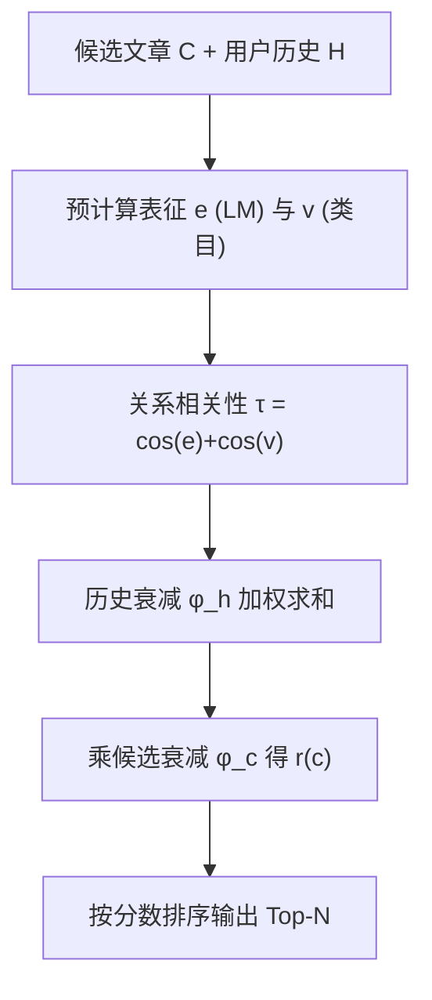

# ZoRRO: A Zero-Weight Personalized Recommender System for Scalable News Recommendation (面向可扩展新闻推荐的零权重个性化推荐系统)

- **会议/期刊**: SIGIR 2026 (49th International ACM SIGIR Conference)
- **作者与机构**: Johannes Kruse, Michael Riis Andersen, Jes Frellsen (DTU)、Ryotaro Shimizu (ZOZO Research)、Kasper Lindskow, Jon Tofteskov (JP/Politikens)、Julian McAuley (UCSD)
- **推荐链路定位**: 召回 / 粗排（候选集打分排序）
- **研究方向**: 协同过滤与双塔召回 / 冷启动与长尾推荐
- **论文原文**: [https://arxiv.org/abs/2607.10910v1](https://arxiv.org/abs/2607.10910v1)
- **开源代码**: [https://github.com/johanneskruse/zorro](https://github.com/johanneskruse/zorro)

## TL;DR (1分钟核心速览)

新闻推荐面临文章秒级更替、物品/用户双重冷启动与 DLRS 维护成本高的三重矛盾。ZoRRO 提出**零权重、免训练**框架：候选文章打分 = 候选侧时间指数衰减 × 历史文章（时间衰减 × 语义+类别余弦相似度）之和，全部参数仅两个衰减率 $\lambda_c,\lambda_h$，无需任何梯度训练。在 EB-NeRD 隐藏测试集 Full-Ranking 协议下 AUC 63.80 超越 NRMS (62.46) 等全部神经基线；线上 A/B 六天 CTR 4.19% 逼近 NRMS 4.33%，而吞吐量高 **600 倍以上**（1954 vs 2.93 req/s）。

## Background & Motivation (背景与核心矛盾)

- **主流范式**: 新闻推荐由 NRMS（多头自注意力）、LSTUR（GRU 序列+用户 embedding）、NPA（个性化注意力）等深度模型主导，依赖大规模训练与持续维护。
- **前人局限**: 其一，新闻生命周期极短，新文章无交互即需曝光，DLRS 的 item embedding 训练滞后于内容更替；其二，Ferrari Dacrema 与 Rendle 等复现研究反复指出，大量神经架构在良好调参的浅层方法面前并无实质增益，却带来 300ms+ 级延迟与千万级参数。
- **核心洞察 (Key Insight)**: 新闻消费的决策信号高度集中于两点——**时效性**（越新越可能被点）与**表征相似度**（与用户历史读过的语义/类目接近）。若把这两点写成解析式打分函数，则完全绕开训练，且新文章只需一次 embedding 前向即可上线。
- **本文切入点**: 用「内在相关性 $\phi$（时间衰减）× 关系相关性$\tau$（余弦相似度）」的乘积-求和结构替代学习式用户塔，把个性化推荐退化为一次矩阵乘法。

## Method (核心方法设计)

### 1. 整体框架 (Overall Architecture)

离线侧对每篇文章预计算两种表征：语言模型文档向量 $\boldsymbol{e}$与类目 one-hot 向量$\boldsymbol{v}$；在线侧取用户最近$M$条点击历史$H$，对候选集$C$一次性计算$\boldsymbol{\tau}(C,H)\in\mathbb{R}^{N\times M}$相似度矩阵，与历史时间衰减向量$\boldsymbol{\phi}_h(H)$相乘后再逐元素乘上候选侧衰减$\boldsymbol{\phi}_c(C)$，得到排序分数。全流程无参数学习、无反向传播，仅两个标量超参需网格搜索。

### 2. 关键设计拆解 (Key Designs)

1. **乘积-求和相关性打分（Zero-Weight Scoring）**：痛点是不训练就无法建模用户偏好 $\to$将用户兴趣隐式表达为「历史文章对候选的相似度加权投票」，候选$c$ 的分数为
$$r(c)=\phi_c(c)\sum_{h\in H}\tau(c,h)\,\phi_h(h),\quad \boldsymbol{r}(C)=\boldsymbol{\phi}_c(C)\odot\big(\boldsymbol{\tau}(C,H)\boldsymbol{\phi}_h(H)\big)$$
直觉上这是一次「以相似度为核的核密度估计」：与用户读过的文章越像、那些文章越新，候选分越高，且整批候选可向量化并行。

2. **双通道关系相关性 $\tau$**：单一语义向量会丢失编辑类目这一强先验$\to$ 将语义与类目相似度直接相加
$$\tau(c,h)=\cos(\boldsymbol{e}_c,\boldsymbol{e}_h)+\cos(\boldsymbol{v}_c,\boldsymbol{v}_h)$$
消融显示语义通道是主信号（去掉类目 AUC 仅降 0.91），类目通道提供互补增益（仅用类目则暴跌至 58.91），二者相加无需学习权重即可工作。

3. **非对称时间衰减与免训练推理**：候选与历史采用独立衰减率 $\phi_c(x)=e^{-\lambda_c t(x)}$、$\phi_h(x)=e^{-\lambda_h t(x)}$，$t$为发布至今小时数。敏感性分析发现最优为$\lambda_c=0.015,\lambda_h=0$——即**只对候选侧惩罚陈旧、对历史侧不做衰减**，说明用户长期兴趣无需遗忘，而曝光必须偏新。总损失不存在（无训练目标），推理仅需一次$N\times M$ 相似度矩阵乘，历史长度 20、维度 768 时单请求 0.51ms。

## Experimental Setup & Evaluation Protocol (实验设置与评估协议)

- **数据集与预处理**: EB-NeRD 大规模新闻推荐数据集，官方划分，无额外 5-core 过滤。

| 数据集 | #Users | #Items | #Interactions | 稀疏度/密度 | 特征/场景说明 |
| :--- | :---: | :---: | :---: | :---: | :--- |
| EB-NeRD (large) | 1,000,000 | 125,000 | 37M+ impressions | 极稀疏 | 娱乐/新闻/犯罪/体育占 78% 曝光；含类目、发布时间、正文 |

- **数据划分与防穿越 (Splitting Strategy)**: 采用官方划分；隐藏测试集实验中拼接 train+valid，保留最后 **24 小时**作早停与 checkpoint 选择，严格按时间切分避免穿越。
- **排名评测协议 (Ranking Protocol)**: 官方评测框架下的 **Full-Ranking**（对候选文章全量打分排序），报告 AUC / MRR / nDCG@5 / nDCG@10；训练阶段基线使用负采样比 $K=4$。
- **对比基线与超参设置**: 神经基线 NRMS、LSTUR、NPA，启发式基线 Popular、Publish、Random；全部基线用 Optuna TPE 在 small split 上调优 AUC，5 epoch、batch 32、Adam lr $10^{-4}$、L2$10^{-4}$、dropout 20%；ZoRRO 仅网格搜索$\lambda_c,\lambda_h$。

## Key Experimental Results (实验关键数据)

### 1. 主实验对比 (Main Results)

| Method | AUC↑ | MRR↑ | nDCG@5↑ | nDCG@10↑ |
| :--- | :---: | :---: | :---: | :---: |
| **ZoRRO** | **63.80** | **41.28** | **46.40** | **52.58** |
| NRMS | 62.46 | 40.79 | 45.56 | 52.19 |
| NPA | 61.57 | 40.46 | 45.05 | 51.79 |
| LSTUR | 59.81 | 38.27 | 42.76 | 49.91 |
| Popular | 59.70 | 37.74 | 42.36 | 49.65 |
| Publish | 51.68 | 31.61 | 34.84 | 43.19 |

ZoRRO 相对最强基线 NRMS 的 AUC 提升 **+1.34 绝对点（+2.1% 相对）**，四项指标全面领先。

### 2. 消融实验 (Ablation Study)

| 配置 | AUC↑ | MRR↑ | nDCG@5↑ | nDCG@10↑ |
| :--- | :---: | :---: | :---: | :---: |
| $\boldsymbol{e}+\boldsymbol{v}$（完整） | **63.30** | **40.49** | **45.41** | **51.74** |
| 仅语义 $\boldsymbol{e}$ | 62.39 | 40.45 | 45.08 | 51.53 |
| 仅类目 $\boldsymbol{v}$ | 58.91 | 36.52 | 41.09 | 48.17 |

| 效率对比 | 吞吐 (req/s)↑ | 延迟 (ms)↓ | 参数量 |
| :--- | :---: | :---: | :---: |
| **ZoRRO** | **1953.91** | **0.51** | **0** |
| NRMS | 2.93 | 341.44 | 323,152 |
| LSTUR | 2.25 | 445.14 | 21,047,104 |
| NPA | 2.62 | 384.61 | 20,405,304 |

### 3. 关键实验发现 (Key Findings)

1. **时效性是主信号但非全部**：纯按发布时间排序的 Publish 仅 51.68 AUC，远低于 ZoRRO 的 63.80，说明「新」必须与「像用户读过的」耦合才有效；且最优 $\lambda_h=0$ 表明历史侧不应衰减，用户长期兴趣稳定。
2. **离线排序优势不迁移到线上 CTR**：隐藏测试集 ZoRRO 领先 NRMS 1.34 AUC，但六天 A/B 中 NRMS CTR 4.33% 反超 ZoRRO 4.19%（均显著高于 Popular 2.96%）。原因是离线基准偏首页静态快照，线上候选为页面下方持续更新的 250 篇热门文章，ZoRRO 的强时效偏好在此反而收窄了 Top-5 时间跨度（9h50m vs NRMS 20h40m）。
3. **同等 CTR 下推荐分布可截然不同**：线上 ZoRRO 多样性 0.54、覆盖率 0.49，均低于 NRMS 的 0.72/0.55；类目上 ZoRRO 将 47.2% 曝光给新闻类，NRMS 仅 21.3% 而把 41.1% 给体育；正面情感文章占比 14.9% vs 21.9%。这提示新闻推荐必须引入 beyond-accuracy 指标评估编辑与规范性影响。

## Highlights & Limitations (亮点、对比与审稿批判)

- **与代表作对比 (vs. Prior Work)**: 与 NRMS/LSTUR/NPA 的本质区别在于**彻底取消用户塔与训练**，把个性化压缩为一次相似度矩阵乘；与 EASE、LightRec 等「轻量化但仍需训练/闭式求解」的路线相比，ZoRRO 连闭式解都不需要，仅两个标量超参，冷启动新文章零延迟上线。
- **可迁移亮点**: ①「候选侧衰减 + 历史侧不衰减」的非对称时间核可直接移植到短视频/快讯召回的时间加权；②把类目 one-hot 余弦与语义余弦直接相加作为免学习多通道相似度，可作为冷启动召回的强 baseline 与蒸馏教师。
- **审稿级局限批判**: ①线上实验仅 6 天、单一出版商单一站点，CTR 差异 4.19% vs 4.33% 未报告显著性检验，结论稳健性存疑；②方法本质是「最近邻+时效」的启发式，缺乏对用户长期偏好漂移与序列顺序的建模，在长历史、兴趣多峰场景下天花板明显；③beyond-accuracy 分析仅描述性统计，未给出可操作的优化目标。

## Rating (四维评分)

- **方法创新性 (Novelty)**: ⭐⭐⭐ （机制极简、理论新颖度有限，但「零权重免训练」的工程定位与双通道相似度设计在新闻场景下自洽有效）
- **评估协议与实验扎实度 (Protocol & Experiments)**: ⭐⭐⭐⭐ （离线 Full-Ranking + 六天真实线上 A/B + 效率测量 + beyond-accuracy 多维分析，唯缺线上显著性检验）
- **写作与数学规范度 (Clarity & Rigor)**: ⭐⭐⭐⭐ （公式极简清晰、向量化形式给出明确，超参敏感性与 embedding 选型分析完整，但缺少复杂度推导）
- **工业落地与复现价值 (Industrial & Practical Value)**: ⭐⭐⭐⭐⭐ （代码开源、零参数、0.51ms 延迟、600 倍吞吐，是可直接上线的强 baseline，落地价值极高）

