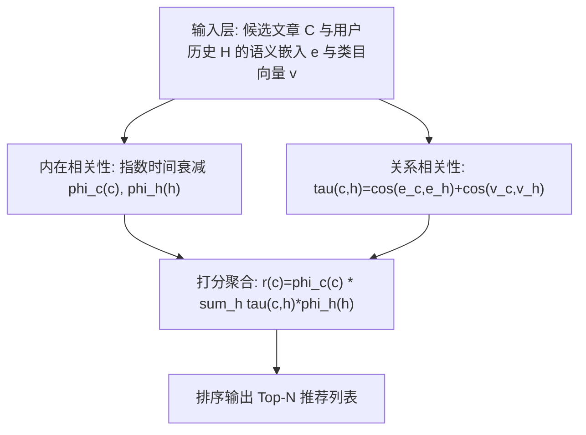
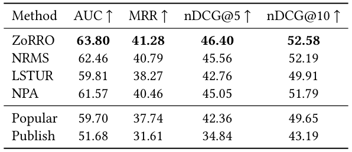
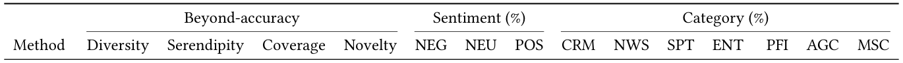
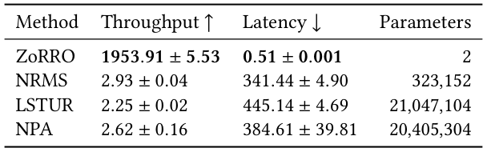
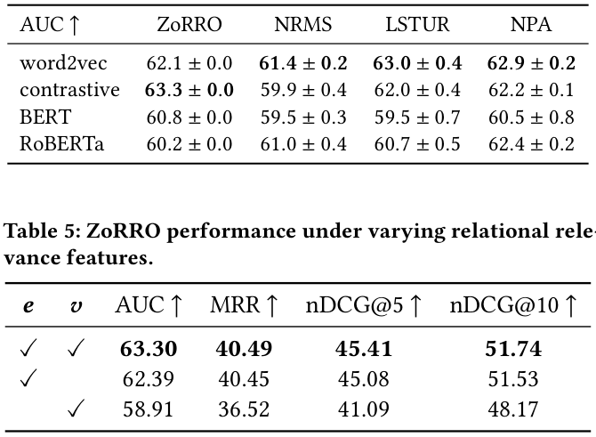
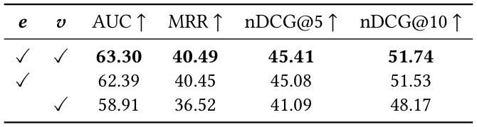
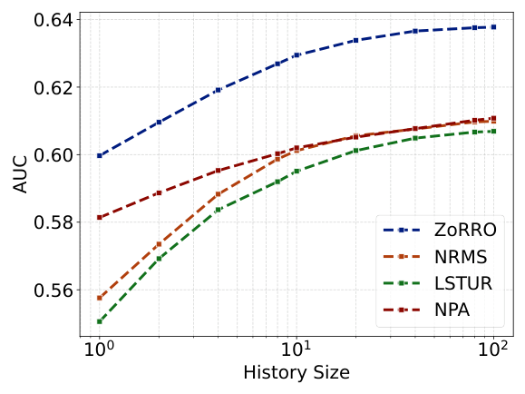

# ZoRRO: A Zero-Weight Personalized Recommender System for Scalable News Recommendation (面向可扩展新闻推荐的零权重个性化推荐系统)

- **会议/期刊**: SIGIR 2026 (第49届国际ACM SIGIR会议，墨尔本)
- **推荐链路定位**: 召回 (Retrieval) — 候选集打分排序
- **研究方向**: 协同过滤与双塔召回 / 冷启动与长尾推荐
- **论文原文**: [https://arxiv.org/abs/2607.10910v1](https://arxiv.org/abs/2607.10910v1)
- **开源代码**: [https://github.com/johanneskruse/zorro](https://github.com/johanneskruse/zorro)

## TL;DR (核心速览)

针对新闻推荐中内容快速更替、冷启动严重、深度模型部署维护成本高的痛点，本文提出 ZoRRO——一个**零权重、免训练**的打分框架：候选文章得分 = 候选侧时间衰减 × Σ(历史文章时间衰减 × 表征相似度)，相似度由文档语义嵌入余弦相似度与类目 one-hot 余弦相似度相加构成。在 EB-NeRD 隐藏测试集上 AUC 达 63.80（超 NRMS 的 62.46），推理吞吐超神经基线 600 倍以上（1954 req/s vs. ~2.9 req/s）；线上 6 天 A/B 测试 CTR 4.19% 略低于 NRMS 的 4.33%，但远超 Popular 的 2.96%。

## Background & Motivation (背景与动机)

- **领域背景与主流范式**: 新闻推荐主流采用深度学习推荐系统（DLRS），如 NRMS（多头自注意力）、LSTUR（GRU 序列建模）、NPA（个性化注意力），通过用户历史点击序列学习个性化表征。
- **现有方法局限 (Limitations of Prior Work)**:
  1. **部署与维护成本高**：DLRS 需要大量算力、专业知识和持续维护，实际生产中复杂模型难以落地与长期维持。
  2. **收益未必成立**：Ferrari Dacrema 等的大规模复现表明许多神经架构打不过调优良好的浅层方法（MF、kNN）；Rendle 等也指出 NCF 相对 MF 的额外复杂度很少带来实际收益。
  3. **新闻场景特殊性**：文章生命周期极短、内容持续涌入，物品与用户冷启动问题尤为严重，需要无需重训练即可快速适配新内容的方案。
- **核心挑战 (Key Challenge)**: 如何在**不训练任何参数**的前提下，同时兼顾时效性（recency）、内容语义相似性与类目一致性，并在延迟敏感的在线场景中高效服务？
- **核心洞察与切入点 (Key Insight)**: 作者观察到新闻消费中"新近性"与"历史兴趣相似性"是两个主导信号，且文章表征可离线预计算。因此可将推荐建模为**加权相似度检索**而非参数化学习：用指数时间衰减刻画内在相关性（intrinsic relevance），用余弦相似度刻画候选-历史的关系相关性（relational relevance），二者相乘求和即得打分，全程零可学习权重。

## Problem Formulation & Method (问题定义与方法架构)

### 1. 符号定义与输入表征 (Notations & Input Representations)

- 用户历史文章序列 $H=[h_1,\dots,h_M]$，候选文章集合 $C=[c_1,\dots,c_N]$。
- 每篇文章 $x$ 有两种表征：(1) 文档语义嵌入 $\boldsymbol{e}_x\in\mathbb{R}^d$（由语言模型生成，如 BERT/RoBERTa/word2vec/对比学习嵌入，实验主用 768 维）；(2) 类目 one-hot 向量 $\boldsymbol{v}_x$。
- 内在相关性 $\phi_c(c)\in\mathbb{R}$（候选侧）、$\phi_h(h)\in\mathbb{R}$（历史侧）；关系相关性 $\tau(c,h)\in\mathbb{R}$。
- 输出：候选文章相关性得分 $r(c)\in\mathbb{R}$，用于排序。

### 2. 整体流水线 (Overall Architecture)

数据流：离线预计算文章语义嵌入与类目向量 $\to$ 在线对候选集计算内在相关性（时间衰减）与关系相关性（余弦相似度矩阵）$\to$ 加权求和得到打分 $\to$ 排序输出 Top-N。全程无梯度更新、无参数学习。

### 3. 核心模块设计与数学原理 (Key Designs & Formulations)

**(1) 打分聚合公式（式1-2）**：对候选 $c$，
$$r(c)=\phi_c(c)\sum_{h\in H}\tau(c,h)\,\phi_h(h)$$
向量形式为 $\boldsymbol{r}(C)=\boldsymbol{\phi}_c(C)\odot(\boldsymbol{\tau}(C,H)\,\boldsymbol{\phi}_h(H))$，其中 $\boldsymbol{\tau}(C,H)\in\mathbb{R}^{N\times M}$ 为候选-历史相似度矩阵，$\odot$ 为 Hadamard 积。物理直觉：候选文章得分由"自身时效性"乘以"与用户历史中各文章的加权相似度总和"决定，本质是**核化加权最近邻检索**。

**(2) 内在相关性——指数时间衰减（式3）**：
$$\phi_c(x)=e^{-\lambda_c t(x)},\quad \phi_h(x)=e^{-\lambda_h t(x)}$$
$t(x)$ 为文章发布至今的小时数，$\lambda_c,\lambda_h$ 为衰减率。仅一个可调参数即可适配不同时间尺度，兼顾简洁与时效建模。实验最优为 $\lambda_c=0.015$、$\lambda_h=0.0$（即历史侧不做时间衰减）。

**(3) 关系相关性——双通道余弦相似度（式4）**：
$$\tau(c,h)=\cos(\boldsymbol{e}_c,\boldsymbol{e}_h)+\cos(\boldsymbol{v}_c,\boldsymbol{v}_h)$$
语义通道捕捉文本内容相似，类目通道捕捉主题一致性。作者强调该框架不绑定具体相似度函数或表征，可替换为学习式类目嵌入等。

### 4. 训练目标、负采样与推理复杂度 (Optimization, Negative Sampling & Complexity)

- **损失函数**: **无**。ZoRRO 为免训练框架，不存在损失函数与梯度更新；超参（$\lambda_c,\lambda_h$、嵌入类型）通过离线 AUC 网格/敏感性分析选取。
- **训练负采样策略**: 不适用（无训练）。基线模型训练时采用负采样比例 $K=4$（沿用 NPA 设置），5 epochs、batch size 32。
- **时间与空间复杂度**: 在线仅需一次 $N\times M$ 相似度矩阵乘法与加权求和，文章嵌入离线预计算。实测（768 维嵌入、历史长度 20）：ZoRRO 吞吐 **1953.91 req/s**、延迟 **0.51 ms/request**、参数量 **0**；NRMS 为 2.93 req/s / 341.44 ms / 323,152 参数；LSTUR 为 2.25 req/s / 445.14 ms / 21,047,104 参数；NPA 为 2.62 req/s / 384.61 ms / 20,405,304 参数。即吞吐提升 **600 倍以上**。

## Experimental Setup & Evaluation Protocol (实验设置与评估协议)

- **数据集统计与预处理**: 使用 Ekstra Bladet News Recommendation Dataset (EB-NeRD)，含超 3700 万条曝光日志、100 万用户、125,000 篇唯一文章；娱乐(ENT)、新闻(NWS)、犯罪(CRM)、体育(SPT) 四类占 78% 曝光，另有个人理财(PFI)、自动生成内容(AGC)、杂项(MSC) 等小类。

| 数据集 (Dataset) | 用户数 (#Users) | 物品数 (#Items) | 交互数 (#Interactions) | 稀疏度/密度 (Sparsity) | 模态/辅助特征说明 |
| :--- | :---: | :---: | :---: | :---: | :--- |
| EB-NeRD (large) | 1,000,000 | 125,000 | 37,000,000+ 曝光日志 | 原文未报告精确稀疏度 | 文章语义嵌入（word2vec/对比学习/BERT/RoBERTa）+ 类目 one-hot |

- **数据划分方式 (Splitting Strategy)**: 采用 EB-NeRD 官方评估框架。隐藏测试集实验中，将训练集与验证集拼接，保留**最后 24 小时**数据用于基线早停与模型检查点选择。属于**时间切分**范式，符合新闻场景防穿越要求；但需注意早停集与测试集同源拼接，存在轻微信息利用风险（作者未讨论）。
- **排名评测协议 (Ranking Protocol)**: 原文未明确说明是 Full-Ranking 还是 Sampled Ranking；基线训练使用 $K=4$ 负采样，但隐藏测试集评估协议细节原文未报告。**注：此为本论文评估透明度上的一个缺口。**
- **评价指标与显著性检验**: AUC、MRR、nDCG@5、nDCG@10；另报告超越准确率指标（多样性、惊喜度、覆盖率、新颖度、情感分布、类目分布）。嵌入维度主实验为 768；表 4 结果报告三次运行的 mean±std，但**未报告配对显著性检验**（如 $p<0.05$）。

## Key Experimental Results (核心实验结果)

### 1. 主实验对比 (Main Results)

<figure class="paper-figure" markdown="span">
  <figcaption>表 1</figcaption>
</figure>

表 1 显示 ZoRRO 在所有排名指标上最优，NRMS 为最强神经基线。ZoRRO AUC 63.80 vs. NRMS 62.46（相对提升约 +2.15%），MRR 41.28 vs. 40.79，nDCG@5 46.40 vs. 45.56，nDCG@10 52.58 vs. 52.19。纯按发布时间排序的 Publish 仅 51.68，说明单纯时效性不足，需结合相似度。

| 数据集 | 指标 | 传统/协同过滤基线 | 序列/图/多模态最强基线 | 本文方法 (Ours) | 相对提升 (Improv.) |
| :--- | :--- | :---: | :---: | :---: | :---: |
| EB-NeRD hidden test | AUC | Popular 59.70 / Publish 51.68 | NRMS 62.46 | **63.80** | +2.15% |
| EB-NeRD hidden test | MRR | Popular 37.74 | NRMS 40.79 | **41.28** | +1.20% |
| EB-NeRD hidden test | nDCG@5 | Popular 42.36 | NRMS 45.56 | **46.40** | +1.84% |
| EB-NeRD hidden test | nDCG@10 | Popular 49.65 | NRMS 52.19 | **52.58** | +0.75% |

**超越准确率（离线，表 2）**：LSTUR 多样性最高（0.74），NPA 覆盖率最高（0.65）；ZoRRO 覆盖率 0.55、新颖度 5.1（低于 NRMS 的 8.1），推荐更集中于近期新闻。

<figure class="paper-figure" markdown="span">
  <figcaption>表 2</figcaption>
</figure>

**推理效率（表 3）**：ZoRRO 吞吐 1953.91 req/s、延迟 0.51 ms、零参数，较神经基线快 600 倍以上。

<figure class="paper-figure" markdown="span">
  <figcaption>表 3</figcaption>
</figure>

**嵌入类型影响（表 4）**：ZoRRO 在对比学习嵌入下最佳（63.3±0.0），NRMS/LSTUR/NPA 在 word2vec 下最佳；域内嵌入普遍优于通用 Transformer 嵌入。

<figure class="paper-figure" markdown="span">
  <figcaption>表 4</figcaption>
</figure>

### 2. 消融实验与控制变量分析 (Ablation Study)

<figure class="paper-figure" markdown="span">
  <figcaption>表 5</figcaption>
</figure>

表 5 对关系相关性双通道做消融（同时保留 $\boldsymbol{e}$ 与 $\boldsymbol{v}$ 为完整版）：完整版 AUC 63.30；去掉类目通道 $\boldsymbol{v}$ 降至 62.39（-0.91）；仅保留类目通道降至 58.91（-4.39）。说明**语义相似度是主导信号，类目信息提供互补增益**。该消融未做参数量对齐问题（ZoRRO 本身零参数），但未报告多次运行方差。

**历史长度影响（图 1）**：历史长度从 1 增至 100，AUC 随长度上升后趋于平台，体现"更丰富历史"与"冷启动用户覆盖率"之间的权衡。LSTUR/NPA 评估时屏蔽了用户 ID 以避免用户标识偏差。

<figure class="paper-figure" markdown="span">
  <figcaption>图 1</figcaption>
</figure>

**时间衰减敏感性（图 2）**：最优 $\lambda_c=0.015$、$\lambda_h=0.0$，即候选侧时效衰减有益、历史侧时间衰减无增益。

### 3. 稀疏度/冷启动分桶与超参敏感度 (Sparsity Buckets & Hyperparameters)

- **冷启动/历史长度分桶**: 图 1 显示历史长度增加带来 AUC 提升但边际递减，短历史（冷启动）用户性能较低，作者将其作为"历史丰富度 vs. 覆盖率"权衡讨论，未做正式分桶显著性分析。
- **关键超参数敏感度**: $\lambda_c$ 在 0.001–0.04 网格上 AUC 约在 0.610–0.630 区间变化，$\lambda_c=0.015$ 附近最优；$\lambda_h=0$ 最优。
- **线上 A/B 测试结果 (Online A/B Test)**: 2024 年 11 月 12–18 日共 6 天，在 Ekstra Bladet 网站进行，流量分配 45% ZoRRO / 45% NRMS / 10% Popular，共享 250 篇近期热门文章的规则候选集。结果：NRMS CTR 4.33%（208,998 用户 / 1,586,784 曝光），ZoRRO 4.19%（207,112 用户 / 1,577,698 曝光），Popular 2.96%（45,640 用户 / 337,355 曝光）。ZoRRO 线上多样性 0.54、覆盖率 0.49，低于 NRMS 的 0.72 / 0.55；类目上 ZoRRO 将 47.2% 推荐分配给新闻类，NRMS 仅 21.3% 而体育类占 41.1%；ZoRRO 正面情感文章占比 14.9%，低于 NRMS 的 21.9%。Top-5 列表时间跨度：ZoRRO 9h50m、NRMS 20h40m、Popular 1d4h、随机采样 1d10h。

## Highlights, Limitations & Critiques (亮点、局限与审稿级批判)

- **核心亮点与可迁移性**:
  1. **极简即竞争力**：零参数、免训练、可离线预计算表征，天然适配新闻/短视频等高周转、强冷启动场景，工程落地门槛极低。
  2. **离线-线上落差的可复现证据**：ZoRRO 离线 AUC 最优但线上 CTR 略逊 NRMS，为"离线指标不能替代线上验证"提供了同一发布商、同一候选池的干净对照，具有方法论价值。
  3. **超越准确率双端分析**：离线与线上同时报告多样性/覆盖率/情感/类目分布，揭示同等 CTR 下推荐流分布可显著不同，对编辑对齐与规范性目标有直接意义。
  4. **打分公式可迁移**：$\phi_c\cdot(\tau\phi_h)$ 的核化加权最近邻形式可替换任意嵌入与相似度，易迁移至其他时效敏感推荐任务。
- **局限性与审稿视角批判 (Critical Limitations)**:
  1. **评估协议透明度不足**：隐藏测试集未明确 Full-Ranking 还是 Sampled Ranking，也未报告显著性检验；表 1 与表 4 的 AUC 数值（63.80 vs. 63.30）口径不一致（不同嵌入/设置），易引起混淆。
  2. **早停数据潜在泄露**：训练+验证拼接后取最后 24 小时做早停，与测试时段邻近，存在轻微时间信息利用风险，作者未讨论。
  3. **线上未胜出**：核心卖点是效率而非效果，线上 CTR 仍低于 NRMS（4.19% vs. 4.33%），且未报告 CTR 差异的置信区间或显著性，$\sigma^2$ 仅给出方差量级。
  4. **推荐分布集中化风险**：ZoRRO 线上多样性/覆盖率更低、新闻类占比高达 47.2%，可能加剧信息茧房与编辑目标偏离，作者虽指出但未给出缓解方案。
  5. **单数据集单场景**：仅 EB-NeRD 一个数据集、单一发布商线上验证，泛化性证据有限；类目 one-hot 相似度对细粒度类目体系敏感，未做类目粒度消融。

## Rating (四维评分)

- **方法创新性 (Novelty)**: ⭐⭐⭐（思路朴素但组合巧妙，零权重免训练在 DLRS 主流下具反潮流价值）
- **评估协议与实验扎实度 (Protocol & Experiments)**: ⭐⭐⭐（有真实线上 A/B 与超越准确率分析，但评估协议细节与显著性检验缺失）
- **写作与数学规范度 (Clarity & Rigor)**: ⭐⭐⭐⭐（公式简洁清晰、符号一致，6 页短文信息密度高）
- **工业落地与复现价值 (Industrial & Practical Value)**: ⭐⭐⭐⭐⭐（零参数、600 倍加速、代码开源、真实生产验证，落地价值极高）
