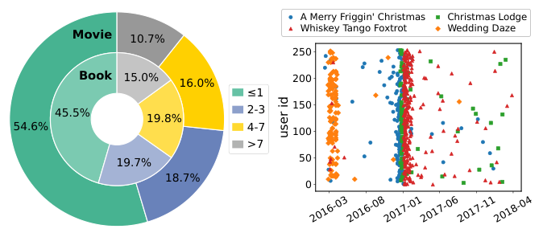
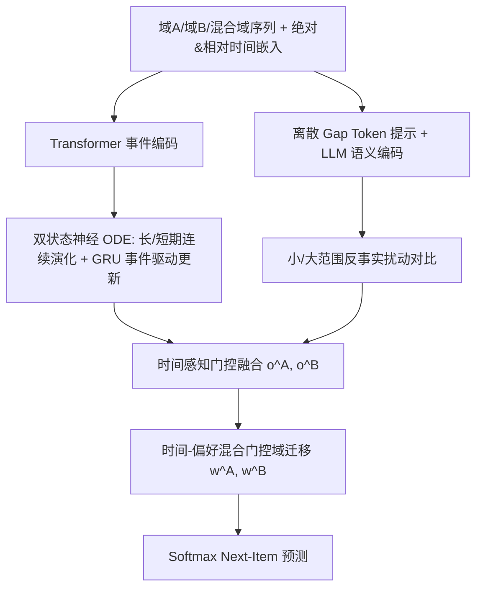
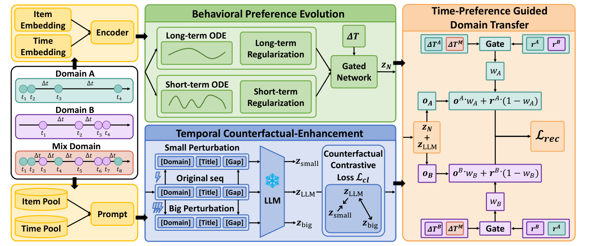

# Bridging Behavior and Semantics for Time-aware Cross-Domain Sequential Recommendation (桥接行为与语义的时间感知跨域序列推荐)

- **会议/期刊**: SIGIR 2026
- **作者与机构**: Zhida Qin, Zemu Liu, Haoyan Fu, Tianyu Huang, Gangyi Ding (北京理工大学)；Chong Zhang (西安交通大学)；Yidong Li (北京交通大学)
- **推荐链路定位**: 精排（跨域序列 Next-Item 预测）
- **研究方向**: 跨域与多场景推荐 / 序列与会话推荐
- **论文原文**: [https://arxiv.org/abs/2605.02369v1](https://arxiv.org/abs/2605.02369v1)
- **开源代码**: 暂未开源

## TL;DR (1分钟核心速览)

现有 CDSR 方法把跨域序列当作等间隔时间轴处理，且把 LLM 语义偏好视为时间不变特征，导致同一时间间隔在不同域引发不同偏好漂移、情境性语义被误当作稳定兴趣而引发负迁移。本文提出 BST-CDSR：用双状态神经 ODE 在连续时间上演化长短期行为偏好，用离散时间 gap token + 反事实扰动让 LLM 生成时间敏感语义，再用时间-偏好混合门控自适应控制域迁移强度。在 Food-Kitchen / Movie-Book / Art-Office 三组数据集、1:999 采样排序协议下，MRR 相对最强基线 LLM-EDT 提升 15.9%–30.5%。

## Background & Motivation (背景与核心矛盾)

- **主流范式**: CDSR 以完全重叠用户为桥梁，用对比学习（C2DSR）、外部注意力（EA-GCL）、多粒度兴趣（Tri-CDR）或 LLM 语义增强（LLM4CDSR、LLM-EDT）对齐跨域序列表征。
- **前人局限一**: 所有方法默认跨域时间间隔"等距"，忽略域特异交互频率与兴趣衰减率。图 1(a) 显示 Movie 域单日交互占比 54.6%，Book 域仅 45.5%，且 Book 域 >7 天长间隔占比高出 5%——同一周间隔在 Movie 域可能已数次兴趣漂移，在 Book 域却几乎无变化。
- **前人局限二**: 语义被建模为静态实体。图 1(b) 中圣诞主题电影、婚礼题材、战争片均呈明显时间聚类峰值，说明部分交互由情境驱动而非稳定偏好；把这类语义跨域迁移即是负迁移的直接来源。
- **核心洞察 (Key Insight)**: 时间不只是排序信号，而是携带域特异漂移速率与语义时效性的双重信息；行为侧需连续时间演化，语义侧需时间敏感性约束。
- **本文切入点**: 在行为建模、语义建模、域迁移三个阶段同时注入时间因素，形成"行为 ODE + 反事实语义 + 门控迁移"的闭环。

<figure class="paper-figure" markdown="span">
  <figcaption>图1：行为与语义的数据分析。(a) 行为视角：不同领域中交互时间间隔的分布；(b) 语义视角：具有强时间相关性的代表性电影条目的交互时间线。</figcaption>
</figure>

## Method (核心方法设计)

### 1. 整体框架 (Overall Architecture)

对域 A、域 B 及按时间合并的混合域 M 三条序列，先做物品嵌入与绝对/相对时间嵌入（相对间隔经 $pos_i=\lfloor a\log(\Delta_i+2)\rfloor$离散化查表）。行为分支用 Transformer 编码事件级表征后送入双状态神经 ODE，输出长短期融合偏好$\boldsymbol{z}_N$；语义分支把 `[Domain][Title][Gap]` 序列喂入 LLM 取末位隐状态，经 PCA+Adapter 降维得$\boldsymbol{z}_{\text{LLM}}$，并以小/大范围 gap 扰动构造反事实对比。两分支求和得$\boldsymbol{o}^A,\boldsymbol{o}^B$，再与混合域偏好表征$\boldsymbol{r}^A,\boldsymbol{r}^B$按门控权重$w^A,w^B$ 加权，softmax 输出下一物品分布。

<figure class="paper-figure" markdown="span">
  <figcaption>图2：所提方法的整体架构。该模型由三个关键组件构成：(i) 时间感知的行为偏好演化模块（绿色），(ii) 时间反事实增强的语义偏好生成器（蓝色），以及 (iii) 用于最终推荐的时间偏好引导的自适应域迁移（橙色）。</figcaption>
</figure>

### 2. 关键设计拆解 (Key Designs)

1. **双状态神经 ODE 行为偏好演化**：离散序列编码器只在交互点更新，无法刻画交互间的渐变漂移与长间隔累积效应。本文将偏好拆为长期 $\boldsymbol{h}^L$与短期$\boldsymbol{h}^S$，交互间用一阶 Euler 近似求解$\frac{d\boldsymbol{h}^L_t}{dt}=f_L(\boldsymbol{h}^L_t,\tilde{\Delta}_t)$，即$\boldsymbol{h}^{L\prime}_t=\boldsymbol{h}^L_t+\tilde{\Delta}_t\cdot f_L(\boldsymbol{h}^L_t,\tilde{\Delta}_t)$；交互发生时再以$\boldsymbol{h}^L_{t+1}=\text{GRU}(\boldsymbol{e}_{t+1},\boldsymbol{h}^{L\prime}_t)$做事件驱动跳变。直觉是"平滑漂移 + 脉冲更新"两段式动力学恰好对应真实兴趣的渐变与突变。融合门控$\boldsymbol{g}_{t+1}=\sigma(\boldsymbol{W}[\boldsymbol{h}^L_{t+1},\boldsymbol{h}^S_{t+1},\tilde{\Delta}_t])$ 显式以归一化间隔为条件，使长间隔自动偏向长期状态。

2. **时间反事实增强的语义生成器**：LLM 对绝对数值时间推理能力弱，且无约束时要么忽略时间、要么对噪声时间过度敏感。本文将间隔映射为离散 token `[Gap]`，并构造同组小扰动 $\boldsymbol{x}_{\text{small}}$与跨组大扰动$\boldsymbol{x}_{\text{big}}$，用排序式反事实目标约束：$\mathcal{L}_1=-\log\sigma\big((\text{sim}(\boldsymbol{z}_{\text{LLM}},\boldsymbol{z}_{\text{small}})-\text{sim}(\boldsymbol{z}_{\text{LLM}},\boldsymbol{z}_{\text{big}}))/\tau\big)$，$\mathcal{L}_2$进一步要求$\boldsymbol{z}_{\text{big}}$与 batch 内 top-$K$ 负样本可分。物理直觉：语义表征应对微小时间抖动鲁棒、对真实时间模式切换敏感，从而剥离"情境语义"与"稳定偏好"。

3. **时间-偏好引导的域迁移与训练目标**：用户跨域切换模式高度异质，固定迁移强度必然负迁移。本文用域感知间隔序列 $\Delta T^M=\{(\text{dom}_i,\Delta^M_{t_i})\}$经注意力得时间因子$\boldsymbol{u}$，用混合域偏好池化得相关性因子$\boldsymbol{r}$，门控输出$w^A=\sigma(f_{\text{gate}}([\boldsymbol{W}^A_t[\boldsymbol{u}^A_t,\boldsymbol{u}^M_t],\boldsymbol{W}^A_r[\boldsymbol{r}^A,\boldsymbol{r}^B]]))$。总损失$\mathcal{L}=\mathcal{L}_{\text{main}}+\lambda_1\mathcal{L}_{\text{ODE}}+\lambda_2\mathcal{L}_{\text{sem}}$，其中$\mathcal{L}_{\text{ODE}}$含长期平滑正则$\sum_t(1-\tilde{\Delta}_t)\|\boldsymbol{h}^L_t-\boldsymbol{h}^L_{t-1}\|_2^2$与短期对比对齐$\mathcal{L}_S$；主损失为逐域交叉熵，负采样为全库 softmax（训练时即全物品归一化），推理无额外负采样开销，但需一次 LLM 前向（离线可缓存）。

## Experimental Setup & Evaluation Protocol (实验设置与评估协议)

- **数据集与预处理**: 沿用 C2DSR 的域配对与过滤协议，三组双域数据集：

| 数据集 | 域 | #Items | #Train | #Valid | #Test | 平均长度 | 稀疏度 |
| :--- | :--- | :---: | :---: | :---: | :---: | :---: | :---: |
| Food-Kitchen | Food | 29,207 | 34,117 | 8,173 | 8,406 | 6.2 | 99.94% |
| | Kitchen | 34,886 | — | — | — | 6.0 | 99.95% |
| Movie-Book | Movie | 36,845 | 58,515 | 7,644 | 7,708 | 6.4 | 99.92% |
| | Book | 63,937 | — | — | — | 5.6 | 99.96% |
| Art-Office | Art | 47,365 | 37,654 | 6,251 | 6,199 | 5.6 | 99.97% |
| | Office | 47,868 | — | — | — | 5.8 | 99.96% |

- **数据划分与防穿越**: 按 8:1:1 比例划分训练/验证/测试，序列按时间戳排序，预测各域下一物品。
- **排名评测协议**: `Sampled Ranking`，每个测试正样本配 999 个随机负样本（1:999），指标 MRR、N@5/10、H@1/5/10。
- **对比基线与超参**: 基线含单域（SASRec、TiSASRec、CL4SRec、IOCRec）、CDSR（C2DSR、EA-GCL、Tri-CDR、ABXI）、LLM-based CDSR（LLMCDSR、LLM4CDSR、LLM-EDT，均用 Llama2-7B）。嵌入维度与 batch size 均为 256，学习率 5e-4（Adam），$\lambda_1=0.01$、$\lambda_2=0.001$，单卡 RTX 3090。

## Key Experimental Results (实验关键数据)

### 1. 主实验对比 (Main Results)

| 数据集/域 | 指标 | SASRec | C2DSR | Tri-CDR | LLM4CDSR | LLM-EDT | **BST-CDSR** | Improv. |
| :--- | :--- | :---: | :---: | :---: | :---: | :---: | :---: | :---: |
| Food | MRR | 0.0917 | 0.1246 | 0.1195 | 0.1410 | 0.1493 | **0.1949** | +30.54% |
| Food | H@10 | 0.1800 | 0.1843 | 0.2087 | 0.2176 | 0.2213 | **0.2547** | +15.09% |
| Kitchen | MRR | 0.0588 | 0.0830 | 0.0713 | 0.1019 | 0.1047 | **0.1213** | +15.85% |
| Kitchen | H@10 | 0.1210 | 0.1276 | 0.1367 | 0.1415 | 0.1428 | **0.1585** | +10.99% |
| Movie | MRR | 0.0673 | 0.0719 | 0.0712 | 0.1053 | 0.1095 | **0.1383** | +26.30% |
| Movie | H@1 | 0.0333 | 0.0490 | 0.0272 | 0.0759 | 0.0820 | **0.1116** | +36.10% |
| Book | MRR | 0.0457 | 0.0673 | 0.0617 | 0.0869 | 0.0917 | **0.1123** | +22.46% |
| Art | MRR | 0.1168 | 0.1504 | 0.1434 | 0.1923 | 0.2010 | **0.2475** | +23.13% |
| Office | MRR | 0.1053 | 0.1372 | 0.1355 | 0.1729 | 0.1805 | **0.2170** | +20.22% |
| Office | H@10 | 0.2112 | 0.2012 | 0.2211 | 0.2521 | 0.2629 | **0.2905** | +10.50% |

### 2. 消融实验 (Ablation Study)

| 变体 | Food MRR | Food N@10 | Movie MRR | Movie H@10 | Book MRR |
| :--- | :---: | :---: | :---: | :---: | :---: |
| Single-ODE | 0.1687 | 0.1731 | 0.1236 | 0.1532 | 0.0950 |
| Dual LS-ODE | 0.1712 | 0.1753 | 0.1271 | 0.1562 | 0.0964 |
| +Semantic | 0.1887 | 0.1959 | 0.1329 | 0.1814 | 0.1091 |
| +CF-Enhance | 0.1890 | 0.1965 | 0.1374 | 0.1876 | 0.1100 |
| Exact-time | 0.1935 | 0.2015 | 0.1368 | 0.1832 | 0.1095 |
| **BST-CDSR** | **0.1949** | **0.2028** | **0.1383** | **0.1928** | **0.1123** |

### 3. 关键实验发现 (Key Findings)

1. **语义分支是最大增益源，但必须配反事实约束**：从 Dual LS-ODE 到 +Semantic，Food MRR 从 0.1712 跳到 0.1887（+10.2%），远超 ODE 解耦本身的 +1.5%；而纯语义分支实验中 Title+Time 在 Kitchen/Book 上反而低于 Title-only（0.1040 vs 0.1053），只有叠加 +CF-Enhance 才在所有域一致提升（Movie MRR 0.0925→0.1041），证明无约束的时间 token 会引入噪声。
2. **离散 gap token 优于精确时间戳**：Exact-time 变体在 Movie（0.1368 vs 0.1383）、Book（0.1095 vs 0.1123）、Food（0.1935 vs 0.1949）全面落后，定量印证 LLM 对绝对数值时间推理能力不足，离散化是更 LLM-friendly 的时间注入方式。
3. **时间越不规则，ODE 优势越大**：在 Food-Kitchen 按间隔方差分桶后，Bucket 2（最不规则）上 BST-CDSR 相对最优基线的 NDCG@10 提升达 59.9%（域 A）与 40.9%（域 B），显著高于 Bucket 0 的 46.8%/36.1%；同时 Bucket 1 绝对性能最高，因其序列最长且时间结构相对连贯。此外注入 20% 噪声后 Food MRR 仍为 0.1754，高于无噪声的 LLM-EDT（0.1493），负迁移抑制有效。

## Highlights & Limitations (亮点、对比与审稿批判)

- **与代表作对比 (vs. Prior Work)**: C2DSR 用对比学习对齐跨域表征但完全无视时间间隔；LLM4CDSR 抽取统一语义嵌入却把语义当静态特征；LLM-EDT 做域感知画像增强但迁移强度固定。本文是首个在行为演化、语义生成、域迁移三阶段统一注入时间因素的 CDSR 框架，且用反事实目标显式区分情境语义与稳定偏好。
- **可迁移亮点**: (1) "小扰动应鲁棒、大扰动应可分"的排序式反事实目标可直接迁移到任何用 LLM 编码结构化元信息（价格、地理位置、时间）的推荐场景；(2) 以归一化间隔 $\tilde{\Delta}_t$ 作为门控条件输入的时间感知融合，可低成本替换现有序列模型中的固定位置编码。
- **审稿级局限批判**: (1) 语义分支依赖 Llama2-7B 前向，虽可离线缓存，但序列级 prompt 随长度线性增长，工业级万级候选场景的推理与存储开销未做量化；(2) 评估仅用 1:999 采样排序，未报告 Full-Ranking 结果，且三组数据集均为双域配对设定，多域（≥3）与冷启动用户场景下的域迁移门控有效性缺乏验证。

## Rating (四维评分)

- **方法创新性 (Novelty)**: ⭐⭐⭐⭐ （双状态 ODE + 反事实时间语义 + 门控迁移的三段式时间注入组合新颖，但各单点均有前人影子，属系统性整合创新）
- **评估协议与实验扎实度 (Protocol & Experiments)**: ⭐⭐⭐⭐ （三数据集六域、11 个基线、消融/分桶/噪声/可视化五类分析齐全，但仅采样排序、缺 Full-Ranking 与显著性检验）
- **写作与数学规范度 (Clarity & Rigor)**: ⭐⭐⭐⭐ （ODE 离散化与反事实损失公式清晰，Euler 近似误差与 LLM 分支复杂度未展开分析）
- **工业落地与复现价值 (Industrial & Practical Value)**: ⭐⭐⭐ （ODE 与门控模块轻量易部署，但 LLM 语义分支的离线成本与未开源削弱了直接复现价值）
