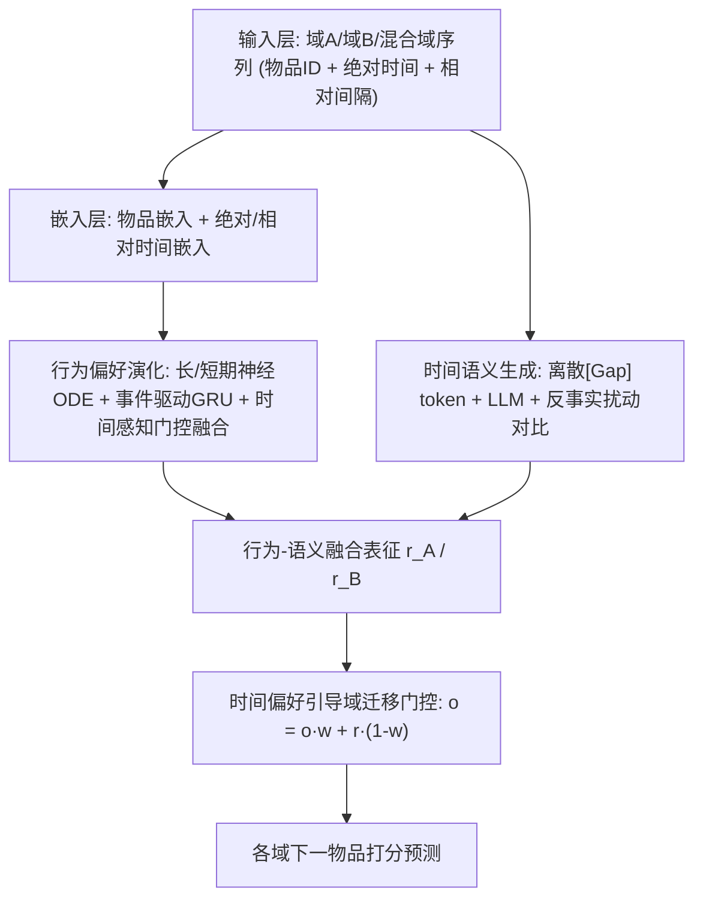
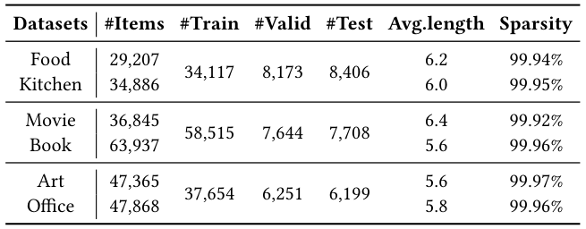
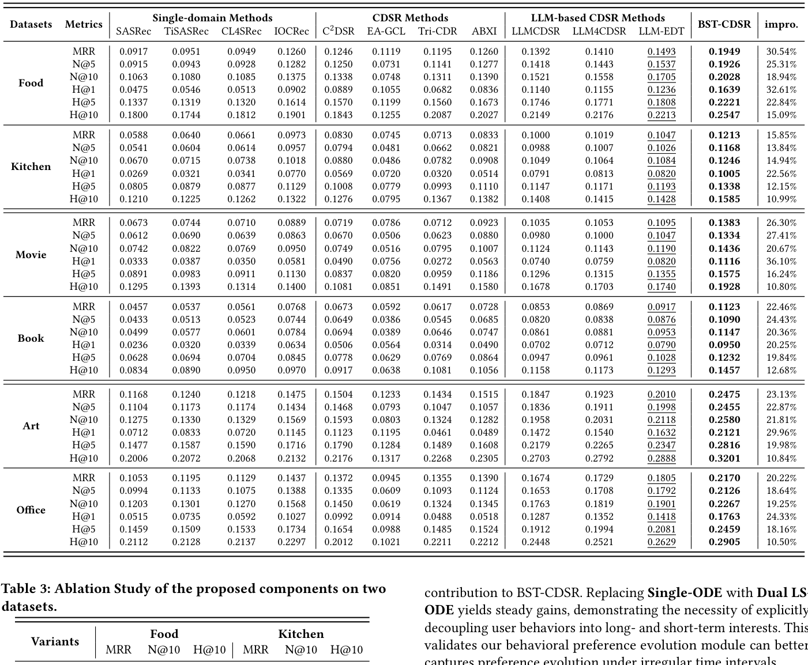
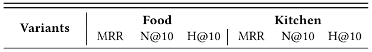
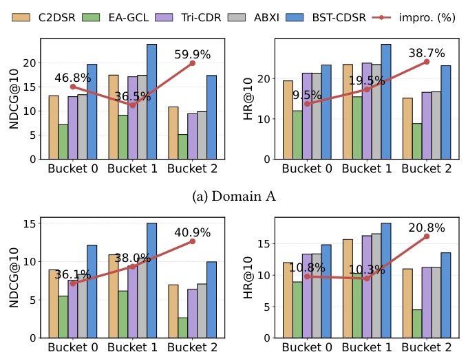

# Bridging Behavior and Semantics for Time-aware Cross-Domain Sequential Recommendation (桥接行为与语义的时间感知跨域序列推荐)

- **会议/期刊**: SIGIR 2026 (第49届国际ACM SIGIR会议，Melbourne, VIC, Australia)
- **推荐链路定位**: 召回 (Retrieval) — 跨域序列下一物品预测 (Next-Item Prediction)
- **研究方向**: 跨域与多场景推荐 (主) / 序列与会话推荐 (次)
- **论文原文**: [https://arxiv.org/abs/2605.02369v1](https://arxiv.org/abs/2605.02369v1)
- **开源代码**: 暂未开源（原文与预提取均未发现开源代码链接）

## TL;DR (核心速览)

针对跨域序列推荐 (CDSR) 中"同一时间间隔在不同域对应不同偏好漂移程度"与"语义偏好被当作时不变静态特征"两大痛点，本文提出 BST-CDSR：用神经 ODE + 事件驱动 GRU 解耦长短期行为偏好并做连续时间演化，用 LLM 对离散化时间间隔 token 建模时间感知语义并施加反事实扰动增强时间敏感性，最后用时间偏好引导的门控自适应控制跨域迁移权重以抑制负迁移。在三个真实数据集上，模型在 HR@10/NDCG@10 等指标上一致优于强基线（具体数值见原文表 2）。

## Background & Motivation (背景与动机)

- **领域背景与主流范式**: 跨域序列推荐 (CDSR) 通过联合建模用户在多个域（如 Movie / Book / Food）上的行为序列来缓解交互稀疏。主流范式分两支：(1) 纯 ID 行为路线，依赖全重叠用户、显式对齐跨域行为相关性（如跨域序列迁移模型）；(2) 近期 LLM 语义注入路线，如 LLM4CDSR 用 LLM 学习统一跨域语义表征、URLLM 用 LLM 抽取物品属性语义构建物品-属性图。
- **现有方法局限 (Limitations of Prior Work)**:
  1. **忽略域相关的交互频率与兴趣衰减速率**：同一时间间隔（如一周）在电影域可能已发生多次兴趣漂移，在图书域却可能兴趣稳定。原文图 1(a) 显示电影域单日交互占比约 54.6%，图书域约 45.5%，长间隔 (>7天) 占比分别为 10.7% 与 15.0%，说明域间时间模式显著异质。
  2. **将语义偏好视为时不变静态特征**：部分语义交互源于情境需求（如圣诞节看圣诞电影），节日过后兴趣即消失；把"情境语义"误当"稳定偏好"并在跨域迁移中传播，会直接导致负迁移。
  3. **离散序列编码器只在交互点更新**：交互之间的偏好连续演化与长间隔的累积影响无法被捕捉。
- **核心挑战 (Key Challenge)**: 跨域时间错位下如何准确建模偏好演化？如何建模时间依赖语义以防止负迁移？简单特征拼接或加深网络无法解决，因为混合域序列会模糊域特有的时间信号，且 LLM 对绝对数值时间推理能力有限（原文引用 [14,17]）。
- **核心洞察与切入点 (Key Insight)**: 原文第 2 节数据洞察——(i) 交互间隔高度非均匀且域相关（图 1(a)）；(ii) 物品语义与交互时间强相关，代表性电影（如 A Merry Friggin' Christmas、Christmas Lodge、Whiskey Tango Foxtrot）的交互频率呈现与语义一致的明显时间聚集（图 1(b)）。由此得出：时间携带排序之外的丰富信息，必须把域相关交互间隔与语义-时间相关性显式注入模型。

<figure class="paper-figure" markdown="span">
  <figcaption>图 1</figcaption>
</figure>

## Problem Formulation & Method (问题定义与方法架构)

### 1. 符号定义与输入表征 (Notations & Input Representations)

- 双域场景：域 $A$ 与域 $B$，物品集 $I^A$、$I^B$，共享时间空间 $T$。
- 用户 $u$ 的交互记为物品-时间对 $(i,t)$，两域序列：
  - $S^A=\{(i^A_k,t^A_k)\}_{k=1}^{n}$，$S^B=\{(i^B_k,t^B_k)\}_{k=1}^{m}$
- 按时间合并构造统一跨域序列 $S^M$。
- 任务：预测各域下一物品 $i^A_{n+1}$、$i^B_{m+1}$。
- 嵌入维度统一为 $d$；序列短于长度 $N$ 时零向量填充。
- 物品嵌入表：域专属 $M^A\in\mathbb{R}^{|I^A|\times d}$、$M^B\in\mathbb{R}^{|I^B|\times d}$，域共享 $M^M\in\mathbb{R}^{(|I^A|+|I^B|)\times d}$。
- 时间编码：绝对时间查表 $M^{at}\in\mathbb{R}^{|T|\times d}$；相对时间间隔 $\Delta_i=t_i-t_{i-1}$（$\Delta_1=-1$ 标记序列起点），对数离散化 $pos_i=\lfloor a\log(\Delta_i+2)\rfloor$ 后查表 $M^{rt}\in\mathbb{R}^{|P|\times d}$。

### 2. 整体流水线 (Overall Architecture)

数据流：域 A / 域 B / 混合域三条序列分别经嵌入层 → 行为偏好演化模块（长短期 ODE + 门控融合）→ 与 LLM 时间语义表征融合 → 时间偏好引导的域迁移门控 → 输出各域推荐打分。

<figure class="paper-figure" markdown="span">
  <figcaption>图 2</figcaption>
</figure>

### 3. 核心模块设计与数学原理 (Key Designs & Formulations)

**(1) 行为偏好演化模块（长短期解耦 + 连续时间 ODE）**

- 先用 Transformer 层得到物品级瞬时偏好 $E=\mathrm{Att}(\mathrm{Emb}(S))$，$\bm{e}_t\in E$ 为第 $t$ 次交互的离散瞬时偏好。
- **长期偏好**：交互之间按神经 ODE 平滑演化，归一化间隔 $\tilde{\Delta}_t=\log_2(\Delta_t+2)/\log_2(\Delta_{max}+2)$：
  $$\frac{d\bm{h}^L_t}{dt}=f_L(\bm{h}^L_t,\tilde{\Delta}_t)$$
  实践中用一阶 Euler 近似：$\bm{h}^L_{t'}=\bm{h}^L_t+\tilde{\Delta}_t\cdot f_L(\bm{h}^L_t,\tilde{\Delta}_t)$；观测到交互 $i_{t+1}$ 后做事件驱动更新：$\bm{h}^L_{t+1}=\mathrm{GRU}(\bm{e}_{t+1},\bm{h}^L_{t'})$。
- **短期偏好**：同构但参数独立，捕捉快速变化的瞬时意图。
- **时间感知门控融合**：
  $$\bm{g}_{t+1}=\sigma(W[\bm{h}^L_{t+1},\bm{h}^S_{t+1},\tilde{\Delta}_t]),\quad \bm{z}_{t+1}=\bm{g}_{t+1}\odot\bm{h}^S_{t+1}+(1-\bm{g}_{t+1})\odot\bm{h}^L_{t+1}$$
  物理直觉：门控输入含归一化间隔，使模型能按时间间隔长短动态调节长短期依赖权重。取最后一步 $\bm{z}_N$ 作为域 A/B 的行为偏好。

**(2) 时间反事实增强语义偏好生成器**

- **离散时间提示构造**：LLM 对连续数值时间推理能力弱，故将 $\Delta_i$ 映射为离散 token $[\mathrm{Gap}]_j=\phi(\Delta_i)\in V_{gap}$，并在每条交互文本前加域 token（$[\mathrm{A\_Domain}]$/$[\mathrm{B\_Domain}]$），使 LLM 能识别域切换。提示模板为 "You will act as a time-aware preference interpreter..."。
- **语义抽取与降维**：$\bm{Z}_{LLM}=\mathrm{LLM}(x)\in\mathbb{R}^{L\times D_{LLM}}$，取最后有效 token 隐状态，经 PCA 降维 $f_{PCA}:\mathbb{R}^{D_{LLM}}\to\mathbb{R}^{D_{Mid}}$ 再经适配层 $f_{Adapt}:\mathbb{R}^{D_{Mid}}\to\mathbb{R}^{d}$ 得 $\bm{z}_{LLM}$（沿用 LLMEmb 思路）。
- **反事实时间敏感性增强**：在保留交互语义的前提下扰动时间模式，构造原始序列 $\bm{z}_{LLM}$、小扰动 $\bm{z}_{small}$、大扰动 $\bm{z}_{big}$ 三视图，用反事实对比损失 $\mathcal{L}_{cf}$ 迫使语义表征对时间偏移敏感（原文该小节在提取文本中被截断，具体扰动幅度与对比形式以原文 4.3.2 节为准）。

**(3) 时间偏好引导的域迁移模块**

- 对每个域，用时间模式 $\Delta T$ 与偏好相关性经门控产生迁移权重 $w_A$、$w_B$，最终表征为源域表征与目标域表征的凸组合：
  $$\bm{o}_A=\bm{o}_A\cdot w_A+\bm{r}_A\cdot(1-w_A),\quad \bm{o}_B=\bm{o}_B\cdot w_B+\bm{r}_B\cdot(1-w_B)$$
  其中 $\bm{r}_A,\bm{r}_B$ 为行为-语义融合表征。物理直觉：当源域语义是情境性、时间上不可迁移时，门控自动压低迁移权重，从而缓解负迁移。

### 4. 训练目标、负采样与推理复杂度 (Optimization, Negative Sampling & Complexity)

- **损失函数**：总损失由推荐主损失 $\mathcal{L}_{rec}$、反事实对比损失 $\mathcal{L}_{cf}$、长期平滑正则 $\mathcal{L}_L$、短期对比对齐正则 $\mathcal{L}_S$ 组成（原文未在提取文本中给出总损失显式加权公式，权重系数以原文为准）：
  - 长期正则（短间隔强约束、长间隔弱约束）：
    $$\mathcal{L}_L=\sum_{t=2}^{N}(1-\tilde{\Delta}_t)\|\bm{h}^L_t-\bm{h}^L_{t-1}\|_2^2$$
  - 短期对比对齐（$\bm{h}^S_t$ 与自身 $\bm{e}_t$ 拉近、与同 batch 其他交互推远，温度 $\tau$）：
    $$\mathcal{L}_S=-\sum_t\log\frac{\exp(\mathrm{sim}(\bm{h}^S_t,\bm{e}_t)/\tau)}{\sum_j\exp(\mathrm{sim}(\bm{h}^S_t,\bm{e}_j)/\tau)}$$
- **训练负采样策略**：$\mathcal{L}_S$ 采用 in-batch 负样本（同 batch 其他交互）；推荐主损失 $\mathcal{L}_{rec}$ 的具体负采样形式原文提取文本未完整给出，需以原文为准。
- **时间与空间复杂度**：ODE 用一阶 Euler 单步近似，避免昂贵数值积分求解器；LLM 语义表征为离线预抽取（PCA + 适配层降维），在线仅做查表与轻量门控融合；原文未报告具体训练单 epoch 耗时、推理延迟 (ms/request) 与峰值显存。

## Experimental Setup & Evaluation Protocol (实验设置与评估协议)

- **数据集统计与预处理**: 原文使用三个真实数据集（Movie-Book 及 Food-Kitchen 等，表 1 给出统计量）。提取文本中表 1 的具体数值未完整呈现，以下仅列出原文明确提及的信息，其余以原文表 1 为准：

| 数据集 (Dataset) | 用户数 (#Users) | 物品数 (#Items) | 交互数 (#Interactions) | 稀疏度/密度 (Sparsity) | 模态/辅助特征说明 |
| :--- | :---: | :---: | :---: | :---: | :--- |
| Movie-Book | 原文表 1（提取文本未给出具体数值） | - | - | - | 物品标题文本 (LLM 语义输入) |
| Food-Kitchen | 原文表 1（提取文本未给出具体数值） | - | - | - | 物品标题文本 (LLM 语义输入) |
| 第三个数据集 | 原文表 1（提取文本未给出具体数值） | - | - | - | - |

<figure class="paper-figure" markdown="span">
  <figcaption>表 1</figcaption>
</figure>

- **数据划分方式 (Splitting Strategy)**: 原文提取文本未明确说明划分策略（LOO / Ratio / 全局时间戳切分），需以原文实验设置章节为准；鉴于任务为带时间戳的下一物品预测，存在按时间顺序切分的可能性，但**原文未报告**，此处不做臆断。
- **排名评测协议 (Ranking Protocol)**: 原文提取文本未明确标注 Full-Ranking 还是 Sampled Ranking，需以原文为准。
- **评价指标与显著性检验**: 原文表 2 报告 HR@10、NDCG@10 等指标（具体指标集合以原文表 2 为准）；是否进行配对显著性检验**原文未报告**。

## Key Experimental Results (核心实验结果)

### 1. 主实验对比 (Main Results)

原文表 2 报告 BST-CDSR 与全部基线在三个数据集上的性能，摘要与结论均声明"consistently outperforms baselines"。由于提取文本未包含表 2 的具体数值，此处不臆造数字，具体数值请查阅原文表 2：

| 数据集 | 指标 | 传统/协同过滤基线 | 序列/图/多模态最强基线 | 本文方法 (Ours) | 相对提升 (Improv.) |
| :--- | :--- | :---: | :---: | :---: | :---: |
| Movie-Book | HR@10 / NDCG@10 | 原文表 2 | 原文表 2 | **原文表 2** | 原文表 2 |
| Food-Kitchen | HR@10 / NDCG@10 | 原文表 2 | 原文表 2 | **原文表 2** | 原文表 2 |
| 第三数据集 | HR@10 / NDCG@10 | 原文表 2 | 原文表 2 | **原文表 2** | 原文表 2 |

<figure class="paper-figure" markdown="span">
  <figcaption>表 2</figcaption>
</figure>

### 2. 消融实验与控制变量分析 (Ablation Study)

原文表 3 在两个数据集上对核心组件做消融（行为偏好演化、时间反事实语义生成、时间偏好引导域迁移等），验证各模块贡献。提取文本未给出具体下降幅度数值，需以原文表 3 为准；消融是否严格控制参数量对齐**原文未报告**。

<figure class="paper-figure" markdown="span">
  <figcaption>表 3</figcaption>
</figure>

### 3. 稀疏度/冷启动分桶与超参敏感度 (Sparsity Buckets & Hyperparameters)

- **时间分布分桶表现**: 原文图 3 在 Food-Kitchen 数据集上按不同时间分布与基线做性能对比，用于验证模型在异质时间间隔下的鲁棒性（具体分桶数值以原文图 3 为准）。
- **关键超参数敏感度**: 温度系数 $\tau$、ODE 归一化参数 $a$、损失权重等敏感度分析**原文提取文本未报告**，需以原文为准。
- **线上 A/B 测试结果**: 原文仅包含离线实验，**未报告**线上 A/B 测试。

<figure class="paper-figure" markdown="span">
  <figcaption>图 3</figcaption>
</figure>

## Highlights, Limitations & Critiques (亮点、局限与审稿级批判)

- **核心亮点与可迁移性**:
  1. **连续时间 + 事件驱动的双状态 ODE 范式**：长短期解耦 + Euler 单步近似在工程上廉价，可迁移到任意带时间戳的序列推荐（如 POI、电商会话）。
  2. **离散 [Gap] token + 反事实扰动**：绕开 LLM 数值时间推理弱的缺陷，用离散 token 让 LLM 感知时间，再用反事实对比增强时间敏感性，这一"离散化 + 反事实"组合对 LLM4Rec 的时间建模具有普适参考价值。
  3. **门控式域迁移权重**：用时间模式与偏好相关性显式控制迁移强度，是缓解 CDSR 负迁移的轻量可插拔设计。
- **局限性与审稿视角批判 (Critical Limitations)**:
  1. **评估协议披露不足**：提取文本未明确数据划分（是否全局时间戳切分）、候选集打分协议（Full vs Sampled Ranking）与显著性检验，审稿中会要求补充；若采用随机比例划分而非时间切分，则存在未来信息泄露风险。
  2. **LLM 依赖的离线成本与可复现性**：LLM 语义表征需离线预抽取，PCA + 适配层的具体维度 $D_{Mid}$、所用 LLM 型号与推理成本原文提取文本未给出；且代码未开源，复现门槛高。
  3. **反事实扰动设计细节缺失**：小/大扰动的幅度定义与 $\mathcal{L}_{cf}$ 的具体形式在提取文本中被截断，若扰动幅度为手工设定，则超参敏感度可能较高。
  4. **仅双域设定**：方法限定域 A/域 B 两域，向多域（>2）扩展时的门控组合复杂度与负迁移控制未讨论。
  5. **效率数据缺失**：未报告训练耗时、推理延迟与显存，工业落地价值难以评估。

## Rating (四维评分)

- **方法创新性 (Novelty)**: ⭐⭐⭐⭐（ODE 连续时间 + LLM 反事实时间语义 + 门控域迁移的三段式组合有新意，但各组件单独看均有先例）
- **评估协议与实验扎实度 (Protocol & Experiments)**: ⭐⭐⭐（三数据集 + 消融 + 时间分布分析较完整，但划分协议、排序协议与显著性检验披露不足）
- **写作与数学规范度 (Clarity & Rigor)**: ⭐⭐⭐⭐（符号与公式清晰，ODE 与正则设计动机明确；部分模块细节在正文中依赖原文补充）
- **工业落地与复现价值 (Industrial & Practical Value)**: ⭐⭐⭐（Euler 近似与离线 LLM 抽取利于落地，但代码未开源、效率数据缺失、LLM 成本未评估）
