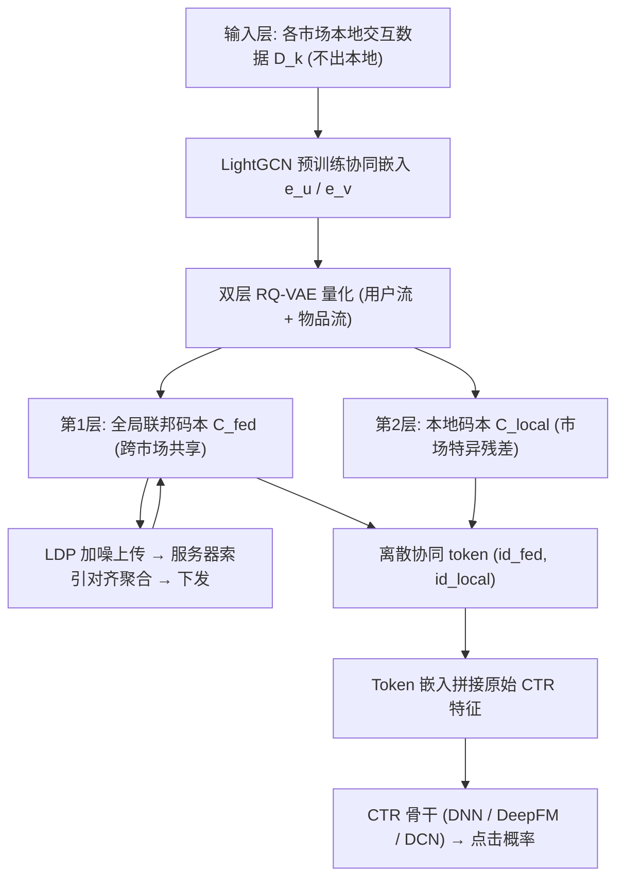
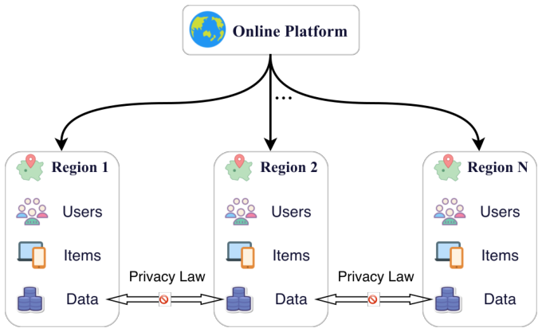
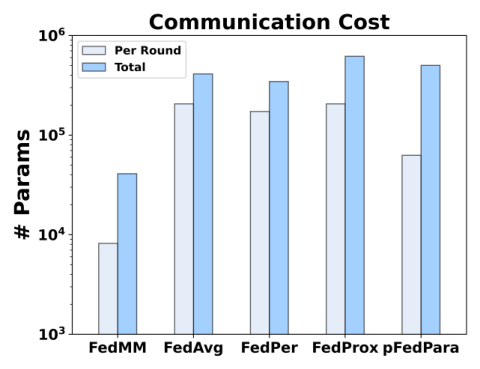
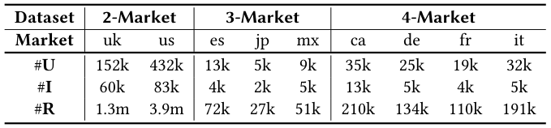
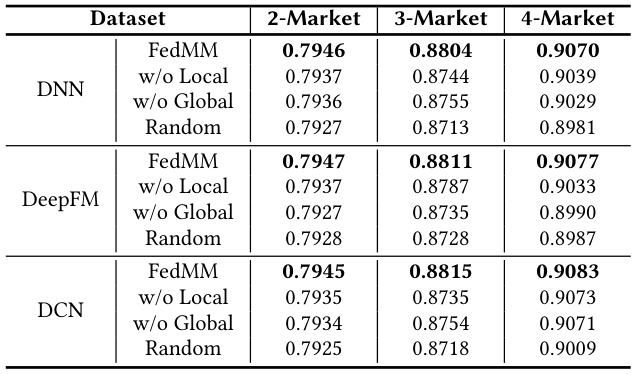
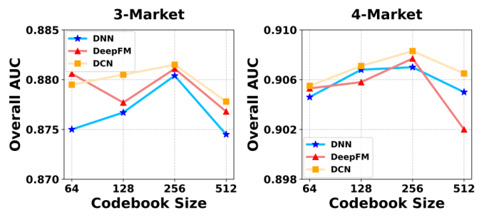
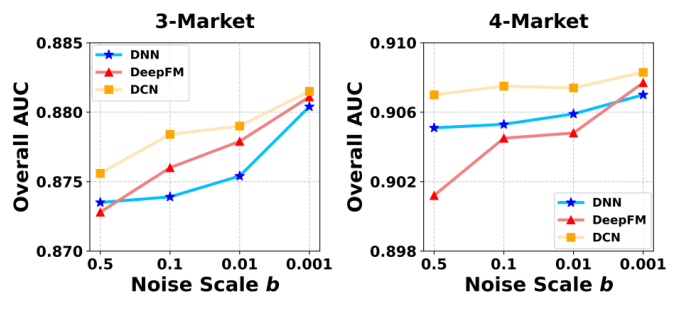
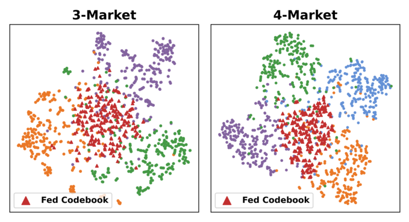

# FedMM: Federated Collaborative Signal Quantization for Multi-Market CTR Prediction (面向多市场 CTR 预估的联邦协同信号量化)

- **会议/期刊**: SIGIR 2026 (49th International ACM SIGIR Conference)
- **推荐链路定位**: 精排 (CTR Prediction) — 以离散协同 token 作为特征增强下游 CTR 骨干
- **研究方向**: 跨域与多场景推荐 (主) / 生成式推荐与离散语义 ID (次，RQ-VAE 码本量化)
- **论文原文**: [https://arxiv.org/abs/2605.11433v1](https://arxiv.org/abs/2605.11433v1)
- **开源代码**: [https://github.com/JunZhangJz/FedMM](https://github.com/JunZhangJz/FedMM)

## TL;DR (核心速览)

针对多市场推荐 (MMR) 中"集中式训练违反数据主权、传统联邦聚合因 ID 空间不相交与市场异质性而负迁移"的双重痛点，FedMM 提出以**双层 RQ-VAE 码本作为联邦传输介质**：第一层全局码本经服务器索引对齐聚合捕捉跨市场共享协同模式，第二层本地码本保留市场特异残差，量化得到的离散协同 token 作为额外特征注入任意 CTR 骨干。在 XMarket 构造的 2/3/4 市场数据集上，AUC 全面超越 Local、FedAvg/FedPer/FedProx/pFedPara 及集中式 MAML/FOREC/MA，4-Market+DCN 达 0.9083，且通信量较模型共享基线降低 20× 以上。

## Background & Motivation (背景与动机)

- **领域背景与主流范式**: 多市场推荐 (MMR) 主流采用"预训练 + 微调"范式——先在集中式全局数据上训练 market-agnostic 统一模型，再适配到各市场。代表工作包括元学习路线 (MAML、FOREC 学习全局初始化后接市场特异层)、嵌入对齐路线 (MA、Bert4XMR 引入 market-specific embedding 映射通用物品表征)、高阶相关路线 (M3Rec 随机游走)。
- **现有方法局限 (Limitations of Prior Work)**:
  1. **隐私与数据主权冲突**: 上述方法均假设平台可将各市场原始数据自由汇聚到中心仓库，但 GDPR 等法规严格限制个人数据跨境流动，集中式 MMR 在工程上已不可行。
  2. **联邦聚合的负迁移**: 直接套用 FedAvg/FedProx/FedPer 等参数聚合范式，在文化背景与消费习惯高度异质的市场间会引入冲突信号，实验显示 FedAvg 甚至劣于 Local 模型。
  3. **ID 空间不相交导致嵌入聚合失效**: 各市场用户严格不重叠，物品 ID 独立编码（同一商品在不同市场对应无关 ID token），不存在统一映射机制，基于 embedding 参数的对齐/聚合策略无从下手。
- **核心挑战 (Key Challenge)**: 如何在**不共享原始数据、不依赖共享 ID 空间**的前提下，既抽取跨市场共享协同知识、又保留市场特异语义，避免"一刀切"聚合带来的负迁移？
- **核心洞察与切入点 (Key Insight)**: 作者的关键切入点是——**码本 (codebook) 而非模型参数或稠密梯度，才是合适的联邦传输介质**。码字是海量嵌入的统计聚合"语义原型"，天然模糊个体身份；且码本按索引对齐即可聚合，绕开了 ID 空间不相交问题。进一步，RQ-VAE 的残差层级结构天然适配"粗粒度全局 + 细粒度本地"的分层量化需求。论文还给出 Theorem 1：在相同初始化假设下，本地码本梯度的线性求和等于全局数据集上码本梯度的求和，即联邦聚合码本在数学上等价于在全体本地数据并集上做量化。

## Problem Formulation & Method (问题定义与方法架构)

### 1. 符号定义与输入表征 (Notations & Input Representations)

- 市场集合 $\mathcal{M}=\{M_1,\dots,M_K\}$，第 $k$ 个市场本地数据 $\mathcal{D}_k=\{(u,v,y,\mathbf{x}) \mid u\in\mathcal{U}_k, v\in\mathcal{V}_k\}$，其中 $\mathcal{U}_k,\mathcal{V}_k$ 为该市场用户/物品集，$y\in\{0,1\}$ 为点击标签，$\mathbf{x}$ 为用户画像与物品属性特征向量。
- **隐私约束**: $\mathcal{D}_k$ 仅存于本地节点，只允许在隐私保护协议（如 LDP）下交换模型参数、梯度或抽象表征。
- **不相交 ID 空间**: 用户跨市场严格不重叠；物品即使实体相同，其 ID 在各市场独立编码，形式上视为完全不相交。
- **输入/输出**: 输入为预训练 CF 模型（LightGCN）产出的用户/物品协同嵌入 $\mathbf{e}_u,\mathbf{e}_v$；输出为点击概率 $\hat{y}_{uv}=f_\Theta(u,v,\mathbf{x})$。
- 关键超参：CTR 特征嵌入维度 $d=16$，MLP 隐层 $[512,256,128]$，码本大小 $T\in\{64,128,256,512\}$（最优 256），RQ-VAE 层数 $m=2$（全局层 + 本地层），损失权重 $\lambda=1$。

### 2. 整体流水线 (Overall Architecture)

数据流分三阶段：(1) **本地信号学习**——各市场用 LightGCN 预训练得到协同嵌入，送入双流（用户/物品各一条）双层 RQ-VAE 量化；(2) **联邦聚合**——各节点上传经 LDP 加噪的全局层码本，服务器按索引对齐聚合后下发，本地再做 $E_{adapt}$ 轮码本对齐；(3) **CTR 增强**——冻结码本，对本地嵌入做一次前向量化得到 token 对 $(id_{fed}, id_{local})$，作为两个额外特征域经嵌入层映射后与原始 CTR 特征拼接，输入 DNN/DeepFM/DCN 骨干。

<figure class="paper-figure" markdown="span">
  <figcaption>图 1：一个典型的多市场推荐场景。在线平台在多个不同地区运营。由于严格的隐私法律和数据主权法规，数据在各地区内相互隔离。</figcaption>
</figure>

<figure class="paper-figure" markdown="span">
  <figcaption>图 2：我们的 FedMM 框架概览。该框架包含三个关键组件：（1）本地信号学习：区域节点使用解耦的联邦本地 RQ-VAE（左下角放大图）学习解耦用户/物品表示。（2）联邦聚合：区域节点上传受本地差分隐私（LDP）保护的联邦码本，随后由中央服务器聚合以同步全局码本（右上角）。（3）CTR 增强：在下游任务中（右下角），离散协同 token 被用于增强 CTR 骨干模型。</figcaption>
</figure>

### 3. 核心模块设计与数学原理 (Key Designs & Formulations)

**(1) 双层残差量化：全局粗粒度 + 本地细粒度**

给定用户协同嵌入 $\mathbf{e}_u$，编码器映射到潜空间 $\mathbf{z}_u=E(\mathbf{e}_u)$，令第 0 层残差 $\mathbf{r}_u^0=\mathbf{z}_u$。第一层在全局联邦码本 $\mathcal{C}^U_{fed}=\{\mathbf{c}^0_j\}_{j=1}^T$ 上做最近邻检索：

$$\mathbf{c}^0_u=\arg\max_{\mathbf{c}^0_j\in\mathcal{C}^U_{fed}} P(\mathbf{c}^0_j\mid \mathbf{r}^0_u),\quad P(\mathbf{c}^0_j\mid \mathbf{r}^0_u)=\frac{e^{\text{sim}(\mathbf{r}^0_u,\mathbf{c}^0_j)/\tau}}{\sum_{k=1}^T e^{\text{sim}(\mathbf{r}^0_u,\mathbf{c}^0_k)/\tau}}$$

其中 $\text{sim}(\cdot)$ 采用**余弦相似度**而非欧氏距离——作者给出两点物理直觉：其一与主流 CF 模型（MF/NGCF/LightGCN）以内积建模交互的优化目标一致，其二余弦对向量模长不敏感，可消除用户活跃度偏差，使量化聚焦内在语义偏好。随后计算一阶残差 $\mathbf{r}^1_u=\mathbf{r}^0_u-\mathbf{c}^0_u$，在本地码本 $\mathcal{C}^U_{local}$ 上以同式检索 $\mathbf{c}^1_u$。量化向量为两层码字之和 $\mathbf{z}^q_u=\mathbf{c}^0_u+\mathbf{c}^1_u$。物品流完全对称。

**(2) 联邦码本聚合与理论等价性**

每轮联邦开始时各节点先做 $E_{adapt}$ 轮本地码本对齐（缓解新全局先验与旧本地码本的失配），再执行 $E$ 轮本地量化训练，随后对全局层码本施加 Laplace 噪声 $\tilde{\mathcal{C}}^k_{fed}\leftarrow\text{LDP}(\mathcal{C}^k_{fed},\epsilon)$ 上传，服务器**按索引 $j$ 对齐**聚合各市场第 $j$ 个码字得到全局码字。Theorem 1 证明：在 Assumption 1（所有客户端以相同全局码本初始化，即第 $j$ 个码字初始代表相同语义簇）下，$\nabla_{\mathbf{c}_j}\mathcal{L}_{global}=\sum_{k=1}^K\nabla_{\mathbf{c}_j}\mathcal{L}^k_{local}$，故聚合码本等价于在 $\bigcup_k\mathcal{E}_k$ 上做量化——这是"码本可聚合"的理论基石，也解释了为何必须索引对齐（否则语义簇错位，等价性失效）。

**(3) 三层隐私防御机制**

- **原型匿名化**: 传输的是离散语义原型而非原始数据或稠密梯度，每个原型是海量嵌入的统计聚合，量化本身充当压缩函数过滤实体级标识信息。
- **粒度隔离**: 细粒度残差与本地码本永不出本地，服务器仅得粗粒度全局原型，缺少残差则无法重建原始嵌入。
- **本地差分隐私**: 上传前注入零均值 Laplace 噪声，提供形式化隐私保证。

**(4) Token 增强 CTR**

收敛后各节点以推理模式（无梯度）对本地嵌入做一次量化，得到 token 对 $(id_{fed}, id_{local})$ 作为两个额外特征域，经可学习嵌入层映射为 $\mathbf{e}_{fed},\mathbf{e}_{local}$，与原始 CTR 特征嵌入拼接为 $\mathbf{x}_{fused}$ 输入骨干：$\hat{y}_{ctr}=f_{\Theta_k}(\mathbf{x}_{fused})$。该 token 是 model-agnostic 的，可插入任意主流深度 CTR 架构。

### 4. 训练目标、负采样与推理复杂度 (Optimization, Negative Sampling & Complexity)

- **码本学习损失**（最大化输入嵌入在最优码字下的似然）：
$$\mathcal{L}^U_{code}=-\left[\log P(\mathbf{c}^0_u\mid\mathbf{z}^0_u)+\log P(\mathbf{c}^1_u\mid\mathbf{z}^1_u)\right],\quad \mathcal{L}_{code}=\mathcal{L}^U_{code}+\mathcal{L}^I_{code}$$
- **语义对齐损失**（以固定输入分布为语义锚，防模式坍缩）：
$$\mathcal{L}^U_{al}=-\log P(\mathbf{e}_u\mid\mathbf{z}^q_u),\quad P(\mathbf{e}_u\mid\mathbf{z}^q_u)=\frac{e^{\text{sim}(\mathbf{z}^q_u,\mathbf{e}_u)/\tau}}{\sum_{j=1}^B e^{\text{sim}(\mathbf{z}^q_u,\mathbf{e}_{u,j})/\tau}}$$
- **量化总目标**: $\mathcal{L}_{RQ}=\mathcal{L}_{code}+\mathcal{L}_{al}$；**重建损失**（用户/物品重建嵌入内积 + BCE）：$\hat{y}={\mathbf{e}'_u}^\top\mathbf{e}'_i$，$\mathcal{L}_{rec}=-[y\log\hat{y}+(1-y)\log(1-\hat{y})]$；**本地总损失**: $\mathcal{L}_{total}=\mathcal{L}_{rec}+\lambda\mathcal{L}_{RQ}$，$\lambda=1$。
- **CTR 阶段损失**: 标准 BCE $\mathcal{L}_{ctr}=-\sum_{(u,v,y,\mathbf{x})\in\mathcal{D}_k}[y\log\hat{y}_{ctr}+(1-y)\log(1-\hat{y}_{ctr})]$。
- **负采样策略**: 原文未显式报告独立的负采样模块。CF 预训练采用 leave-one-out 划分（每用户留一交互作测试），CTR 阶段以评分阈值 $\ge 4$ 定义正样本、$<4$ 为负样本，属隐式反馈二分类设定；语义对齐损失中的分母对 batch 内 $B$ 个样本求和，隐含 in-batch 对比形式。**原文未报告**显式难负例挖掘或采样比例。
- **复杂度与通信**: 传输量与骨干模型规模**完全解耦**——只传紧凑的全局码本（$T$ 个码字），而非稠密 MLP 层。图 3 显示模型共享基线每轮需数百 K 参数，FedMM 通信负载降低 **20× 以上**；pFedPara 虽降低单轮开销但收敛需更多轮，总通信负担反而更高。在线推理仅需一次最近邻码本检索 + 常规 CTR 前向，无需 Beam Search。

<figure class="paper-figure" markdown="span">
  <figcaption>图 3：按每个区域节点传输参数数量衡量的通信成本比较（对数刻度）。该图对比了每轮通信开销（浅蓝色）与整个训练过程的通信开销（深蓝色）。</figcaption>
</figure>

## Experimental Setup & Evaluation Protocol (实验设置与评估协议)

- **数据集**: XMarket（Bonab 等爬取 18 个 Amazon 市场、11 种语言构建的大规模跨市场电商数据集），作者构造 2/3/4 市场三个版本。预处理保留交互数 > 3 的用户。

<figure class="paper-figure" markdown="span">
  <figcaption>表 1：数据集统计。</figcaption>
</figure>

| 数据集 (Dataset) | 市场构成 | 用户数 (#Users) | 物品数 (#Items) | 交互数 (#Interactions) | 稀疏度/密度 | 模态/辅助特征说明 |
| :--- | :--- | :---: | :---: | :---: | :---: | :--- |
| 2-Market | uk / us | 152k / 432k | 60k / 83k | 1.3m / 3.9m | 原文未报告 | 用户画像 + 物品属性离散特征 |
| 3-Market | es / jp / mx | 13k / 5k / 9k | 4k / 2k / 5k | 72k / 27k / 51k | 原文未报告 | 同上 |
| 4-Market | ca / de / fr / it | 35k / 25k / 19k / 32k | 13k / 5k / 4k / 5k | 210k / 134k / 110k / 191k | 原文未报告 | 同上 |

- **数据划分方式 (Splitting Strategy)**: **两阶段混合划分**。CF 预训练阶段采用 **Leave-One-Out (留一法)**；CTR 任务阶段将显式评分转为二值反馈（$\ge 4$ 为正/点击，$<4$ 为非交互），并按 **8:1:1 比例划分**训练/验证/测试。需注意：比例划分若未按全局时间戳切分，存在未来信息泄露的潜在风险，**原文未说明是否做时间切分**。
- **排名评测协议 (Ranking Protocol)**: 采用 **AUC**（ROC 曲线下面积）作为唯一指标，属 CTR 二分类概率评估，非全库排序或采样排序协议。原文明确"$>0.1\%$ AUC 提升在 CTR 任务中即视为显著"。
- **评价指标与显著性检验**: AUC；嵌入维度 $d=16$ 全模型对齐；表 2 中带 $*$ 标记表示与最强基线做 **two-sample $t$-test，$p\le 0.05$** 显著。**原文未报告**多随机种子方差数值。

## Key Experimental Results (核心实验结果)

### 1. 主实验对比 (Main Results)

骨干涵盖 DNN / DeepFM / DCN，基线分三类：单市场 Local、联邦方法 (FedAvg/FedPer/FedProx/pFedPara)、集中式 MMR (MAML/FOREC/MA)。下表提取 Overall AUC：

| 数据集 | 骨干 | 指标 | Local 基线 | 最强联邦基线 | 最强集中式 MMR 基线 | 本文方法 (Ours) | 相对提升 (vs 最强基线) |
| :--- | :--- | :--- | :---: | :---: | :---: | :---: | :---: |
| 2-Market | DNN | Overall AUC | 0.7929 | 0.7933 (FedProx) | 0.7939 (FOREC) | **0.7946*** | +0.09% (vs FOREC) |
| 3-Market | DNN | Overall AUC | 0.8756 | 0.8725 (FedPer) | 0.8819 (FOREC) | **0.8804*** | 略低于 FOREC，但显著优于全部联邦基线 |
| 4-Market | DNN | Overall AUC | 0.9022 | 0.9003 (FedPer) | 0.9059 (MA) | **0.9070*** | +0.12% (vs MA) |
| 2-Market | DeepFM | Overall AUC | 0.7929 | 0.7932 (FedProx) | 0.7939 (FOREC) | **0.7947*** | +0.10% |
| 3-Market | DeepFM | Overall AUC | 0.8750 | 0.8767 (FedProx) | 0.8819 (FOREC) | **0.8811*** | 略低于 FOREC |
| 4-Market | DeepFM | Overall AUC | 0.9031 | 0.8905 (pFedPara) | 0.9059 (MA) | **0.9077*** | +0.20% |
| 4-Market | DCN | Overall AUC | 0.9024 | 0.9054 (FedProx) | 0.9059 (MA) | **0.9083*** | +0.26% |

关键观察：(1) **FedAvg 常劣于 Local**（如 4-Market+DNN：0.8964 vs 0.9022），实证负迁移严重；(2) FedMM 在**不共享原始数据**前提下达到甚至超越集中式 MMR 水平，说明隐私保护不必以性能为代价；(3) 3-Market 上 FOREC 略优，作者归因于该场景市场数少、集中式元学习仍能有效利用联合分布，而 FedMM 的优势随市场数增加（4-Market）更明显。

### 2. 消融实验与控制变量分析 (Ablation Study)

三个变体：**w/o Local**（仅全局码本，无本地码本）、**w/o Global**（仅本地训练，无联邦聚合）、**Random**（码本随机初始化并冻结）。

<figure class="paper-figure" markdown="span">
  <figcaption>表 3：对我们的 FedMM 进行的消融分析，其中最佳结果以粗体标出。</figcaption>
</figure>

| 数据集 | 骨干 | FedMM | w/o Local | w/o Global | Random |
| :--- | :--- | :---: | :---: | :---: | :---: |
| 2-Market | DNN | **0.7946** | 0.7937 | 0.7936 | 0.7927 |
| 3-Market | DNN | **0.8804** | 0.8744 | 0.8755 | 0.8713 |
| 4-Market | DNN | **0.9070** | 0.9039 | 0.9029 | 0.8981 |
| 3-Market | DeepFM | **0.8811** | 0.8787 | 0.8735 | 0.8728 |
| 4-Market | DCN | **0.9083** | 0.9073 | 0.9071 | 0.9009 |

- **w/o Global 下降**印证跨市场协作的必要性，数据稀疏场景尤甚；**w/o Local 下降**说明全局码本仅提供粗粒度参考，缺本地残差则分辨率不足；**Random 大幅下降**（4-Market+DNN 降 0.89%）证明增益来自学到的语义原型而非结构复杂度本身。整体看，**全局码本贡献在 3-Market 更突出，本地码本在 4-Market 更关键**，二者协同最优。
- 消融对照**未显式做参数量对齐或图度数匹配**控制，但 Random 变体在结构完全一致下仅替换码本内容，构成较干净的 sanity check。

### 3. 稀疏度/冷启动分桶与超参敏感度 (Sparsity Buckets & Hyperparameters)

- **交互频次分桶**: **原文未报告**按长尾物品或冷启动用户分桶的细分实验，仅以整体 AUC 评估。
- **码本大小 $T$ 敏感度**（图 4）: $T$ 从 64 增至 256 时性能持续提升（表征容量增强、可捕捉更细语义簇），增至 512 时饱和甚至下降，作者归因于码本坍缩、过拟合市场噪声或码字利用率稀疏；最优 $T=256$。
- **噪声尺度 $b$ 隐私-效用权衡**（图 5）: $b$ 从 0.001 增至 0.5 时 Overall AUC 单调下降（隐私越强方差越大），但降幅相对可控，严格隐私设置下仍保持竞争力。
- **t-SNE 可视化**（图 6）: 不同市场用户嵌入呈明显分簇、仅部分重叠，直观印证严重 non-IID 异质性；全局码本向量（红三角）并非孤立或坍缩到单一区域，而是集中于多市场流形交汇的中心区，充当"连接枢纽"桥接分布鸿沟，同时各市场保留自身流形——验证分层码本设计的合理性。
- **线上 A/B 测试**: **原文仅包含离线实验**，未报告任何线上 CTR/CVR/GMV 收益。

<figure class="paper-figure" markdown="span">
  <figcaption>图 4：在两个数据集上对码本大小 𝑇 的敏感性分析。彩色曲线表示 FedMM 与不同骨干架构集成时的性能趋势（蓝色表示 DNN，红色表示 DeepFM，黄色表示 DCN）。</figcaption>
</figure>

<figure class="paper-figure" markdown="span">
  <figcaption>图 5：在两个数据集上的隐私-效用分析（相对于噪声尺度 𝑏）。彩色曲线表示 FedMM 与不同骨干架构集成时的性能趋势（蓝色表示 DNN，红色表示 DeepFM，黄色表示 DCN）。</figcaption>
</figure>

<figure class="paper-figure" markdown="span">
  <figcaption>图 6：潜在空间的 t-SNE 可视化。不同颜色的散点表示来自不同市场的本地用户嵌入，用以说明市场异质性。红色三角形表示 FedMM 学习到的共享全局码本嵌入，它们分布在各个簇中，以捕捉共同的协同模式。</figcaption>
</figure>

## Highlights, Limitations & Critiques (亮点、局限与审稿级批判)

- **核心亮点与可迁移性**:
  1. **"码本即通信介质"的范式转换**极具迁移价值——将联邦传输对象从稠密参数/梯度换成离散语义原型，同时解决隐私（原型匿名化）、通信（20× 降载）、ID 不相交对齐（索引对齐聚合）三个问题，可迁移到跨域推荐、联邦图推荐、联邦序列推荐等场景。
  2. **Theorem 1 的梯度线性等价性**为码本聚合提供了干净的理论支撑，且明确揭示"索引对齐"是等价性成立的必要条件，工程指导性强。
  3. **分层量化 (coarse-to-fine)** 与 RQ-VAE 残差结构的天然契合，是"全局共享 + 本地特异"解耦的一种优雅实现，token 作为 model-agnostic 特征可插入任意 CTR 骨干，落地成本低。
- **局限性与审稿视角批判**:
  1. **评估协议偏弱**: 仅用 AUC 单一指标，缺少 GAUC（多市场场景下按市场分组的 AUC 更贴合业务）、LogLoss、校准指标；且 CTR 阶段 8:1:1 比例划分**未说明是否按时间切分**，存在未来信息穿越风险，审稿人应追问。
  2. **提升幅度偏小且不稳定**: 2-Market 上相对 FOREC 仅 +0.09%，3-Market 上甚至略逊于 FOREC，作者以"市场数少时集中式元学习仍有效"解释，但缺乏对"FedMM 在何种市场数/异质度阈值下才显著占优"的量化刻画。
  3. **隐私保证不够形式化**: 虽声称 LDP，但仅报告噪声尺度 $b$ 与 AUC 的经验权衡曲线，**未给出 $(\epsilon,\delta)$-DP 的形式化隐私预算**，也未做成员推断/重建攻击的实证评估，"三层防御"中前两层属定性论证。
  4. **理论假设较强**: Assumption 1 要求所有客户端以相同全局码本初始化且第 $j$ 个码字语义一致，但市场异质性下初始语义簇是否真能对齐、索引对齐在码本漂移后是否仍成立，原文未讨论失效边界。
  5. **缺失关键实验**: 无长尾/冷启动分桶、无多随机种子方差数值（仅给 $t$-test 显著性标记）、无线上 A/B、无与"仅传梯度 + 安全聚合"等更强隐私基线的对比。
  6. **RQ-VAE 训练开销未报告**: 离线量化与构图耗时、单轮联邦通信的实际 wall-clock 时间、峰值显存均**原文未报告**，仅给参数传输量对比。

## Rating (四维评分)

- **方法创新性 (Novelty)**: ⭐⭐⭐⭐ — "码本作为联邦传输与 ID 对齐介质"的视角新颖，分层量化设计自洽，但 RQ-VAE 与联邦学习均为成熟组件的组合创新。
- **评估协议与实验扎实度 (Protocol & Experiments)**: ⭐⭐⭐ — 三骨干 × 三市场规模 × 三类基线覆盖较全且有 $t$-test，但仅 AUC 单指标、划分未明示时间切分、缺分桶与方差报告、无线上验证。
- **写作与数学规范度 (Clarity & Rigor)**: ⭐⭐⭐⭐ — 符号清晰、Theorem 1 证明简洁、算法伪代码完整；但隐私分析偏定性、部分超参（$\tau$、$E_{adapt}$、$R$）取值未在正文明确。
- **工业落地与复现价值 (Industrial & Practical Value)**: ⭐⭐⭐⭐ — 通信降载 20×、token model-agnostic、代码已开源，工程友好；但离线量化开销与真实跨市场 ID 对齐的鲁棒性仍需工业验证。
