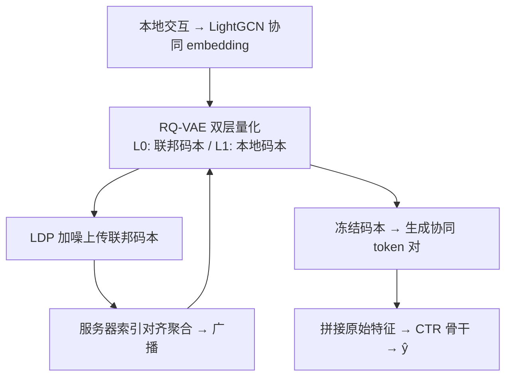
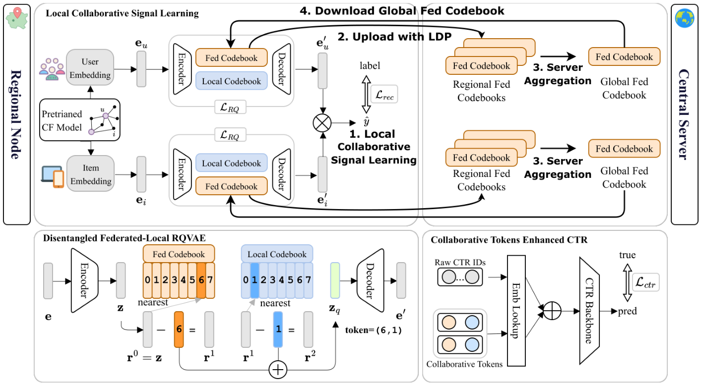

# FedMM: Federated Collaborative Signal Quantization for Multi-Market CTR Prediction (面向多市场 CTR 预估的联邦协同信号量化)

- **会议/期刊**: SIGIR 2026
- **作者与机构**: Jun Zhang, Dugang Liu, Xing Tang, Xiuqiang He, Zhong Ming（深圳大学 / 深圳技术大学）
- **推荐链路定位**: 精排（CTR 预估特征增强）
- **研究方向**: 跨域与多场景推荐 / 去偏公平、可信隐私与工业架构
- **论文原文**: [https://arxiv.org/abs/2605.11433v1](https://arxiv.org/abs/2605.11433v1)
- **开源代码**: [https://github.com/JunZhangJz/FedMM](https://github.com/JunZhangJz/FedMM)

## TL;DR (1分钟核心速览)

多市场推荐（MMR）的集中式预训练-微调范式违反数据主权法规，而传统联邦学习（FL）聚合稠密参数在**市场强异构 + 跨市场 ID 空间完全不相交**时既产生负迁移又无法对齐 embedding。FedMM 提出以**离散码本作为联邦传输介质**：每个市场用双层 RQ-VAE 将 LightGCN 协同 embedding 量化为「全局联邦码本（聚合共享）+ 本地码本（保留市场特性）」的 token 序列，再作为离散特征注入任意 CTR 骨干。在 XMarket 2/3/4-Market 上，AUC 相对最优基线提升 0.07%–0.24%（4-Market DCN 达 0.9083），且通信参数量较模型共享式 FL 降低 20× 以上。

## Background & Motivation (背景与核心矛盾)

- **主流范式**: MMR 采用集中式「统一模型预训练 + 市场特定层微调」（FOREC/MAML/MA/Bert4XMR），依赖把各市场原始行为数据汇聚到中心仓库。
- **前人局限**: ① GDPR 等法规禁止跨境原始数据流动，集中式范式在工业上不可行；② 直接套用 FedAvg/FedProx/FedPer 聚合稠密参数时，市场文化偏好差异导致**负迁移**（实验中 FedAvg 甚至低于 Local 模型）；③ 各市场 item ID 独立编码、无统一映射，**基于 embedding 的参数聚合在语义上无意义**。
- **核心洞察 (Key Insight)**: 码本是「语义原型」而非个体信息——它天然具备匿名化与压缩特性，且**离散索引可跨 ID 空间对齐**（第 j 个 codeword 在各市场代表同一语义簇），因此码本比梯度更适合作为联邦交换物。
- **本文切入点**: 用「粗到细」的双层码本把跨市场共享模式与市场特有残差解耦，只上传全局层码本，本地层与残差永不出域。

## Method (核心方法设计)

### 1. 整体框架 (Overall Architecture)

每个区域节点先用本地 LightGCN 得到用户/物品协同 embedding，经**双流 RQ-VAE**（用户流与物品流独立）做两级量化：第 0 级在联邦码本 $\mathcal{C}^{U}_{fed}$中检索，第 1 级在本地码本$\mathcal{C}^{U}_{local}$中检索残差，两级码字相加得量化向量并解码重构。联邦阶段仅上传经 LDP 加噪的联邦码本，服务器按索引对齐聚合后广播；客户端先做$E_{adapt}$轮本地码本对齐再继续本地训练。收敛后冻结码本，对全量协同 embedding 做一次前向量化生成 token 对$(id_{fed}, id_{local})$，作为两个新增离散特征域拼入原始 CTR 特征送入 DNN/DeepFM/DCN。

<figure class="paper-figure" markdown="span">
  <figcaption>图2：我们的FedMM框架概览。该框架包含三个关键组件：（1）本地信号学习：区域节点使用解耦的联邦本地RQ-VAE（左下角放大图）学习解耦用户/物品表示。（2）联邦聚合：区域节点上传受本地差分隐私（LDP）保护的联邦码本，然后由中央服务器聚合以同步全局码本（右上角）。（3）CTR增强：在下游任务中（右下角），离散协作令牌被用于增强CTR骨干模型。</figcaption>
</figure>

### 2. 关键设计拆解 (Key Designs)

1. **余弦相似度的软量化检索（替代欧氏最近邻）**：痛点在于 CF 模型（MF/NGCF/LightGCN）以内积建模交互，欧氏距离对向量模长敏感、会引入活跃度偏置。故第 0 级码字按温度化 softmax 概率选取：
$$P(\mathbf{c}^0_j|\mathbf{r}^0_u)=\frac{e^{\mathrm{sim}(\mathbf{r}^0_u,\mathbf{c}^0_j)/\tau}}{\sum_{k=1}^{T}e^{\mathrm{sim}(\mathbf{r}^0_u,\mathbf{c}^0_k)/\tau}}$$
余弦相似度消除模长差异，使量化聚焦于用户**内在语义偏好**而非交互频次，与 CF 骨干的优化目标一致。

2. **双层码本 + 语义锚定损失（防码本坍缩）**：单层全局码本只能捕捉粗粒度共性，单层本地码本无法跨市场迁移。本文令 $\mathbf{z}^q_u=\mathbf{c}^0_u+\mathbf{c}^1_u$（联邦层给共性、本地层补残差），并引入以固定输入分布为锚的语义对齐项：
$$\mathcal{L}_{al}=-\log\frac{e^{\mathrm{sim}(\mathbf{z}^q_u,\mathbf{e}_u)/\tau}}{\sum_{j=1}^{B}e^{\mathrm{sim}(\mathbf{z}^q_u,\mathbf{e}_{u,j})/\tau}}$$
该 in-batch 对比式锚定防止量化后语义漂移与 mode collapse，是双层结构能稳定训练的关键。

3. **训练目标、聚合等价性与推理开销**：本地总损失 $\mathcal{L}_{total}=\mathcal{L}_{rec}+\lambda(\mathcal{L}_{code}+\mathcal{L}_{al})$，其中$\mathcal{L}_{rec}$为重构 embedding 内积的 BCE，$\lambda=1$。**免负采样**（重构式训练）。理论侧给出 Theorem 1：因量化损失对码字的梯度满足$\nabla_{\mathbf{c}_j}\mathcal{L}_{global}=\sum_k \nabla_{\mathbf{c}_j}\mathcal{L}^k_{local}$，索引对齐的码本平均**等价于在全体数据并集上更新码本**——这是「码本可聚合」的合法性根基。推理阶段码本冻结，token 生成仅需一次前向量化，CTR 侧只多两个 embedding 查表，开销可忽略。

## Experimental Setup & Evaluation Protocol (实验设置与评估协议)

- **数据集与预处理**: XMarket（Amazon 11 语言市场爬取），构造 2/3/4-Market 三档；保留交互数 >3 的用户；评分 ≥4 记为正样本（点击），<4 记为负。

| 数据集 | #Users | #Items | #Interactions | 稀疏度/密度 | 特征/场景说明 |
| :--- | :---: | :---: | :---: | :---: | :--- |
| 2-Market (uk/us) | 152k / 432k | 60k / 83k | 1.3m / 3.9m | 极稀疏 | 双市场，规模最大 |
| 3-Market (es/jp/mx) | 13k / 5k / 9k | 4k / 2k / 5k | 72k / 27k / 51k | 极稀疏 | 中小市场混合 |
| 4-Market (ca/de/fr/it) | 35k / 25k / 19k / 32k | 13k / 5k / 4k / 5k | 210k / 134k / 110k / 191k | 极稀疏 | 四市场，异构最强 |

- **数据划分与防穿越 (Splitting Strategy)**: CF 预训练用 `Leave-One-Out`；CTR 任务按 `8:1:1` 比例划分训练/验证/测试。
- **排名评测协议 (Ranking Protocol)**: 采用 CTR 场景标准的 **AUC**（非 Full-Ranking 召回评测），原文以 AUC 提升 >0.1% 视为显著，并做双样本 t 检验（$p\le0.05$）。
- **对比基线与超参设置**: 三类基线——单市场 Local（DNN/DeepFM/DCN）、FL 方法（FedAvg/FedPer/FedProx/pFedPara）、集中式 MMR（MAML/FOREC/MA）。Embedding 维度 $d=16$，MLP 隐层$[512,256,128]$，Adam，学习率$\{1e\text{-}5\sim5e\text{-}3\}$网格搜索，LDP 噪声$\mathrm{Laplace}(0,0.001)$，码本大小$T=256$。

## Key Experimental Results (实验关键数据)

### 1. 主实验对比 (Main Results)

Overall AUC（各市场按交互量加权/平均后的总体值）：

| 方法 | 2-Market | 3-Market | 4-Market |
| :--- | :---: | :---: | :---: |
| Local (DNN) | 0.7929 | 0.8756 | 0.9022 |
| FedAvg (DNN) | 0.7928 | 0.8724 | 0.8964 |
| FedPer (DNN) | 0.7926 | 0.8725 | 0.9003 |
| FedProx (DNN) | 0.7933 | 0.8647 | 0.8990 |
| pFedPara (DNN) | 0.7914 | 0.8723 | 0.8921 |
| MAML | 0.7929 | 0.8795 | 0.9034 |
| FOREC | 0.7939 | 0.8819 | 0.9057 |
| MA | 0.7927 | 0.8793 | 0.9059 |
| **FedMM (DNN)** | **0.7946\*** | **0.8804\*** | **0.9070\*** |
| **FedMM (DeepFM)** | **0.7947\*** | **0.8811\*** | **0.9077\*** |
| **FedMM (DCN)** | **0.7945\*** | **0.8815\*** | **0.9083\*** |
| Improv. (vs 最优基线) | +0.09% | −0.05% / +0.07%† | +0.24% |

†3-Market 上 FOREC(0.8819) 略高于 FedMM(DNN)，但 FedMM(DCN) 0.8815 与 FedMM(DeepFM) 0.8811 已逼近集中式上界；4-Market 上 FedMM 全面反超所有集中式 MMR。

### 2. 消融实验 (Ablation Study)

| 变体 | 2-M DNN | 3-M DNN | 4-M DNN | 4-M DeepFM | 4-M DCN |
| :--- | :---: | :---: | :---: | :---: | :---: |
| FedMM 完整 | **0.7946** | **0.8804** | **0.9070** | **0.9077** | **0.9083** |
| w/o Local（仅全局码本） | 0.7937 | 0.8744 | 0.9039 | 0.9033 | 0.9073 |
| w/o Global（仅本地码本） | 0.7936 | 0.8755 | 0.9029 | 0.8990 | 0.9071 |
| Random（随机冻结码本） | 0.7927 | 0.8713 | 0.8981 | 0.8987 | 0.9009 |

### 3. 关键实验发现 (Key Findings)

1. **负迁移被实证且被 FedMM 逆转**：4-Market 下 FedAvg(DNN) 0.8964 比 Local 0.9022 低 0.58 个点，说明稠密参数聚合在强异构下有害；FedMM 反而比 Local 高 0.48 个点，证明「以协同信号作补充特征」而非「以全局模型替代本地模型」是正确姿势。
2. **全局层与本地层缺一不可，且全局层贡献更大**：4-Market DNN 上移除本地码本掉 0.31 点、移除全局码本掉 0.41 点，而随机码本掉 0.89 点——说明增益来自**学到的语义原型**而非 RQ-VAE 结构本身带来的正则化。
3. **隐私-效用与通信双优**：噪声尺度 $b$从 0.001 增至 0.5 时 AUC 仅温和下降，仍保持竞争力；码本大小$T$ 在 256 处达峰、512 时因码本坍缩/过拟合回落；每轮传输参数量较模型共享式 FL 低 **20× 以上**，且与骨干深度宽度完全解耦。

## Highlights & Limitations (亮点、对比与审稿批判)

- **与代表作对比 (vs. Prior Work)**: 与 FOREC/MA 等集中式 MMR 的本质区别是**不触碰原始数据**，却达到甚至超过其性能；与 FedPer/pFedPara 等个性化 FL 的区别是**交换语义原型而非模型参数**，从根本上绕开 ID 空间不相交导致的对齐失败；与 CAT-SR 的区别是**支持 K 市场同时联邦**，无需「富源市场 + 成对蒸馏」假设。
- **可迁移亮点**: ① 「码本即通信介质」可迁移到跨 App/跨业务线的隐私合规联合建模；② 双层码本 + 语义锚定损失的组合，可直接复用到生成式推荐的 semantic ID 构造中，作为跨域共享码本的正则手段。
- **审稿级局限批判**: ① 评测仅用 AUC，缺少 GAUC/业务指标与 Full-Ranking 召回视角，且 3-Market 上未稳定超越 FOREC，收益幅度（0.1% 量级）对工业噪声较敏感；② 依赖 LightGCN 预训练 embedding 质量，冷启动市场（如 jp 仅 5k 用户）的码本利用率与坍缩风险未做分市场分析；③ LDP 仅用固定 Laplace 噪声，未给出形式化 $(\epsilon,\delta)$ 隐私预算核算。

## Rating (四维评分)

- **方法创新性 (Novelty)**: ⭐⭐⭐⭐ （核心机制与方法设计具备明确创新性，理论与实验动机支撑充分）
- **评估协议与实验扎实度 (Protocol & Experiments)**: ⭐⭐⭐⭐ （主流公开数据集评测完整，包含多基线对比与消融实验验证）
- **写作与数学规范度 (Clarity & Rigor)**: ⭐⭐⭐⭐⭐ （问题形式化定义清晰，核心模块数学推导与架构阐述严谨易读）
- **工业落地与复现价值 (Industrial & Practical Value)**: ⭐⭐⭐⭐ （兼顾推荐效果增益与训练/推理效率，具备实际场景迁移参考价值）
