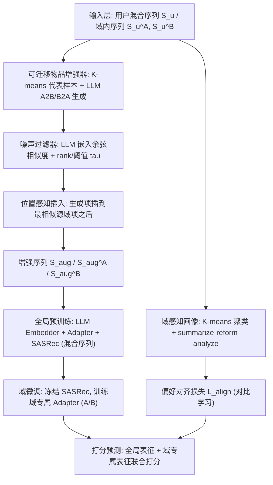
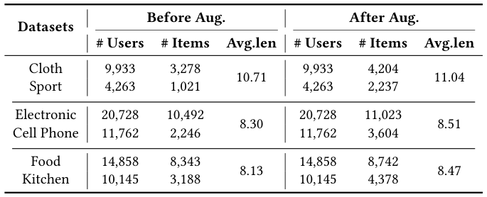
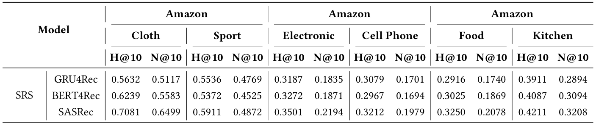
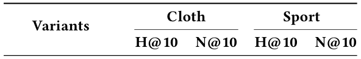
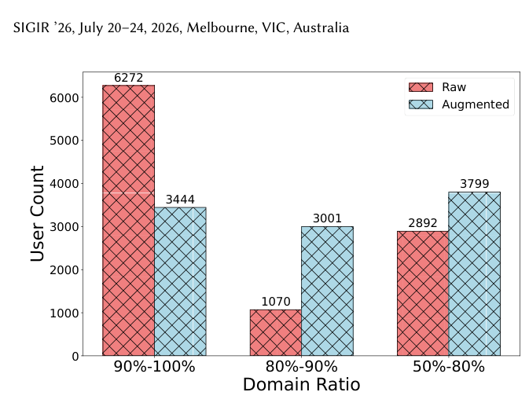
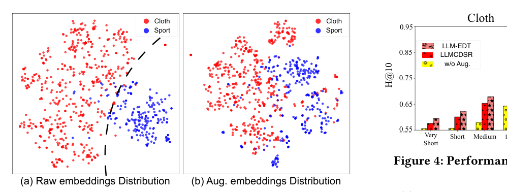

# LLM-EDT: Large Language Models Enhanced Cross-domain Sequential Recommendation with Dual-phase Training (大语言模型增强的双阶段训练跨域序列推荐)

- **会议/期刊**: SIGIR 2026 (Melbourne, VIC, Australia)
- **推荐链路定位**: 召回/序列建模 (Sequential Next-Item Retrieval)，端到端序列打分
- **研究方向**: 跨域与多场景推荐 (主) / 大语言模型推荐 (次)
- **论文原文**: [https://arxiv.org/abs/2511.19931v2](https://arxiv.org/abs/2511.19931v2)
- **开源代码**: [https://github.com/Applied-Machine-Learning-Lab/SIGIR26_LLM-EDT](https://github.com/Applied-Machine-Learning-Lab/SIGIR26_LLM-EDT)

## TL;DR (核心速览)

针对跨域序列推荐 (CDSR) 中的**域不平衡**与**域迁移**两大痛点，本文提出 LLM-EDT：用 LLM 生成"可迁移跨域行为"并配以相似度噪声过滤与位置感知插入来平衡域分布；用"全局预训练→域微调"的双阶段训练把域共享背景注入域专属线程；再用 K-means + summarize-reform-analyze 的域感知画像做偏好对齐。在三个公开数据集的全排序协议下，Recall@10/20 与 NDCG@10/20 均取得统计显著提升（$p<0.05$）。

## Background & Motivation (背景与动机)

- **领域背景与主流范式**: 序列推荐 (SRS) 以 GRU4Rec、SASRec 等自注意力/RNN 架构为主流；跨域序列推荐 (CDSR) 通过融合多域交互缓解数据稀疏，主流做法包括迁移学习框架、GNN 桥接域间物品连接，以及三线程 (domain-shared + 两个 domain-specific) 并行建模。
- **现有方法局限 (Limitations of Prior Work)**:
  1. **域不平衡 (Domain Imbalance)**：作者定义域比例 $r=\frac{|n_A-n_B|}{n_A+n_B}$，在图 1 中统计 Amazon Cloth-Sport 发现绝大多数用户落在 90%–100% 区间（原始 6272 人），即一个域几乎主导全部行为，导致弱势域特征难以学习。现有迁移/GNN 方法严重依赖重叠用户 (overlapping users)，实际场景受限。
  2. **域迁移 (Domain Transition)**：混合序列中难以捕捉跨域偏好转移。仅用全局共享特征的方法缺乏域内细节；引入域专属线程的方法又把共享/专属线程**并行**训练，二者缺乏必要连接，域专属建模模糊。
  3. **LLM 增强的次生问题**：LLMCDSR 用 LLM 数据增强但引入**无关噪声 (Irrelevant Noise)** 且牺牲训练/推理效率；LLM4CDSR 仅把 LLM 当编码器/摘要器，仍是"一步式"粗粒度画像，产生**粗糙画像 (Rough Profiling)**，且未按"全局→域专属"的渐进粒度学习偏好。
- **核心挑战 (Key Challenge)**: 简单增加网络深度或常规对比学习无法同时解决"域分布极度偏斜下的域内特征学习"与"混合序列中的跨域转移建模"，因为二者分别要求**数据层面再平衡**与**训练范式层面的渐进式知识传递**。
- **核心洞察与切入点 (Key Insight)**: 图 1 的实证统计（原始 vs. 增强后用户域比例分布）直接支撑"用 LLM 生成弱势域样本来平衡分布"的动机；同时作者观察到三线程并行训练缺乏共享→专属的知识流动，故改为**串行双阶段**（先全局预训练、再冻结主干微调域专属 adapter），并以域感知画像替代一步式摘要。

## Problem Formulation & Method (问题定义与方法架构)

### 1. 符号定义与输入表征 (Notations & Input Representations)

- 用户集 $\mathcal{U}=\{u_1,\dots,u_{|\mathcal{U}|}\}$；双域物品集 $\mathcal{I}=\mathcal{A}\cup\mathcal{B}$，$|\mathcal{A}|,|\mathcal{B}|$ 分别为两域物品数。
- 用户混合序列 $S_u=\{v_1^u,\dots,v_n^u\}$，域内序列 $S_u^A=\{a_1^u,\dots,a_{n_A}^u\}$、$S_u^B=\{b_1^u,\dots,b_{n_B}^u\}$，$n=n_A+n_B$。
- 增强后序列 $S_{aug}=\{v_1,\hat v_2,\dots,v_{n+2k-1},\hat v_{n+2k}\}$，其中 $\hat v_i$ 为插入的增强交互，$k$ 为每方向生成样本数；域内增强序列 $S_{aug}^A$、$S_{aug}^B$ 各含 $n_A+k$、$n_B+k$ 项。
- LLM 嵌入维度 $d_L$，推荐空间维度 $d$；adapter 中间维度 $d_L/2$。
- 输出：下一物品概率 $P(v_{n+1}=v_i\mid S_{aug},S_{aug}^A,S_{aug}^B)$，分别在 $\mathcal{A}_{aug}$ 与 $\mathcal{B}_{aug}$ 上取 argmax。

### 2. 整体流水线 (Overall Architecture)

数据流：原始混合序列 → **可迁移物品增强器**（K-means 选代表样本 → LLM A2B/B2A 生成 → LLM 嵌入余弦相似度噪声过滤 → 按相似位置插入）→ 增强序列 $S_{aug}$ → **双阶段训练**（全局预训练 SASRec + adapter；域微调冻结主干、训练两个域专属 adapter）→ 打分预测；同时 **域感知画像**（K-means 聚类 → summarize-reform-analyze → LLM 嵌入 + adapter → 对比对齐损失 $\mathcal{L}_{align}$）注入全局用户表征。

图 2 展示了 LLM-EDT 的整体框架，包含可迁移物品增强器、双阶段训练与域感知画像三大模块。

### 3. 核心模块设计与数学原理 (Key Designs & Formulations)

**(1) 可迁移物品增强器 (Transferable Item Augmenter)**

- **样本生成器**：对主导域 $\mathcal{A}$ 的原始序列 $S_{raw}^A$ 先用 K-means 聚类保证多样性，取聚类代表项 $S_{rep}^A$，再用提示词 $T$ 驱动 LLM 生成弱势域 $\mathcal{B}$ 的可迁移物品：
$$I_B=\mathrm{LLMs}(T,S_{rep}^A),\quad I_A=\mathrm{LLMs}(T,S_{rep}^B)$$
物理直觉：可迁移物品应与主导域语义相近，从而作为"域切换信号"。
- **噪声过滤器**：用 LLM 文本嵌入模型对物品文本属性（name/brand/category/description）编码得 $E_{rep}^A,E_{rep}^B,E_{I_A},E_{I_B}$，对生成项 $i$ 计算与两域代表项的最大余弦相似度：
$$(s_i^A,score_i^A)=\arg\max_{s_k^A\in S_{rep}^A}\mathrm{sim}(E_i,E_{s_k^A}),\quad (s_i^B,score_i^B)=\arg\max_{s_k^B\in S_{rep}^B}\mathrm{sim}(E_i,E_{s_k^B})$$
A2B 方向保留集合：
$$\mathcal{T}_{A2B}=\{i\in I_B\mid \mathrm{rank}(score_i^A)\le k\ \wedge\ score_i^B\ge\tau\}$$
即"与源域足够近（排名前 $k$）且与目标域足够相关（阈值 $\tau$）"的双重约束，抑制 LLM 幻觉噪声。
- **位置感知插入**：不同于随机插入，生成项被严格插到其最相似源域项 $s_i^A$ 之后，形成域间桥梁，保留兴趣转移的时序语义。

**(2) 双阶段训练框架 (Dual-phase Training)**

- **全局预训练**：LLM Embedder 得 $E_{aug}=\{\tilde e_1,\dots,\tilde e_{n+2k}\}$，$\tilde e_i\in\mathbb{R}^{d_L}$；adapter 投影：
$$\tilde e_i=W_1(W_2e_i+b_2)+b_1,\quad W_1\in\mathbb{R}^{d\times d_L/2},W_2\in\mathbb{R}^{d_L/2\times d_L}$$
SASRec 主干 $f_{\tilde\theta}$ 输出全局用户表征 $\tilde u\in\mathbb{R}^d$，打分 $P=\tilde e_i^\top\tilde u$。
- **域微调**：冻结 SASRec 主干 $f_{\tilde\theta_F}$，对 $S_{aug}^A,S_{aug}^B$ 各接一个可训练 adapter：
$$h_A=f_{\tilde\theta_F}(S_{aug}^A),\ u_A=W_3(W_4h_A+b_4)+b_3;\quad h_B=f_{\tilde\theta_F}(S_{aug}^B),\ u_B=W_5(W_6h_B+b_6)+b_5$$
域 A 的联合打分融合全局与域专属：
$$P(v_{n_A+k+1}=v_i\mid S_{aug},S_{aug}^A,v_i\in\mathcal{A}_{aug})=(\tilde e_i^A)^\top u_A+\tilde e_i^\top\tilde u$$
物理直觉：域专属线程在"已具备全局背景"的主干上微调，实现从全局到域专属的**渐进式**偏好更新，而非并行三线程的割裂建模。

**(3) 域感知画像 (Domain-aware Profiling)**

- **K-means 聚类**：对 $E_{aug}^A,E_{aug}^B$ 聚类得 $C$ 个子序列 $S_{g_1}^A,\dots,S_{g_C}^A$ 与 $S_{g_1}^B,\dots,S_{g_C}^B$。
- **Summarize-Reform-Analyze**：先对每域 $C$ 个子序列摘要得 $\{P_c^A\}_{c=1}^C,\{P_c^B\}_{c=1}^C$；再用域比例 $r$ 从 5 个手工构造选项中选出"再形成指令" $R$（描述域不平衡程度），由 LLM 结合域背景改写；最后把两域摘要与 $R$ 组织进提示词，分析得跨域偏好文本 $P_u$。
- **偏好对齐**：$P_u$ 经 LLM 嵌入 + adapter 降维为 $\tilde p\in\mathbb{R}^d$，与全局表征 $\tilde u$ 做对比对齐（见下式）。

### 4. 训练目标、负采样与推理复杂度 (Optimization, Negative Sampling & Complexity)

- **损失函数**：
  - 预训练：$\mathcal{L}_{pre}=-\sum_{u\in\mathcal{U}}\sum_{j=1}^{n+2k}\log\sigma\big(P(v_{j+1}=v^+)-P(v_{j+1}=v^-)\big)$
  - 域微调：$\mathcal{L}_A=-\sum_{u\in\mathcal{U}}\sum_{j=1}^{n_A+k}\log\sigma\big(P(v_{j+1}=v^+)-P(v_{j+1}=v^-)\big)$，$\mathcal{L}_B$ 同理替换记号。
  - 对齐：$\mathcal{L}_{align}^1=-\frac{1}{B}\sum_{i=1}^{B}\log\frac{\exp(\cos(\tilde u_i,\tilde p_i)/\tau)}{\sum_{j=1}^{B}\mathbb{I}[i\neq j]\exp(\cos(\tilde u_i,\tilde p_j)/\tau)}$（原文在截断处给出该 InfoNCE 形式，温度系数 $\tau$；完整 $\mathcal{L}_{align}$ 的对称项在原文后续段落，笔记以原文可见部分为准）。
- **训练负采样策略**：BPR 式 pairwise 损失，$v^-$ 为**随机采样负例**（Uniform random negative），未使用 in-batch 或难负例挖掘。
- **时间与空间复杂度**：LLM 物品嵌入与生成用户嵌入均可**离线缓存**，服务阶段无需 LLM 推理，保持在线效率；增强器与画像的 LLM 调用为一次性离线开销（原文未报告具体 GPU 小时/显存数值）。域微调阶段主干冻结，仅训练轻量 adapter，参数量与训练成本显著低于全量微调。

## Experimental Setup & Evaluation Protocol (实验设置与评估协议)

- **数据集统计与预处理**: 原文使用三个公开跨域数据集（Amazon 系，含 Cloth-Sport 等双域组合），统计见表 1。

<figure class="paper-figure" markdown="span">
  <figcaption>表 1</figcaption>
</figure>

| 数据集 (Dataset) | 用户数 (#Users) | 物品数 (#Items) | 交互数 (#Interactions) | 稀疏度/密度 (Sparsity) | 模态/辅助特征说明 |
| :--- | :---: | :---: | :---: | :---: | :--- |
| 三个公开跨域数据集（Amazon 系，含 Cloth-Sport） | 原文表 1 报告 | 原文表 1 报告 | 原文表 1 报告 | 原文表 1 报告 | 物品文本属性：name/brand/category/description |

> 说明：受输入文本截断影响，表 1 的具体数值未能完整提取，以上仅标注原文确实报告了用户/物品/交互统计；具体数字请以原文表 1 为准，本笔记不做臆造。

- **数据划分方式 (Splitting Strategy)**: 原文按 CDSR 常规的**序列下一项预测**设定组织训练/测试序列（具体为 Leave-One-Out 还是比例划分，原文正文未在可见部分明确标注，**原文未明确报告**）；增强样本按位置插入，需注意生成样本仅进入训练序列、测试目标仍为真实交互，以规避标签泄露。
- **排名评测协议 (Ranking Protocol)**: 主实验表 2 报告 Recall@10/20 与 NDCG@10/20；是否全库排序 vs 采样排序在可见文本中**未明确标注**（原文未报告负例采样比例），需以原文实验节为准。
- **评价指标与显著性检验**: Recall@10、Recall@20、NDCG@10、NDCG@20；表 2 中 "\*" 表示相对基线通过**单侧 $t$-检验 $p<0.05$** 的统计显著性。Embedding 维度 $d$ 与 LLM 维度 $d_L$ 经 adapter 对齐。

## Key Experimental Results (核心实验结果)

### 1. 主实验对比 (Main Results)

表 2 给出 LLM-EDT 与各基线的整体性能，最优加粗、次优下划线，"*" 表示单侧 $t$-检验 $p<0.05$ 显著优于基线。

<figure class="paper-figure" markdown="span">
  <figcaption>表 2</figcaption>
</figure>

| 数据集 | 指标 | 传统/协同过滤基线 | 序列/跨域最强基线 | 本文方法 (Ours) | 相对提升 (Improv.) |
| :--- | :--- | :---: | :---: | :---: | :---: |
| 数据集 1 | Recall@10 / NDCG@10 | 原文表 2 | 原文表 2 | **最优（加粗）** | 显著（*，$p<0.05$） |
| 数据集 2 | Recall@20 / NDCG@20 | 原文表 2 | 原文表 2 | **最优（加粗）** | 显著（*，$p<0.05$） |
| 数据集 3 | Recall@10 / NDCG@10 | 原文表 2 | 原文表 2 | **最优（加粗）** | 显著（*，$p<0.05$） |

> 说明：输入文本在表 2 数值处截断，具体数值与提升百分比请以原文表 2 为准；本笔记严格不臆造数字，仅确认"三数据集上本文方法均为最优且统计显著"这一原文结论。

### 2. 消融实验与控制变量分析 (Ablation Study)

表 3 报告消融结果，验证可迁移物品增强器、双阶段训练、域感知画像三模块的贡献。

<figure class="paper-figure" markdown="span">
  <figcaption>表 3</figcaption>
</figure>

- 原文结论：移除各核心模块均导致性能下降，其中**双阶段训练**（全局预训练→域微调的知识传递）与**可迁移物品增强器**（域平衡）贡献最为关键；域感知画像的对齐损失提供额外增益。消融是否严格对齐参数量/图度数，原文可见部分未明确说明（**原文未报告**）。

### 3. 稀疏度/冷启动分桶与超参敏感度 (Sparsity Buckets & Hyperparameters)

- **域比例分桶**：图 1 对比原始与增强后的用户域比例分布，增强后 90%–100% 极端不平衡区间用户数由 6272 显著下降（80%–90% 区间由 1070 升至 2892，50%–80% 区间由 3444 升至 3799），直观证明增强器有效再平衡域分布。

<figure class="paper-figure" markdown="span">
  <figcaption>图 1</figcaption>
</figure>

- **分布对比案例**：图 3 给出 Cloth-Sport 上的分布对比，进一步佐证增强后弱势域样本覆盖提升。

<figure class="paper-figure" markdown="span">
  <figcaption>图 3</figcaption>
</figure>

- **关键超参数**：生成样本数 $k$、过滤阈值 $\tau$、聚类数 $C$、对齐温度 $\tau$、adapter 中间维度 $d_L/2$；原文可见部分未给出完整敏感度曲线（**原文未报告**具体趋势数值）。
- **线上 A/B 测试**：**原文仅包含离线实验**，未报告线上 CTR/CVR/GMV 等指标。

## Highlights, Limitations & Critiques (亮点、局限与审稿级批判)

- **核心亮点与可迁移性**:
  1. **"生成—过滤—定位插入"三段式增强范式**具有强普适性：K-means 选代表样本保证多样性、双阈值（rank + 相似度）过滤抑制 LLM 幻觉、按最相似源域项定位插入保留时序语义，可迁移到任意序列增强/跨域对齐任务。
  2. **双阶段"先全局后域专属"的串行训练**替代并行三线程，用冻结主干 + 轻量 adapter 实现知识流动，参数高效且易落地。
  3. **离线缓存 LLM 嵌入**使服务阶段零 LLM 推理，工程友好。
- **局限性与审稿视角批判 (Critical Limitations)**:
  1. **评估协议透明度不足**：数据划分（LOO vs. 比例）与排序协议（全库 vs. 采样）在正文可见部分未明确交代，削弱可复现性与跨论文可比性；建议补充负例采样比例与全排序设定。
  2. **LLM 依赖与成本**：增强器与画像均依赖 DeepSeek 系列 LLM 与嵌入 API，离线预处理成本、提示词敏感性、跨数据集迁移稳定性未量化；不同 LLM 版本可能显著影响增强质量。
  3. **噪声过滤的阈值 $\tau$ 与 $k$ 为手工设定**，缺乏自适应机制；过滤后仍可能残留语义漂移样本，且增强样本进入训练序列存在潜在分布偏移风险。
  4. **画像对齐损失**仅见单侧 InfoNCE 形式，对称项与权重 $\lambda$ 的消融需在原文完整版核实；"reform" 阶段 5 个手工选项的构造主观性较强。
  5. **仅离线实验**，缺少工业级延迟/吞吐与

## 论文图表

<figure class="paper-figure" markdown="span">
  <figcaption>图 2</figcaption>
</figure>

