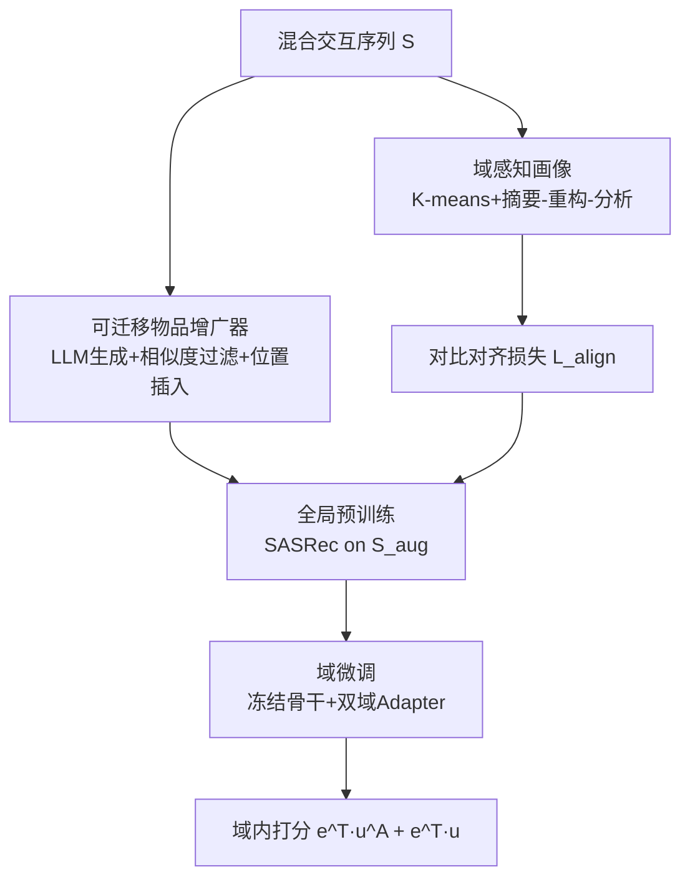
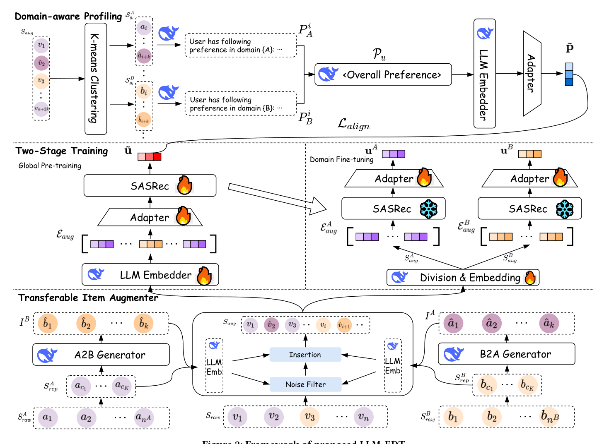

# LLM-EDT: Large Language Model Enhanced Cross-domain Sequential Recommendation with Dual-phase Training (大模型增强的双阶段训练跨域序列推荐)

- **会议/期刊**: SIGIR 2026
- **作者与机构**: Ziwei Liu, Qidong Liu, Wanyu Wang, Yejing Wang, Pengyue Jia, Tong Xu, Wei Huang, Chong Chen, Xiangyu Zhao (香港城市大学、西安交通大学、中科大、清华等)
- **推荐链路定位**: 召回（序列下一物品预测）
- **研究方向**: 跨域与多场景推荐 / 序列推荐
- **论文原文**: [https://arxiv.org/abs/2511.19931v2](https://arxiv.org/abs/2511.19931v2)
- **开源代码**: [https://github.com/Applied-Machine-Learning-Lab/SIGIR26_LLM-EDT](https://github.com/Applied-Machine-Learning-Lab/SIGIR26_LLM-EDT)

## TL;DR (1分钟核心速览)

跨域序列推荐（CDSR）长期受困于**域不平衡**（单域交互主导，另一域特征学不出来）与**域迁移**（混合序列中跨域偏好难捕捉）两大矛盾。本文提出 LLM-EDT：用 LLM 生成"可迁移物品"并做相似度噪声过滤与位置感知插入来平衡域分布；用"全局预训练→域微调"的双阶段训练把域共享背景注入域专属线程；再用 K-means 聚类 + 摘要-重构-分析流水线生成细粒度用户画像并以对比对齐损失注入表征。在 Amazon 三组跨域数据集上，H@10/N@10 相对最强基线提升 2.81%–26.96%（单侧 t 检验 $p<0.05$）。

## Background & Motivation (背景与核心矛盾)

- **主流范式**: CDSR 通过融合多域交互缓解单域稀疏，主流做法分两支——仅用全局共享特征加额外迁移目标（如 ABXI），或并行维护"共享线程 + 域专属线程"的三线程结构（如 TriCDR、LLM4CDSR）。
- **前人局限**: ① 传统迁移/GNN 方法（C2DSR、TriCDR）**强依赖重叠用户**，现实中大量用户仅单域有交互；② 三线程结构并行训练，域专属与域共享特征之间**缺乏显式连接**，域专属建模模糊；③ LLMCDSR 用 LLM 增广但**引入无关噪声**且牺牲效率，LLM4CDSR 的画像仅一步摘要，属**粗糙画像**。
- **核心洞察 (Key Insight)**: 作者统计 Amazon Cloth-Sport 的域比例 $r=\frac{|n_A-n_B|}{n_A+n_B}$，发现绝大多数用户落在 90%–100% 区间（图1），即域不平衡是普遍现象而非个例；同时 t-SNE 显示两域物品嵌入在语义空间存在明显间隔（图3a），说明需要"可迁移物品"充当桥梁。
- **本文切入点**: 用 LLM 生成**语义上接近主导域、但属于弱势域**的迁移物品来平衡分布，并以"先全局后域专属"的渐进训练替代并行三线程。

## Method (核心方法设计)

### 1. 整体框架 (Overall Architecture)

输入用户混合交互序列 $S$，先经**可迁移物品增广器**：LLM 分别做 A2B/B2A 生成候选物品，经 LLM 嵌入余弦相似度过滤后，按"最相似原始物品之后"的位置插入，得到增广序列$S_{aug}$及其按域切分的$S^A_{aug},S^B_{aug}$。随后进入**双阶段训练**：全局预训练在$S_{aug}$上训练 SASRec 获得域共享表征$\tilde{u}$；域微调冻结骨干、仅训练两个域适配器得到$u^A,u^B$，预测时融合两者。并行地，**域感知画像**模块对每域嵌入做 K-means 聚类，经摘要-重构-分析生成文本画像$P_u$，编码为$\tilde{p}$后与$\tilde{u}$ 做对比对齐。

<figure class="paper-figure" markdown="span">
  <figcaption>图2：所提出的LLM-EDT框架</figcaption>
</figure>

### 2. 关键设计拆解 (Key Designs)

1. **可迁移物品增广器（生成-过滤-插入三件套）**：痛点是不加筛选的 LLM 增广会引入幻觉噪声、随机插入破坏位置语义。生成端先用 K-means 对主导域物品聚类取代表样本 $S^{A}_{rep}$喂给 LLM 保证多样性；过滤端对生成物品$i$ 计算与两域代表集的最大余弦相似度，仅保留"在目标域相似度排名靠前且绝对相似度达标"的样本：
$$T^{A2B}=\{i\in I^B \mid \mathrm{rank}(score^A_i)\le k \wedge score^B_i\ge \tau\}$$
插入端不做随机插入，而是把生成物品紧接在其最相似的原始物品 $s^A_i$ 之后，使其天然成为域切换信号。直觉：迁移物品既贴近主导域语义、又归属弱势域，从而在嵌入空间"缝合"两域间隔（图3b 验证分布更紧凑）。

2. **双阶段训练（全局预训练 → 域微调）**：针对三线程并行导致域专属与共享特征脱节的问题，改为**串行渐进**。预训练阶段用适配器把 LLM 嵌入降维投影到推荐空间 $\tilde{e}_i=W_1(W_2e_i+b_2)+b_1$，在$S_{aug}$上以 BPR 式损失$\mathcal{L}_{pre}$ 训练；微调阶段**冻结 SASRec 骨干**，仅用两个轻量适配器编码域序列，最终打分显式融合全局与域专属两路：
$$P(v_{n_A+k+1}=v_i\mid S_{aug},S^A_{aug})=\tilde{e}^A_i{}^\top u^A+\tilde{e}_i{}^\top\tilde{u}$$
这样域专属线程天然继承全局背景，且两路打分相加保证共享知识不被域微调冲掉。

3. **域感知画像与对齐损失**：针对"一步摘要"的粗糙画像，先用 K-means 把每域序列切成 $C$个子序列分别摘要得$\{P^c_A\},\{P^c_B\}$，再用域比例$r$构造"重构指令"$R$平衡两域摘要权重，最后分析生成跨域画像$P_u$。以 InfoNCE 对齐全局表征与画像表征：
$$\mathcal{L}_{align}=-\frac{1}{B}\sum_{i=1}^{B}\log\frac{\exp(\cos(\tilde{u}_i,\tilde{p}_i)/\tau)}{\sum_{j=1}^{B}\mathbb{I}[i\neq j]\exp(\cos(\tilde{u}_i,\tilde{p}_j)/\tau)}$$
总损失为 $\mathcal{L}_{pre}+\alpha\mathcal{L}_{align}$（预训练）与$\mathcal{L}_A+\mathcal{L}_B$（微调）。负采样采用**随机负采样**（每正样本配一随机负例）。推理时所有 LLM 嵌入与画像均可离线缓存，线上仅加载适配器与 SASRec，**零 LLM 推理开销**。

## Experimental Setup & Evaluation Protocol (实验设置与评估协议)

- **数据集与预处理**: 三组 Amazon 子类跨域对，增广前后统计如下：

| 数据集 | #Users | #Items(前/后) | Avg.len(前/后) | 场景说明 |
| :--- | :---: | :---: | :---: | :--- |
| Cloth-Sport | 9,933 | 3,278 / 4,204 | 10.71 / 11.04 | 服饰→运动，域不平衡最严重 |
| Electronic-Cell Phone | 20,728 | 10,492 / 11,023 | 8.30 / 8.51 | 电子→手机 |
| Food-Kitchen | 14,858 | 8,343 / 8,742 | 8.13 / 8.47 | 食品→厨具 |

- **数据划分与防穿越 (Splitting Strategy)**: 沿用 LLM4CDSR 的序列划分设定（按时间序的下一物品预测，具体切分比例与基线一致）。
- **排名评测协议 (Ranking Protocol)**: 报告 H@10 与 N@10；基线对比采用与 LLM4CDSR 一致的评测流程，显著性用单侧 t 检验 $p<0.05$。
- **对比基线与超参设置**: 基线分三类——SRS（GRU4Rec/BERT4Rec/SASRec）、CDSR（C2DSR/TriCDR/SyNCRec/ABXI）、LLM 增强（LLM-ESR/LLMCDSR/LLM4CDSR）。隐藏维 128、batch 512、预训练 lr 1e-3、微调 lr 1e-5、适配器维 64、聚类数 $K=10$、$\alpha\in\{0.1,\dots,1.0\}$，结果取种子 {42,44,46} 均值。

## Key Experimental Results (实验关键数据)

### 1. 主实验对比 (Main Results)

| 模型 | Cloth H@10 | Sport H@10 | Elec H@10 | Cell H@10 | Food H@10 | Kitchen H@10 |
| :--- | :---: | :---: | :---: | :---: | :---: | :---: |
| SASRec | 0.7081 | 0.5911 | 0.3501 | 0.3212 | 0.3250 | 0.4211 |
| C2DSR | 0.7166 | 0.5948 | 0.4559 | 0.2819 | 0.3416 | 0.4424 |
| TriCDR | 0.7219 | 0.6114 | 0.4532 | 0.2616 | 0.3457 | 0.4446 |
| ABXI | 0.7474 | 0.6440 | 0.4623 | 0.3282 | 0.3652 | 0.4682 |
| LLM-ESR | 0.7433 | 0.6394 | 0.4548 | 0.3411 | 0.3667 | 0.4551 |
| LLMCDSR | 0.7646 | 0.7138 | 0.4900 | 0.3586 | 0.3746 | 0.4779 |
| LLM4CDSR | 0.7882 | 0.7021 | 0.4818 | 0.3423 | 0.3976 | 0.4901 |
| **LLM-EDT** | **0.8104** | **0.7649** | **0.5289** | **0.4553** | **0.4349** | **0.5406** |
| Improv.% | +2.81 | +7.16 | +7.94 | +26.96 | +9.38 | +10.30 |

N@10 上提升更显著：Cell Phone +25.82%、Sport +7.35%、Kitchen +12.42%。

### 2. 消融实验 (Ablation Study)

| 变体 | Cloth H@10 | Cloth N@10 | Sport H@10 | Sport N@10 |
| :--- | :---: | :---: | :---: | :---: |
| LLM-EDT | **0.8078** | **0.7432** | **0.7529** | **0.6779** |
| w/o Aug. | 0.7919 | 0.7311 | 0.6854 | 0.6291 |
| w/o Filtering | 0.7724 | 0.7148 | 0.6670 | 0.6079 |
| w/o Inserting | 0.7802 | 0.7195 | 0.6703 | 0.6214 |
| Random Inserting | 0.7842 | 0.7235 | 0.6774 | 0.6377 |
| w/o DFT | 0.7581 | 0.6753 | 0.7049 | 0.6022 |
| w/o Profiling | 0.7951 | 0.7377 | 0.7399 | 0.6617 |
| w/o S-R-A | 0.7901 | 0.7321 | 0.7278 | 0.6526 |

### 3. 关键实验发现 (Key Findings)

1. **增广的收益主要落在弱势域**：去掉增广后 Sport 域 H@10 从 0.7529 掉到 0.6854（-6.75pt），而 Cloth 仅掉 1.59pt，说明迁移物品确实在补弱势域信号；且"过滤"比"插入方式"更关键（w/o Filtering 在 Cloth 上甚至低于 w/o Aug.，证明未过滤的幻觉样本会造成负迁移）。
2. **双阶段训练是域迁移问题的核心解**：w/o DFT 在 Cloth 上 H@10 暴跌至 0.7581（-4.97pt），是消融中最大跌幅之一，验证"先全局后域专属"的串行渐进优于并行三线程；而 w/o S-R-A 掉 1.77pt，说明细粒度画像比朴素摘要更有效。
3. **冷启动与骨干无关性双重验证**：按交互长度分桶后，LLM-EDT 在 Very Short 到 Very Long 全部桶上均优于 LLMCDSR；替换骨干为 GRU4Rec/BERT4Rec 后仍保持 SOTA（如 BERT4Rec 骨干下 Cloth H@10 达 0.8113），且换用 GPT-3.5 性能仅微降（0.8091 vs 0.8104），体现 LLM-agnostic 与 model-agnostic 的通用性。

## Highlights & Limitations (亮点、对比与审稿批判)

- **与代表作对比 (vs. Prior Work)**: 相比 LLMCDSR 的"生成+元学习召回"，本文把噪声控制前移到**训练前的相似度过滤**，避免元网络额外开销；相比 LLM4CDSR 的三线程并行 + 一步画像，本文用**串行双阶段 + 聚类多粒度画像**建立域间显式连接，这是性能差距的主要来源。
- **可迁移亮点**: ① "按最相似原始物品定位插入"的位置感知增广策略可直接迁移到任何序列增广任务；② 离线缓存 LLM 嵌入 + 线上仅跑适配器的部署范式，是 LLM4Rec 工业落地的通用降本技巧。
- **审稿级局限批判**: ① 增广与画像依赖 DeepSeek API，虽单用户成本低（生成+摘要约 $0.00067$），但**离线批处理延迟与 API 稳定性**未讨论，且画像质量对 prompt 设计敏感；② 实验仅在 Amazon 两域对上进行，**多域（>2）场景与真实工业跨场景数据**未验证，域比例$r$ 的二域定义也难以直接推广。

## Rating (四维评分)

- **方法创新性 (Novelty)**: ⭐⭐⭐⭐ （迁移物品"生成-过滤-定位插入"闭环与串行双阶段训练组合新颖，但各组件单看均有前作影子）
- **评估协议与实验扎实度 (Protocol & Experiments)**: ⭐⭐⭐⭐ （三数据集、三类基线、8 组消融、冷启动/骨干/LLM 替换/效率分析齐全，但划分细节依赖前作、缺全库排序说明）
- **写作与数学规范度 (Clarity & Rigor)**: ⭐⭐⭐⭐ （公式与符号清晰，动机统计图有说服力；部分符号如 $k$与聚类数$K$ 易混淆）
- **工业落地与复现价值 (Industrial & Practical Value)**: ⭐⭐⭐⭐ （代码开源、线上零 LLM 推理、参数量接近 SASRec，但离线 API 依赖与多域扩展性待验证）
