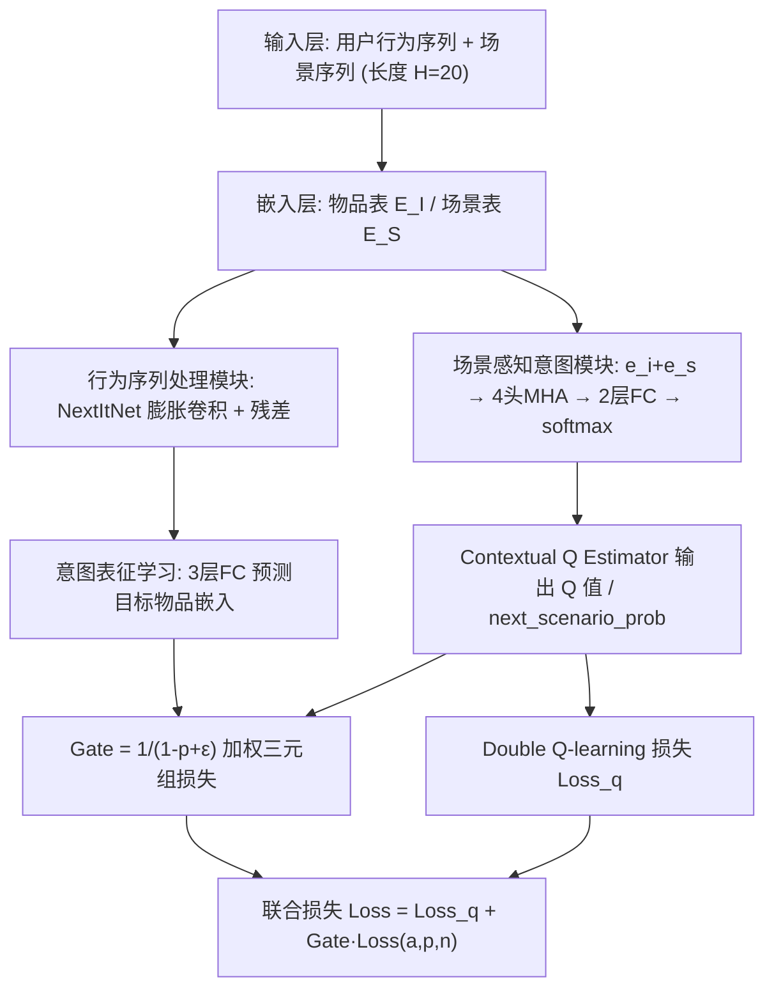
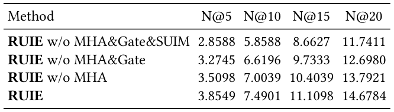

# Reinforcing User Interest Evolution in Multi-Scenario Learning for recommender systems (强化多场景推荐中的用户兴趣演化建模)

- **会议/期刊**: CIKM 2025 (arXiv 预印本 v1, 2025-06-21)
- **推荐链路定位**: 召回 / 序列下一物品预测 (Next-Item Prediction)，可延伸至粗排
- **研究方向**: 跨域与多场景推荐 (主) / 序列与会话推荐 (次)
- **论文原文**: [https://arxiv.org/abs/2506.17682v1](https://arxiv.org/abs/2506.17682v1)
- **开源代码**: 暂未开源（原文与正则预提取均未发现代码链接；数据集 KuaiSAR 公开于 [https://kuaisar.github.io/](https://kuaisar.github.io/)）

## TL;DR (核心速览)

针对多场景推荐中"用户兴趣跨场景漂移"与"场景间负迁移"两大痛点，本文提出 RUIE：用 NextItNet 膨胀卷积编码跨场景行为序列，用 Double Q-learning + 多头注意力 Contextual Q Estimator 估计"下一场景"的行为置信度 Q 值，并以该 Q 值构造门控 $Gate=\frac{1}{1-p+\epsilon}$ 动态加权三元组对比损失。在 KuaiSAR 工业数据集、全库排序 (Full-Ranking) 协议下，NDCG@20 达 14.6784，相对最强基线 STAR (4.4549) 提升约 229%。

## Background & Motivation (背景与动机)

- **领域背景与主流范式**: 工业 DLRM 中多场景建模已成热点，主流范式分两支：(1) 多任务共享底层表征（STAR 的星型拓扑 + 场景专属塔）；(2) 层级信息抽取 + 个性化先验（PEPNet 的 GateNU 门控网络）。序列侧则普遍采用 DIN 注意力、SASRec 自注意力、Caser 卷积、GRU 循环网络等下一物品预测架构。
- **现有方法局限 (Limitations of Prior Work)**:
  1. **兴趣漂移不可见**：用户兴趣随时间从场景 A（话题 a）迁移到场景 B（话题 b），但场景 A 仍按旧兴趣加投话题 b 的曝光，形成**曝光偏置 (exposure bias)**（见图 1）。STAR/PEPNet 均无显式的"兴趣迁移检测"机制。
  2. **场景间负迁移**：场景 A 的数据被场景 B 的行为"污染"，共享底层表征把不相关信号灌入各场景塔，导致单场景精度受损。
  3. **样本置信度不区分**：不同场景下同一行为（点击/关注/点赞/分享）的信息量差异巨大，但现有方法对所有样本等权优化，低置信场景样本稀释了高置信场景的学习信号。
- **核心挑战 (Key Challenge)**: 简单的特征拼接或加深网络无法解决——因为问题本质是**"样本该被信任多少"的动态信用分配问题**，而非表征容量问题；常规对比学习（如 SGL/SimGCL 式增广）也无从判断某条序列样本属于哪个场景、该场景当前是否仍是用户注意力焦点。
- **核心洞察与切入点 (Key Insight)**: 作者把"下一场景预测"形式化为强化学习中的**状态-动作价值估计**：状态 $s$ = 用户行为序列特征，动作 $a$ = 场景 ID，奖励 $r$ = 行为类型（click=1, follow=3, like=3, share=2）。若模型能准确预测用户下一步会去哪个场景（Q 值高），说明该场景行为可信、应加大学习；反之则降权。这一"Q 值即行为置信度"的桥接，正是把 RL 与对比学习缝合起来的关键。

## Problem Formulation & Method (问题定义与方法架构)

### 1. 符号定义与输入表征 (Notations & Input Representations)

- 物品集 $\mathcal{I}$、场景集 $\mathcal{S}$，嵌入维度 $d$（原文未显式给出 $d$ 的具体数值，仅记为 $d$；注意力头数 $h=4$，故 $D_k=D_v=D_q=D/h$）。
- 两张嵌入表：$E_I \in \mathbb{R}^{|\mathcal{I}|\times d}$、$E_S \in \mathbb{R}^{|\mathcal{S}|\times d}$，查表得 $e_i$、$e_s$。
- 用户行为序列长度 $H=20$（不足补特殊 token = max item ID + 1），滑动窗口按时间顺序更新，标签恒为序列中下一交互物品。
- 输出：目标物品嵌入预测 $\hat{e}$，以及下一场景概率 `next_scenario_prob`（即 Q 值经 softmax 后的分量）。

### 2. 整体流水线 (Overall Architecture)

数据流：物品/场景 ID → 双嵌入表 → ① NextItNet 膨胀卷积序列编码得 $\upsilon_U(A)$；② 场景感知意图模块中 $e_{i+s}=e_s+e_i$ 经 4 头多头注意力 + 两层 FC + softmax 得 Q 值；③ 意图表征学习用 3 层 FC 从序列表征预测目标物品嵌入，三元组损失约束；④ 取目标场景对应 Q 值构造 Gate，加权对比损失，与 Double Q-learning 损失联合优化。

图 2 给出了 RUIE 的整体框架：左侧为行为序列与场景序列双输入，中部为 NextItNet 序列编码与场景感知意图模块，右侧为 Gate 对比损失与 Q 损失的双路汇合。

### 3. 核心模块设计与数学原理 (Key Designs & Formulations)

**(1) 行为序列处理模块（NextItNet 膨胀卷积）**
$$\upsilon_U(A) = f(e_{i_1}, e_{i_2}, \dots, e_{i_H})$$
其中 $f(\cdot)$ 为带残差连接的堆叠膨胀卷积层。选用 NextItNet 而非 RNN/自注意力的物理直觉：掩码卷积天然保持自回归性（不泄漏未来信息），膨胀卷积在不增加参数的前提下扩大感受野，兼顾短期与长期兴趣，且训练效率优于需复杂对齐的注意力方案。

**(2) Contextual Q Estimator（场景感知 Q 估计器）**
先做场景-物品加性融合 $e_{i+s}=e_s+e_i$，再以 $Q=e_i$、$K=V=e_{i+s}$ 做 4 头注意力：
$$head_i = \text{Attention}(Q_i,K_i,V_i)=\text{softmax}\!\left(\frac{Q_iK_i^\top}{\sqrt{d_k}}\right)V_i$$
$$\text{MultiHead}(Q,K,V)=\text{Concat}(head_1,\dots,head_4)W_O,\quad W_O\in\mathbb{R}^{h\cdot D_v\times D}$$
取序列**下一位置**的注意力表征，与序列模块输出拼接，经两层 FC + softmax 得最终 Q 值。设计直觉：以物品为 Query、场景增强物品为 Key/Value，让模型显式学习"物品-场景关联"，从而捕捉兴趣在场景间的迁移轨迹。

**(3) Double Q-learning 更新（算法 1）**
双估计器 $Q_A,Q_B$ 交替更新以抑制 Q-learning 的过估计：
$$Q_A(s,a)\leftarrow Q_A(s,a)+\alpha\big[r+\gamma Q_B(s',a^*) - Q_A(s,a)\big],\quad a^*=\arg\max_a Q_A(s',a)$$
$$Q_B(s,a)\leftarrow Q_B(s,a)+\alpha\big[r+\gamma Q_A(s',b^*) - Q_B(s,a)\big],\quad b^*=\arg\max_b Q_B(s',b)$$
奖励设定：click=1, follow=3, like=3, share=2；折扣因子 $\gamma=0.5$。Q 的累积值即"长期用户参与价值"，作为最终损失中的行为置信度。

**(4) 意图表征学习与 Q 门控损失**
3 层 FC（ReLU）从 $\upsilon_U(A)$ 预测目标物品嵌入 $\hat{e}$，正样本为目标物品 $p$，随机采 10 个序列外物品为负样本 $n$，三元组损失：
$$\text{Loss}(a,p,n)=\max\big(0,\ \mathcal{E}(a,p)-\mathcal{E}(a,n)+\alpha\big)$$
其中 $\mathcal{E}$ 为欧氏距离，$\alpha$ 为温度/间隔系数。门控：
$$Gate=\frac{1}{1-\text{next\_scenario\_prob}+\epsilon}$$
当目标场景 Q 值低（用户对该场景兴趣弱、行为置信度低）时，$Gate$ 变小，对比损失被降权——这正是"防止负迁移"的机制化实现。

### 4. 训练目标、负采样与推理复杂度 (Optimization, Negative Sampling & Complexity)

- **总损失**: $\text{Loss}=\text{Loss}_q + Gate\cdot\text{Loss}(a,p,n)$，其中 $\text{Loss}_q$ 为 Double Q-learning 损失，第二项为 Q 门控三元组损失。
- **负采样策略**: 意图表征学习阶段对每条序列**随机采样 10 个不在该序列中的物品**作为负例（Uniform 随机负采样），正例为目标物品；评测阶段则**不使用负采样**，采用全库排序。
- **超参与优化**: 学习率 0.01，batch size 256，训练 50 epochs，Adam 优化器，注意力头数 4，对比模块 3 层 FC。
- **复杂度**: 序列编码为膨胀卷积，复杂度约 $O(H\cdot d^2)$ 量级（$H=20$ 固定，远低于长序列 Transformer 的 $O(H^2 d)$）；Q 估计器为 4 头注意力，$O(H^2 d/h)$。原文**未报告**离线预处理耗时、单 epoch 训练耗时、在线推理延迟 (ms/request) 与峰值显存，亦未讨论是否支持 ANN 检索。

## Experimental Setup & Evaluation Protocol (实验设置与评估协议)

- **数据集统计与预处理**: 仅使用一个公开工业数据集 **KuaiSAR**（快手短视频平台，融合搜索与推荐双场景，DAU 超 4 亿）。原文**未给出**用户数/物品数/交互数/稀疏度的完整统计表，仅说明随机采样 **10,000 名用户**，训练集时间跨度 2023/05/22–2023/05/28，测试集为 2023/05/29。

| 数据集 (Dataset) | 用户数 (#Users) | 物品数 (#Items) | 交互数 (#Interactions) | 稀疏度/密度 (Sparsity) | 模态/辅助特征说明 |
| :--- | :---: | :---: | :---: | :---: | :--- |
| KuaiSAR | 10,000（采样） | 原文未报告 | 原文未报告 | 原文未报告 | 搜索 + 推荐双场景；行为类型 click/follow/like/share |

- **数据划分方式 (Splitting Strategy)**: **全局时间戳切分**（训练 05/22–05/28，测试 05/29），且对每条用户序列"保留最后一个物品作测试、其余作训练"，属于时间切分 + 序列末位留出的混合策略。时间切分本身可降低穿越风险，但原文未说明是否对训练窗口内序列做严格因果掩码之外的额外防泄漏处理。
- **排名评测协议 (Ranking Protocol)**: 明确采用 **Full-Ranking（全库排序）**，原文强调"不使用常被批评引入偏置的负采样"。
- **评价指标与显著性检验**: NDCG@K，K ∈ {5, 10, 15, 20}。原文**未报告**多随机种子方差、配对显著性检验（t-test/Wilcoxon/Bootstrap），也未说明嵌入维度 $d$ 的具体取值与基线间的参数量对齐情况。

## Key Experimental Results (核心实验结果)

### 1. 主实验对比 (Main Results)

表 1 报告了 KuaiSAR 上的全库排序结果（NDCG@K，数值为百分数尺度）：

| 数据集 | 指标 | 传统/序列基线 | 多场景最强基线 | 本文方法 (Ours) | 相对提升 (Improv.) |
| :--- | :--- | :---: | :---: | :---: | :---: |
| KuaiSAR | N@5 | DIN 0.0549 / GRU 0.4705 / SASRec 1.0980 | STAR 1.4039 | **3.8549** | +174.6% (vs STAR) |
| KuaiSAR | N@10 | DIN 0.1372 / SASRec 2.3568 | STAR 2.7450 | **7.4901** | +172.9% (vs STAR) |
| KuaiSAR | N@15 | DIN 0.2627 / SASRec 3.4745 | PEPNet 3.8235 | **11.1098** | +190.6% (vs PEPNet) |
| KuaiSAR | N@20 | DIN 0.3294 / SASRec 4.8392 | STAR 4.4549 | **14.6784** | +229.5% (vs STAR) |

作者归因：(a) 多头注意力类方法优于其他基线，因其能捕捉跨场景行为序列的高层表征；(b) GRU/DIN 等传统序列模型缺乏跨场景兴趣动态演化建模能力；(c) PEPNet/STAR 虽优于传统模型，但缺少"逐物品跨场景反馈机制"，故次优。

### 2. 消融实验与控制变量分析 (Ablation Study)

表 2 消融结果（NDCG@K）：

| 配置 | N@5 | N@10 | N@15 | N@20 |
| :--- | :---: | :---: | :---: | :---: |
| RUIE w/o MHA&Gate&SUIM | 2.8588 | 5.8588 | 8.6627 | 11.7411 |
| RUIE w/o MHA&Gate | 3.2745 | 6.6196 | 9.7333 | 12.6980 |
| RUIE w/o MHA | 3.5098 | 7.0039 | 10.4039 | 13.7921 |
| RUIE (full) | **3.8549** | **7.4901** | **11.1098** | **14.6784** |

- 移除 MHA：N@20 从 14.6784 降至 13.7921（−6.0%），说明多头注意力对捕捉兴趣迁移与物品-场景关联贡献最大。
- 再移除 Gate：降至 12.6980（相对 full −13.5%），说明 RL 与对比学习之间缺少"路标"时学习方向失焦。
- 再移除整个 SUIM 模块：降至 11.7411（相对 full −20.0%），验证场景感知意图模块的整体必要性。
- **批判点**：消融为逐层剥离式（cumulative removal），未做单模块独立移除，也未控制参数量对齐或图拓扑度数匹配，因此各模块的边际贡献存在混淆。

### 3. 稀疏度/冷启动分桶与超参敏感度 (Sparsity Buckets & Hyperparameters)

- **分桶分析**: 原文**未报告**按用户/物品交互频次分桶的长尾或冷启动表现。
- **超参敏感度**: 原文**未报告**温度系数 $\alpha$、折扣因子 $\gamma$、损失权重、序列长度 $H$ 或注意力头数 $h$ 的敏感性分析；仅给出固定取值（$\gamma=0.5$，$h=4$，$H=20$，lr=0.01，batch=256，50 epochs）。
- **线上 A/B 测试**: 原文**仅包含离线实验**，未报告任何线上 CTR/CVR/留存收益。

## Highlights, Limitations & Critiques (亮点、局限与审稿级批判)

- **核心亮点与可迁移性**:
  1. **"Q 值即样本置信度"的桥接思想**极具迁移性：把 RL 的价值估计当作对比学习/多任务损失的动态权重，可无缝移植到跨域推荐 (CDR)、多任务精排 (MMoE/PLE 的专家门控)、甚至去噪推荐中的样本重加权。
  2. **门控形式 $Gate=1/(1-p+\epsilon)$** 简洁且单调，避免了额外可学习参数带来的过拟合，工程上易实现。
  3. 全库排序评测 + 时间切分，在工业数据集上比常见的 1:99 负采样协议更可信。
- **局限性与审稿视角批判 (Critical Limitations)**:
  1. **实验规模与统计严谨性不足**：仅 1 个数据集、10,000 用户子采样，无多随机种子方差、无显著性检验，NDCG 绝对数值极低（N@5 仅 3.85），提升幅度（+229%）异常巨大却缺乏误差棒，审稿人会强烈质疑基线调参与评测可比性。
  2. **基线覆盖偏弱**：缺少近两年多场景 SOTA（如 ADIN、M2M、Hamur、以及基于对比学习的多场景方法），也未与任何 RL-based 推荐基线（如 DQN/PPO 类）对比，难以支撑"RL 有效"的论断。
  3. **RL 形式化存疑**：动作空间定义为"场景 ID"而非"物品"，奖励为手工设定的行为权重（1/3/3/2），$\gamma=0.5$ 偏小；Double Q-learning 的离线训练细节（经验回放、目标网络、探索策略）完全缺失，算法 1 与网络实现之间的对应关系模糊。
  4. **Gate 方向性可疑**：$p$ 低时 $Gate$ 小、损失被降权，但低 $p$ 也可能意味着"用户即将迁移到新场景"——此时恰恰应加强学习而非抑制，作者未讨论这一潜在反向效应。
  5. **可复现性缺口**：无开源代码，嵌入维度 $d$、数据集完整统计、训练耗时/显存均未报告，KuaiSAR 子采样用户列表亦未公开。
  6. **写作规范**：5 页短文，公式排版与符号一致性一般（如 $\alpha$ 同时用作学习率与三元组间隔），参考文献与图表编号存在明显排版瑕疵。

## Rating (四维评分)

- **方法创新性 (Novelty)**: ⭐⭐⭐（Q 值门控对比学习的组合有新意，但各组件均为成熟技术拼接）
- **评估协议与实验扎实度 (Protocol & Experiments)**: ⭐⭐（全库排序 + 时间切分值得肯定，但单数据集、无方差/显著性、基线偏旧）
- **写作与数学规范度 (Clarity & Rigor)**: ⭐⭐（RL 训练细节缺失、符号复用、排版瑕疵较多）
- **工业落地与复现价值 (Industrial & Practical Value)**: ⭐⭐⭐（门控机制轻量易落地，但无代码、无线上验证、超参与实现细节不足）

## 论文图表

<figure class="paper-figure" markdown="span">
  <figcaption>图 1</figcaption>
</figure>

<figure class="paper-figure" markdown="span">
  <figcaption>图 2</figcaption>
</figure>

<figure class="paper-figure" markdown="span">
  <figcaption>表 2</figcaption>
</figure>

