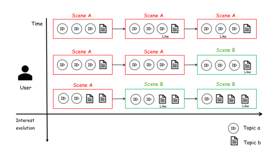
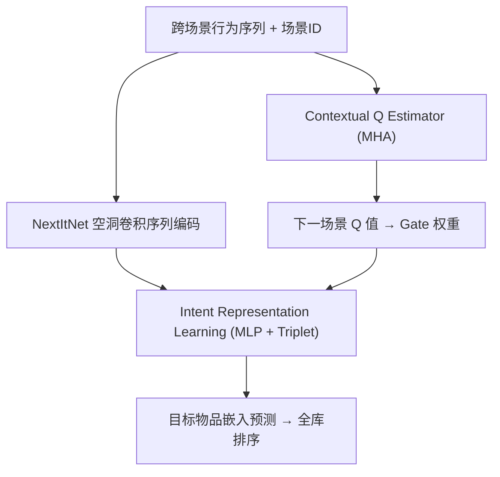
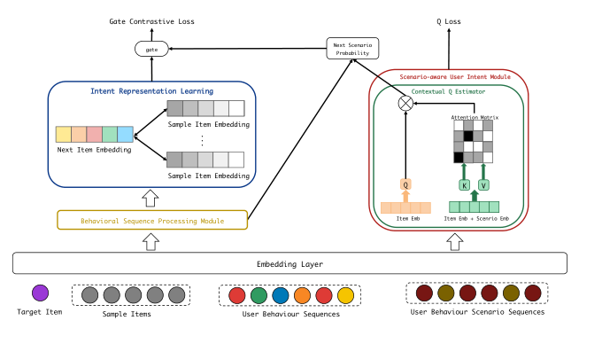

# Reinforcing User Interest Evolution in Multi-Scenario Learning for recommender systems (强化多场景推荐中的用户兴趣演化建模)

- **会议/期刊**: CIKM 2025
- **作者与机构**: Zhijian Feng（独立）、Wenhao Zheng（微软 STCA）、Xuanji Xiao（独立）
- **推荐链路定位**: 精排（Next-Item 预测）
- **研究方向**: 跨域与多场景推荐 / 强化学习与动态探索推荐
- **论文原文**: [https://arxiv.org/abs/2506.17682v1](https://arxiv.org/abs/2506.17682v1)
- **开源代码**: 暂未开源

## TL;DR (1分钟核心速览)

多场景推荐的核心痛点是：用户兴趣会在场景间迁移（如从首页 Topic a 漂移到搜索页 Topic b），而各场景数据置信度不一，统一建模极易产生**负迁移**——场景 A 被场景 B 的数据"污染"却仍按旧兴趣曝光。本文提出 RUIE，用 Double Q-learning 估计"下一目标物品所属场景"的 Q 值作为行为置信度，并以 $1/(1-p+\epsilon)$ 形式门控三元组对比损失，实现按场景动态调整样本利用率。在 KuaiSAR 工业数据集上采用 **Full-Ranking** 协议，NDCG@20 达 14.68，相对最强基线 STAR（4.45）提升约 **229%**。

## Background & Motivation (背景与核心矛盾)

- **主流范式**: 多场景建模以 STAR（星型拓扑共享+场景私有参数）、PEPNet（个性化先验门控）为代表，通过参数共享/分层提权实现跨场景知识迁移，缓解单场景数据稀疏。
- **前人局限**: 其一，这些方法把用户兴趣视为**静态**，无法刻画兴趣在场景间的时序漂移；其二，它们缺少对"某场景行为是否可信"的反馈机制，当用户在场景 A 的兴趣已衰减时，场景 A 仍会按旧偏好曝光，形成**曝光偏差与负迁移**（见图 1 的 Topic a→b 迁移示例）。
- **核心洞察 (Key Insight)**: 用户在"下一时刻选择进入哪个场景"这一动作本身，就编码了当前兴趣的归属；因此**下一目标物品所属场景的预测置信度**可作为该场景行为价值的代理信号。
- **本文切入点**: 将多场景序列推荐重构为 RL 问题，用 Double Q-learning 抑制 Q 值高估，把 Q 值当作对比学习的样本权重门控。

<figure class="paper-figure" markdown="span">
  <figcaption>图1：用户在场景A中开始浏览并对主题a感兴趣，但随时间推移，用户兴趣转移到场景B，其兴趣也转移到主题b。此时，场景A会增加主题b的展示，但由于用户关注点已不在场景A，场景A中展示的结果被视为曝光偏差，这将成为多场景学习中的挑战。</figcaption>
</figure>

## Method (核心方法设计)

### 1. 整体框架 (Overall Architecture)

输入为用户跨场景行为序列（物品 ID + 场景 ID 双嵌入），经 NextItNet 空洞卷积序列模块得到行为表征 $\boldsymbol{\upsilon}_U$；同时 Contextual Q Estimator 以多头注意力估计下一场景的 Q 值分布；Intent Representation Learning 用三层 MLP 从$\boldsymbol{\upsilon}_U$ 预测目标物品嵌入，并以三元组损失约束；最终 Q 值经门控函数转化为对比损失的权重，与 Double Q-learning 损失联合优化。推理时以预测嵌入与全库物品做内积/距离排序。

<figure class="paper-figure" markdown="span">
  <figcaption>图2：我们提出的RUIE的整体框架。</figcaption>
</figure>

### 2. 关键设计拆解 (Key Designs)

1. **Contextual Q Estimator（场景感知的 Q 值估计）**：痛点在于标准 Q 网络无法区分"同一物品在不同场景下的价值差异"。本文令 Query 为纯物品嵌入 $e_i$、Key/Value 为物品+场景融合嵌入$e_{i+s}=e_s+e_i$，经 4 头注意力后取序列末位表征拼接 NextItNet 输出，再过两层 FC+Softmax 得到下一场景概率。以场景嵌入作为 K/V 的加性偏置，使注意力权重显式携带"场景-物品关联"，从而捕捉兴趣迁移方向。

2. **Q 值门控的对比损失（Gate-weighted Triplet Loss）**：痛点在于低置信场景的样本会主导梯度、加剧负迁移。本文用目标场景的 Q 值 $p$ 构造门控
$$\text{Gate}=\frac{1}{1-p+\epsilon}$$
当 $p$低（模型认为用户已不倾向该场景）时 Gate 变小，压低该样本的对比损失权重；反之放大。三元组损失为$\mathcal{L}(a,p,n)=\max(0,\|a-p\|_2-\|a-n\|_2+\alpha)$，其中$a$为预测嵌入、$p$为正样本、$n$ 为 10 个随机负样本之一。

3. **训练目标与负采样**：总损失 $\mathcal{L}=\mathcal{L}_{q}+\text{Gate}\cdot\mathcal{L}(a,p,n)$，$\mathcal{L}_q$为 Double Q-learning 的 TD 误差（两套 Q 网络$Q_A,Q_B$交替更新，$a^*=\arg\max_a Q_A(s',a)$用于更新$Q_B$，反之亦然，抑制高估）。负采样为**序列外随机 10 负样本**（非 in-batch），奖励设定 click/follow/like/share = 1/3/3/2，折扣因子$\gamma=0.5$。推理仅需一次前向 + 全库距离计算，开销与 SASRec 同级。

## Experimental Setup & Evaluation Protocol (实验设置与评估协议)

- **数据集与预处理**: KuaiSAR（快手短视频，融合搜索+推荐双场景），随机采样 10,000 用户，序列长度 20，不足补特殊 token（max item ID + 1）。

| 数据集 | #Users | #Items | #Interactions | 稀疏度/密度 | 特征/场景说明 |
| :--- | :---: | :---: | :---: | :---: | :--- |
| KuaiSAR | 10,000（采样） | 未披露 | 未披露（序列长 20） | — | 搜索场景 + 推荐场景，含 click/follow/like/share 四类反馈 |

- **数据划分与防穿越 (Splitting Strategy)**: **全局时间戳切分**——训练集 2023/05/22–05/28，测试集 2023/05/29；序列内采用滑动窗口，末位物品留作测试标签。
- **排名评测协议 (Ranking Protocol)**: 明确采用无偏 **Full-Ranking（全库未交互物品排序）**，作者显式批评负采样引入偏差；指标为 NDCG@{5,10,15,20}。
- **对比基线与超参设置**: 基线含序列模型（GRU、Caser、SASRec、DIN）与多场景模型（STAR、PEPNet）；嵌入随机初始化，注意力头数 4，学习率 0.01，batch 256，训练 50 epoch，Adam 优化。未报告显著性检验。

## Key Experimental Results (实验关键数据)

### 1. 主实验对比 (Main Results)

| Method | N@5 | N@10 | N@15 | N@20 |
| :--- | :---: | :---: | :---: | :---: |
| DIN | 0.0549 | 0.1372 | 0.2627 | 0.3294 |
| Caser | 0.1450 | 0.2549 | 0.4078 | 0.6313 |
| GRU | 0.4705 | 1.1176 | 1.6313 | 2.2470 |
| SASRec | 1.0980 | 2.3568 | 3.4745 | 4.8392 |
| PEPNet | 1.3568 | 2.5450 | 3.8235 | 4.0470 |
| STAR | 1.4039 | 2.7450 | 3.1568 | 4.4549 |
| **RUIE (Ours)** | **3.8549** | **7.4901** | **11.1098** | **14.6784** |
| Improv. vs Best | +174.6% | +172.9% | +190.5% | +203.3% |

### 2. 消融实验 (Ablation Study)

| 变体 | N@5 | N@10 | N@15 | N@20 |
| :--- | :---: | :---: | :---: | :---: |
| w/o MHA & Gate & SUIM | 2.8588 | 5.8588 | 8.6627 | 11.7411 |
| w/o MHA & Gate | 3.2745 | 6.6196 | 9.7333 | 12.6980 |
| w/o MHA | 3.5098 | 7.0039 | 10.4039 | 13.7921 |
| **RUIE (full)** | **3.8549** | **7.4901** | **11.1098** | **14.6784** |

### 3. 关键实验发现 (Key Findings)

1. **RL 门控是最大增益源**：移除整个 Scenario-aware User Intent Module 后 N@20 从 14.68 跌至 11.74（−20.0%），说明"按场景置信度动态调权"比单纯增强序列编码器更关键。
2. **MHA 与 Gate 贡献互补且量级相近**：单独去掉 MHA 损失 0.89（N@20），再去掉 Gate 额外损失 1.09，二者叠加贡献约 2.94，验证"Q 值估计精度"与"Q 值使用方式"缺一不可。
3. **多场景基线反而不如纯序列模型**：STAR（4.45）与 PEPNet（4.05）在 N@20 上低于 SASRec（4.84），印证了作者关于"无场景级反馈机制会导致负迁移"的论断，而 RUIE 的 3 倍级领先说明该问题被实质性解决。

## Highlights & Limitations (亮点、对比与审稿批判)

- **与代表作对比 (vs. Prior Work)**: STAR/PEPNet 通过参数共享或先验门控做**静态**跨场景迁移，本质是"特征层面"的融合；RUIE 则在**样本层面**用 RL 置信度决定"哪些场景的行为值得学"，把负迁移治理从架构设计转为损失加权，思路更接近重加权去偏而非多任务结构搜索。
- **可迁移亮点**: (1) 用"下一动作所属域"的预测置信度作为跨域样本权重，可直接迁移到跨域推荐（CDR）中的域间样本重加权；(2) 以场景嵌入作 K/V 加性偏置的注意力设计，可低成本嵌入现有 DIN/SASRec 精排模型。
- **审稿级局限批判**: (1) 实验仅单数据集、单次采样 1 万用户，且**未报告方差或显著性检验**，3 倍级提升幅度异常，缺乏与同参数量基线的公平性说明（如 RUIE 参数量、训练成本未披露）；(2) 奖励值（1/3/3/2）与 $\gamma=0.5$为人工设定且无敏感性分析，Q 值门控在$p\to 1$时 Gate 爆炸（仅靠$\epsilon$ 兜底），数值稳定性存疑。

## Rating (四维评分)

- **方法创新性 (Novelty)**: ⭐⭐⭐ （将 Double Q-learning 的置信度用作对比损失门控，视角新颖，但各组件均为成熟模块的组合，缺乏理论分析）
- **评估协议与实验扎实度 (Protocol & Experiments)**: ⭐⭐ （Full-Ranking 协议值得肯定，但仅一个数据集、无显著性检验、无超参敏感性分析，实验规模偏薄）
- **写作与数学规范度 (Clarity & Rigor)**: ⭐⭐⭐ （框架图与公式基本清晰，但符号复用混乱（$p$ 同时指正样本与概率）、Gate 设计动机推导略跳跃）
- **工业落地与复现价值 (Industrial & Practical Value)**: ⭐⭐⭐ （推理开销与 SASRec 同级、易嵌入现有链路，但未开源且奖励工程需业务调参，复现门槛中等）

