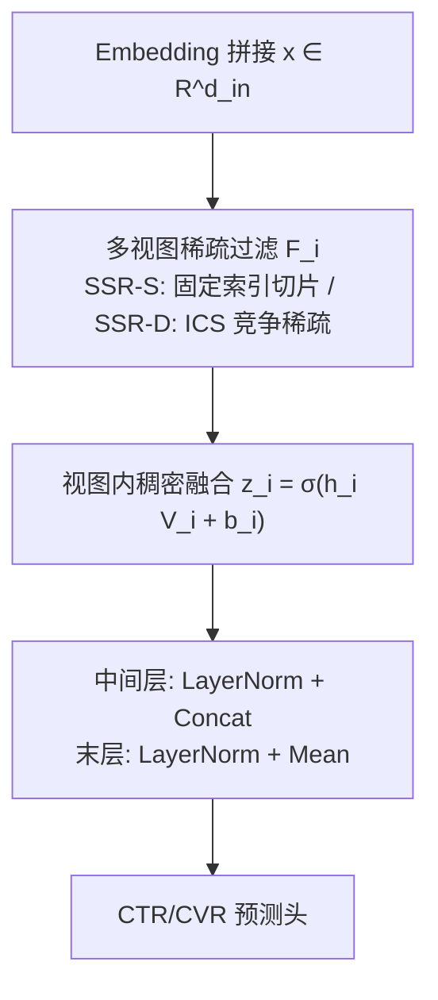
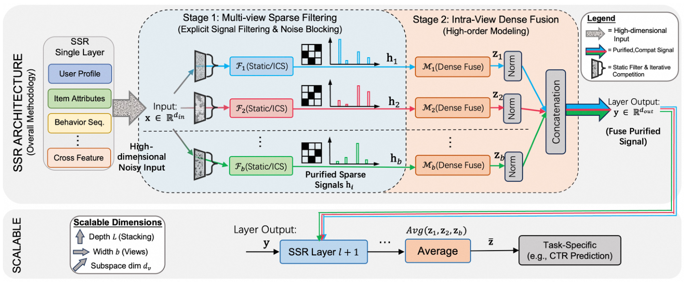

# Beyond Dense Connectivity: Explicit Sparsity for Scalable Recommendation (超越稠密连接：面向可扩展推荐的显式稀疏化)

- **会议/期刊**: SIGIR 2026 (Full Paper)
- **作者与机构**: Yantao Yu, Sen Qiao, Lei Shen, Bing Wang, Xiaoyi Zeng（阿里巴巴国际数字商业集团 AliExpress）
- **推荐链路定位**: 精排（CTR/CVR 预估主干网络）
- **研究方向**: CTR 预估与特征交叉 / 工业级全链路架构
- **论文原文**: [https://arxiv.org/abs/2604.08011v4](https://arxiv.org/abs/2604.08011v4)
- **开源代码**: [https://github.com/Atticus666/SSRNet](https://github.com/Atticus666/SSRNet)

## TL;DR (1分钟核心速览)

推荐输入是数百个异构特征域拼接的扁平向量，任意样本仅少数维度有效，而稠密 MLP 强制全连接，迫使优化器把容量浪费在"压制噪声"而非"建模模式"上，导致 scaling 收益递减甚至退化。作者在线上 CTR 模型中发现 **92% 连接权重被隐式压至近零、80% 权重能量集中于前 4% 维度**，据此提出 SSR：把隐式权重抑制转为**显式信号过滤**，用"先过滤、后融合"的多视图架构（静态随机过滤 SSR-S / 迭代竞争稀疏 ICS 的 SSR-D）在稠密融合前于源头阻断噪声。在 Avazu/Criteo/Alibaba 与十亿级 AliExpress 工业集上，SSR-D 全面超越 RankMixer（工业 Click AUC 0.6667 vs 0.6621），SSR-S 仅用 56% 参数、44% FLOPs 即反超，且线上 A/B 延迟持平（25ms）下 CTR +2.1%、GMV +3.5%。

## Background & Motivation (背景与核心矛盾)

- **主流范式**: 工业 CTR 主干（Wide&Deep、DLRM、DCN v2、RankMixer）仍以 3–4 层稠密 MLP 为核心，靠加深加宽提升容量；AutoInt/AFN 用自注意力做高阶交叉，AutoFIS 走"先稠密训练再剪枝"路线。
- **前人局限**: ① 稠密全连接假设"任意维度对等可能交互"，而推荐数据的高阶交互高度集中于少数特征子集，归纳偏置与数据分布错配，优化器被迫学习"该压制哪些连接"；② 自注意力经 Softmax 产生严格正权重（$\alpha_{ij}>0$），计算图仍是全连接，噪声无法在源头阻断；AutoFIS 式后剪枝在稠密交互已发生后才删冗余，且剪枝后容量受限（工业 AUC 仅 0.6592）。
- **核心洞察 (Key Insight)**: 线上模型权重呈现极端**隐式连接稀疏**——92% 权重 < $10^{-3}$，80% 权重能量集中在前 4% 维度。这说明数据本身偏好稀疏，但隐式抑制既未真正消除噪声干扰，也未提供信号筛选机制；且"何为噪声"随用户/样本而变，静态稀疏结构无法覆盖上下文依赖。
- **本文切入点**: 将稀疏从"训练副产物"升级为"可控架构设计"，用显式维度级硬过滤在稠密非线性融合之前隔离噪声，并提供静态（结构稀疏）与动态（样本自适应）两种实例化。

## Method (核心方法设计)

### 1. 整体框架 (Overall Architecture)

输入特征（用户画像、物品属性、交叉统计、行为序列）经 Embedding 拼接为 $x\in\mathbb{R}^{d_{in}}$。SSR 层将其解耦为 $b$ 个独立"净化视图"，每个视图 $\phi_i$ 严格分两阶段：先由稀疏过滤器 $\mathcal{F}_i$ 做维度级硬筛选得到 $h_i$，再由视图内稠密融合 $M_i$ 在低维子空间建模高阶交互得到 $z_i$。中间层将各视图输出 LayerNorm 后拼接送入下一层；最后一层改为**均值聚合** $\bar z=\frac{1}{b}\sum_i \text{LN}(z_i)$，既把各视图拉向共享语义空间、又使预测头输入维度固定为 $d_v$ 不随视图数线性膨胀。训练端到端，推理为标准前向打分。

<figure class="paper-figure" markdown="span">
  <figcaption>图 2：SSR 框架：面向可扩展推荐的显式稀疏化。</figcaption>
</figure>

### 2. 关键设计拆解 (Key Designs)

1. **SSR-S 静态随机过滤器（零 FLOP 结构稀疏）**：痛点是用 Top-k 等"逻辑稀疏"虽把无用特征乘零，但物理计算图仍为 $O(d^2)$ 宽。SSR-S 令 $\mathcal{F}_i$ 为固定二值选择矩阵 $M_i\in\{0,1\}^{d_{in}\times d_v}$（每列严格 one-hot），视图内无放回采样、视图间独立采样形成 Feature Bagging 式多样性：
$$h_i = x M_i \quad(\text{实现为 zero-FLOP 的并行 gather 索引切片})$$
由于在计算前就切片输入索引，维度选择成本与推理成本解耦，未选维度在源头被物理阻断。

2. **ICS 迭代竞争稀疏（可微动态过滤）**：痛点在于 Top-k 的离散截断不可微（STE 存在梯度失配），Soft Top-k/NeuralSort 需 $O(N\log N)$ 排序。ICS 把稀疏化建模为连续动力系统：特征强度视为"生命力"，均值场构成全局抑制力，强者存活、弱者收敛到真零：
$$x^{(t+1)}=\text{ReLU}\big(x^{(t)}-\alpha_t\cdot\mu^{(t)}\big),\quad \mu^{(t)}=\tfrac{1}{d_v}\textstyle\sum_j x_j^{(t)}$$
其中 $\alpha_t$ 为每轮可学习灭绝率。多轮迭代（$T=5$）必要，因为噪声逐步熄灭时 $\mu^{(t)}$ 持续精化，实现"先粗滤后细调"的非线性稀疏化；单步阈值化依赖静态噪声底估计。由于 $\alpha_t>0,\mu^{(t)}\ge 0$，系统满足 $|x^{(t+1)}|_1\le|x^{(t)}|_1$ 单调能量衰减，故引入可学习缩放 $\gamma\odot x^{(T)}$ 补偿信号衰减、稳定数值动态范围。复杂度 $O(T\cdot N)$ 严格线性。

3. **视图内块对角融合与训练目标**：融合等价于块对角权重 $W_{block}=\text{diag}(V_1,\dots,V_b)$，强制视图间语义隔离，参数量 $O(b\cdot d_v^2)$ 相比全连接 $O((b d_v)^2)$ 降低 $1/b$ 倍，使同等算力下可显著扩容。总损失为 CTR/CVR 任务的加权交叉熵（工业双任务 click/pay），无额外对比或正则项；负采样即曝光日志天然负例，无显式负采样设计。

## Experimental Setup & Evaluation Protocol (实验设置与评估协议)

- **数据集与预处理**: 类别特征频次 $\le 5$ 剔除，数值特征 log 变换后离散化。

| 数据集 | #Samples | 正样本率 | 类别特征 | 数值特征 | 特征取值数 | 场景说明 |
| :--- | :---: | :---: | :---: | :---: | :---: | :--- |
| Avazu | 40.4M | 16.98% | 23 | 0 | 1.54M | 移动广告点击 |
| Criteo | 45.8M | 25.62% | 26 | 13 | 1.00M | 展示广告 |
| Alibaba | 42.3M | 3.89% | 23 | 4 | 1.34M | 阿里展示广告 |
| Industrial | 1.003B | 3.45%/0.08% | 183 | 129 | — | AliExpress 推荐，click/pay 双任务 |

- **数据划分与防穿越**: 公开集标准随机划分 8:1:1；工业集采用**基于时间的切分**（最近一天作验证与测试）以模拟线上。
- **排名评测协议**: 采用 AUC / LogLoss，工业集额外报告 GAUC（缓解用户活跃度偏差，聚焦用户内排序）；pay 任务在全样本空间评估。效率侧报告主干参数量（剔除 Embedding 表）与单次前向 FLOPs。
- **对比基线与超参**: 四组基线——经典稠密（DeepFM、DCN v2）、注意力/动态（AutoInt、MMoE）、特征选择 AutoML（AutoFIS、AFN）、SOTA 可扩展架构（Wukong、RankMixer）。Embedding 维度统一 16，Adam + batch 1024 + early stopping，ICS 迭代 $T=5$、$\alpha_t$ 初始 0.1、$\gamma$ 初始全 1；显著性 $p<0.05$。

## Key Experimental Results (实验关键数据)

### 1. 主实验对比 (Main Results)

工业数据集（Click/Pay 双任务，AUC/GAUC）：

| Model | Click AUC | Click GAUC | Pay AUC | Pay GAUC | #Params | FLOPs |
| :--- | :---: | :---: | :---: | :---: | :---: | :---: |
| Dense MLP | 0.6593 | 0.6281 | 0.8083 | 0.6770 | 60M | 3.4G |
| DeepFM | 0.6563 | 0.6251 | 0.8053 | 0.6730 | 13M | 0.6G |
| DCN v2 | 0.6571 | 0.6262 | 0.8065 | 0.6742 | 15M | 0.9G |
| AutoInt | 0.6594 | 0.6279 | 0.8078 | 0.6769 | 26.2M | 1.7G |
| AutoFIS | 0.6592 | 0.6285 | 0.8085 | 0.6777 | 10.8M | 0.5G |
| Wukong | 0.6615 | 0.6298 | 0.8115 | 0.6805 | 93M | 2.9G |
| RankMixer | 0.6621 | 0.6305 | 0.8122 | 0.6815 | 101M | 3.2G |
| **SSR-S** | 0.6644 | 0.6326 | 0.8162 | 0.6841 | 57M | 1.4G |
| **SSR-D** | **0.6667\*** | **0.6351\*** | **0.8194\*** | **0.6862\*** | 100M | 3.3G |
| Improv. (vs RankMixer) | +0.69% | +0.73% | +0.89% | +0.69% | — | — |

公开集（AUC / LogLoss / Params / FLOPs）：

| Model | Avazu AUC | Alibaba AUC | Criteo AUC | Avazu Params | Avazu FLOPs |
| :--- | :---: | :---: | :---: | :---: | :---: |
| DeepFM | 0.7752 | 0.6594 | 0.7986 | 0.23M | 464.2M |
| AutoInt | 0.7722 | 0.6784 | 0.8053 | 0.07M | 850.2M |
| AutoFIS | 0.7802 | 0.6637 | 0.8089 | 0.23M | 472.7M |
| Wukong | 0.7756 | 0.6782 | 0.8073 | 0.17M | 719.6M |
| RankMixer | 0.7772 | 0.6801 | 0.8092 | 0.64M | 1.32G |
| **SSR-S** | **0.7827\*** | **0.6827\*** | **0.8098\*** | 0.33M | 688.7M |
| **SSR-D** | **0.7835\*** | **0.6844\*** | 0.8096\* | 0.97M | 2.00G |
| Improv. (SSR-D vs RankMixer) | +0.63% | +0.43% | +0.04% | — | — |

### 2. 消融实验 (Ablation Study)

以完整 SSR-D 为基线，报告 AUC 绝对变化（×10⁻²）：

| Setting | Avazu ΔAUC | Industrial ΔAUC |
| :--- | :---: | :---: |
| w/o Sparse Filtering（直接稠密块） | −0.50 | −0.37 |
| w/o Multi-view（$b=1$） | −0.22 | −0.15 |
| Static (SSR-S) vs. Dynamic | −0.12 | −0.23 |
| Top-k (STE) vs. ICS | −0.18 | −0.29 |
| Dropout vs. SSR-S | −0.32 | −0.45 |

ICS 敏感性（Avazu）：$T=1$ 稀疏度 76.4%/AUC 0.7821 → $T=5$ 稀疏度 91.0%/AUC 0.7835；$\alpha_t\in[0.1,0.5]$ 区间稀疏度 80.4%→94.5% 而 AUC 稳定在 0.7828–0.7835；去掉 $\gamma$ 降至 0.7832。

### 3. 关键实验发现 (Key Findings)

1. **增益来自结构而非容量**：SSR-S 以 57M 参数（RankMixer 的 56%）、1.4G FLOPs（44%）取得 Click AUC 0.6644，反超 101M/3.2G 的 RankMixer 0.6621；Avazu 上更以约一半参数与 FLOPs 提升 +0.55pt AUC，证明显式稀疏过滤本身即是收益来源。
2. **稀疏过滤是 scaling 的关键开关**：移除稀疏过滤导致最大跌幅（Avazu −0.50pt、工业 −0.37pt），远超移除多视图（−0.22/−0.15）；且 Dropout 替代 SSR-S 反而暴跌 0.32–0.45pt，说明收益不是正则化效应而是学到了有意义的稀疏结构。图 4 显示 Dense MLP 在 5M→900M 参数区间过早饱和，而 SSR 轨迹更陡、差距随规模拉大。
3. **动态样本自适应与可微性是二阶增益**：静态 SSR-S 换为动态 ICS 提升 0.12–0.23pt，Top-k(STE) 换 ICS 提升 0.18–0.29pt；ICS 训练动态显示 Layer 2 收敛稀疏度（~90%）高于 Layer 1（~75%），深层更选择性；视图间投影余弦相似度持续偏低，无需显式多样性正则即自然分化。线上 A/B（两周，对比同参 RankMixer）延迟持平 25ms，CTR +2.1%、人均订单 +3.2%、GMV +3.5%。

## Highlights, Limitations & Rating (亮点、对比与审稿评价)

- **与代表作对比 (vs. Prior Work)**: 与 AutoInt/AFN 的本质区别在于后者 Softmax 权重严格为正、计算图仍全连接，噪声无法阻断；与 AutoFIS 的区别是"先稠密后剪枝"vs"边学边滤"，SSR 在融合前硬截断；与 RankMixer/Wukong 相比，SSR 用块对角多视图替代全局稠密混合，把参数预算投向高信噪比子空间，因而在同等算力下 scaling 曲线更陡。
- **可迁移亮点**: ① "filter-then-fuse" 的块对角多视图分解可直接嵌入任意 MLP 主干，以 $1/b$ 参数复杂度换取扩容空间；② ICS 的均值场竞争抑制是可微 Top-k 的线性复杂度替代品，可迁移至特征选择、MoE 路由与序列稀疏注意力。
- **审稿级局限批判**: ① 静态 SSR-S 的随机索引固定后不可学习，特征域语义（如 ID 类 vs 统计类）未被利用，可能切掉稀有但高价值维度；② 动态 ICS 引入 $T$ 轮迭代与投影矩阵，SSR-D 的 FLOPs（2.0G）已高于 SSR-S 近 3 倍，且论文未报告训练吞吐与显存开销；③ 评估集中于 CTR/CVR 单点任务，缺少与序列建模、生成式推荐的组合验证，Criteo 上增益仅 +0.04% 亦说明饱和场景下收益有限。
- **四维评分**: 创新性 ⭐⭐⭐⭐ | 实验扎实度 ⭐⭐⭐⭐⭐ | 方法清晰度 ⭐⭐⭐⭐⭐ | 落地价值 ⭐⭐⭐⭐⭐

