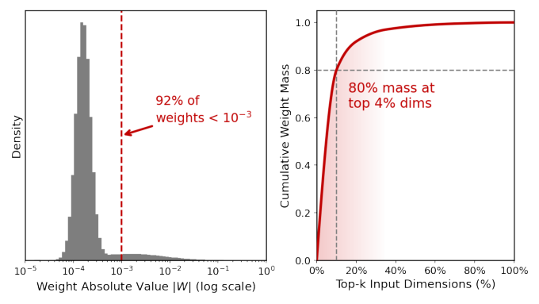
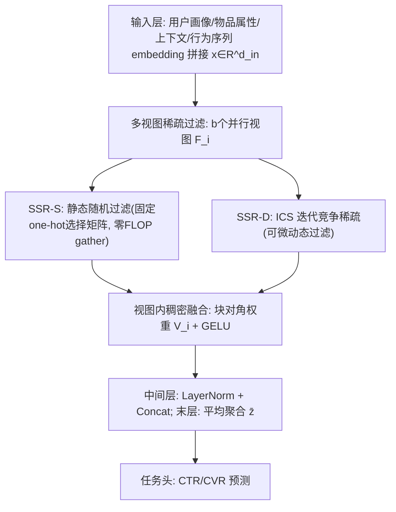
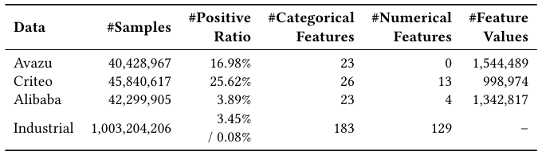
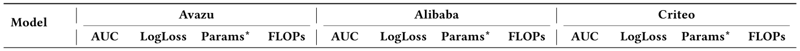
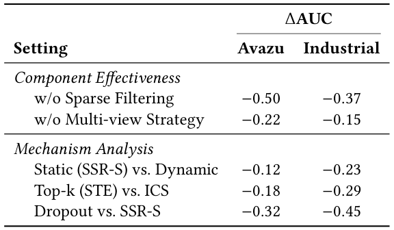
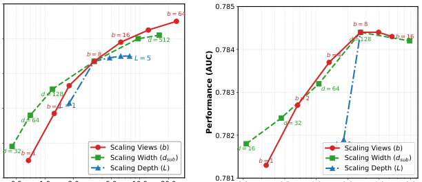
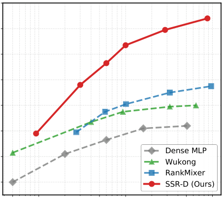
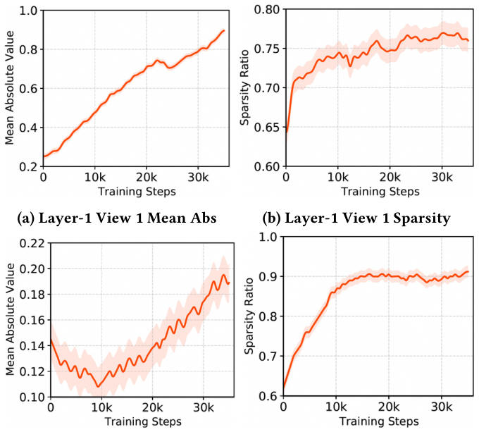

# Beyond Dense Connectivity: Explicit Sparsity for Scalable Recommendation (超越稠密连接：面向可扩展推荐的显式稀疏化)

- **会议/期刊**: SIGIR 2026 (Full Paper)
- **推荐链路定位**: 精排 (CTR/CVR Ranking)
- **研究方向**: CTR预估与特征交叉 / 多任务学习与列表级重排
- **论文原文**: [https://arxiv.org/abs/2604.08011v4](https://arxiv.org/abs/2604.08011v4)
- **开源代码**: [https://github.com/Atticus666/SSRNet](https://github.com/Atticus666/SSRNet)

## TL;DR (核心速览)

针对推荐输入高维极稀疏、稠密MLP扩展收益递减甚至退化的问题，本文发现工业CTR模型存在"隐式连接稀疏"（92%权重趋零、80%权重能量集中于4%维度），据此提出 filter-then-fuse 范式：先将输入分解为多视图做维度级稀疏过滤，再在子空间内稠密融合。通过静态随机过滤(SSR-S)与可微迭代竞争稀疏(SSR-D/ICS)两种实现，在 Avazu/Criteo/Alibaba 及十亿级 AliExpress 工业数据上，AUC 全面超越 RankMixer 等SOTA，且随参数量扩展持续增益、稠密模型则饱和。

## Background & Motivation (背景与动机)

- **领域背景与主流范式**: 受LLM缩放定律启发，工业CTR主干（Wide&Deep、DLRM、DCN v2、RankMixer）尝试加深加宽以利用海量行为数据，但主流工业模型仍停留在3–4层浅层结构。
- **现有方法局限 (Limitations of Prior Work)**:
  1. **稠密连接与稀疏数据的结构性错配**：推荐输入是数百个异构特征域拼接的扁平向量，无空间/序列局部性，单样本仅少量维度真正相关；全连接层强制全局稠密耦合，迫使优化器耗费容量去"抑制噪声"而非"建模模式"。
  2. **隐式抑制低效**：图1显示生产CTR模型92%连接被压至近零(<10⁻³)、80%权重能量集中于前4%维度，但隐式抑制既不阻断噪声传播，也不提供信号筛选机制。
  3. **软注意力/后剪枝保留全连接图**：AutoInt 的 softmax 权重严格为正(α_ij>0)，AutoFIS 属"先稠密后剪枝"，均无法在源头阻断噪声。
- **核心挑战 (Key Challenge)**: 简单加深加宽或加正则无法解决——因为问题不在容量不足，而在归纳偏置错配（稠密拓扑假设所有维度对等可能交互，而数据交互高度集中于小子集）。
- **核心洞察与切入点 (Key Insight)**: 借助 MLP-Mixer 的 Kronecker 积等价于"宽而稀疏MLP"的理论（Hayase & Karakida）及 Golubeva 假设（固定参数量下增宽/增稀疏提升泛化），作者主张将隐式稀疏转为**显式、可控的架构设计**，且因"何为噪声"随用户/样本而异，需同时具备**结构性稀疏**与**样本条件动态稀疏**。

<figure class="paper-figure" markdown="span">
  <figcaption>图1：在线CTR主干网络隐藏层的稀疏性分析。（左）92%的权重被抑制至接近零（&lt; 10−3）。（右）80%的权重能量集中在排名前4%的维度中。</figcaption>
</figure>

## Problem Formulation & Method (问题定义与方法架构)

### 1. 符号定义与输入表征 (Notations & Input Representations)

- 输入：原始特征（用户画像、候选物品属性、交叉统计、行为序列）经 embedding 拼接为初始向量 $\mathbf{x}\in\mathbb{R}^{d_{in}}$。
- 视图数 $b$，每视图子空间维度 $d_v$（动态实例中扩展为 $d_v^*>d_v$）。
- 输出：CTR/CVR logits $y_{ctr}=\sigma(\mathbf{W}_{ctr}\bar{\mathbf{z}}+\mathbf{b}_{ctr})$。
- 关键超参：ICS 迭代次数 $T=5$，可学习灭绝率 $\alpha_t$ 初始化为 0.1，可学习缩放 $\gamma$ 初始化为全1向量。

### 2. 整体流水线 (Overall Architecture)

数据流：特征 embedding 拼接 $\to$ 分解为 $b$ 个独立净化视图，每视图先**稀疏过滤** $F_i$ 再**视图内稠密融合** $M_i$ $\to$ 中间层拼接(LayerNorm+concat)、末层平均聚合 $\to$ 任务头预测。

<figure class="paper-figure" markdown="span">
  <figcaption>图2：SSR框架：面向可扩展推荐的显式稀疏化。</figcaption>
</figure>

### 3. 核心模块设计与数学原理 (Key Designs & Formulations)

**(1) 多视图稀疏过滤 (Filter)**：对第 $i$ 个视图，从高维输入提取净化表示 $\mathbf{h}_i=F_i(\mathbf{x})$。
- **SSR-S 静态随机过滤**：$F_i$ 为二值选择矩阵 $\mathbf{M}_i\in\{0,1\}^{d_{in}\times d_v}$，每列严格 one-hot，初始化后固定。视图内无放回均匀采样 $d_v$ 个特征索引，视图间独立采样（允许重叠）形成 Feature Bagging 效应。计算为 $\mathbf{h}_i=\mathbf{x}\mathbf{M}_i$，实现为**零FLOP的并行 gather（索引切片）**，在源头阻断未选维度传播，实现硬降维（物理计算图变窄），区别于 Top-k 的"逻辑稀疏"（乘零但图仍为 $O(d^2)$）。
- **SSR-D 迭代竞争稀疏 (ICS)**：$\mathbf{h}_i=\text{ICS}_i(\mathbf{x}\mathbf{W}_{proj}^i)$，$\mathbf{W}_{proj}^i\in\mathbb{R}^{d_{in}\times d_v^*}$ 为可学习投影，输出为稀疏表示（多数非关键元素被严格截断为零）。

**(2) ICS 迭代竞争稀疏（生物启发的连续动力系统）**：将输入 $\mathbf{p}\in\mathbb{R}^{d_v}$ 视为生态种群，特征强度为活力，稀疏化建模为离散时间非线性动力系统（算法1）：
- 初始化：$\mathbf{x}^{(0)}=\text{ReLU}(\mathbf{z})$（保证非负物理意义）；
- 迭代竞争（$t=0..T-1$）：全局抑制场 $\mu^{(t)}=\frac{1}{d_v}\sum_j x_j^{(t)}$，更新 $\mathbf{x}^{(t+1)}=\text{ReLU}(\mathbf{x}^{(t)}-\alpha_t\cdot\mu^{(t)})$，仅显著强于抑制场的特征存活，其余收敛到真零（硬稀疏）；
- 信号恢复：$\mathbf{y}=\gamma\odot\mathbf{x}^{(T)}$，$\gamma\in\mathbb{R}^{d_v}$ 为可学习逐维缩放，解耦恢复与变换、稳定方差与动态范围。
- 物理直觉：$T>1$ 必要，因迭代中特征分布不稳定，单步阈值依赖静态噪声底估计；多步渐进过滤（先粗后细）逼近复杂非线性稀疏。因 $\alpha_t>0,\mu^{(t)}\ge0$，系统满足单调非增 $|\mathbf{x}^{(t+1)}|_1\le|\mathbf{x}^{(t)}|_1$，能量必然衰减，故需 $\gamma$ 补偿。

**(3) 视图内稠密融合 (Fuse)**：$\mathbf{z}_i=\sigma(\mathbf{h}_i\mathbf{V}_i+\text{bias}_i)$，等价于块对角权重 $\mathbf{W}_{block}=\text{diag}(\mathbf{V}_1,...,\mathbf{V}_b)$，强制视图间语义隔离，参数 $O(b\cdot d_v^2)$，相比标准全连接 $O((b\cdot d_v)^2)$ **降低 $1/b$ 复杂度**，可在同预算下显著扩参。中间层 $\mathbf{y}=\text{concat}(\text{LN}(\mathbf{z}_1),...,\text{LN}(\mathbf{z}_b))$；末层改为平均 $\bar{\mathbf{z}}=\frac{1}{b}\sum_i\text{LN}(\mathbf{z}_i)$，促使视图收敛到共享语义空间并将预测头输入维度固定为 $d_v$（不随 $b$ 线性增长）。

### 4. 训练目标、负采样与推理复杂度 (Optimization, Negative Sampling & Complexity)

- **损失函数**: 原文未显式给出完整损失公式，实验采用 CTR 任务标准交叉熵（AUC/LogLoss 评估），工业数据含 click 与 pay 两任务；未报告温度系数或对比损失项。
- **训练负采样策略**: 不适用（CTR 二分类，全样本训练，非负采样排序范式）。
- **时间与空间复杂度**:
  - ICS 每轮仅加减与求均值，$O(N)$，$T$ 轮共 $O(T\cdot N)$ 严格线性，避免 Top-k/NeuralSort 的 $O(N\log N)$ 排序瓶颈；且将噪声维度驱动到真零而非低概率。
  - SSR-S 过滤为零 FLOP gather，物理计算图变窄。
  - 在线推理：SSR-D 平均响应 26ms（+1ms），与 RankMixer 的 25ms 基本持平（表6）。

## Experimental Setup & Evaluation Protocol (实验设置与评估协议)

- **数据集统计与预处理**（表1）：类别特征频率 $\le 5$ 被移除，数值特征 log 变换后离散化。

<figure class="paper-figure" markdown="span">
  <figcaption>表1：数据集统计信息</figcaption>
</figure>

| 数据集 (Dataset) | 用户/样本数 (#Samples) | 正样本比例 (#Positive Ratio) | 类别特征数 | 数值特征数 | 特征取值数 (#Feature Values) |
| :--- | :---: | :---: | :---: | :---: | :--- |
| Avazu | 40,428,967 | 16.98% | 23 | 0 | 1,544,489 |
| Criteo | 45,840,617 | 25.62% | 26 | 13 | 998,974 |
| Alibaba | 42,299,905 | 3.89% | 23 | 4 | 1,342,817 |
| Industrial (AliExpress) | 1,003,204,206 | 3.45% / 0.08% | 183 | 129 | - |

- **数据划分方式 (Splitting Strategy)**: 公开数据集采用标准随机划分 **8:1:1**；工业数据集采用**基于时间的切分**（最近一天作验证与测试，模拟线上），降低数据穿越风险。
- **排名评测协议 (Ranking Protocol)**: 非排序召回场景，采用 CTR 预测指标 **AUC、LogLoss**；工业数据额外报告 **GAUC**（缓解用户活跃度偏差，聚焦用户内排序）；pay 任务在全样本空间评估。
- **评价指标与显著性检验**: AUC/LogLoss/GAUC + 效率指标 Params（仅主干、排除 embedding 表）与 FLOPs（单次前向）。表2/表3 中 * 表示相对最佳基线具统计显著性 $p<0.05$。Embedding 维度统一设为 16，Adam，batch=1024，早停，NVIDIA A100 集群，TensorFlow 实现。

## Key Experimental Results (核心实验结果)

### 1. 主实验对比 (Main Results)

**工业数据集（表2）**：SSR-D 全面最优，Click AUC 0.6667、Pay AUC 0.8194，均显著超越最强基线 RankMixer（0.6621 / 0.8122）；SSR-S 仅用 57M 参数、1.4G FLOPs 即超越 RankMixer（101M / 3.2G），验证增益来自稀疏架构而非参数量。

| 数据集 | 指标 | Dense MLP | 最强基线 RankMixer | 本文 SSR-D | 相对提升 |
| :--- | :--- | :---: | :---: | :---: | :---: |
| Industrial | Click AUC | 0.6593 | 0.6621 | **0.6667*** | +0.69% |
| Industrial | Click GAUC | 0.6281 | 0.6305 | **0.6351*** | +0.73% |
| Industrial | Pay AUC | 0.8083 | 0.8122 | **0.8194*** | +0.89% |
| Industrial | Pay GAUC | 0.6770 | 0.6815 | **0.6862*** | +0.69% |

**公开基准（表3）**：SSR-D 相对 RankMixer 的 AUC 提升为 Avazu +0.63%、Criteo +0.03%、Alibaba +0.43%；SSR-S 在 Avazu 上以 0.33M 参数、688.7M FLOPs 取得 0.7827（RankMixer 0.7772，1.32G FLOPs），参数与 FLOPs 约减半。

<figure class="paper-figure" markdown="span">
  <figcaption>表3：在公开基准（Avazu、Alibaba和Criteo）上的性能与效率对比。最佳结果以粗体标出。*表示相对于最佳基线具有统计显著性，𝑝&lt; 0.05。</figcaption>
</figure>

| 数据集 | 指标 | 传统基线 DeepFM | 最强基线 RankMixer | 本文 SSR-D | 相对提升 |
| :--- | :--- | :---: | :---: | :---: | :---: |
| Avazu | AUC | 0.7752 | 0.7772 | **0.7835*** | +0.81% |
| Alibaba | AUC | 0.6594 | 0.6801 | **0.6844*** | +0.63% |
| Criteo | AUC | 0.7986 | 0.8092 | **0.8096*** | +0.05% |

### 2. 消融实验与控制变量分析 (Ablation Study)

表4（相对完整 SSR-D 的 AUC 变化，×10⁻²）：

<figure class="paper-figure" markdown="span">
  <figcaption>表4：不同组件和机制的影响。基线为完整的SSR-D模型。性能变化以AUC（×10−2）报告。</figcaption>
</figure>

| 设置 | Avazu ΔAUC | Industrial ΔAUC |
| :--- | :---: | :---: |
| w/o Sparse Filtering | −0.50 | −0.37 |
| w/o Multi-view Strategy | −0.22 | −0.15 |
| Static (SSR-S) vs. Dynamic | −0.12 | −0.23 |
| Top-k (STE) vs. ICS | −0.18 | −0.29 |
| Dropout vs. SSR-S | −0.32 | −0.45 |

**结论**：维度级稀疏过滤贡献最大（去掉后降幅最大），验证"全局稠密连接次优"的核心假设；多视图分解维持容量；动态 ICS 优于静态；ICS 优于不可微 Top-k(STE)；与 Dropout 对比证明增益非仅来自正则，而是学到了有意义的稀疏。消融未显式对齐参数量，但主实验通过 Params/FLOPs 列做了预算对照。

### 3. 稀疏度/冷启动分桶与超参敏感度 (Sparsity Buckets & Hyperparameters)

- **可扩展性（图3/图4）**：工业数据上扩展视图数 $b$ 是最可靠维度（至 $b=64$ 仍持续上升，未饱和）；扩展宽度 $d_v$ 在中低资源有效但高复杂度处递减；扩展深度 $L$ 收益最低、早饱和。Avazu 小数据上各维度普遍饱和（$d_v>128$ 退化）。图4显示 SSR-D 在 5M–900M 参数区间轨迹更陡，与 RankMixer/Wukong 差距随规模扩大，而 Dense MLP 过早饱和。
- **ICS 超参敏感度（表5，Avazu）**：$T=1$ 稀疏度 76.4%/AUC 0.7821，$T=5$ 达 91.0%/0.7835（渐进过滤有效）；$\alpha_t$ 在 [0.1,0.5] 区间稀疏度从 80.4% 平滑移至 94.5% 而性能稳定（鲁棒）；去掉 $\gamma$ 降至 0.7832（数值稳定性必要）。
- **视图多样性（图6）**：各视图投影矩阵余弦相似度低、近似正交，无模式坍缩，无需显式多样性正则。
- **线上 A/B 测试（表6）**：两周、与同参数 RankMixer 对比，SSR-D 延迟 26ms(+1ms)，CTR +2.1%、人均订单 +3.2%、GMV +3.5%。

<figure class="paper-figure" markdown="span">
  <figcaption>图3：在Industrial和Avazu数据集上缩放模型维度对性能和成本的影响。</figcaption>
</figure>
<figure class="paper-figure" markdown="span">
  <figcaption>图4：在Industrial数据集上的性能（AUC）与模型参数量（对数刻度）对比。</figcaption>
</figure>
<figure class="paper-figure" markdown="span">
  <figcaption>图5：迭代竞争稀疏（ICS）模块训练动态的可视化。</figcaption>
</figure>

## Highlights, Limitations & Critiques (亮点、局限与审稿级批判)

- **核心亮点与可迁移性**:
  1. **filter-then-fuse 范式**具普适性——"先源头阻断噪声再融合"可迁移到多模态融合、序列建模等稀疏高维输入场景。
  2. **ICS 算子**将稀疏化建模为可微连续动力系统，$O(T\cdot N)$ 线性复杂度、无 STE 梯度失配、驱动真零，可作为 Top-k/软注意力的通用替代。
  3. **块对角融合降复杂度 $1/b$** 使同预算下大幅扩参成为可能，工程价值高（零 FLOP gather、线上延迟几乎不变）。
  4. 十亿级工业数据 + 线上 A/B 双重验证，落地说服力强。

- **局限性与审稿视角批判**:
  1. **理论深度有限**：MLP-Mixer 等价性与 Golubeva 假设属借用论证，未给出针对推荐数据稀疏分布的收敛性或泛化界。
  2. **损失与训练细节缺失**：正文未给出完整损失公式、正则项权重、多任务（click/pay）损失加权方式，复现需依赖代码。
  3. **SSR-S 随机性未做方差报告**：静态随机过滤的随机种子敏感性、多次运行方差未报告；显著性仅标注 $p<0.05$ 但未说明检验方法（t-test/Wilcoxon）。
  4. **Criteo 增益极小**（+0.03%~0.05%），在饱和基准上优势边际，需警惕过拟合评测集的可能。
  5. **消融未严格参数量对齐**：w/o Sparse Filtering 等对照的参数量/FLOPs 未列出，难以完全排除容量混淆。
  6. **ICS 的 $T$、$\alpha$、$\gamma$ 引入额外超参**，虽报告鲁棒但跨域最优配置仍需调参。

## Rating (四维评分)

- **方法创新性 (Novelty)**: ⭐⭐⭐⭐ （filter-then-fuse 与 ICS 生物启发动力系统设计新颖，但稀疏化大方向非首创）
- **评估协议与实验扎实度 (Protocol & Experiments)**: ⭐⭐⭐⭐ （三公开集+十亿级工业集+线上A/B，覆盖充分；扣分于方差/检验方法细节缺失）
- **写作与数学规范度 (Clarity & Rigor)**: ⭐⭐⭐⭐ （ICS 算法与复杂度推导清晰，但损失函数与部分训练细节留白）
- **工业落地与复现价值 (Industrial & Practical Value)**: ⭐⭐⭐⭐⭐ （零FLOP过滤、延迟持平、GMV+3.5%，已开源代码，落地价值极高）
