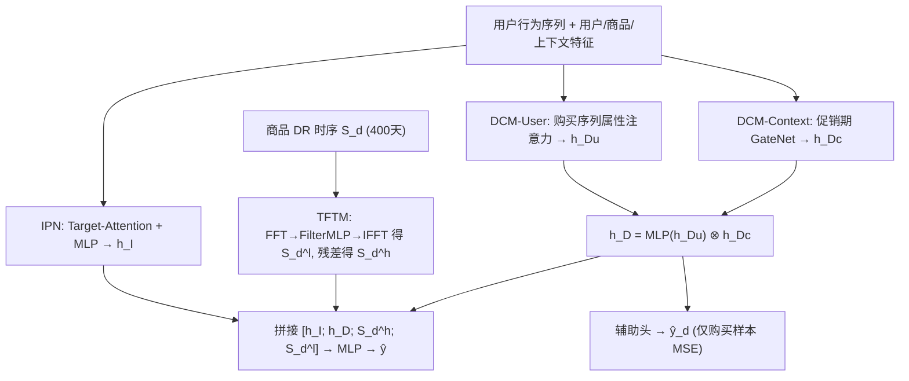

# Cheaper is Better: A Discount-Aware Network for Conversion Rate Prediction in E-commerce Recommendation System (越便宜越好：电商推荐系统中折扣感知的转化率预估网络)

- **会议/期刊**: SIGIR 2026 (Industry Track)
- **作者与机构**: Ruocong Tang, Yang Huang, Xing Fang, Chenyi Yan, Chuike Sun, Jing Wang（阿里巴巴集团）
- **推荐链路定位**: 精排（pCVR 预估）
- **研究方向**: CTR/CVR 预估与特征交叉 / 去偏公平与工业架构
- **论文原文**: [https://arxiv.org/abs/2607.12578v1](https://arxiv.org/abs/2607.12578v1)
- **开源代码**: [https://github.com/tangrc/DANet](https://github.com/tangrc/DANet)

## TL;DR (1分钟核心速览)

现有 CVR 模型对"价格"的建模受限于价格量纲跨度极大（几元到数万元）而难以直接学习，本文改用**折扣率 (Discount Rate, DR)** 作为价格的归一化替代信号，提出 DANet：用 FFT 时频分解提取商品 DR 的长周期趋势与高频噪声、用 DCM-User/DCM-Context 双通道校正用户折扣敏感度偏差与促销周期偏差、并加一路仅作用于购买样本的 DR 回归辅助任务。在阿里天猫 2.41B 曝光工业日志上，离线 AUC 相对 IPN-Base 提升 1.61%（0.8345→0.8479），线上 A/B pCVR +3.63%、GMV +2.23%，已全量部署。

## Background & Motivation (背景与核心矛盾)

- **主流范式**: 工业 CVR 精排以 DIN 式 target-attention 建模用户行为序列兴趣为主，价格因素仅被 PASBR（会话图模拟价格容忍度）、CoHHN（兴趣-价格双通道聚合）等少数工作显式引入。
- **前人局限**: 其一，原始价格分布跨卖家、跨类目剧烈漂移，直接回归价格与 CVR 的关系几乎不可学；其二，同一商品对全平台用户标价相同，但用户参与"满减/凑单"等促销活动的程度不同，**实际成交折扣率高度个性化**（图 1 中耳机、酒类、厨具的成交 DR 分布均呈多峰），且 DR 在结算前无法预先获知，只能靠历史时序推断。
- **核心洞察 (Key Insight)**: DR 是价格的有界归一化形式，天然消解量纲问题；同时 DR 由三方博弈决定——卖家类目长期定价策略（低频趋势）、平台促销周期（周期性偏差）、用户折扣敏感度（个性化偏差），三者恰好可分解为三个可独立建模的信号源。
- **本文切入点**: 把商品 DR 的 400 天时序当作一条"价格信号"做频域滤波，再用两个去偏网络分别剥离用户与上下文偏差，最后以显式 DR 标签做辅助监督。

## Method (核心方法设计)

### 1. 整体框架 (Overall Architecture)

DANet 由兴趣偏好网络 IPN 与折扣偏好网络 DPN 两支构成。IPN 沿用 DIN 范式：候选商品 embedding 作 Query，对点击/加购/购买三条行为序列做 Multi-Head Target-Attention 后 sum-pooling，与用户、商品、上下文稠密 embedding 拼接过 MLP 得 $h_I$。DPN 接收目标商品的 DR 时序$S_d\in\mathbb{R}^{400}$，经 TFTM 拆为低频趋势$S_d^l$与高频残差$S_d^h$，再经 DCM-User（购买序列属性注意力）与 DCM-Context（促销期门控偏置）得$h_D$。四路向量拼接后过融合 MLP 输出$\hat{y}$，同时 DPN 分支额外输出$\hat{y}_d$ 参与辅助回归。

### 2. 关键设计拆解 (Key Designs)

1. **时频变换模块 TFTM（把 DR 时序拆成趋势 + 噪声）**：痛点在于原始 DR 曲线同时混有季节性促销峰与日常抖动，时域 MLP 难以分离。做法是先 FFT 到频域、用 MLP $f_t(\cdot)$ 做可学习滤波、再 IFFT 回时域得低频分量，高频分量由残差直接取：
$$Z=\mathrm{FFT}(S_d),\quad Z^l=f_t(Z),\quad S_d^l=\mathrm{IFFT}(Z^l),\quad S_d^h=S_d-S_d^l$$
直觉上低频分量承载"春季/冬季大促"这类平滑趋势（图 3 可视化证实），高频分量则是噪声，二者分开送入下游可避免噪声污染趋势表征。内存复杂度 $O(N)$、FFT 复杂度$O(N\log N)$，$N=400$ 开销可忽略。

2. **分布校正模块 DCM（剥离用户与促销期两类偏差）**：DCM-User 针对"购买行为稀疏且缺时序连贯性"，把每条购买记录 embedding 拆成折扣/类目/价格三个子向量，以候选商品 $E_A$ 为 Query 做属性注意力加权聚合：
$$h_{Du}=\sum_{j=1}^{L}w_j\,[e_{i_j}^d;e_{i_j}^c;e_{i_j}^p],\quad w_j=a(e_{i_j},E_A)$$
DCM-Context 则借鉴 PEPNet 的多场景偏置思路，用促销上下文 embedding $e_{tc}$过 GateNet 生成周期偏置，与用户侧做逐元素门控：$h_D=f_{du}(h_{Du})\otimes \mathrm{GateNet}(e_{tc})$。这样"同一用户在大促期与平销期"的折扣敏感度被显式区分。

3. **训练目标、负采样与推理效率**：主损失为常规 CE，辅助损失仅在 $y=1$的购买样本上对显式 DR 标签$y_d$ 做 MSE，总损失
$$\mathcal{L}=\mathcal{L}_{m}+\alpha\cdot\mathbb{I}(y=1)\,\mathrm{MSE}(y_d,\hat{y}_d)$$
样本来自曝光日志天然分布（CTR/CVR 任务不做负采样，全量曝光样本训练），$\alpha$ 为缩放超参。线上推理仅增加一次 32 点 FFT 与两个轻量 MLP，实测响应时间增幅 <5%。

## Experimental Setup & Evaluation Protocol (实验设置与评估协议)

- **数据集与预处理**: 因缺乏公开成交价数据，作者自建阿里天猫 2025/08/26–11/25 采样日志 $\mathcal{D}_a$：

| 数据集 | #Users | #Items | #Exposures | #Clicks | #Purchases |
| :--- | :---: | :---: | :---: | :---: | :---: |
| $\mathcal{D}_{train}$ (08/26–11/10) | 9.76M | 5.08M | 2.41B | 100.12M | 5.08M |
| $\mathcal{D}_{test}$ (11/11–11/25) | 4.45M | 3.41M | 0.96B | 33.39M | 1.67M |

- **数据划分与防穿越 (Splitting Strategy)**: **全局时间戳切分**，训练/测试区间完全不重叠，且测试段覆盖双十一大促，天然检验模型对促销期分布漂移的泛化。
- **排名评测协议 (Ranking Protocol)**: 离线采用 **AUC**（全量曝光样本上的排序能力，非采样排序）；线上采用 pCVR 与 GMV 双指标 A/B。离线实验重复 5 次取 mean±std。
- **对比基线与超参设置**: 基线为 DIN、PASBR、CoHHN 及作者自建 IPN-Base；item ID embedding 64 维、类目/品牌 32 维、其余类别特征 8 维，IPN 与 DCM 均用 8 头注意力、隐层 128，TFTM 用 32 点 FFT，Adagrad lr=0.1、batch=1024，10 台参数服务器 + 4 张 V100 分布式训练。

## Key Experimental Results (实验关键数据)

### 1. 主实验对比 (Main Results)

| Model | Offline AUC (mean±std.) | Online pCVR Gain | Online GMV Gain |
| :--- | :---: | :---: | :---: |
| DIN | 0.8343±0.00132 | -0.01% | -0.04% |
| CoHHN | 0.8337±0.00253 | -0.74% | -0.91% |
| IPN-Base | 0.8345±0.00062 | 0% | 0% |
| PASBR | 0.8370±0.00021 | +1.62% | +0.79% |
| **DANet (full)** | **0.8479±0.00163** | **+3.63%** | **+2.23%** |
| Improv. vs IPN-Base | **+1.61%** | — | — |

### 2. 消融实验 (Ablation Study)

| 变体 | AUC | 相对 IPN-Base 的线上 pCVR / GMV |
| :--- | :---: | :---: |
| IPN-Base | 0.8345 | 0% / 0% |
| + DCM-User (A) | 0.8361 | +0.85% / +0.22% |
| + DCM-Context (B) | 0.8357 | +0.59% / +0.08% |
| + TFTM (C) | 0.8389 | +2.65% / +1.60% |
| + Auxiliary task (D) | 0.8347 | +0.30% / +0.02% |
| DANet (A&B&C&D) | **0.8479** | **+3.63% / +2.23%** |

### 3. 关键实验发现 (Key Findings)

1. **TFTM 是绝对主力，且与其余模块强互补**：单独加 TFTM 即带来 +2.65% pCVR（远超 DCM-User 的 +0.85%），但四模块全开时增益达 +3.63%，高于各单模块增益之和，说明"趋势信号 + 去偏信号"存在正向交互而非冗余。
2. **价格类基线普遍失效，验证了 DR 替代价格的必要性**：显式建模价格的 PASBR 仅得 0.8370，双通道的 CoHHN 甚至低于 DIN（0.8337 vs 0.8343，线上 pCVR -0.74%），说明原始价格量纲与个性化折扣的耦合会引入负迁移，而归一化的 DR 才是可学信号。
3. **折扣商品曝光结构被显著重塑**：线上折扣商品 pCVR 曝光占比（Exposure Ratio）从 IPN-Base 的 7.56% 提升至 11.14%（相对 +47.32%），表明模型不只是"预测更准"，而是主动把高转化潜力的折扣商品推到更前位置，直接对应 GMV +2.23% 的商业收益。

## Highlights & Limitations (亮点、对比与审稿批判)

- **与代表作对比 (vs. Prior Work)**: 相比 PASBR 用会话图模拟"价格容忍度"、CoHHN 用双通道并行聚合兴趣与价格，DANet 的本质差异是把价格**变换到折扣率空间并做频域分解**，将"价格"从静态标量升级为带时序演化的信号；同时 DCM 的偏差校正粒度（用户级 + 促销期级）比前两者更细。
- **可迁移亮点**: 其一，FFT→可学习滤波→IFFT 的"趋势/残差"拆分范式可直接迁移到用户活跃度、商品热度等任意长周期行为时序；其二，辅助回归头只在正样本上计算 MSE 的"标签仅在购买后可见"设计，可复用到任何延迟反馈场景（如退款率、复购间隔）。
- **审稿级局限批判**: 其一，数据集为单一平台自采且无公开成交价数据，AUC 提升缺乏跨平台可复现性验证，且未报告与延迟反馈（DF）类方法的联合实验，而 DR 本身正是结算后才确定的强延迟信号；其二，TFTM 固定 $N=400$天与 32 点 FFT，对新上架商品（时序不足 400 天）如何补齐、冷启动商品 DR 缺失时的降级策略均未讨论，超参$\alpha$ 的敏感性分析也仅给出"实验确定最优值"一句。

## Rating (四维评分)

- **方法创新性 (Novelty)**: ⭐⭐⭐⭐ （首次将折扣率作为价格的可学时序信号并引入频域分解，思路清晰但各组件均为成熟技术的组合式创新）
- **评估协议与实验扎实度 (Protocol & Experiments)**: ⭐⭐⭐⭐ （2.41B 曝光工业级数据 + 时间切分防穿越 + 5 次重复 + 线上 A/B 全链路验证，但仅单平台、缺延迟反馈对比）
- **写作与数学规范度 (Clarity & Rigor)**: ⭐⭐⭐ （公式简洁、模块边界清楚，但 DCM-Context 的 GateNet 细节与 $\alpha$取值未展开，部分符号如$f_m$、$\mathcal{M}$ 定义略含糊）
- **工业落地与复现价值 (Industrial & Practical Value)**: ⭐⭐⭐⭐⭐ （已在天猫全量部署、响应时间增幅 <5%、代码开源，工程可复现性极强）

