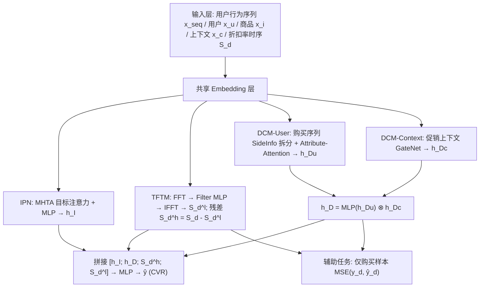
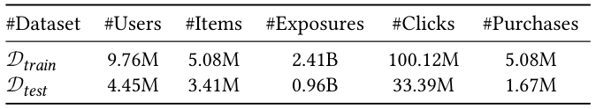
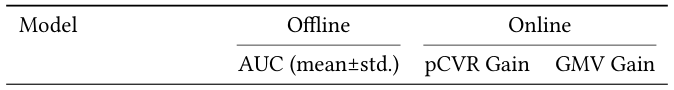
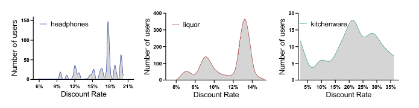
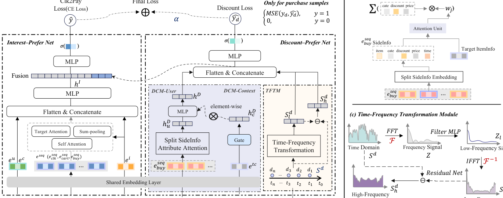
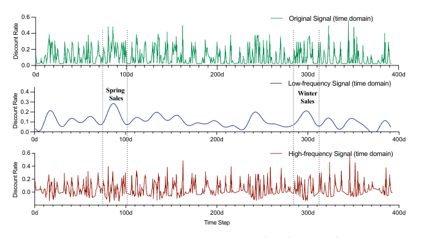

# Cheaper is Better: A Discount-Aware Network for Conversion Rate Prediction in E-commerce Recommendation System (越便宜越好：电商推荐系统中面向转化率预估的折扣感知网络)

- **会议/期刊**: SIGIR 2026 (第 49 届国际 ACM SIGIR 会议，Melbourne, VIC, Australia)
- **推荐链路定位**: 精排 (CTR/CVR Prediction, Post-click CVR)
- **研究方向**: CTR/CVR 预估与特征交叉 / 去偏公平与工业架构
- **论文原文**: [https://arxiv.org/abs/2607.12578v1](https://arxiv.org/abs/2607.12578v1)
- **开源代码**: [https://github.com/tangrc/DANet](https://github.com/tangrc/DANet)

## TL;DR (核心速览)

针对电商 CVR 预估中"商品价格分布跨度极大、难以直接建模"的痛点，本文提出用**折扣率 (Discount Rate, DR)** 替代绝对价格，并设计 Discount-Aware Network (DANet)：用 FFT 时频分解捕捉商品 DR 长期趋势、用 DCM-User/DCM-Context 双重去偏修正用户折扣敏感度与促销周期偏差、用折扣率回归辅助任务强化表征。在阿里天猫工业数据集上离线 AUC 相对提升 1.61%，线上 A/B 测试 pCVR +3.63%、GMV +2.23%，已全量部署于天猫 APP。

## Background & Motivation (背景与动机)

- **领域背景与主流范式**: Post-click CVR 预估是电商推荐的核心环节，工业界主流范式为"Embedding + 序列兴趣建模 (DIN/DIEN) + MLP"的深度 CTR/CVR 模型，并围绕数据稀疏 (DS)、样本选择偏差 (SSB, ESMM 系列) 与延迟反馈三大经典问题展开。
- **现有方法局限 (Limitations of Prior Work)**:
  1. **价格建模困难**：商品价格从几元到数万元不等，跨卖家、跨类目分布差异巨大，直接对绝对价格建模难以学到稳定的价格-CVR 关系（PASBR 引入价格但仅模拟价格容忍度）。
  2. **折扣率不可预知且高度个性化**：平台对同一商品标价相同，但用户因参与"满减/凑单"等促销活动，实际成交折扣率差异显著（见图 1 中耳机、酒类、厨具三类商品的用户成交折扣率分布），且 DR 只有在结算时才确定，无法作为静态特征提前获取。
  3. **DR 受三重因素耦合影响**：卖家长期定价策略、平台促销活动周期、用户折扣敏感度，现有 CVR 模型无法同时感知这三者。
- **核心挑战 (Key Challenge)**: 为什么不能简单把价格/折扣率作为普通数值特征拼接进 DIN？因为 (a) 单点折扣率无法反映商品长期价格演化趋势；(b) 用户成交折扣率存在严重的组合购买与促销参与偏差，直接聚合会引入系统性噪声；(c) 不同促销周期（如双 11 大促 vs 平销期）折扣率上限不同，存在周期性偏差。
- **核心洞察与切入点 (Key Insight)**: 作者通过天猫 90 天真实成交日志的分布观察（图 1）发现：同一商品下不同用户的成交折扣率呈明显多峰分布，说明折扣率是"个性化 + 周期性"的混合信号。由此切入：将 DR 建模为**时间序列**，用频域分解分离长期趋势与高频噪声，再用双通道去偏网络修正用户与上下文偏差。

## Problem Formulation & Method (问题定义与方法架构)

### 1. 符号定义与输入表征 (Notations & Input Representations)

给定训练集 $\mathcal{D}=\{(x_i,y_i)\}_{i=1}^{|\mathcal{D}|}$，样本特征 $x_i=\{x^{seq}, x_u, x_i, x_c, S_d\}$，CVR 标签 $y_i\in\{0,1\}$（1 表示购买）。目标为预测 $p_{cvr}=p(y_i=1\mid x_i)$。五类特征：

- $x^{seq}$：用户行为序列（点击序列、加购序列、购买序列），序列长度固定为 $L$；
- $x_u$：用户画像与偏好统计特征；
- $x_i$：商品 ID、类目、品牌及统计特征；
- $x_c$：上下文特征（位置、促销信息）；
- $S_d\in\mathbb{R}^N$：**目标商品折扣率时间序列**（本文首次引入 CVR 任务），$N=400$ 天，覆盖过去约一年。

### 2. 整体流水线 (Overall Architecture)

DANet 由 **Interest-Prefer Net (IPN)** 与 **Discount-Prefer Net (DPN)** 两大部分组成，DPN 内含时频变换模块 (TFTM)、分布修正模块 (DCM-User & DCM-Context) 与监督回归辅助任务。IPN 输出兴趣表征 $h_I$，DPN 输出折扣表征 $h_D$、低频信号 $S_d^l$ 与高频信号 $S_d^h$，四者拼接后经 MLP 输出 CVR 概率。

### 3. 核心模块设计与数学原理 (Key Designs & Formulations)

**(1) Interest-Prefer Net (IPN)**：对用户不同行为序列 $e_{seq}$ 施加 Multi-Head Target-Attention (MHTA)，以候选商品 $e_i$ 为 Query、历史行为序列为 Key/Value 动态捕捉兴趣，再与 $e_u,e_i,e_c$ 拼接送入 MLP：

$$h_I = f_i(\mathcal{I}(x)) = f_i([e_u; e_i; e_c; MHTA(e_{seq})])$$

**(2) Time-Frequency Transformation Module (TFTM)**：将 DR 时序 $S_d=[d_1,\dots,d_N]$ 经 FFT 变换到频域，用 MLP $f_t(\cdot)$ 做信号滤波（保留稳定低频信息、学习各频率分量影响），再 IFFT 回时域得到低频趋势 $S_d^l$；高频非平稳分量由残差获得：

$$Z=FFT(S_d),\quad Z^l=f_t(Z),\quad S_d^l=IFFT(Z^l),\quad S_d^h=S_d-S_d^l$$

物理直觉：低频分量刻画卖家长期定价策略与季节性趋势（如图 3 中"春季/冬季促销"的平滑走势），高频分量则包含促销脉冲与噪声，二者分离后分别作为特征输入，避免噪声污染趋势信号。内存复杂度 $O(N)$，FFT 复杂度 $O(N\log N)$，$N=400$。

**(3) Distribution Correction Module (DCM)**：分两路去偏。
- **DCM-User**：购买行为稀疏但强反映折扣偏好，故对购买序列做 **SideInfo 拆分**（将每个商品 embedding 拆为折扣 $e_{ij}^d$、类目 $e_{ij}^c$、价格 $e_{ij}^p$ 三个属性向量），再以候选商品 embedding $E_A$ 为 query 做 Attribute-Attention：

$$h_{Du}=\mathcal{AA}_u(E_A,e_{i_1},\dots,e_{i_L})=\sum_{j=1}^{L}a(e_{i_j},E_A)[e_{i_j}^d;e_{i_j}^c;e_{i_j}^p]=\sum_{j=1}^{L}w_j[e_{i_j}^d;e_{i_j}^c;e_{i_j}^p]$$

- **DCM-Context**：借鉴 PEPNet 思想，用促销上下文特征 $e_{tc}$ 经 GateNet 生成周期偏差 embedding，与用户折扣表征做逐元素乘：

$$h_D=f_{du}(h_{Du})\otimes h_{Dc}=f_{du}(h_{Du})\otimes GateNet(e_{tc})$$

**(4) Supervised Regression Auxiliary Task**：为让 DPN 学到"值准确"的折扣表征，构造显式折扣率标签 $y_d$，仅在购买样本上做 MSE 回归：

$$\hat{y}_d=\sigma(f_d(\mathcal{DPN}(x)))=f_d([h_D;S_d^h;S_d^l])$$

### 4. 训练目标、负采样与推理复杂度 (Optimization, Negative Sampling & Complexity)

- **损失函数**：主任务为 CVR 交叉熵，辅助任务为购买样本上的 MSE，总损失：

$$\text{Loss}=\text{Loss}_m+\alpha\cdot\{\text{MSE}(y_d,\hat{y}_d),\ y=1;\ 0,\ y=0\}$$

其中 $\text{Loss}_m=-\frac{1}{|\mathcal{D}|}\sum_{(x,y)\in\mathcal{D}}(y\log\hat{y}+(1-y)\log(1-\hat{y}))$，$\alpha$ 为缩放超参（最优值由实验确定，原文未给出具体数值）。
- **训练负采样策略**：CVR 任务为二分类，**无显式负采样**；样本来自曝光-点击-购买漏斗日志，购买为正样本、点击未购买为负样本（post-click 设定）。
- **时间与空间复杂度**：TFTM 内存 $O(N)$、FFT $O(N\log N)$，$N=400$；DCM-User 注意力复杂度 $O(L\cdot d)$。线上部署后**响应时间增加 < 5%**，作者称对推荐系统可接受。训练使用分布式 TensorFlow 1.4，10 台参数服务器 + 4 张 Nvidia Tesla V100 16GB GPU。

## Experimental Setup & Evaluation Protocol (实验设置与评估协议)

- **数据集统计与预处理**: 由于缺乏最终成交价数据，业界无公开 DR 数据集，作者自建阿里天猫 2025/08/26–2025/11/25 线上日志采样数据集 $\mathcal{D}_a$，按时间切分为不重叠训练集与测试集：

<figure class="paper-figure" markdown="span">
  <figcaption>表 1</figcaption>
</figure>

| 数据集 (Dataset) | 用户数 (#Users) | 物品数 (#Items) | 曝光数 (#Exposures) | 点击数 (#Clicks) | 购买数 (#Purchases) |
| :--- | :---: | :---: | :---: | :---: | :---: |
| $\mathcal{D}_{train}$ (08/26–11/10) | 9.76M | 5.08M | 2.41B | 100.12M | 5.08M |
| $\mathcal{D}_{test}$ (11/11–11/25) | 4.45M | 3.41M | 0.96B | 33.39M | 1.67M |

- **数据划分方式 (Splitting Strategy)**: **Global Temporal Split（全局时间戳切分）**，训练集 08/26–11/10、测试集 11/11–11/25，严格按时间先后切分，**无未来信息泄露风险**；且测试期恰覆盖双 11 大促，可检验模型对促销期分布偏移的泛化能力。
- **排名评测协议 (Ranking Protocol)**: 本文为 CVR 二分类预估，**非排序召回任务**，采用 AUC 作为离线指标（全样本打分，无负采样排序协议）；线上采用 pCVR 与 GMV 监控指标。
- **评价指标与显著性检验**: 离线 AUC（5 次重复实验，报告 mean±std.）；线上 pCVR Gain、GMV Gain。Embedding 维度：Item ID 64 维，Category/Brand ID 32 维，其他类别特征 8 维；IPN 与 DCM 均用 8 头注意力、隐藏维 128；TFTM 用 32 点 FFT。原文报告了 5 次重复的标准差，但**未明确报告配对显著性检验 (p 值)**。

## Key Experimental Results (核心实验结果)

### 1. 主实验对比 (Main Results)

<figure class="paper-figure" markdown="span">
  <figcaption>表 2</figcaption>
</figure>

| 数据集 | 指标 | DIN (序列基线) | PASBR (价格基线) | CoHHN (价格+兴趣双通道) | 本文 DANet | 相对提升 (Improv.) |
| :--- | :--- | :---: | :---: | :---: | :---: | :---: |
| $\mathcal{D}_{test}$ | AUC | 0.8343±0.00132 | 0.8370±0.00021 | 0.8337±0.00253 | **0.8479±0.00163** | +1.61% (vs. IPN-Base 0.8345) |
| 线上 | pCVR Gain | -0.01% | +1.62% | -0.74% | **+3.63%** | — |
| 线上 | GMV Gain | -0.04% | +0.79% | -0.91% | **+2.23%** | — |

关键观察：(1) IPN-Base 与 DIN 基本持平，证明 IPN 基线有效；(2) PASBR 引入价格因素成为次优方法，验证价格对购买决策的影响；(3) CoHHN 的双通道聚合在天猫场景下反而劣于 DIN；(4) DANet 离线与线上均显著领先次优方法。

### 2. 消融实验与控制变量分析 (Ablation Study)

| 配置 | AUC (mean±std.) | 线上 pCVR Gain | 线上 GMV Gain |
| :--- | :---: | :---: | :---: |
| IPN-Base | 0.8345±0.00062 | 0% | 0% |
| + DCM-User (A) | 0.8361±0.00131 | +0.85% | +0.22% |
| + DCM-Context (B) | 0.8357±0.00276 | +0.59% | +0.08% |
| + TFTM (C) | 0.8389±0.00052 | +2.65% | +1.60% |
| + Auxiliary task (D) | 0.8347±0.00048 | +0.30% | +0.02% |
| DANet (A&B&C&D) | **0.8479±0.00163** | **+3.63%** | **+2.23%** |

贡献排序：**TFTM > DCM-User > DCM-Context > Auxiliary task**。TFTM 贡献最大（单独 +2.65% pCVR），说明引入商品 DR 长期演化趋势的建模范式对购买导向学习最关键；DCM-User 与 DCM-Context 证明用户与上下文偏差建模的必要性；辅助任务通过显式 DR 标签帮助学习更好的折扣表征。**注意**：消融为逐模块累加式（非严格参数量对齐的 leave-one-out），原文未报告参数量匹配对照。

### 3. 稀疏度/冷启动分桶与超参敏感度 (Sparsity Buckets & Hyperparameters)

- **用户/物品交互频次分桶表现**: 原文未报告长尾/冷启动分桶实验。
- **关键超参数敏感度**: 原文仅提及 $\alpha$ 为缩放超参、最优最大值由实验确定，但**未给出 $\alpha$ 的具体取值与敏感度曲线**；FFT 点数固定为 32，$N=400$。
- **线上 A/B 测试结果 (Online A/B Test)**: 在天猫 APP 首页进行线上 A/B 测试，DANet 相对 IPN-Base 取得 **pCVR +3.63%、GMV +2.23%**；此外**折扣商品曝光占比 (PVR) 从 7.56% 提升至 11.14%（相对提升 47.32%）**，说明模型能主动为高折扣商品争取更多曝光。模型已成功全量部署于天猫 APP（千万级 DAU），响应时间增加 < 5%。

### 4. 案例分析与可视化 (Case Study)

<figure class="paper-figure" markdown="span">
  <figcaption>图 1</figcaption>
</figure>

图 1 展示了耳机、酒类、厨具三类商品在 90 天内用户实际成交折扣率的分布，同一商品下不同用户折扣率呈多峰分布，直观说明折扣率的个性化与促销参与偏差，是 DCM-User 设计的直接动机。

<figure class="paper-figure" markdown="span">
  <figcaption>图 2</figcaption>
</figure>

图 2 给出 DANet 整体框架：IPN 负责兴趣建模，DPN 由 TFTM、DCM-User、DCM-Context 与监督回归辅助任务构成，最终拼接输出 CVR 概率。

<figure class="paper-figure" markdown="span">
  <figcaption>图 3</figcaption>
</figure>

图 3 对 1000 个代表性样本平均后可视化 $S_d$、$S_d^l$、$S_d^h$：低频信号呈现平滑趋势（可辨识"春季/冬季促销"周期），高频信号含更多噪声，验证 TFTM 有效分离趋势与噪声，与设计预期一致。

## Highlights, Limitations & Critiques (亮点、局限与审稿级批判)

- **核心亮点与可迁移性**:
  1. **"折扣率替代绝对价格"的建模视角**具有强工业可迁移性——将难以归一化的价格信号转化为有界、可比较的比率信号，可推广到外卖、本地生活、机票酒店等动态定价场景。
  2. **FFT 时频分解用于用户/商品时序特征**是一个轻量且可解释的算子（$O(N\log N)$），可迁移到用户活跃度周期、商品销量季节性等任意长时序特征建模。
  3. **SideInfo 拆分 + Attribute-Attention** 将购买序列按折扣/类目/价格属性解耦注意力，思路可复用到多属性序列建模。
  4. 完整的**离线 + 线上 A/B + 全量部署**闭环，工业说服力强。
- **局限性与审稿视角批判 (Critical Limitations)**:
  1. **数据集不可复现**：核心实验依赖阿里内部天猫日志（含最终成交价），业界无公开 DR 数据集，开源代码虽提供但数据无法获取，复现性受限；论文仅 5 页（short paper），实验规模有限。
  2. **评估协议偏弱**：仅报告 AUC 单指标，缺少 GAUC、LogLoss、校准误差等 CVR 任务常用指标；未报告配对显著性检验（虽有 5 次重复 std，但 DANet 的 std 0.00163 大于 PASBR 的 0.00021，提升的统计稳健性需更严格检验）。
  3. **消融不严谨**：采用逐模块累加而非 leave-one-out，且未做参数量对齐或计算量匹配对照，TFTM 的增益可能部分来自额外参数容量。
  4. **超参透明度不足**：辅助损失权重 $\alpha$ 的最优值、FFT 点数选择依据均未给出敏感度分析。
  5. **时序泄露边界模糊**：$S_d$ 为 400 天滑动窗口，测试期（双 11）的 DR 序列是否包含测试期当天及之后的信息、训练/测试窗口如何对齐，原文未明确说明，存在潜在特征穿越风险。
  6. **理论深度有限**：DCM-Context 直接借用 PEPNet 的 GateNet 结构，创新性更多体现在特征工程与模块组合层面。

## Rating (四维评分)

- **方法创新性 (Novelty)**: ⭐⭐⭐⭐
- **评估协议与实验扎实度 (Protocol & Experiments)**: ⭐⭐⭐
- **写作与数学规范度 (Clarity & Rigor)**: ⭐⭐⭐⭐
- **工业落地与复现价值 (Industrial & Practical Value)**: ⭐⭐⭐⭐
