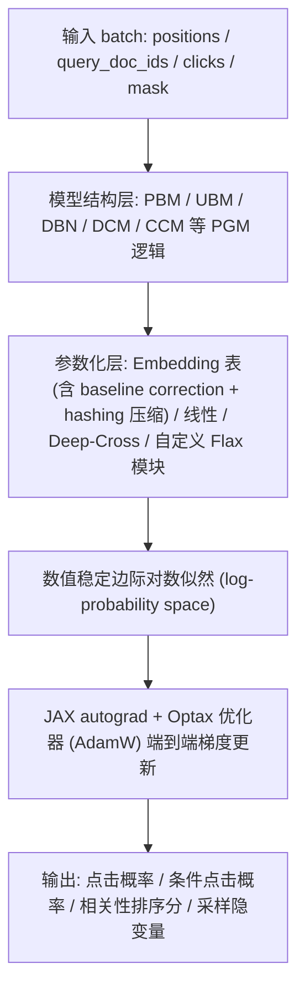
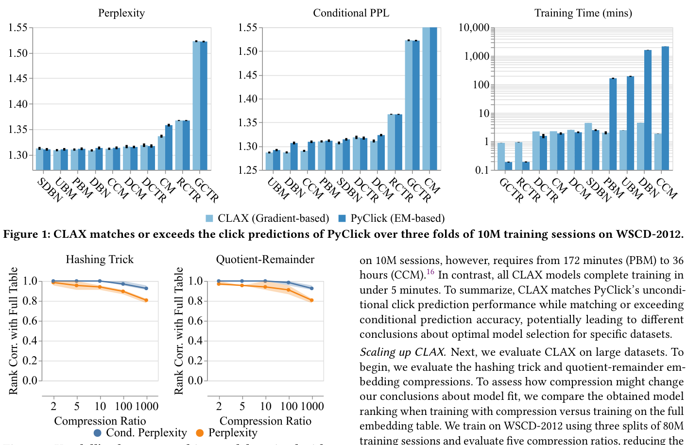
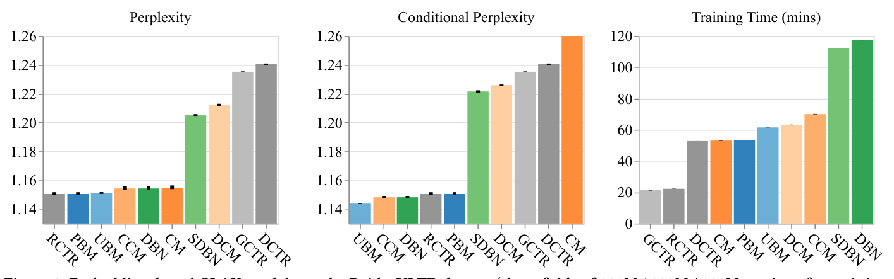
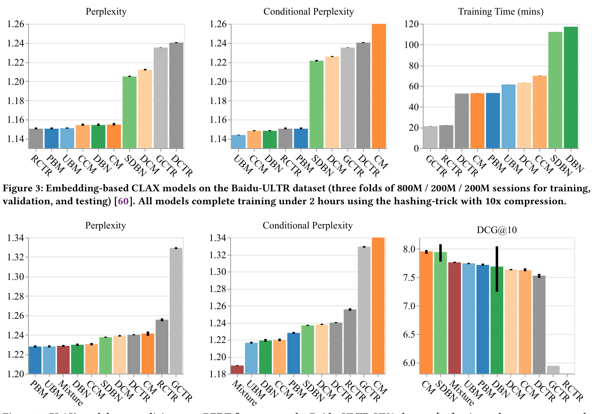

# CLAX: Fast and Flexible Neural Click Models in JAX (基于 JAX 的快速灵活神经点击模型)

- **会议/期刊**: arXiv 预印本 (2025-11-05)
- **推荐链路定位**: 精排 (CTR/排序) 的点击偏差建模与无偏学习排序 (Unbiased LTR) 基础设施
- **研究方向**: CTR预估与特征交叉 / 去偏公平与工业架构
- **论文原文**: [https://arxiv.org/abs/2511.03620v1](https://arxiv.org/abs/2511.03620v1)
- **开源代码**: [https://github.com/philipphager/clax](https://github.com/philipphager/clax)

## TL;DR (核心速览)

针对经典 PGM 点击模型（PBM/UBM/DBN 等）长期依赖 EM 优化、难以接入现代深度学习框架的痛点，CLAX 提出在 JAX 中以数值稳定的方式直接对边际对数似然做梯度优化，并解耦"模型结构"与"参数化"（Embedding/线性/Deep-Cross/自定义 Flax 模块可插拔）。在 Baidu-ULTR 全量 10 亿+ 会话上单卡约 2 小时完成训练，比 EM 快数个数量级，且复杂 PGM 的神经参数化在排序性能上超过工业常用的 two-tower (PBM) 模型。

## Background & Motivation (背景与动机)

- **领域背景与主流范式**: 点击模型是搜索与推荐中理解/预测用户交互的基础工具，用于位置偏差估计、反事实 LTR、RL 用户模拟与新排序系统离线评估。经典模型（PBM、UBM、DBN、DCM、CCM 等）以概率图模型 (PGM) 形式刻画吸引力 (attractiveness)、满意度 (satisfaction) 与 Examination 等隐变量，主流求解方式是 EM 算法（PyClick、ParClick、MassiveClicks 等库）。
- **现有方法局限**:
  1. **EM 扩展性差**：迭代式全量数据扫描，中等规模数据集即过慢，催生了大量专用并行/在线变体，但都绑定 EM 范式；
  2. **神经点击模型两条路线割裂**：RNN/Attention/GNN 类模型（NCM、CACM、XPA、GraphCM）预测强但牺牲可解释性；而 PGM 的神经参数化几乎只停留在 two-tower (PBM) 这一最简单形式，DBN/UBM 等更复杂结构未被系统性地梯度化；
  3. **工程可扩展性缺失**：专用库难以插入自定义神经模块或额外特征，无法复用现代深度学习生态（自适应优化器、混合精度、JIT）。
- **核心挑战**: 复杂 PGM 的边际似然含隐变量，无法直接优化完全数据似然；而 EM 的 Q 函数虽简单却要求逐模型手工推导 E/M 步，且难以 mini-batch 化。
- **核心洞察**: 作者引用经典结论——Q 函数在当前参数处的梯度等于边际对数似然梯度（式 10），并以 PBM 显式验证（式 11）。这意味着 EM 可视为带自适应步长的梯度上升，因此完全可以用自动微分直接优化边际似然，从而在保留 PGM 可解释性的同时获得深度学习框架的全部工程红利。

## Problem Formulation & Method (问题定义与方法架构)

### 1. 符号定义与输入表征 (Notations & Input Representations)

- 用户会话/查询集合，文档 $d\in D$，展示位置 $k\in\{1,\dots,K\}$；二值随机变量：点击 $C$、考察 $E$、吸引力 $A$（DBN 另含满意度 $S$）。
- 输入 batch 为 Python 字典，元素是形状 `(batch_size, max_positions)` 的 2D 数组：`positions`（从 1 开始）、`query_doc_ids`、`clicks`、`mask`（变长会话 padding 后的有效位标记）。
- 输出：`compute_loss`（负对数似然）、`predict_clicks`（$\hat c=P(C=1|d,k)$ 的对数概率）、`predict_conditional_clicks`（给定前序点击的条件点击概率）、`predict_relevance`（排序分数，通常为吸引力，DBN 可综合吸引力与满意度）、`sample`（采样点击序列及全部隐变量）。

### 2. 整体流水线 (Overall Architecture)

数据流：PGM 结构定义变量间依赖 → 参数化层为每个结构组件提供可学习参数 → 在 log 概率空间计算边际似然 → 自动微分 + mini-batch 梯度下降 → 输出多种预测接口。

### 3. 核心模块设计与数学原理 (Key Designs & Formulations)

**(1) 以 PBM 为例的边际似然与梯度化**

PBM 点击概率：$P(C=1|d,k)=P(E=1|k)\cdot P(A=1|d)=\theta_k\gamma_d$。边际对数似然：

$$\mathcal{L}(\theta,\gamma;\mathcal{D})=\sum_{(d,k,c)\in\mathcal{D}}\left[c\log(\theta_k\gamma_d)+(1-c)\log(1-\theta_k\gamma_d)\right]$$

对参数求偏导（式 7、8）：

$$\frac{\partial\mathcal{L}}{\partial\gamma_d}=\sum_{(d',k,c),d'=d}\left(\frac{c}{\gamma_d}-\frac{(1-c)\theta_k}{1-\theta_k\gamma_d}\right),\quad \frac{\partial\mathcal{L}}{\partial\theta_k}=\sum_{(d,k',c),k'=k}\left(\frac{c}{\theta_k}-\frac{(1-c)\gamma_d}{1-\theta_k\gamma_d}\right)$$

更新：$\theta_k^{(t+1)}=\theta_k^{(t)}+\eta\frac{\partial\mathcal{L}}{\partial\theta_k}$，$\gamma_d$ 同理。物理直觉：EM 的 E 步后验期望（式 3、4）本质是在"补全"隐变量，而梯度法用自动微分绕过手工推导，直接对可观测边际似然做随机优化。

**(2) 结构-参数化解耦 (Decoupling)**

CLAX 将"变量如何交互"（PGM 结构）与"参数如何取值"（参数化）分离。默认用 Embedding 表（如 UBM 为 1 亿 query-doc 吸引力 embedding + 位置考察参数表），并支持：
- **Baseline correction**：为整张 embedding 表加共享基线参数，embedding 学习相对全局值的偏移，新参数从基线出发逐步适应，缓解长尾 query-doc 对稀疏问题；
- **Hashing 压缩**：借鉴深度推荐中的大 embedding 表压缩方法（如 10× 压缩），使十亿级 query-doc 对可单卡容纳；
- **特征化模型**：线性模型、深度网络、Deep-Cross 网络、任意匹配输出形状的自定义 Flax 模块，可端到端优化；
- **Meta-model**：可对多个点击模型做混合（mixture），应对不同会话中用户行为异质。

**(3) 数值稳定性**

全部计算在 log 概率空间完成，避免 $\theta_k\gamma_d$ 接近 0/1 时的数值下溢与除零，这是相对 Defayet 等 PyTorch 实现的关键工程改进。

### 4. 训练目标、负采样与推理复杂度 (Optimization, Negative Sampling & Complexity)

- **损失函数**: 负边际对数似然（各模型在附录 A 给出完整推导），自定义模型可替换为其他损失；优化器示例为 AdamW（学习率 0.003，50 epochs）。
- **负采样策略**: 点击模型为观测点击的似然建模，**不涉及负采样**（非对比/非 BPR 范式）；未点击即 $c=0$ 的观测直接进入似然。
- **复杂度**: EM 需全量数据多轮 E/M 迭代；CLAX 支持 mini-batch + JIT + GPU，单卡约 2 小时完成 Baidu-ULTR 全量（10 亿+ 会话）训练与评估，比传统 EM 快数个数量级。在线推理为逐位置前向计算，无 ANN/Beam Search 需求。

## Experimental Setup & Evaluation Protocol (实验设置与评估协议)

- **数据集统计与预处理**: 原文正文（截取部分）未给出完整数据集统计表；核心实验使用 **Baidu-ULTR** 全量数据（10 亿+ 用户会话，三折划分：800M / 200M / 200M 会话用于训练/验证/测试），以及 **Baidu-ULTR-UVA** 数据集与 **WSCD-2012**（用于 embedding 压缩下的 Kendall's $\tau$ 一致性分析）。具体过滤规则原文未在可见部分报告。

| 数据集 (Dataset) | 用户数 (#Users) | 物品数 (#Items) | 交互数 (#Interactions) | 稀疏度/密度 (Sparsity) | 模态/辅助特征说明 |
| :--- | :---: | :---: | :---: | :---: | :--- |
| Baidu-ULTR | 原文未报告 | 原文未报告 | 10 亿+ 会话 | 原文未报告 | 位置、query-doc id、点击 |
| Baidu-ULTR-UVA | 原文未报告 | 原文未报告 | 原文未报告 | 原文未报告 | 含 BERT 特征，用于 Deep-Cross 泛化实验 |
| WSCD-2012 | 原文未报告 | 原文未报告 | 原文未报告 | 原文未报告 | 用于压缩前后排序一致性 (Kendall's $\tau$) |

- **数据划分方式 (Splitting Strategy)**: Baidu-ULTR 采用**按会话的三折划分**（800M/200M/200M），属于大规模留出划分；是否按全局时间戳切分原文可见部分未明确说明，存在潜在时间穿越风险需读者注意。
- **排名评测协议 (Ranking Protocol)**: 原文可见部分未明确说明是 Full-Ranking 还是 Sampled Ranking；从任务性质看为基于真实曝光日志的点击预测与排序评估（非全库召回排序）。
- **评价指标与显著性检验**: 使用排序性能指标（结合 Rax 库的 LTR 指标）与 Kendall's $\tau$ 排序一致性；原文可见部分未报告配对显著性检验细节。

## Key Experimental Results (核心实验结果)

### 1. 主实验对比 (Main Results)

原文可见部分未提供完整主实验数值表格。核心定性结论为：**复杂 PGM（UBM、DBN 等）的神经参数化在排序性能上超过广泛使用的 two-tower (PBM) 模型**，说明将更丰富的 PGM 结构梯度化具有实际排序收益。具体数值提升比例原文可见部分未报告。

### 2. 消融实验与控制变量分析 (Ablation Study)

原文可见部分未提供标准消融表。相关分析包括：
- **梯度优化 vs. EM**：直接梯度优化达到与 EM 可比的实证性能（贡献点一）；
- **Embedding 压缩影响**：图 2 展示 WSCD-2012 上压缩与未压缩训练模型间的 Kendall's $\tau$，评估压缩对排序一致性的影响；
- **参数化对比**：图 3 展示 Baidu-ULTR 上基于 embedding 的 CLAX 模型（10× hashing 压缩下均在 2 小时内完成训练）；图 4 展示在 Baidu-ULTR-UVA 上用 Deep-Cross 网络对 BERT 特征泛化，取得强排序性能且模型拟合形态与 embedding 模型不同。

<figure class="paper-figure" markdown="span">
  <figcaption>图 2</figcaption>
</figure>
图 2: 在 WSCD-2012 上，使用与不使用 embedding 压缩训练的排序模型之间的 Kendall's $\tau$。

<figure class="paper-figure" markdown="span">
  <figcaption>图 3</figcaption>
</figure>
图 3: Baidu-ULTR 数据集上的基于 embedding 的 CLAX 模型（三折 800M / 200M / 200M 会话用于训练、验证与测试）。所有模型在使用 10× 压缩的 hashing-trick 下均在 2 小时内完成训练。

<figure class="paper-figure" markdown="span">
  <figcaption>图 4</figcaption>
</figure>
图 4: 在 Baidu-ULTR-UVA 数据集上，使用 Deep-Cross 网络对 BERT 特征泛化的 CLAX 模型取得强排序性能，且与基于 embedding 的模型呈现不同的模型拟合。

### 3. 稀疏度/冷启动分桶与超参敏感度 (Sparsity Buckets & Hyperparameters)

- **长尾处理**: 通过 baseline correction 让稀疏 query-doc 的 embedding 从共享基线出发逐步适应，作者指出这能改善长尾数据上的点击预测；原文可见部分未给出分桶数值。
- **关键超参数**: 示例配置为 AdamW 学习率 0.003、50 epochs；hashing 压缩率（如 10×）与 embedding 表规模（如 1 亿）为影响显存与效果的关键旋钮，原文可见部分未给出系统敏感度曲线。
- **线上 A/B 测试**: 原文未报告线上 A/B 测试，仅包含离线实验。

## Highlights, Limitations & Critiques (亮点、局限与审稿级批判)

- **核心亮点与可迁移性**:
  1. **范式贡献**：用"Q 函数梯度 = 边际似然梯度"这一经典结论，把 EM 时代的 PGM 点击模型整体迁移到 autograd 生态，任何 PGM 边际似然都可直接 SGD 优化，且该范式不绑定 JAX（可移植到 PyTorch/TensorFlow）；
  2. **工程价值**：结构-参数化解耦 + baseline correction + hashing 压缩 + log 空间数值稳定，使十亿级会话单卡 2 小时训练成为可能，对工业无偏 LTR 的位置偏差估计流水线有直接落地价值；
  3. **可扩展性**：Meta-model 混合多个点击模型，为异质用户行为建模提供现成接口。
- **局限性与审稿视角批判**:
  1. **实验报告不完整**：可见正文缺少完整数据集统计表、主实验数值表与显著性检验，作为系统/库论文尚可，但作为方法论文其"复杂 PGM 优于 two-tower"的核心主张缺乏可核验的量化证据；
  2. **评估协议透明度不足**：Baidu-ULTR 三折划分是否按时间切分未明确，若随机划分则存在未来信息泄露风险；排序指标定义与候选集协议未交代；
  3. **与专用库的定位权衡**：作者明确不与 ParClick/MassiveClicks 在纯 EM 速度上竞争，但在超大规模下 JAX 编译开销、TPU/GPU 可移植性与多机扩展性未系统评估；
  4. **理论保证缺失**：梯度法失去 EM 的单调似然提升保证，收敛稳定性依赖学习率与初始化，原文未给出收敛性分析。

## Rating (四维评分)

- **方法创新性 (Novelty)**: ⭐⭐⭐⭐ （范式迁移清晰有力，但核心数学结论为经典结果，创新在系统化与工程化）
- **评估协议与实验扎实度 (Protocol & Experiments)**: ⭐⭐⭐ （规模亮眼，但可见部分缺少完整数值表、划分细节与显著性检验）
- **写作与数学规范度 (Clarity & Rigor)**: ⭐⭐⭐⭐ （EM 与梯度法的推导对照严谨，log 空间数值稳定处理规范）
- **工业落地与复现价值 (Industrial & Practical Value)**: ⭐⭐⭐⭐⭐ （开源库、十亿级单卡可复现、可直接接入无偏 LTR 流水线）
