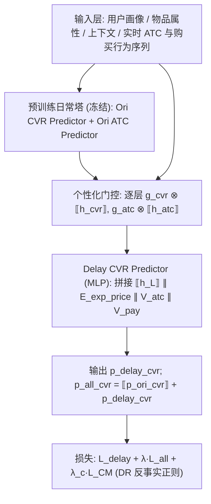
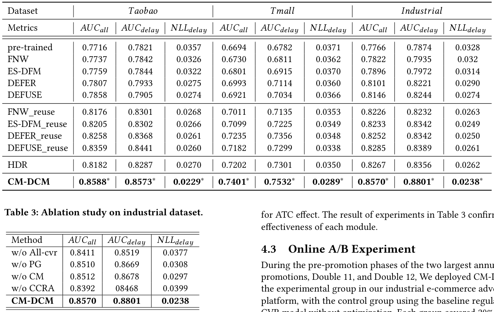
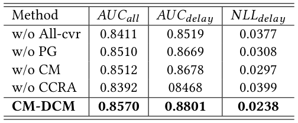
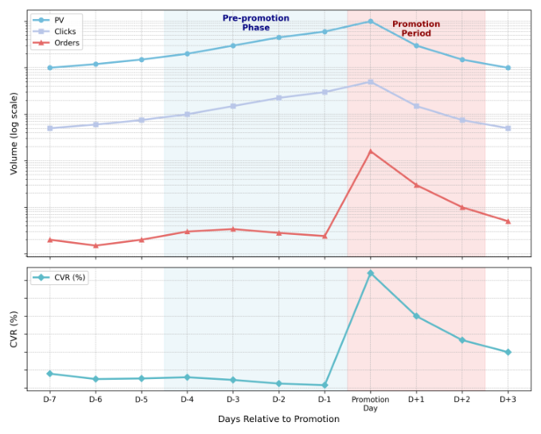
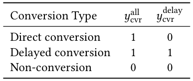
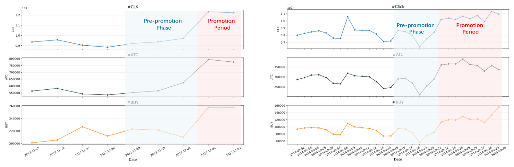

# Counterfactual Multi-task Learning for Delayed Conversion Modeling in E-commerce Sales Pre-Promotion (电商大促预热期延迟转化的反事实多任务建模)

- **会议/期刊**: SIGIR 2026 (49th International ACM SIGIR Conference, Melbourne, VIC, Australia)
- **推荐链路定位**: 精排 (CTR/CVR Ranking) — 广告/推荐系统中的转化率预估打分环节
- **研究方向**: CTR/CVR 预估与特征交叉 (主) / 多任务学习与列表级重排 (次)
- **论文原文**: [https://arxiv.org/abs/2604.21675v2](https://arxiv.org/abs/2604.21675v2)
- **开源代码**: 暂未开源（原文与预提取均未发现代码链接）

## TL;DR (核心速览)

针对电商大促**预热期 (pre-promotion)** 用户"加购但不买、等到大促日才下单"造成的**延迟转化集中于单日**这一特殊分布偏移问题，本文提出 CM-DCM：以多任务架构解耦"直接转化"与"延迟转化"，用个性化门控从日常预训练 CVR/ATC 塔迁移表征以缓解预热期数据稀疏，并用基于 Doubly Robust 估计器的反事实因果正则刻画 ATC→延迟转化的因果效应。在 Taobao/Tmall/工业数据集上，AUC_delay 相对最强基线提升约 1.6%~5.0%，线上 A/B 广告收入 +7.87%、延迟 GMV +4.24%、整体 GMV +1.42%，P99 延迟仅 +2ms。

## Background & Motivation (背景与动机)

- **领域背景与主流范式**: 电商大促（双 11、黑五等）贡献了平台全年 GMV 的相当大比例，大促周期的 CVR 预估直接决定广告出价与流量分配效率。延迟反馈建模（Delayed Feedback Modeling）已有成熟范式：FNW 的负样本复制、ES-DFM 的期望延迟、DEFER 的延迟标签重加权、DEFUSE 的双模型分解，以及 HDR 针对波动数据的历史日期复用。
- **现有方法局限 (Limitations of Prior Work)**:
  1. **预热期被忽视**：现有工作聚焦"大促当天"的 CVR 预估（如 HDR 用历史日期复用修正当天低估），但预热期（活动宣布后至大促日）用户行为模式与标签延迟机制完全不同，几乎无人建模。
  2. **延迟分布假设失效**：主流延迟反馈方法假设转化在**连续时间窗口**内以稳定分布延迟发生；而预热期的延迟转化**高度集中于大促日单点**（图 1 显示预热期 CVR 骤降，但约 45% 的大促日订单源自预热期点击），违反连续延迟假设。
  3. **OOD 偏移 + 数据稀疏**：按日训练的 CVR 模型无法捕捉预热期意图（分布外偏移）；预热窗口仅 3~7 天，样本量小，直接训练易过拟合。
- **核心挑战 (Key Challenge)**: 简单的特征拼接或加深网络无法解决，因为问题本质是**标签定义与因果结构**的问题——预热期点击的"负样本"中混入了大量"未来会转化"的假阴性，且 ATC 与转化之间的观测相关性被用户意图、商品热度等混杂因子污染。
- **核心洞察与切入点 (Key Insight)**: 作者观察到 ATC（加购）是用户**显式意图**的强信号（加购物品转化率是纯浏览的 3~5 倍），且预热期 ATC 不只是与延迟转化**相关**，而很可能**因果驱动**了延迟转化。因此引入因果推断（Doubly Robust 估计器）把这一先验注入模型，同时用多任务解耦 + 门控迁移解决稀疏与 OOD 问题。

## Problem Formulation & Method (问题定义与方法架构)

### 1. 符号定义与输入表征 (Notations & Input Representations)

- 用户-物品点击事件集合 $\mathcal{D}$（预热期全部点击），每个事件 $i$ 有特征向量 $\mathbf{x}_i \in \mathbb{R}^d$（用户画像、物品属性、上下文、实时行为序列如 ATC）。
- 标签定义（见表 1）：
  - $y^{\text{all}}_i \in \{0,1\}$：当日或大促日发生购买即为 1；
  - $y^{\text{delay}}_i \in \{0,1\}$：**仅当**购买发生在大促日才为 1。
  - 三种转化类型：直接转化 $(y^{\text{all}}=1, y^{\text{delay}}=0)$、延迟转化 $(1,1)$、未转化 $(0,0)$。
- 主任务目标：估计延迟转化率 $p^{\text{delay}}_i = P(y^{\text{delay}}_i=1 \mid \mathbf{x}_i)$。
- 关键中间表征：预训练塔最后隐层输出 $\llbracket \mathbf{h}_L \rrbracket$（stop-gradient 冻结）、曝光价格与折扣率嵌入 $\mathbf{E}_{\text{exp\_price}}$、用户实时 ATC 行为序列池化 $\mathbf{V}^{\text{urb}}_{\text{atc}}$ 与购买行为序列池化 $\mathbf{V}^{\text{urb}}_{\text{pay}}$。

### 2. 整体流水线 (Overall Architecture)

数据流：原始特征 → 预训练日常多任务塔（Ori CVR Predictor / Ori ATC Predictor，冻结）→ 逐层个性化门控调制 → 拼接价格嵌入与实时行为序列 → Delay CVR Predictor (MLP) → 输出 $p^{\text{delay}}_{\text{cvr}}$，与冻结的 $p^{\text{ori}}_{\text{cvr}}$ 相加得 $p^{\text{all}}_{\text{cvr}}$；训练时叠加 DR 反事实因果正则。

图 2 给出了 CM-DCM 的整体架构：<figure class="paper-figure" markdown="span">
  <figcaption>图 2</figcaption>
</figure>

### 3. 核心模块设计与数学原理 (Key Designs & Formulations)

**(1) 直接/延迟转化解耦的多任务架构**。最终全转化概率为冻结的日常塔输出与延迟塔输出之和：

$$p^{\text{all}}_{\text{cvr}} = \llbracket p^{\text{ori}}_{\text{cvr}} \rrbracket + p^{\text{delay}}_{\text{cvr}}$$

其中 $\llbracket \cdot \rrbracket$ 为 stop-gradient，冻结预训练塔参数以防其在微调中退化。延迟塔输入为：

$$\text{input}_{\text{delay}} = \llbracket \mathbf{h}_L \rrbracket \parallel \mathbf{E}_{\text{exp\_price}} \parallel \mathbf{V}^{\text{urb}}_{\text{atc}} \parallel \mathbf{V}^{\text{urb}}_{\text{pay}}, \quad p^{\text{delay}}_{\text{cvr}} = \sigma(\text{MLP}_{\text{delay}}(\text{input}_{\text{delay}}))$$

**物理直觉**：把"日常就能转化的部分"与"被大促折扣推迟的部分"显式拆开，避免单一 CVR 头在预热期把延迟正样本误判为负样本；残差式相加保证日常能力不被破坏。

**(2) 个性化门控表征迁移 (Personalized Gated Transfer)**。对预训练塔每一隐层 $i$，用用户当前预热期行为生成门控信号：

$$\mathbf{g}^i_{\text{cvr}} = \sigma(\text{Gate}^i_{\text{cvr}}([\mathbf{E}_{\text{user}} \parallel \mathbf{V}^{\text{urb}}_{\text{atc}} \parallel \mathbf{V}^{\text{urb}}_{\text{pay}}])), \quad \mathbf{g}^i_{\text{atc}} = \sigma(\text{Gate}^i_{\text{atc}}([\cdot]))$$

$$\text{input}^i_{\text{delay}} = (\mathbf{g}^i_{\text{cvr}} \otimes \llbracket \mathbf{h}^i_{\text{cvr}} \rrbracket) \parallel (\mathbf{g}^i_{\text{atc}} \otimes \llbracket \mathbf{h}^i_{\text{atc}} \rrbracket) \parallel \cdots$$

**物理直觉**（借鉴 PEPNet）：不同商品有不同"考虑周期"，不同用户活跃度也不同；逐层、逐用户的软门控让模型自适应决定从日常塔迁移多少信息，缓解预热期 3~7 天的数据稀疏。

**(3) 反事实因果正则 (Counterfactual Causal Regularization)**。设 $A \in \{0,1\}$ 为 ATC 指示、$Y$ 为延迟转化标签，$\mu(\mathbf{x}, A)$ 为插补模型，$p_a(\mathbf{x})$ 为倾向得分（直接复用预训练 ATC 模型的输出）。个体因果效应 (ICE) 的 Doubly Robust 估计为：

$$\hat{\tau}_{\text{DR}}(\mathbf{x}) = \underbrace{[\mu(\mathbf{x},1) - \mu(\mathbf{x},0)]}_{\text{Outcome Regression}} + \underbrace{\frac{A(Y - \mu(\mathbf{x},1))}{p_a(\mathbf{x})} - \frac{(1-A)(Y - \mu(\mathbf{x},0))}{1 - p_a(\mathbf{x})}}_{\text{IPW Correction}}$$

并构造正则项，使主模型对加购用户的预测与反事实插补值对齐：

$$\mathcal{L}_{\text{CM}} = \mathbb{E}\left[ \left( p^{\text{delay}}_{\text{cvr}} - \mu(\mathbf{x}, 1) \right)^2 \right]$$

**物理直觉**：观测到的 ATC-转化相关性被用户意图、商品热度等混杂因子污染；DR 估计器同时用结果回归与逆概率加权纠偏，把"加购→延迟转化"的因果先验注入损失，帮助模型区分真负样本与大促日延迟正样本。

### 4. 训练目标、负采样与推理复杂度 (Optimization, Negative Sampling & Complexity)

- **损失函数**（式 11）：

$$\mathcal{L}_{\text{CM-DCM}} = \mathcal{L}_{\text{delay\_cvr}} + \lambda \mathcal{L}_{\text{all\_cvr}} + \lambda_c \mathcal{L}_{\text{CM}}$$

其中前两项均为二元交叉熵 (BCE)，$\lambda$ 与 $\lambda_c$ 由基础参数搜索确定（原文未报告具体取值）。
- **负采样策略**：本文为 CTR/CVR 排序任务，**不涉及显式负采样**；正负样本由真实曝光点击日志的标签定义（表 1 的三类转化），延迟正样本通过"预热期点击 + 大促日完成购买"的标签规则构造。
- **时间与空间复杂度**: 原文未报告理论复杂度与训练耗时/显存。线上推理方面，延迟转化塔与原始 CVR 塔**并行计算**、门控网络较小，实测 **P99 延迟仅增加 2ms**（表 4）。超参：Adagrad，lr=0.001，隐层 [512, 256, 128]，门控 MLP [128, 64]，batch size=1024。

## Experimental Setup & Evaluation Protocol (实验设置与评估协议)

- **数据集统计与预处理**: 原文**未报告**各数据集的用户数/物品数/交互数/稀疏度统计表，仅给出时间窗口划分与来源：

| 数据集 (Dataset) | 时间范围与划分 | 交互数/稀疏度 | 模态/辅助特征说明 |
| :--- | :--- | :---: | :--- |
| Taobao (公开, 天池) | 2017-11-25~28 常规训练；11-29~12-01 预热期；12-02~03 大促期；预热样本 80/20 划分 | 原文未报告 | 点击、加购、购买及精确时间戳 |
| Tmall (公开, 天池) | 2024-09-15~20 预热期；09-21~30 大促期；此前数据训练常规 CVR；80/20 划分 | 原文未报告 | 同上 |
| Industrial (阿里广告平台) | 2023-07-01~11-11，多国家；D7/D8/D9/D10/D11 各取前 3 天为预热期 | 原文未报告 | 点击日志 + 转化标签 |

- **数据划分方式 (Splitting Strategy)**: 采用**时间切分 + 历史预热样本随机 80/20 划分**。常规 CVR 塔用预热期之前的数据训练；预热期样本中 80% 作为"历史大促数据"训练、20% 评估。由于 Taobao 数据本身无先验大促周期，作者用随机划分模拟历史大促复用，**存在一定信息泄露风险**（同一预热窗口内的样本被随机分到训练/测试，而非严格按时间或按用户隔离）。
- **排名评测协议 (Ranking Protocol)**: 原文未明确说明是 Full-Ranking 还是 Sampled Ranking；从指标定义看属于**点击样本内的二分类排序评估**（在预热期点击集合上计算），非全库未交互物品排序。
- **评价指标与显著性检验**: $AUC_{\text{all}}$（真实正转化 vs 未转化）、$AUC_{\text{delay}}$（延迟转化 vs 未转化）、$NLL_{\text{delay}}$（基于延迟转化标签的负对数似然）。每组实验**重复 5 次取均值**，并做显著性检验（表 2 中 $*$ 表示 $p$-value < 0.05）。Embedding 维度 $d$ 原文未报告。

## Key Experimental Results (核心实验结果)

### 1. 主实验对比 (Main Results)

表 2 汇总了 Taobao / Tmall / Industrial 三个数据集的结果（5 次均值，$*$ 表示 $p<0.05$）：<figure class="paper-figure" markdown="span">
  <figcaption>表 2</figcaption>
</figure>

| 数据集 | 指标 | 预训练日常 CVR | 最强延迟基线 (DEFUSE_reuse / DEFER_reuse) | 本文 CM-DCM | 相对提升 (Improv.) |
| :--- | :--- | :---: | :---: | :---: | :---: |
| Taobao | AUC_all | 0.7716 | 0.8359 (DEFUSE_reuse) | **0.8588*** | +2.74% |
| Taobao | AUC_delay | 0.7821 | 0.8441 (DEFUSE_reuse) | **0.8573*** | +1.56% |
| Taobao | NLL_delay | 0.0357 | 0.0260 (DEFUSE_reuse) | **0.0229*** | -11.9% (越低越好) |
| Tmall | AUC_all | 0.6694 | 0.7235 (DEFER_reuse) | **0.7401*** | +2.29% |
| Tmall | AUC_delay | 0.6782 | 0.7356 (DEFER_reuse) | **0.7532*** | +2.39% |
| Tmall | NLL_delay | 0.0371 | 0.0338 (DEFUSE_reuse) | **0.0289*** | -14.5% |
| Industrial | AUC_all | 0.7766 | 0.8285 (DEFUSE_reuse) | **0.8570*** | +3.44% |
| Industrial | AUC_delay | 0.7874 | 0.8389 (DEFUSE_reuse) | **0.8801*** | +4.91% |
| Industrial | NLL_delay | 0.0328 | 0.0249 (ES-DFM_reuse) | **0.0238*** | -4.4% |

关键结论：(i) CM-DCM 全面超越预训练同日 CVR 模型，印证常规 CVR 对延迟模式失效；(ii) 超越所有"日延迟策略"（即使 1 天窗口），说明连续延迟假设不适用于预热期；(iii) 超越历史数据复用 (HDR) 与复用增强的延迟模型，归因于多任务解耦、个性化门控与 ATC 因果建模三者协同。

### 2. 消融实验与控制变量分析 (Ablation Study)

表 3 在工业数据集上做消融：<figure class="paper-figure" markdown="span">
  <figcaption>表 3</figcaption>
</figure>

| 变体 | AUC_all | AUC_delay | NLL_delay | 相对完整模型 AUC_delay 下降 |
| :--- | :---: | :---: | :---: | :---: |
| w/o All-cvr | 0.8411 | 0.8519 | 0.0377 | -3.20% |
| w/o PG (个性化门控) | 0.8510 | 0.8669 | 0.0308 | -1.50% |
| w/o CM (CM 损失) | 0.8512 | 0.8678 | 0.0297 | -1.40% |
| w/o CCRA (反事实因果正则) | 0.8392 | 0.8468 | 0.0399 | -3.78% |
| CM-DCM (完整) | 0.8570 | 0.8801 | 0.0238 | — |

**贡献最大的是 CCRA（反事实因果正则）**，移除后 AUC_delay 下降 3.78%、NLL 从 0.0238 恶化到 0.0399；其次为 All-cvr 多任务项（-3.20%）。个性化门控与 CM 损失贡献相对温和（约 -1.4%~-1.5%）。需注意：原文消融**未严格控制参数量对齐**（移除模块会同时减少参数），也未报告多随机种子方差，仅给出单次或均值结果。

### 3. 稀疏度/冷启动分桶与超参敏感度 (Sparsity Buckets & Hyperparameters)

- **分桶分析**: 原文**未报告**按用户/物品交互频次或长尾/头部物品的分桶结果。
- **超参敏感度**: 原文仅说明 $\lambda$ 与 $\lambda_c$ 通过基础参数搜索取最优，**未报告**敏感度曲线或具体取值。
- **线上 A/B 测试结果**: 在双 11 与双 12 两大促预热期部署，实验组 CM-DCM、对照组为未优化的日常 CVR 模型，各覆盖 20% 流量，共持续 6 天。结果（表 4）：**广告收入 +7.87%、延迟 GMV +4.24%、整体 GMV +1.42%、P99 延迟 +2ms**。

## Highlights, Limitations & Critiques (亮点、局限与审稿级批判)

- **核心亮点与可迁移性**:
  1. **问题定义新颖**：首次系统刻画"预热期延迟转化集中于单日"这一分布偏移，并给出可落地的标签定义（表 1 的三类转化），可直接迁移到任何"事件驱动型集中转化"场景（如限时秒杀、预售定金、会员日）。
  2. **因果正则的工程化**：用 DR 估计器把 ATC 因果先验注入损失，且倾向得分直接复用预训练 ATC 模型，几乎零额外推理成本（P99 +2ms），是工业界可复制的轻量因果增强范式。
  3. **门控迁移 + 冻结塔**：stop-gradient 冻结日常塔、逐层个性化门控迁移，兼顾"不破坏日常能力"与"适配稀疏预热期"，思路可迁移到任何短周期冷启动场景。
- **局限性与审稿视角批判 (Critical Limitations)**:
  1. **评估协议存在泄露风险**：Taobao/Tmall 的预热样本采用**随机 80/20 划分**而非按时间或按用户隔离，同一预热窗口内的样本可能同时出现在训练与测试中，AUC 可能被高估；且原文未明确 Full-Ranking 还是 Sampled Ranking，削弱了与延迟反馈文献的可比性。
  2. **数据集统计缺失**：未报告用户数、物品数、交互数、稀疏度、Embedding 维度 $d$，复现难度高。
  3. **消融不严谨**：未做参数量对齐、未报告方差与多种子，且 w/o All-cvr 与 w/o CCRA 的描述与表 3 命名存在轻微不一致（正文写"removes the transition probability from ATC to delayed cvr module"对应 w/o All-cvr

## 论文图表

<figure class="paper-figure" markdown="span">
  <figcaption>图 1</figcaption>
</figure>

<figure class="paper-figure" markdown="span">
  <figcaption>表 1</figcaption>
</figure>

<figure class="paper-figure" markdown="span">
  <figcaption>图 3</figcaption>
</figure>

