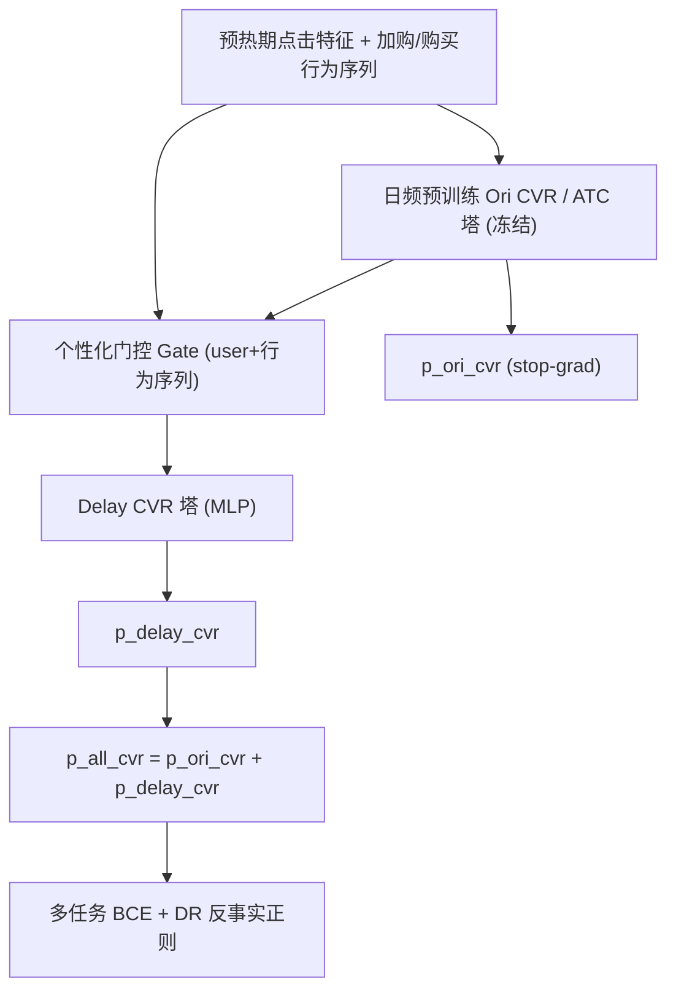
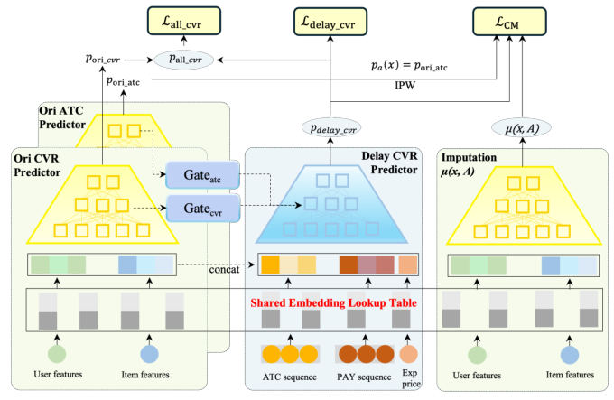

# Counterfactual Multi-task Learning for Delayed Conversion Modeling in E-commerce Sales Pre-Promotion (电商大促预热期延迟转化的反事实多任务建模)

- **会议/期刊**: SIGIR 2026 (49th International ACM SIGIR Conference)
- **作者与机构**: Xin Song, Kaiyuan Li, Jinxin Hu（阿里巴巴集团）
- **推荐链路定位**: 精排（CVR 预估）
- **研究方向**: CTR/CVR 预估与特征交叉 / 去偏公平与工业架构
- **论文原文**: [https://arxiv.org/abs/2604.21675v2](https://arxiv.org/abs/2604.21675v2)
- **开源代码**: 暂未开源

## TL;DR (1分钟核心速览)

大促预热期用户“只加购不下单”，转化被压缩到促销日单点爆发，违背传统延迟反馈模型“连续延迟窗口 + 稳定转化分布”的假设，导致预热期 CVR 被严重低估（约 45% 促销日订单源自预热期点击）。本文提出 CM-DCM：以多任务架构解耦直接/延迟转化、用个性化门控从日频 CVR/ATC 预训练塔迁移表征、并以 Doubly Robust 反事实正则刻画“加购→延迟转化”的因果效应。在 Taobao/Tmall/工业三数据集上，$AUC_{delay}$ 相对最强基线 DEFUSE_reuse 提升 1.3–4.1 个点，线上 A/B 广告收入 +7.87%、延迟 GMV +4.24%，P99 仅增 2ms。

## Background & Motivation (背景与核心矛盾)

- **主流范式**: 延迟反馈 CVR 建模（FNW、ES-DFM、DEFER、DEFUSE）通过样本复制/重加权或期望等待时间，把延迟正样本回填到点击时刻；HDR 则复用历史日期数据缓解大促日 CVR 低估。
- **前人局限**: ① 这些方法假设延迟在连续时间窗内均匀发生，而预热期转化**集中在促销日单点**，延迟窗口假设直接失效；② 日频训练的 CVR 模型面对预热期行为分布漂移（OOD）无法捕捉“等待折扣”的购买意图，且预热窗口仅 3–7 天、样本极稀疏。
- **核心洞察 (Key Insight)**: 预热期加购（ATC）不是与延迟转化“相关”，而是**因果地**提升促销日转化概率（加购物品转化率约为纯浏览的 3–5 倍）；但观测到的 ATC–转化相关性被用户意图、商品热度等混杂因子污染，需因果推断剥离。
- **本文切入点**: 用历史预热期数据 + 多任务解耦 + 反事实正则，把“加购的因果效应”显式注入延迟 CVR 预测。

## Method (核心方法设计)

### 1. 整体框架 (Overall Architecture)

模型为双塔结构：左侧是日频数据预训练的 Ori CVR / Ori ATC 塔（参数冻结，输出经 stop-gradient 保护），右侧是主模块 Delay CVR 塔。Delay 塔输入由四部分拼接：Ori CVR 塔末层隐向量 $\llbracket \mathbf{h}_L \rrbracket$、曝光价格与折扣率嵌入、加购行为序列池化$\mathbf{V}^{atc}_{urb}$、购买行为序列池化$\mathbf{V}^{pay}_{urb}$，经 MLP 输出延迟转化概率。最终全转化概率为冻结的日频 CVR 与延迟 CVR 之和，训练时联合延迟标签与全转化标签，并叠加 ATC 反事实正则。

<figure class="paper-figure" markdown="span">
  <figcaption>图2：延迟转化模型的反事实多任务学习架构（CM-DCM）。</figcaption>
</figure>

### 2. 关键设计拆解 (Key Designs)

1. **直接/延迟转化解耦的多任务架构**：痛点是把延迟正样本硬回填会污染日频 CVR 塔。本文令 $p^{all}_{cvr}=\llbracket p^{ori}_{cvr}\rrbracket+p^{delay}_{cvr}$，stop-gradient 冻结日频塔参数，Delay 塔只学“促销日额外增量”，避免日频任务退化；损失为$\mathcal{L}=\mathcal{L}_{delay\_cvr}+\lambda\mathcal{L}_{all\_cvr}$，两个 BCE 分别监督延迟标签与全转化标签，使模型能区分“真负样本”与“被促销推迟的正样本”。

2. **个性化门控表征迁移（PG）**：预热期样本稀疏，直接拼接预训练塔隐层易引入与当前商品考虑周期不匹配的噪声。对每层 $i$计算门控$\mathbf{g}^i_{cvr}=\sigma(\mathrm{Gate}^i_{cvr}([\mathbf{E}_{user}\|\mathbf{V}^{atc}_{urb}\|\mathbf{V}^{pay}_{urb}]))$（ATC 侧同理），再以$\mathbf{g}^i\otimes\llbracket\mathbf{h}^i\rrbracket$ 逐元素调制后送入 Delay 塔对应层。门控随用户实时行为动态变化，实现“按商品考虑周期自适应”的知识迁移。

3. **ATC 因果效应的反事实正则（CCRA）**：以 ATC 指示 $A$、延迟转化$Y$，用 Doubly Robust 估计个体因果效应
$\hat{\tau}_{DR}(\mathbf{x})=[\mu(\mathbf{x},1)-\mu(\mathbf{x},0)]+\frac{A(Y-\mu(\mathbf{x},1))}{p_a(\mathbf{x})}-\frac{(1-A)(Y-\mu(\mathbf{x},0))}{1-p_a(\mathbf{x})}$，
其中倾向分 $p_a(\mathbf{x})$直接复用预训练 ATC 塔输出，$\mu$为插补模型。正则项$\mathcal{L}_{CM}=\mathbb{E}[(p^{delay}_{cvr}-\mu(\mathbf{x},1))^2]$把主预测拉向“已加购”的反事实结果，总损失$\mathcal{L}_{CM\text{-}DCM}=\mathcal{L}_{delay\_cvr}+\lambda\mathcal{L}_{all\_cvr}+\lambda_c\mathcal{L}_{CM}$。直觉：DR 的双重稳健性在倾向分或插补模型任一正确时无偏，从而在稀疏预热窗口内稳定注入因果先验。

4. **训练与推理开销**：Adagrad、lr=0.001、隐层 [512,256,128]、门控 MLP [128,64]、batch=1024；$\lambda,\lambda_c$ 网格搜索。推理时 Delay 塔与日频塔并行计算、门控网络极小，线上 P99 仅 +2ms。

## Experimental Setup & Evaluation Protocol (实验设置与评估协议)

- **数据集与预处理**: 公开 Taobao（2017-11-25~12-03）与 Tmall（2024-09），加工业数据集（2023-07-01~11-11，多国点击日志，D7/D8/D9/D10/D11 五个大促，各取前 3 天为预热期）。预热期全部点击中、促销日完成购买者标为延迟转化。

| 数据集 | 预热窗口 | 促销期 | 划分方式 | 场景说明 |
| :--- | :---: | :---: | :---: | :--- |
| Taobao | 11.29–12.01 | 12.02–12.03 | 历史预热样本 80/20 随机划分 | 公开行为日志（CLK/ATC/BUY） |
| Tmall | 09.15–09.20 | 09.21–09.30 | 同上 80/20 | 公开行为日志 |
| Industrial | 各促前 3 天 | D7–D11 | 同上 80/20 | 多国广告点击/转化日志 |

- **数据划分与防穿越 (Splitting Strategy)**: 采用**时间切分 + 历史预热样本随机 80/20**：常规期数据训练日频 CVR 塔，预热期历史样本 80% 训练、20% 评估，促销日标签仅用于构造延迟标签，评估集与训练集按样本隔离。
- **排名评测协议 (Ranking Protocol)**: 全量评估（非采样），$AUC_{delay}$衡量延迟转化 vs 非转化的 pairwise 排序，$AUC_{all}$衡量真实正转化 vs 负样本排序，$NLL_{delay}$在延迟转化上计算；每组实验跑 5 次取均值并做$p<0.05$ 显著性检验。
- **对比基线与超参设置**: 基线含 pre-trained 日频 CVR、FNW、ES-DFM、DEFER、DEFUSE（各含 Daily Delayed 与 Pre-promotion Reuse 两种微调策略）及 HDR；隐层 [512,256,128]，门控 [128,64]，batch 1024。

## Key Experimental Results (实验关键数据)

### 1. 主实验对比 (Main Results)

| 方法 | Taobao $AUC_{all}$| Taobao$AUC_{delay}$| Taobao$NLL_{delay}$| Tmall$AUC_{delay}$| Industrial$AUC_{all}$| Industrial$AUC_{delay}$| Industrial$NLL_{delay}$ |
| :--- | :---: | :---: | :---: | :---: | :---: | :---: | :---: |
| pre-trained | 0.7716 | 0.7821 | 0.0357 | 0.6782 | 0.7766 | 0.7874 | 0.0328 |
| ES-DFM | 0.7759 | 0.7844 | 0.0322 | 0.6915 | 0.7896 | 0.7972 | 0.0314 |
| DEFER | 0.7807 | 0.7933 | 0.0275 | 0.7114 | 0.8101 | 0.8221 | 0.0290 |
| DEFUSE | 0.7858 | 0.7905 | 0.0274 | 0.7034 | 0.8146 | 0.8244 | 0.0274 |
| DEFER_reuse | 0.8258 | 0.8368 | 0.0261 | 0.7356 | 0.8252 | 0.8342 | 0.0250 |
| DEFUSE_reuse | 0.8359 | 0.8441 | 0.0260 | 0.7299 | 0.8285 | 0.8389 | 0.0261 |
| HDR | 0.8182 | 0.8287 | 0.0270 | 0.7301 | 0.8267 | 0.8356 | 0.0262 |
| **CM-DCM** | **0.8588\*** | **0.8573\*** | **0.0229\*** | **0.7532\*** | **0.8570\*** | **0.8801\*** | **0.0238\*** |
| Improv. | +2.74% | +1.56% | -11.9% | +2.39% | +3.44% | +4.91% | -8.8% |

（Improv. 相对最强基线 DEFUSE_reuse / Tmall 上 DEFER_reuse；\* 表示 $p<0.05$。）

### 2. 消融实验 (Ablation Study)

| 变体 | $AUC_{all}$|$AUC_{delay}$|$NLL_{delay}$ |
| :--- | :---: | :---: | :---: |
| w/o All-cvr | 0.8411 | 0.8519 | 0.0377 |
| w/o PG | 0.8510 | 0.8669 | 0.0308 |
| w/o CM | 0.8512 | 0.8678 | 0.0297 |
| w/o CCRA | 0.8392 | 0.8468 | 0.0399 |
| **CM-DCM** | **0.8570** | **0.8801** | **0.0238** |

### 3. 关键实验发现 (Key Findings)

1. **反事实正则是最大增益源**：移除 CCRA 后 $AUC_{delay}$ 从 0.8801 跌至 0.8468（-3.3 点）、NLL 从 0.0238 升至 0.0399，跌幅超过移除 PG（-1.3 点）与移除 CM 损失（-1.2 点），说明 ATC 因果先验是区分“真负样本”与“促销推迟正样本”的关键。
2. **复用策略本身即强基线，但天花板明显**：所有 reuse 变体较 Daily Delayed 提升 3–5 个点（如 DEFER 0.7933→0.8368），但最强 reuse 基线仍落后 CM-DCM 1.5–4.9 点，证明“把延迟样本回填到促销日”只解决了标签对齐，未解决分布漂移与因果混杂。
3. **线上收益与低延迟兼得**：Double 11/12 六天 A/B（各 20% 流量）广告收入 +7.87%、延迟 GMV +4.24%、整体 GMV +1.42%，P99 仅 +2ms，验证双塔并行 + 轻量门控的工程可行性。

## Highlights & Limitations (亮点、对比与审稿批判)

- **与代表作对比 (vs. Prior Work)**: 相较 FNW/ES-DFM/DEFER/DEFUSE 的“连续延迟窗口 + 样本复制/重加权”，本文首次针对**单点集中延迟**建模；相较 HDR 的“历史日期复用”，本文进一步用多任务解耦 + 因果正则处理分布漂移与 ATC 混杂，且 HDR 在 Tmall 上（0.7301）甚至不及 DEFER_reuse（0.7356），说明单纯复用不足以应对预热期。
- **可迁移亮点**: ① stop-gradient 冻结日频塔、只学“增量残差”的解耦范式可迁移到任何“基线与大促/事件期分布不一致”的场景；② 用预训练 ATC 塔直接充当 DR 倾向分，免去额外倾向分模型，是工业因果正则的低成本落地技巧。
- **审稿级局限批判**: ① 公开数据集缺显式大促标签，Taobao/Tmall 的预热窗口靠作者对行为曲线的目视推断（图 3），划分合理性存疑，且仅 80/20 单次随机划分、未做多折；② 反事实正则依赖“无未观测混杂”与倾向分正确性假设，论文未做敏感性分析；③ 仅 6 页短文，缺少延迟窗口长度、$\lambda_c$ 等超参敏感性实验与跨大促泛化分析。

## Rating (四维评分)

- **方法创新性 (Novelty)**: ⭐⭐⭐⭐ （首次定义并建模“预热期单点集中延迟”，DR 正则 + 门控迁移组合有新意，但各组件均为已有技术的针对性拼装）
- **评估协议与实验扎实度 (Protocol & Experiments)**: ⭐⭐⭐ （三数据集 + 线上 A/B + 显著性检验较完整，但公开集划分靠目视推断、单次 80/20 划分、缺超参敏感性）
- **写作与数学规范度 (Clarity & Rigor)**: ⭐⭐⭐⭐ （公式与符号简洁清晰，DR 估计与损失衔接自然；但消融表 w/o CCRA 处 0.8468 存在排版笔误，因果假设未展开讨论）
- **工业落地与复现价值 (Industrial & Practical Value)**: ⭐⭐⭐⭐⭐ （阿里真实广告平台全量 A/B 验证，收入 +7.87%、P99 仅 +2ms，双塔并行架构可直接复用；可惜未开源）
