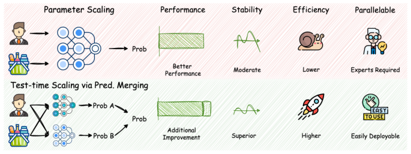
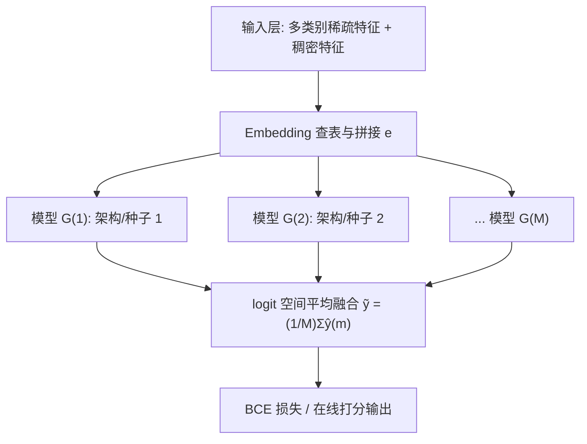
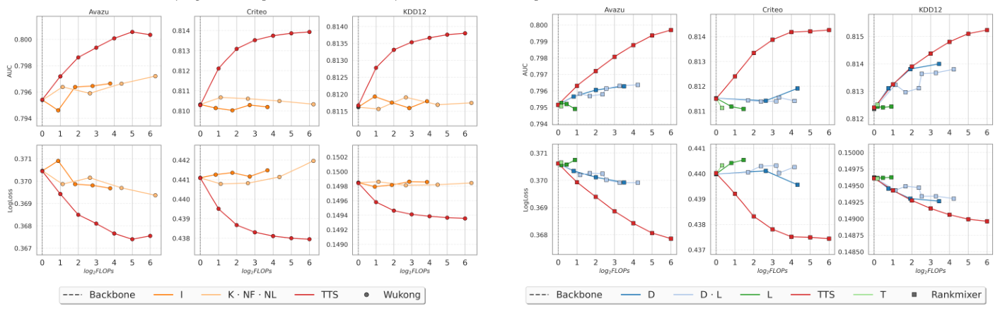
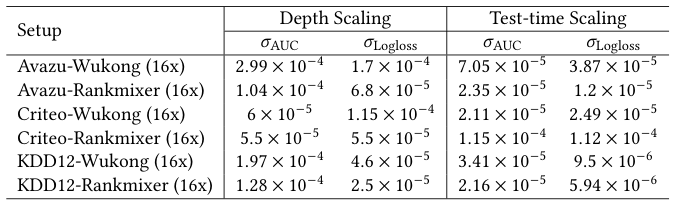
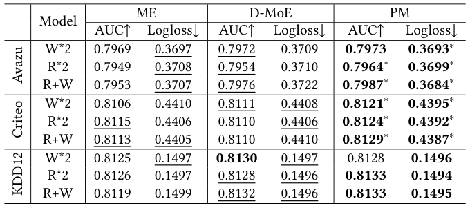
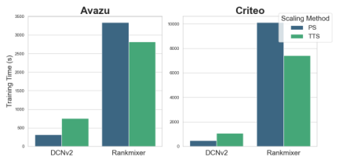

# Exploring Test-time Scaling via Prediction Merging on Large-Scale Recommendation (大规模推荐中基于预测融合的测试时缩放探索)

- **会议/期刊**: SIGIR 2026
- **推荐链路定位**: 精排 (CTR Prediction / Ranking)
- **研究方向**: 去偏公平、可信隐私与工业架构 / CTR 预估与特征交叉
- **论文原文**: [https://arxiv.org/abs/2512.07650v1](https://arxiv.org/abs/2512.07650v1)
- **开源代码**: [https://github.com/aTitye/TTS4CTR](https://github.com/aTitye/TTS4CTR)

## TL;DR (核心速览)

本文针对大规模推荐系统（DLRS）中"参数缩放"（深度/宽度缩放）训练成本高、稳定性差、部署困难的问题，首次将语言模型中的**测试时缩放（Test-time Scaling）** 引入推荐领域。核心痛点是：推荐模型输入结构统一、数据分布单一，难以像 LM 那样自然产生多样输出。作者提出两条获取"多样且有意义"预测的路径——**异构架构组合**与**同构架构下随机初始化**，并在 **logit 预测空间**直接平均融合（Prediction Merging）。在 Criteo/Avazu/KDD12 三个基准、8 个骨干模型上，16× 同构缩放使 Wukong 在 Avazu 上 AUC 从 0.7954 提升至 0.8001（+0.47pt），且在同推理预算下优于参数缩放，方差更小、可并行部署。

## Background & Motivation (背景与动机)

- **领域背景与主流范式**: 受 LM 缩放定律启发，DLRS 的缩放沿两个维度展开：(i) **宽度缩放 (Width Scaling)**，并行扩展交互模块数量，每个模块配独立 embedding 表（如 Multi-Embed、D-MoE），类似 MoE 但特征多 embedding 表；(ii) **深度缩放 (Depth Scaling)**，设计可无缝堆叠的统一交互层（如 Wukong、RankMixer）。两者本质都是**在训练时增加可训练参数量**。
- **现有方法局限 (Limitations of Prior Work)**:
  1. **训练成本与调参负担**：深度缩放需在大量缩放维度上做探索（附录 A.3），在大规模生产数据上代价非平凡；宽度缩放需设计多样性正则项防止表征坍缩。
  2. **稳定性不足**：深度缩放模型对随机种子敏感，方差较大（表 3 显示 Wukong 16× 的 σAUC 达 2.99×10⁻⁴）。
  3. **部署刚性**：参数缩放后的单一巨型模型难以拆分到多服务器并行，在线推理延迟随参数量线性增长。
- **核心挑战 (Key Challenge)**: LM 能通过 prompt/解码随机性天然产生多样输出，但推荐系统为满足大规模在线服务偏好**统一输入结构**，且所有专家特征被统一输入以追求最优性能，因此**如何在测试时对同一实例生成多样且有意义的输出**是直接决定测试时缩放可用性的关键。
- **核心洞察与切入点 (Key Insight)**: 作者提出两条获取多样性的路径：(1) 利用**不同推荐架构的异构性**（不同架构捕捉不同交互与相关性已被反复证明有效）；(2) 利用**同构架构下随机初始化的随机性**（初始化对训练至关重要，不同随机种子可在 logit 空间产生多样性）。二者可组合，且融合直接在**预测 logit 空间**进行，无需对单模型架构做任何假设。图 1 直观对比了参数缩放与测试时缩放的差异。

<figure class="paper-figure" markdown="span">
  <figcaption>图 1</figcaption>
</figure>

## Problem Formulation & Method (问题定义与方法架构)

### 1. 符号定义与输入表征 (Notations & Input Representations)

- 数据集 $\{X, Y\}$，基数 $|X,Y| = N$；$X$ 为多类别特征集（用户、物品、上下文），$Y \in \{0,1\}^N$ 为交互标签。
- 每个特征 $x_i$ 属于特征域 $\mathbf{x}_i$，基数 $D_i$；对应 embedding 表 $E \in \mathbb{R}^{D_i \times d}$，$d$ 为 embedding 维度。
- 单特征 embedding：$e_i = E(x_i)$；拼接后 $e = [e_1, \cdots, e_n]$，$n$ 为特征域数量。
- 交互层：$h = I(e)$；预测模块 $F: I \to Y$，输出 $\hat{y} = F(h)$。

### 2. 整体流水线 (Overall Architecture)

数据流向：多类别特征 $\to$ embedding 查表与拼接 $\to$ 交互模块（单模型 / 深度堆叠 / 宽度并行）$\to$ 预测模块输出 logit $\to$ **多模型 logit 平均融合** $\to$ 最终预测。图 2 对比了四种结构：(a) 经典模型、(b) 深度缩放、(c) 宽度缩放、(d) 预测融合。

<figure class="paper-figure" markdown="span">
  <figcaption>图 2</figcaption>
</figure>

### 3. 核心模块设计与数学原理 (Key Designs & Formulations)

**(1) 参数缩放的形式化（作为对照基线）**

- **深度缩放**：堆叠 $M$ 个交互层，$h^{(i)} = I^{(i)}(h^{(i-1)})$，$h^{(0)} = e$，最终 $\hat{y} = F(h^{(M)})$。信息在层间**隐式融合**。
- **宽度缩放**：$M$ 套 embedding 表 $e_i^{(m)} = E^{(m)}(x_i)$，各专家 $h^{(m)} = I^{(m)}(e^{(m)})$，平均得 $h = \frac{1}{M}\sum_{m=1}^{M} h^{(m)}$，损失 $\mathcal{L} = \mathcal{L}_{pred} + \lambda \mathcal{L}_{reg}(\{h^{(m)}\})$，$\lambda$ 控制多样性正则强度。注意宽度缩放是**在交互表征空间融合**，且所有专家共享**单一监督信号**。

**(2) 预测融合（本文核心）**

与参数缩放的两点本质差异：(i) 预测融合**直接鼓励生成多样输出**，而参数缩放只产生单一预测；(ii) 预测融合的**监督信号数量更多**——各模型 $G^{(m)}: x \to y$ 独立或分组训练，而现有方案所有专家联合训练仅一个监督信号加人工先验正则。

给定模型族 $\{F^{(m)} | 1 \le m \le M\}$，对每个实例：
$$\hat{y}^{(m)} = G^{(m)}(x), \quad \tilde{y} = \frac{1}{M}\sum_{m=1}^{M} \hat{y}^{(m)}$$

关键设计直觉：融合发生在 **logit 空间**而非表征空间，因此对单模型架构**无任何假设**，异构/同构模型可无缝集成；且由于是并行结构，天然适配多服务器部署。

**(3) 分组训练算法（Algorithm 1）**

将初始模型集划分为 $K$ 个互斥子集 $S_1, \cdots, S_K$，逐组训练：每组内用式 (10) 计算融合预测 $\tilde{y}_k$，再以式 (3) 的 BCE 目标调优组内模型。分组训练相比全联合训练可降低显存与通信开销（附录 B.2 有消融）。

### 4. 训练目标、负采样与推理复杂度 (Optimization, Negative Sampling & Complexity)

- **损失函数**: 各模型（或分组）均采用标准二分类交叉熵：
$$\mathcal{L} = \mathcal{L}_{pred} = -\frac{1}{N}\sum_{x,y \in \{X,Y\}} y\log(\hat{y}) + (1-y)\log(1-\hat{y})$$
宽度缩放基线额外加 $\lambda \mathcal{L}_{reg}$；本文预测融合**无额外正则项**。
- **训练负采样策略**: 本文为 CTR 二分类任务，正负样本由原始点击日志天然给出（曝光未点击为负），**原文未采用额外负采样策略**，亦未报告负采样比例调整。
- **时间与空间复杂度**:
  - 离线训练：$M$ 个模型可独立/分组训练，总训练 FLOPs 与 $M$ 个独立模型之和相当，但**无需像深度缩放那样探索缩放维度**。
  - 在线推理：融合为 $M$ 次前向 + 一次平均，**天然可并行**；作者强调"随着在线并行服务器增加可无缝加速，且不影响用户侧推理时间"。原文未报告具体 ms/request 延迟与峰值显存数值。

## Experimental Setup & Evaluation Protocol (实验设置与评估协议)

- **数据集统计与预处理**: 三个公开真实数据集，统计量在附录 A.1（正文未给出完整表格，以下为正文描述的预处理规则）：

| 数据集 (Dataset) | 用户数 (#Users) | 物品数 (#Items) | 交互数 (#Interactions) | 稀疏度/密度 (Sparsity) | 模态/辅助特征说明 |
| :--- | :---: | :---: | :---: | :---: | :--- |
| Criteo | 原文未报告 | 原文未报告 | 一周广告点击数据 | 原文未报告 | 26 个类别域 + 13 个数值域；数值 $x>2$ 时离散化为 $\lfloor \log_2(x) \rfloor$，否则置 1；低频类别替换为 "OOV"，`min_count=10` |
| Avazu | 原文未报告 | 原文未报告 | 10 天点击日志 | 原文未报告 | 24 个类别域；移除 `instance_id`，`timestamp` 拆为 hour/weekday/is_weekend；"OOV" 替换，`min_count=2` |
| KDD12 | 原文未报告 | 原文未报告 | 搜索会话日志 | 原文未报告 | 11 个类别域；click 字段为点击次数；"OOV" 替换，`min_count=10` |

- **数据划分方式 (Splitting Strategy)**: 原文正文**未明确说明**训练/验证/测试划分比例或是否采用时间戳切分（统计与划分细节置于附录 A.1，正文未展开）。从 CTR 预估惯例推断应为按比例随机划分，但**原文未报告，存在潜在时间信息泄露风险无法排除**。
- **排名评测协议 (Ranking Protocol)**: 本文为 CTR 二分类任务，采用 **AUC 与 Log Loss** 评估，**非全库排序/采样排序协议**；原文未报告 GAUC 或 Top-K 指标。
- **评价指标与显著性检验**: AUC（0.1% 提升即视为显著，遵循 [8,23] 惯例）与 Log Loss；表 1/表 2 中 ∗ 表示相对骨干模型的双侧 $t$ 检验 $p < 0.05$ 显著；表 3 报告 5 次随机试验的标准差。Embedding 维度 $d$ 原文正文未明确给出（应在附录 A.1/A.3）。

## Key Experimental Results (核心实验结果)

### 1. 主实验对比 (Main Results)

**同构架构缩放（表 1）**：8 个骨干模型（FNN、IPNN、DeepFM、DCN、DCNv2、FinalMLP、Wukong、RankMixer）在 2×/4×/8×/16× 缩放下的 AUC/Logloss。关键结果摘录：

| 数据集 | 指标 | 骨干 (Backbone) | 16× 同构缩放 (Ours) | 相对提升 (Improv.) |
| :--- | :--- | :---: | :---: | :---: |
| Avazu | AUC / Logloss | Wukong 0.7954 / 0.3704 | **0.8001 / 0.3677** | +0.47pt / -0.0027 |
| Avazu | AUC / Logloss | RankMixer 0.7952 / 0.3706 | **0.7988 / 0.3684** | +0.36pt / -0.0022 |
| Avazu | AUC / Logloss | DCNv2 0.7946 / 0.3711 | **0.7989 / 0.3685** | +0.43pt / -0.0026 |
| Criteo | AUC / Logloss | RankMixer 0.8115 / 0.4400 | **0.8142 / 0.4375** | +0.27pt / -0.0025 |
| Criteo | AUC / Logloss | DCNv2 0.8116 / 0.4398 | **0.8132 / 0.4384** | +0.16pt / -0.0014 |
| KDD12 | AUC / Logloss | RankMixer 0.8124 / 0.1496 | **0.8148 / 0.1491** | +0.24pt / -0.0005 |
| KDD12 | AUC / Logloss | IPNN 0.8118 / 0.1498 | **0.8134 / 0.1494** | +0.16pt / -0.0004 |

**异构架构缩放（表 2）**：Wukong+RankMixer 组合在 Avazu 上从 1× 的 0.7982 提升至 32× 的 **0.8030**（+0.48pt），为全文最高 AUC；Criteo 上 32× 达 0.8145；KDD12 上 32× 达 0.8155。强架构组合（Wukong+RankMixer）优于 Rankmixer+DCNv2 与 Wukong+DCNv2。

<figure class="paper-figure" markdown="span">
  <figcaption>表 1</figcaption>
</figure>

### 2. 消融实验与控制变量分析 (Ablation Study)

- **深度缩放 vs 测试时缩放（RQ2，图 3）**：在相同 FLOPs 预算下，测试时缩放曲线整体位于参数缩放之上；可扩展架构（Wukong、RankMixer）在参数缩放下仍遵循缩放律，而 DCNv2、FinalMLP 在高 FLOPs 下出现**递减甚至负收益**，说明经典模型参数可扩展性有限。
- **稳定性（表 3）**：5 次随机试验下，测试时缩放（从 64× 种子模型集中重复采样 16× 五次）的 σAUC 普遍低于深度缩放，如 Avazu-Wukong 从 2.99×10⁻⁴ 降至 7.05×10⁻⁵，Avazu-Rankmixer 从 1.04×10⁻⁴ 降至 2.35×10⁻⁵；Criteo-Rankmixer 例外（测试时缩放 σAUC 反而略高，1.15×10⁻⁴ vs 5.5×10⁻⁵），作者未深入解释。
- **与宽度缩放对比（RQ3，表 4）**：原文表 4 对比 Multi-Embed (ME) 与 D-MoE，正文未展开具体数值讨论（表格在原文中给出）。
- **正交性（RQ4）**：测试时缩放与参数缩放正交，可叠加使用。
- **预测融合 vs 模型融合（RQ5）**：正文未给出具体数值结论，需参见原文对应小节。
- **分组训练消融**：置于附录 B.2，正文未展开。

<figure class="paper-figure" markdown="span">
  <figcaption>表 3</figcaption>
</figure>

<figure class="paper-figure" markdown="span">
  <figcaption>表 4</figcaption>
</figure>

### 3. 稀疏度/冷启动分桶与超参敏感度 (Sparsity Buckets & Hyperparameters)

- **用户/物品交互频次分桶表现**: 原文**未报告**长尾/冷启动分桶实验。
- **关键超参数敏感度**: 原文**未系统报告**温度系数、损失权重等超参敏感度；缩放因子（2×–64×）的影响通过表 1/表 2 与附录 B.1（DCNv2、RankMixer、Wukong 扩至 64×）呈现，结论一致：性能随模型数增加而提升，但边际收益递减。
- **缩放因子对比（表 5）**: 在 Avazu 与 KDD12 上对比 Wukong 与 RankMixer 在不同缩放因子下的表现，括号内为相对 Base 模型的提升。

<figure class="paper-figure" markdown="span">
  <figcaption>表 5</figcaption>
</figure>

- **线上 A/B 测试结果**: 原文**仅包含离线实验**，未报告线上 A/B 测试；但作者论证了在线部署的并行加速特性（增加并行服务器不影响用户侧延迟）。

## Highlights, Limitations & Critiques (亮点、局限与审稿级批判)

- **核心亮点与可迁移性**:
  1. **新缩放维度的提出**：将 LM 的测试时缩放思想系统迁移到 DLRS，且论证其与参数缩放**正交**，为工业界提供了一条"不改模型结构、只加并行推理"的扩容路径。
  2. **logit 空间融合的架构无关性**：融合算子极简（平均），对单模型无假设，异构/同构均可组合，工程可迁移性极强。
  3. **稳定性与部署友好**：方差显著低于深度缩放，且天然并行，适合多服务器部署。
- **局限性与审稿视角批判 (Critical Limitations)**:
  1. **评估协议薄弱**：仅用 AUC/Logloss，缺少 GAUC、Top-K 排序指标与校准（Calibration）分析；数据划分策略正文未交代，无法排除时间泄露风险。
  2. **融合算子过于朴素**：仅做等权平均，未探索加权融合、Stacking 或学习式融合；对"多样性"仅有定性论证（RQ7），缺少预测相关性/多样性的定量度量（如 pairwise 相关系数、集成多样性指标）。
  3. **效率论证不完整**：未报告单次推理延迟 (ms/request)、峰值显存、训练总耗时等关键工程指标，"同预算下优于参数缩放"的 FLOPs 对齐口径需更严谨说明。
  4. **基线覆盖有限**：宽度缩放对比（表 4）与模型融合对比（RQ5）正文讨论不足；缺少与经典集成学习（Bagging/Snapshot Ensemble）的对照。
  5. **理论深度不足**：为何 logit 平均有效、多样性如何量化驱动增益，缺乏偏差-方差分解或集成学习理论层面的分析。

## Rating (四维评分)

- **方法创新性 (Novelty)**: ⭐⭐⭐⭐
- **评估协议与实验扎实度 (Protocol & Experiments)**: ⭐⭐⭐
- **写作与数学规范度 (Clarity & Rigor)**: ⭐⭐⭐⭐
- **工业落地与复现价值 (Industrial & Practical Value)**: ⭐⭐⭐⭐⭐
