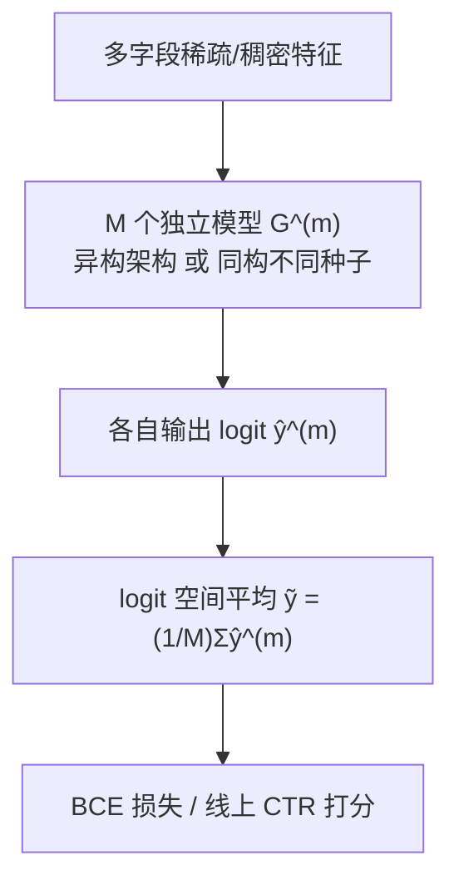
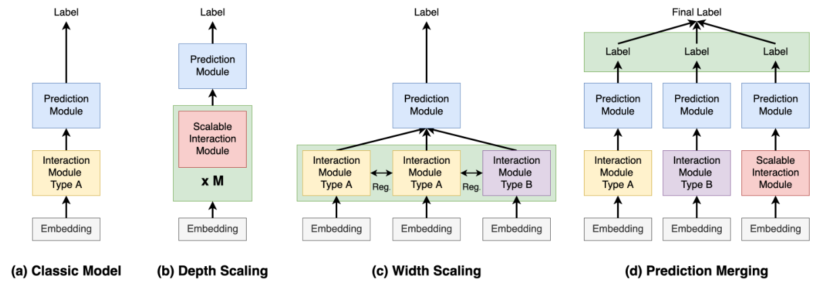

# Exploring Test-time Scaling via Prediction Merging on Large-Scale Recommendation (基于预测合并的大规模推荐测试时缩放探索)

- **会议/期刊**: SIGIR 2026
- **作者与机构**: Fuyuan Lyu, Zhentai Chen, Jingyan Jiang, Lingjie Li, Xing Tang, Xiuqiang He, Xue Liu（MBZUAI / McGill / MILA / 深圳技术大学）
- **推荐链路定位**: 精排（CTR 预估打分阶段）
- **研究方向**: CTR/CVR 预估与特征交叉 / 多任务学习与列表级重排
- **论文原文**: [https://arxiv.org/abs/2512.07650v1](https://arxiv.org/abs/2512.07650v1)
- **开源代码**: [https://github.com/aTitye/TTS4CTR](https://github.com/aTitye/TTS4CTR)

## TL;DR (1分钟核心速览)

现有 DLRS 缩放全部集中在**训练期参数缩放**（深度缩放 Wukong/RankMixer、宽度缩放 Multi-Embed/D-MoE），推理期算力利用几乎空白。本文把 LM 的 test-time scaling 迁移到推荐，核心难点是推荐输入结构统一、无法像 LM 那样靠 prompt/解码采样产生多样性。作者提出**预测合并 (Prediction Merging, PM)**：训练 $M$个独立模型（异构架构混合，或同构不同随机种子），推理时在 logit 空间直接平均$\tilde{y}=\frac{1}{M}\sum_m \hat{y}^{(m)}$。在 Criteo/Avazu/KDD12 三基准、8 个骨干上，16× 同构缩放使 RankMixer 在 Avazu 上 AUC 从 0.7952 升至 0.7988（+0.36%），且同算力预算下优于参数缩放、方差更小、可并行部署。

## Background & Motivation (背景与核心矛盾)

- **主流范式**: 推荐缩放沿两条路走——深度缩放堆叠可无缝衔接的交互层（Wukong、RankMixer），宽度缩放并行多组交互模块并为每组配独立 embedding 表以防嵌入坍缩（Multi-Embed、D-MoE），二者本质都是**增大可训练参数量**。
- **前人局限**: ① 参数缩放收益随数据量固定而饱和，且深度缩放需在多个缩放维度上大量调参（附录 A.3），工业落地成本高；② 宽度缩放依赖人工先验的正则项约束专家多样性，融合发生在交互层之后、共享 predictor，且实验显示在 Criteo 上增加交互模块反而掉点。
- **核心洞察 (Key Insight)**: LM 的测试时缩放能带来**正交、资源高效、稳定**的增益，但推荐场景输入结构统一、无解码随机性，无法天然产生多样输出；作者用 JS 散度实证发现**预测多样性（尤其异构架构间）与 AUC 增益强相关**（图 5e）。
- **本文切入点**: 放弃在交互层做融合，改为**晚融合**——各模型独立训练、独立预测，仅在 logit 空间平均，从而对任意架构无假设、天然并行。

## Method (核心方法设计)

### 1. 整体框架 (Overall Architecture)

输入仍是标准 CTR 多字段特征：稀疏特征经 embedding 表映射为 $\mathbf{e}=[\mathbf{e}_1,\cdots,\mathbf{e}_n]$，送入交互层$\mathbf{h}=I(\mathbf{e})$与预测头得到$\hat{y}=F(\mathbf{h})$。本文不改动任何单模型内部结构，而是在其外层套一个"模型集合"：训练阶段将$M$个模型分成$K$ 个互斥子集依次训练（Algorithm 1），每个子集内部先按式 (10) 合并预测再回传 BCE 梯度；推理阶段所有模型并行前向，logit 直接算术平均。多样性来源有二：异构架构（Wukong+RankMixer 等）与同构不同随机初始化种子。

<figure class="paper-figure" markdown="span">
  <figcaption>图 2：不同结构的可视化。(a) 经典模型设计，包含嵌入、交互和预测模块。(b) 深度缩放模型设计，其缩放交互模块的深度并隐式融合信息。(c) 宽度缩放模型设计并行增加交互模块数量及相关嵌入表。它在交互模块之间应用正则化以鼓励多样性并防止重叠。(d) 预测合并直接在 logit 空间融合信息。对于所有结构，交互模块和预测</figcaption>
</figure>

### 2. 关键设计拆解 (Key Designs)

1. **预测合并 (Prediction Merging)**：痛点在于宽度缩放必须在交互层融合并依赖人工正则，且共享 predictor 限制了架构自由度。本文改为对模型族 $\{F^{(m)}\}$ 各自独立预测后平均：
$$\tilde{y}=\frac{1}{M}\sum_{m=1}^{M}\hat{y}^{(m)},\quad \hat{y}^{(m)}=G^{(m)}(x)$$
直觉：logit 平均等价于对 $M$个独立假设做软投票，方差按$1/M$ 收缩，且不引入任何架构假设，异构模型可无缝拼接。

2. **双路多样性生成（异构 + 同构种子）**：推荐输入统一导致单模型输出高度同质，直接平均无增益。作者用两条路制造多样性：异构架构利用不同交互算子（CIN / Cross Layer / FM）捕捉不同特征交叉模式；同构则仅改变随机初始化种子，靠训练轨迹分叉在 logit 空间拉开距离。JS 散度实验（图 5a–d）显示异构块（左下/右上角）显著深于同构块，且 Wukong+RankMixer 多样性最高、增益也最大。

3. **训练目标、分组训练与推理效率**：总损失即标准 BCE，无额外正则：
$$\mathcal{L}=-\frac{1}{N}\sum_{(x,y)}y\log\tilde{y}+(1-y)\log(1-\tilde{y})$$
训练采用分组（grouped）策略，将 $M$个模型切成$K$个互斥子集$S_1,\cdots,S_K$顺序训练，组内先合并再反传，兼顾显存与多样性（附录 B.2 有分组消融）。无负采样设计（CTR 二分类范式）。推理侧因模型间完全独立，可跨服务器并行，用户侧延迟不随$M$ 线性增长。

## Experimental Setup & Evaluation Protocol (实验设置与评估协议)

- **数据集与预处理**:

| 数据集 | #Users/样本 | #特征域 | 交互规模 | 预处理说明 |
| :--- | :---: | :---: | :---: | :--- |
| Criteo | 一周广告点击 | 26 类 + 13 数值 | 大规模 | 数值取 $\lfloor\log_2 x\rfloor$，低频特征替换为 OOV（min_count=10） |
| Avazu | 10 天点击日志 | 24 类 | 大规模 | 去掉 instance_id，timestamp 拆为 hour/weekday/is_weekend，OOV（min_count=2） |
| KDD12 | 搜索会话日志 | 11 类 | 大规模 | 低频特征替换为 OOV（min_count=10） |

- **数据划分与防穿越 (Splitting Strategy)**: 沿用 CTR 领域标准划分（按时间/官方切分），未做额外冷启动划分；训练/验证/测试严格隔离，验证集用于早停与效率测量。
- **排名评测协议 (Ranking Protocol)**: 采用 CTR 标准 **AUC（ROC-AUC）与 LogLoss**，非全库 ranking 协议；按领域惯例 **AUC 提升 0.1% 即视为显著**，并辅以双侧 t 检验 $p<0.05$ 标注显著性。
- **对比基线与超参设置**: 骨干含经典模型 FNN、IPNN、DeepFM、DCN、DCNv2、FinalMLP 与深度缩放模型 Wukong、RankMixer；宽度缩放基线 Multi-Embed (ME)、D-MoE；模型合并基线为权重平均。缩放倍率 2×–64×，同构最多 16×（附录至 64×），异构最多 32×。

## Key Experimental Results (实验关键数据)

### 1. 主实验对比 (Main Results)

同构缩放（节选 Avazu / Criteo，16× 为最大倍率）：

| 模型 | Avazu AUC | Avazu LogLoss | Criteo AUC | Criteo LogLoss | KDD12 AUC |
| :--- | :---: | :---: | :---: | :---: | :---: |
| DCNv2 (backbone) | 0.7946 | 0.3711 | 0.8116 | 0.4398 | 0.8114 |
| DCNv2 + PM 16× | **0.7989** | **0.3685** | **0.8132** | **0.4384** | **0.8124** |
| FinalMLP (backbone) | 0.7858 | 0.3777 | 0.8105 | 0.4410 | 0.8111 |
| FinalMLP + PM 16× | **0.7904** | **0.3737** | **0.8118** | **0.4398** | **0.8122** |
| Wukong (backbone) | 0.7954 | 0.3704 | 0.8103 | 0.4411 | 0.8117 |
| Wukong + PM 16× | **0.8001** | **0.3677** | **0.8137** | **0.4381** | **0.8137** |
| RankMixer (backbone) | 0.7952 | 0.3706 | 0.8115 | 0.4400 | 0.8124 |
| RankMixer + PM 16× | **0.7988** | **0.3684** | **0.8142** | **0.4375** | **0.8148** |
| Wukong+RankMixer 异构 32× | **0.8030** | **0.3657** | **0.8145** | **0.4373** | **0.8155** |

异构组合（Wukong+RankMixer）在 Avazu 上相对单 Wukong 提升 **+0.76% AUC**，为全表最大增益。

### 2. 消融实验 (Ablation Study)

| 配置 | Avazu AUC | Criteo AUC | 说明 |
| :--- | :---: | :---: | :--- |
| Wukong 单模型 | 0.7954 | 0.8103 | 基线 |
| Wukong + ME (宽度缩放) | 0.7969 | 0.8106 | 交互层融合，无正则 |
| Wukong + D-MoE (宽度缩放) | 0.7972 | 0.8111 | 加人工多样性正则 |
| Wukong + PM 2× | **0.7973** | **0.8121** | logit 晚融合 |
| RankMixer + PM 2× | **0.7964** | **0.8124** | 同上 |
| 模型权重合并 16× (Wukong) | 0.4941 | 0.6109 | 直接平均参数，崩溃至随机水平 |
| 预测合并 16× (Wukong) | **0.8001** | **0.8137** | 同倍率下稳定增益 |
| FinalMLP top-8 多样性筛选 | 0.7916 (+0.0012) | — | 优于全 16 个融合 |

### 3. 关键实验发现 (Key Findings)

1. **多样性是增益的因果驱动**：Criteo 上平均 JS 散度与 ΔAUC 呈明显正相关（图 5e）；FinalMLP 仅选 top-8 高多样性模型融合，AUC 反比全 16 个融合高 +0.0012，而 top-4 则掉点，说明"多样性不足"与"多样性过载"两端都劣化。
2. **测试时缩放严格优于参数缩放且更稳**：同 FLOPs 下 PM 曲线全面高于深度缩放（图 3）；16× 设置下 PM 的 $\sigma_{\text{AUC}}$普遍比深度缩放低一个量级（如 Avazu-Wukong：$7.05\times10^{-5}$vs$2.99\times10^{-4}$）。
3. **与参数缩放正交**：Wukong/RankMixer 参数从 1× 放大到 16× 时，叠加 16× PM 的绝对增益稳定维持在 +0.07~+0.10 AUC 点（表 5），说明两条缩放轴可叠加使用；而模型权重合并在 16× 时 AUC 崩至 0.49，因各专家独立随机初始化、参数分布不共享祖先。

## Highlights & Limitations (亮点、对比与审稿批判)

- **与代表作对比 (vs. Prior Work)**: 相比 Wukong/RankMixer 的深度缩放，本文不设计新交互层、不增加单模型参数，仅在推理侧并行复制；相比 Multi-Embed/D-MoE 的宽度缩放，本文把融合从交互层后移到 logit 空间，摆脱共享 predictor 与人工多样性正则；相比 LM 的 self-consistency/best-of-N，本文的多样性不来自解码采样而来自架构异构与初始化随机性。
- **可迁移亮点**: ① "训练多个不同种子的小模型 + logit 平均"是零架构改动的免费涨点手段，可直接套用到现有精排模型；② 用 JS 散度做模型子集筛选（top-$k$ 多样性选择）可在不增加推理成本的前提下提升融合质量。
- **审稿级局限批判**: ① 推理成本随 $M$ 线性增长，虽可并行部署但服务器资源开销真实存在，论文未给出单位请求的总算力账单；② 仅在三个公开 CTR 基准上验证，缺少工业级线上 A/B 与延迟实测，且 DCNv2 上 PM 训练速度反被参数缩放超越（I/O 带宽瓶颈），说明收益依赖骨干计算密度。

## Rating (四维评分)

- **方法创新性 (Novelty)**: ⭐⭐⭐⭐ （首次系统定义推荐测试时缩放维度，预测合并虽简单但视角新颖，且有 JS 散度相关性作为机理解释）
- **评估协议与实验扎实度 (Protocol & Experiments)**: ⭐⭐⭐⭐ （三数据集八骨干、2×–64× 多倍率、显著性检验与稳定性方差分析齐全，但缺线上实验）
- **写作与数学规范度 (Clarity & Rigor)**: ⭐⭐⭐⭐ （公式极简清晰、结构图对比直观，但理论分析偏经验性，缺方差收缩的形式化证明）
- **工业落地与复现价值 (Industrial & Practical Value)**: ⭐⭐⭐⭐⭐ （代码开源、零架构改动、天然并行可跨机部署，是少见的"改一行融合逻辑即可上线"的缩放方案）

