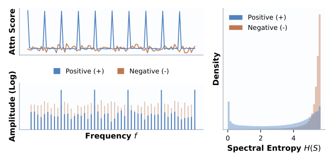
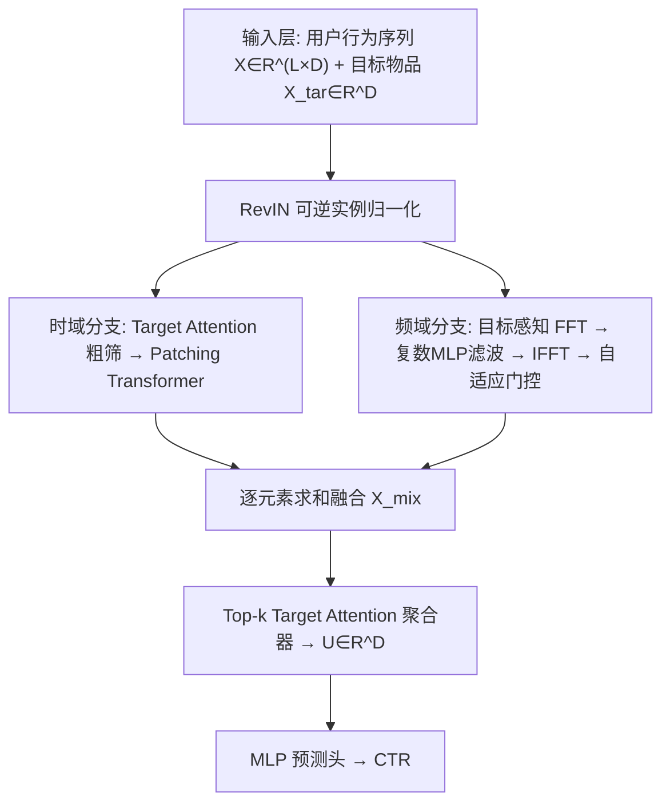
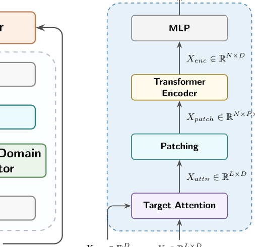
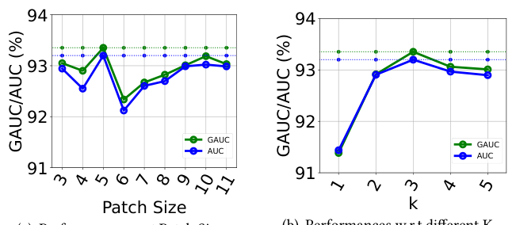
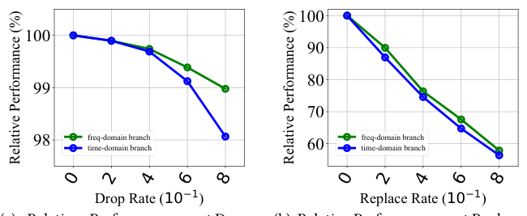
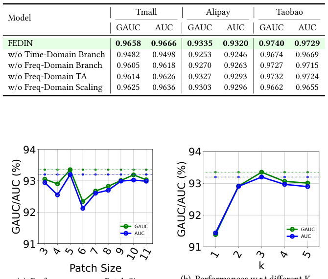

# FEDIN: Frequency-Enhanced Deep Interest Network for Click-Through Rate Prediction (频率增强深度兴趣网络)

- **会议/期刊**: SIGIR 2026 (49th International ACM SIGIR Conference, Melbourne, VIC, Australia)
- **推荐链路定位**: 精排 (CTR Prediction / Ranking)
- **研究方向**: CTR预估与特征交叉 / 序列推荐
- **论文原文**: [https://arxiv.org/abs/2605.01726v1](https://arxiv.org/abs/2605.01726v1)
- **开源代码**: [https://github.com/otokoneko/FEDIN](https://github.com/otokoneko/FEDIN)

## TL;DR (核心速览)

针对 CTR 精排中用户行为序列时域噪声大、现有频域方法（如 DIFF）忽略候选物品上下文的问题，FEDIN 提出"目标条件化频谱"经验观察（正样本注意力谱熵更低、更集中），设计时域（Target Attention + Patching Transformer）与频域（目标感知 FFT + 复数 MLP 可学习滤波 + 自适应共振门控）双分支架构，在 Tmall/Alipay/Taobao 三数据集上以 GAUC/AUC 全面超越 DIN、DIEN、SASRec、DIFF 等基线，Taobao 上 GAUC 达 0.9740（相对最强基线 +0.51%）。

## Background & Motivation (背景与动机)

- **领域背景与主流范式**: CTR 预估的核心是从用户历史行为序列中提取兴趣表征，主流范式为 Embedding&MLP + 序列建模（RNN / Transformer / SSM）+ Target Attention（DIN 系列）。近年频域分析（FMLP-Rec、FEARec、DIFF）被引入以对抗时域噪声，利用 FFT 的全局周期性视角做去噪与模式识别。
- **现有方法局限 (Limitations of Prior Work)**:
  1. **时域方法对点噪声敏感**：用户历史是"长期周期习惯 + 短期随机噪声"的混合，纯时域模型（含 Target Attention）难以从长序列中解耦稳定周期模式与随机点击。
  2. **频域方法目标无关 (Target-Agnostic)**：DIFF 等 SOTA 方法对用户序列独立做频域滤波，忽略候选物品上下文；而用户行为序列是"多态的 (polymorphic)"，没有目标物品作为条件，模型无法区分真实信号频率分量与背景噪声。
  3. **频域与时域互补性未被充分利用**：频域擅长全局周期与抗噪，时域擅长局部序列演化，现有工作未做有效融合。
- **核心挑战 (Key Challenge)**: 为什么简单地对原始序列做 FFT 不够？因为目标物品是"天然频率选择器 (natural frequency selector)"——同一用户序列在不同候选物品条件下，其注意力谱呈现截然不同的熵分布，目标无关的频谱分析会抹平这一关键条件现象。
- **核心洞察与切入点 (Key Insight)**: 作者对标准 Target Attention 骨干的注意力分数做统计观察（图 1）：将条件于不同目标物品的注意力分数投影到频域后，**正样本呈现高度集中的低熵谱峰（周期性共振），负样本呈现类白噪声的高熵分布**。这一经验观察为"目标条件化频域滤波"提供了理论依据。

<figure class="paper-figure" markdown="span">
  <figcaption>图1：目标条件化频谱模式的经验观察。（左）不同目标下注意力分数的案例研究对比：正样本倾向于在用户序列中引发更明显的周期性共振，表现为集中的频谱峰。（右）跨数据集的频谱熵 𝐻(𝑆) = −Í𝑝𝑘log2 𝑝𝑘 统计分布，显示正样本相比负样本通常呈现更低的熵特征。</figcaption>
</figure>

## Problem Formulation & Method (问题定义与方法架构)

### 1. 符号定义与输入表征 (Notations & Input Representations)

- 用户行为序列 $X \in \mathbb{R}^{L \times D}$，$L$ 为最大序列长度（实验固定 $L=100$），$D$ 为 embedding 维度（实验 $D=32$）。
- 目标物品表征 $X_{tar} \in \mathbb{R}^{D}$。
- 输出：用户兴趣表征 $U \in \mathbb{R}^{D}$，经 MLP 预测头输出 CTR。
- 中间变量：注意力加权序列 $X_{attn} \in \mathbb{R}^{L \times D}$、分片表征 $X_{patch} \in \mathbb{R}^{N \times P \times D}$（$N$ 为 patch 数，$P$ 为 patch 大小）、时域表征 $X_{time} \in \mathbb{R}^{L' \times D}$、频域表征 $X_{freq} \in \mathbb{R}^{L' \times D}$、融合表征 $X_{mix}$。

### 2. 整体流水线 (Overall Architecture)

数据流：输入序列与目标物品先经 **RevIN**（可逆实例归一化）缓解分布漂移与非平稳性 → 并行进入**时域分支**（Target Attention 粗筛 → Patching Transformer 细粒度演化建模）与**频域分支**（目标感知 FFT → 复数 MLP 可学习滤波 → IFFT → 自适应共振缩放）→ 两分支逐元素求和得 $X_{mix}$ → **Top-k Target Attention 聚合器**输出最终兴趣 $U$ → MLP 预测 CTR。双分支可高度并行执行，利于实时部署。

<figure class="paper-figure" markdown="span">
  <figcaption>图2：FEDIN 的架构。</figcaption>
</figure>

### 3. 核心模块设计与数学原理 (Key Designs & Formulations)

**(1) 时域分支：粗到细 (Coarse-to-Fine) 兴趣演化提取**

- **Target Attention 粗筛**：不同于 DIN 的加权池化，此处保留加权序列以维持时间分辨率：
$$X_{attn} = \text{Softmax}(X_{tar}X^{\top}/\alpha)^{\top} \odot X \in \mathbb{R}^{L \times D}$$
- **Patching Transformer 细粒度建模**：将 $X_{attn}$ 切分为非重叠 patch $X_{patch} \in \mathbb{R}^{N \times P \times D}$（不足则零填充），展平后线性投影回 $D$ 维，经 Transformer Encoder 建模 patch 间依赖，得 $X_{time}$。物理直觉：既识别"用户喜欢什么"，也刻画"兴趣如何随时间演化"，同时将自注意力复杂度从 $O(L^2)$ 降至 $O(N^2)$（$N = L/P$）。

**(2) 频域分支：目标感知频谱滤波（核心创新）**

- **目标条件化频谱生成**：先算原始注意力分数 $X_{score} = XX_{tar}^{\top}/\alpha \in \mathbb{R}^{L}$，再对其做 FFT 得 $\hat{X}_{score} = \mathcal{F}(X_{score}) \in \mathbb{C}^{L}$。**关键设计**：变换的是注意力分数而非原始序列 $X$，从而保证频谱条件于目标上下文。目标感知频谱为：
$$\hat{X}_{attn} = \text{Softmax}(\text{Amp}(\hat{X}_{score})) \otimes \mathcal{F}(X) \in \mathbb{C}^{F \times D}$$
其中 $\otimes$ 为沿 $D$ 维的广播逐元素乘，突出用户与目标强共振的频率分量。
- **可学习复数谱滤波器**：采用复数 MLP（遵循 Deep Complex Networks 的复数运算规范，严格保持相位-幅度耦合）自适应放大主谐波、抑制噪声：
$$\hat{X}_{freq} = \mathcal{F}^{-1}(\text{MLP}(\hat{X}_{attn}))$$
- **自适应共振缩放 (Adaptive Resonance Scaling)**：并非所有用户-物品对都有强周期性，基于"强兴趣低谱熵"的观察引入门控：
$$X_{freq} = \text{Sigmoid}(\text{MLP}(\text{Amp}(\hat{X}_{score}))) \cdot \hat{X}_{freq}$$
谱结构清晰时更依赖频域视图，否则回退时域。

**(3) 用户兴趣聚合器：Top-k Target Attention**

$$U = \text{Softmax}(\text{Top-}k(X_{tar}X_{mix}^{\top}/\alpha, k)) \cdot X_{mix}$$

仅保留相似度最高的 $k$ 个物品，实现方式为将非 top-$k$ 注意力分数 mask 为 $-\infty$ 后再 Softmax（保证可微、梯度可回传）。设计灵感来自多任务学习中的参数隔离策略（MMoE/PLE/STEM），防止冲突或弱兴趣信号稀释最终预测（缓解 seesaw 现象）。

### 4. 训练目标、负采样与推理复杂度 (Optimization, Negative Sampling & Complexity)

- **损失函数**: 原文未显式写出损失公式，但作为 CTR 二分类任务，采用标准 **BCE (Binary Cross-Entropy)** 损失（基于 FuxiCTR 框架实现）。原文未报告额外的正则项或辅助损失权重。
- **训练负采样策略**: CTR 场景下负样本由曝光未点击日志天然提供（隐式反馈），原文未采用额外负采样或难负例挖掘策略。
- **时间与空间复杂度**:
  - 频域分支计算开销由 FFT 主导，复杂度 $O(L \log L)$，显著优于标准自注意力的 $O(L^2)$，随 $L$ 增大优势更明显。
  - 时域分支经 patching 后自注意力复杂度为 $O(N^2)$（$N=L/P$）。
  - 双分支可并行执行，利于实时部署。原文未报告具体单次推理延迟 (ms/request) 或峰值显存数值。

## Experimental Setup & Evaluation Protocol (实验设置与评估协议)

- **数据集统计与预处理**: 使用三个公开数据集 Tmall、Taobao、Alipay（均来自阿里天池）。**原文未报告各数据集的用户数、物品数、交互数、稀疏度等统计量**，也未说明 5-core/10-core 等过滤规则，仅给出数据来源链接。

| 数据集 (Dataset) | 用户数 (#Users) | 物品数 (#Items) | 交互数 (#Interactions) | 稀疏度/密度 (Sparsity) | 模态/辅助特征说明 |
| :--- | :---: | :---: | :---: | :---: | :--- |
| Tmall | 原文未报告 | 原文未报告 | 原文未报告 | 原文未报告 | 电商行为序列 |
| Taobao | 原文未报告 | 原文未报告 | 原文未报告 | 原文未报告 | 电商行为序列 |
| Alipay | 原文未报告 | 原文未报告 | 原文未报告 | 原文未报告 | 支付/生活服务行为序列 |

- **数据划分方式 (Splitting Strategy)**: 按**全局时间线 (global timeline)** 划分为训练/验证/测试集，属于 Global Temporal Split，可有效防止未来信息泄露（数据穿越）。
- **排名评测协议 (Ranking Protocol)**: 采用 CTR 预估标准的**逐样本二分类打分协议**（非全库排序、非负采样排序），以 AUC 与 GAUC 为指标；GAUC 按用户分组加权，是工业 CTR 的核心指标。
- **评价指标与显著性检验**: 指标为 **AUC** 与 **Group AUC (GAUC)**；表 1 中带星号 (*) 表示相对最强基线的提升通过统计显著性检验（$p$-value $< 0.05$）。Embedding 维度 $D=32$，最大序列长度 $L=100$，所有模型基于 FuxiCTR 统一实现以保证公平对比；优化器 Adam，学习率 $5e-4$，batch size 2048。

## Key Experimental Results (核心实验结果)

### 1. 主实验对比 (Main Results)

表 1 展示三数据集 GAUC/AUC 对比（加粗为最优，下划线为基线最优）：

| 数据集 | 指标 | DIN (强基线) | SASRec / GRU4Rec | DIFF (频域SOTA) | 本文 FEDIN | 相对提升 (Improv.) |
| :--- | :--- | :---: | :---: | :---: | :---: | :---: |
| Tmall | GAUC | 0.9547 | 0.9210 (GRU4Rec) | 0.8513 | **0.9658*** | +1.16% (vs DIN) |
| Tmall | AUC | 0.9518 | 0.9269 (BST) | 0.8618 | **0.9666*** | +1.55% (vs DIN) |
| Alipay | GAUC | 0.8897 | 0.9268 (GRU4Rec) | 0.8962 | **0.9335*** | +0.72% (vs GRU4Rec) |
| Alipay | AUC | 0.8832 | 0.9312 (SASRec) | 0.8995 | **0.9320*** | +0.09% (vs SASRec) |
| Taobao | GAUC | 0.9689 | 0.9618 (GRU4Rec) | 0.9463 | **0.9740*** | +0.53% (vs DIN) |
| Taobao | AUC | 0.9664 | 0.9638 (GRU4Rec) | 0.9475 | **0.9729*** | +0.67% (vs DIN) |

关键观察：DIN 在 Tmall/Taobao 表现优异但在 Alipay 上明显下滑（数据稀疏性与行为复杂度差异）；DIFF 作为频域 SOTA 在三数据集上均未超越 DIN，印证了"目标无关频域滤波次优"的论点；FEDIN 在所有数据集上稳定取得 SOTA，体现双分支架构对稀疏/噪声环境的鲁棒性。

### 2. 消融实验与控制变量分析 (Ablation Study)

表 2 消融结果（GAUC/AUC）：

| 变体 | Tmall GAUC | Alipay GAUC | Taobao GAUC | 结论 |
| :--- | :---: | :---: | :---: | :--- |
| FEDIN (完整) | 0.9658 | 0.9335 | 0.9740 | — |
| w/o Time-Domain Branch | 0.9482 | 0.9253 | 0.9674 | 降幅最大（Tmall −1.76 GAUC），时域局部演化不可或缺 |
| w/o Freq-Domain Branch | 0.9605 | 0.9270 | 0.9727 | 频域提供互补全局周期信息 |
| w/o Freq-Domain TA | 0.9614 | 0.9327 | 0.9732 | 验证"目标条件化频谱"核心假设：静态可学习滤波替代目标感知谱后性能下降 |
| w/o Freq-Domain Scaling | 0.9625 | 0.9303 | 0.9662 | 自适应门控必要，Taobao 上降幅明显（−0.78 GAUC） |

贡献最大模块为**时域分支**（移除后降幅最大）；**目标感知频谱 (Freq-Domain TA)** 的移除验证了论文核心假设——仅分析用户行为谱不足，目标物品是激活特定共振模式的必要条件。原文消融未显式报告参数量对齐或图拓扑度数匹配等控制变量。

### 3. 稀疏度/冷启动分桶与超参敏感度 (Sparsity Buckets & Hyperparameters)

- **用户/物品交互频次分桶表现**: 原文未做长尾/冷启动分桶实验，但通过 Alipay（较稀疏数据集）上的稳定表现间接说明鲁棒性。
- **关键超参数敏感度**（图 3，Taobao 数据集）:
  - **Patch Size**（3–11）：极端值要么碎片化局部上下文、要么造成信息损失，存在最优中间值。
  - **Top-k 的 $k$**（1–5）：需在兴趣多样性与噪声抑制间平衡，$k$ 过小限制覆盖、过大引入无关信号并加剧 seesaw 现象。
- **抗噪性分析**（图 4，Taobao）：在 Drop Noise（随机删除行为）与 Replace Noise（随机替换为均匀采样物品）两种合成噪声下，噪声率 $\rho \in \{0.0, 0.2, 0.4, 0.6, 0.8\}$，频域分支的相对性能衰减显著低于时域分支——随机噪声在频域表现为分散高熵波动，而核心兴趣集中于共振峰，谱滤波可有效衰减高熵噪声。
- **线上 A/B 测试结果**: 原文仅包含离线实验，未报告线上 A/B 测试。

<figure class="paper-figure" markdown="span">
  <figcaption>图3：Taobao 数据集上的超参数分析。</figcaption>
</figure>

<figure class="paper-figure" markdown="span">
  <figcaption>图4：Taobao 数据集上的抗噪性分析。</figcaption>
</figure>

<figure class="paper-figure" markdown="span">
  <figcaption>表2：三个数据集上的消融分析。最佳性能以粗体表示。</figcaption>
</figure>

## Highlights, Limitations & Critiques (亮点、局限与审稿级批判)

- **核心亮点与可迁移性**:
  1. **"目标条件化频谱"经验观察**具有普适价值——将频域分析从"序列级"推进到"目标条件级"，可迁移至序列推荐、会话推荐、多模态序列建模等任务。
  2. **对注意力分数而非原始序列做 FFT** 的设计巧妙，使频谱天然携带目标上下文，且计算量仅 $O(L\log L)$。
  3. **复数 MLP 滤波器 + 自适应共振门控**兼顾相位-幅度耦合与"按需依赖频域"的灵活性，工程上双分支可并行，利于工业实时部署。
  4. **Top-k Target Attention** 借鉴多任务学习的参数隔离思想缓解 seesaw 现象，思路可迁移至其他注意力聚合场景。

- **局限性与审稿视角批判 (Critical Limitations)**:
  1. **数据集统计信息缺失**：原文未报告三数据集的用户/物品/交互规模与过滤规则，削弱了实验可复现性与可比性；也未说明正样本定义（点击 vs. 转化）。
  2. **基线覆盖不足**：缺少近年频域序列推荐（FMLP-Rec、FEARec）与更强序列模型（Mamba4Rec、Temporal Interest Network）的直接对比；DIFF 被改造适配 CTR 任务，改造公平性需进一步论证。
  3. **效率证据薄弱**：虽在理论上论证 $O(L\log L)$ 优势，但未报告实际训练单 epoch 耗时、推理延迟 (ms/request) 与峰值显存，工业落地价值缺乏量化支撑。
  4. **超参敏感与调参成本**：Patch Size 与 $k$ 均存在明显最优区间，且需逐数据集调优；复数 MLP 的实现与训练稳定性（复数梯度）未做深入讨论。
  5. **统计严谨性**：仅报告 $p<0.05$ 显著性标记，未说明检验方法（配对 $t$-test / Wilcoxon）与多随机种子方差；消融未做参数量对齐控制。
  6. **理论深度**：谱熵与"真实兴趣"的因果关联仍停留在经验观察层面，缺乏更严格的理论刻画（如为何低熵对应正样本）。

## Rating (四维评分)

- **方法创新性 (Novelty)**: ⭐⭐⭐⭐ （目标条件化频谱观察新颖，双分支融合设计合理，但频域+时域混合范式本身非首创）
- **评估协议与实验扎实度 (Protocol & Experiments)**: ⭐⭐⭐ （三数据集 + 全局时间切分 + 显著性标记规范，但数据集统计缺失、基线覆盖与效率证据不足）
- **写作与数学规范度 (Clarity & Rigor)**: ⭐⭐⭐⭐ （公式与维度标注清晰，复数滤波与门控设计表述严谨，损失函数与实现细节略简）
- **工业落地与复现价值 (Industrial & Practical Value)**: ⭐⭐⭐⭐ （双分支可并行、$O(L\log L)$ 复杂度、代码已开源、基于 FuxiCTR 实现，落地友好；但缺线上验证与延迟数据）
