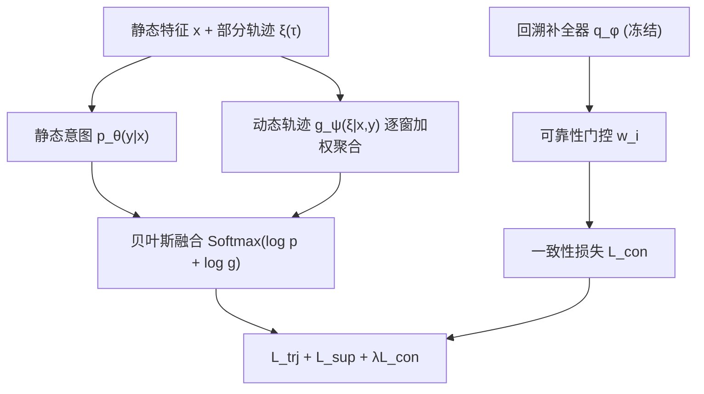

# Follow the TRACE: Exploiting Post-Click Trajectories for Online Delayed Conversion Rate Prediction (循迹而行：利用点击后轨迹进行在线延迟转化率预估)

- **会议/期刊**: SIGIR 2026 (Short Paper)
- **作者与机构**: Xinyue Zhang, Yuanhao Ding, Xiang Ao — 中科院计算所 AI 安全国家重点实验室 / 中国科学院大学
- **推荐链路定位**: 精排（CVR 预估）
- **研究方向**: CTR/CVR 预估与特征交叉 / 去偏与工业架构
- **论文原文**: [https://arxiv.org/abs/2604.23197v1](https://arxiv.org/abs/2604.23197v1)
- **开源代码**: [https://github.com/LunaZhangxy/TRACE](https://github.com/LunaZhangxy/TRACE)

## TL;DR (1分钟核心速览)

在线 CVR 预估中，延迟反馈迫使系统在「标签准确」与「数据新鲜」间二选一：未转化样本被硬标为负例产生假阴性偏差。TRACE 将点击后行为在观测窗口内的累积演化形式化为**反馈轨迹**，用贝叶斯分解把静态意图与轨迹似然相乘，并对未揭示样本做连续后验修正而非硬打标；再用全生命周期数据训练的回溯补全器 + 可靠性门控缓解早期轨迹稀疏。在 Criteo/Taobao 流式模拟协议下，AUC 分别达 0.8382 / 0.8354，较最强基线 DEFUSE 提升 0.47% / 0.46%，且作为即插即用模块可为 7 个骨干平均带来 +1.20% AUC。

## Background & Motivation (背景与核心矛盾)

- **主流范式**: 延迟反馈 CVR 分三线——延迟时间建模（ES-DFM 的 elapsed-time 采样、DEFER 的延迟正例复制）、无偏标签校正（FNW/DEFUSE 的重要性加权）、多窗口流式融合（FTP/MISS 的多 horizon 估计聚合）。
- **前人局限**: ① 上述方法均把未揭示样本当作「待修正的静态负例」，只关心**何时**转化，忽略观测期内点击后行为**如何演化**；② GDFM 虽引入点击后动作，但把每个动作视为**独立代理信号**，丢弃了跨窗口累积状态的结构信息，且对早期稀疏样本无任何补偿机制。
- **核心洞察 (Key Insight)**: 阿里行为日志显示超 50% 购买发生在交互后 1 小时内，CVR 随 action-to-purchase 间隔呈幂律衰减——即**轨迹的完整度本身就是判别「未揭示正例 vs 真负例」的证据**，而非仅是一个时间戳。
- **本文切入点**: 不等待最终结果、不强行打硬标签，而是评估「已累积的反馈状态与转化/非转化两个假设的契合度」，随信号到达持续精化后验。

## Method (核心方法设计)

### 1. 整体框架 (Overall Architecture)

输入为静态特征 $\boldsymbol{x}$ 与部分可见轨迹 $\boldsymbol{\xi}(\tau)=(\boldsymbol{o}\odot \mathbf{M}(\tau),\mathbf{m}(\tau))$（$\mathbf{m}\in\{0,1\}^H$ 为窗口可见掩码，$\boldsymbol{o}\in\{0,1\}^{H\times K}$ 为 $K$ 类点击后行为的全生命周期累积状态）。模型分两支：静态意图估计器 $p_\theta(y|\boldsymbol{x})$ 给出先验，动态轨迹估计器 $g_\psi(\boldsymbol{\xi}|\boldsymbol{x},y)$ 逐窗口打分并加权聚合，二者经贝叶斯分解融合为最终后验。离线阶段用随机 horizon 截断训练回溯补全器 $q_\phi$；在线阶段冻结 $q_\phi$，以可靠性门控 $w_i$ 加权的一致性损失为未揭示样本提供软后验引导。在线仅更新 $\theta$，$\psi,\phi$ 固定，推理开销与普通 MLP 精排同量级。

<figure class="paper-figure" markdown="span">
  <figcaption>图1：我们提出的模型TRACE的整体架构。</figcaption>
</figure>

### 2. 关键设计拆解 (Key Designs)

1. **轨迹条件贝叶斯分解（Trajectory-Conditioned Estimation）**：痛点是把未揭示样本硬标负例引入偏差。TRACE 将后验写成两个可分解项：
$$p(y|\boldsymbol{x},\boldsymbol{\xi})=\mathrm{Softmax}_y\big[\log p(y|\boldsymbol{x})+\log g(\boldsymbol{\xi}|\boldsymbol{x},y)\big]$$
其中轨迹似然按窗口对数似然加权聚合 $\log g_\psi=\sum_h \alpha_{i,h}\log p_\psi(o_{i,h}|\boldsymbol{x},y)$，权重 $\alpha_{i,h}\propto m_{i,h}\eta_h$，$\eta_h$ 由训练集窗口熵 $\tilde{C}_h$ 预计算（熵越低、判别力越强的窗口权重越大）。直觉：静态意图回答「这人想不想买」，轨迹似然回答「已观测到的行为演化更像买还是不像买」，二者在对数域相加即完成证据融合。

2. **边际化轨迹损失（避免硬标签）**：对未揭示样本不取 $\arg\max y$，而是对 $y$ 边际化，最大化每个已观测窗口的边际似然：
$$\ell_{i,h}=-\log\sum_{y}p_\theta(y|\boldsymbol{x}_i)\,p_\psi(o_{i,h}|\boldsymbol{x}_i,y)$$
这使模型在证据不足时自然保持「不确定」，随窗口揭示逐步收敛，从根上规避假阴性。

3. **回溯补全器 + 可靠性门控（Retrospective Completion）**：早期轨迹稀疏使未揭示正例与真负例几乎不可分。离线用随机截断 $k\sim\mathcal{U}\{1..H\}$ 训练 $q_\phi(y|\boldsymbol{x},\boldsymbol{\xi}_{1:k})$（含 horizon embedding $e_k$），在线以 stop-gradient 软目标做一致性约束：
$$\mathcal{L}_{con}=\frac{1}{\sum_{i\in\mathcal{U}_\tau}w_i+\epsilon}\sum_{i\in\mathcal{U}_\tau}w_i\cdot\mathrm{BCE}\big(p_i,\mathrm{sg}(q_i)\big)$$
门控 $w_i=\sigma(\cdot)\cdot\sigma(\cdot)\cdot\sigma(\cdot)$ 由在线熵 $H(p_i)$、补全器置信度 $1-H(q_i)$、轨迹稀疏度 $1-\kappa_i$ 三者相乘构成——只有「当前不确定 + 补全器自信 + 轨迹确实稀疏」时才放大引导，避免强信号样本被污染。总目标 $\mathcal{L}_{total}=\mathcal{L}_{trj}+\mathcal{L}_{sup}+\lambda\mathcal{L}_{con}$，$\lambda=0.1$；该接口对任意骨干 $\mathcal{M}_\theta$ 只需追加 $\lambda\mathcal{L}_{con}$，无需改架构。

## Experimental Setup & Evaluation Protocol (实验设置与评估协议)

- **数据集与预处理**:

| 数据集 | 时间跨度 | $d_{max}$ | $H$ / $K$ | 窗口划分 | 场景说明 |
| :--- | :---: | :---: | :---: | :--- | :--- |
| Criteo Conversion Logs | 60 天 | 30 天 | 6 / 1 | [6min,15min,1h,1d,7d,30d] | 仅购买行为，前 10 天预训练 |
| Taobao (Alibaba) | 9 天 | 3 天 | 5 / 3 | [2min,10min,2h,1d,3d] | 加购/收藏/购买三类行为，后 7 天流式评估 |

- **数据划分与防穿越**: 严格**全局时间戳切分** + 流式模拟（predict-then-update）：按点击时间 $c$ 排序，$\tau$ 时刻仅可见 $c\le\tau$ 的样本且仅可见 $\tau$ 前到达的反馈；滑动间隔 $\Delta$ = 1h (Criteo) / 20min (Taobao)，先对下一区间预测再更新。
- **排名评测协议**: 全量流式样本上的 AUC / NLL / PR-AUC / ECE，无负采样，属无偏全库评估。
- **对比基线与超参**: 8 个基线（Vanilla、FNW、FTP、MISS、ES-DFM、DEFER、GDFM、DEFUSE）+ Pretrain 下界 + Oracle 上界；隐层 {256,256,128}，ReLU，L2=$10^{-6}$，Adam lr=$10^{-3}$，batch=4096，$\lambda=0.1$，$\beta=2$。

## Key Experimental Results (实验关键数据)

### 1. 主实验对比 (Main Results)

| Method | Criteo AUC↑ | Criteo NLL↓ | Criteo PR-AUC↑ | Taobao AUC↑ | Taobao NLL↓ | Taobao PR-AUC↑ |
| :--- | :---: | :---: | :---: | :---: | :---: | :---: |
| Vanilla | 0.7247 | 0.5868 | 0.5133 | 0.8295 | 0.0721 | 0.4865 |
| FNW | 0.7864 | 0.5506 | 0.5697 | 0.8246 | 0.0757 | 0.4727 |
| ES-DFM | 0.8098 | 0.4097 | 0.6053 | 0.8306 | 0.0708 | 0.4805 |
| GDFM | 0.8308 | 0.4053 | 0.6257 | 0.8325 | 0.0635 | 0.4861 |
| DEFER | 0.8326 | 0.3965 | 0.6319 | 0.8268 | 0.0705 | 0.4744 |
| DEFUSE | 0.8335 | 0.3959 | 0.6336 | 0.8316 | 0.0647 | 0.4901 |
| **TRACE** | **0.8382** | **0.3919** | **0.6370** | **0.8354** | **0.0610** | **0.4911** |
| Oracle | 0.8430 | 0.3869 | 0.6447 | 0.8398 | 0.0603 | 0.4930 |
| **Improv. vs DEFUSE** | **+0.56%** | **−1.01%** | **+0.54%** | **+0.46%** | **−5.72%** | **+0.20%** |

### 2. 消融实验 (Ablation Study)

| 变体 | Criteo AUC | Taobao AUC | 说明 |
| :--- | :---: | :---: | :--- |
| w/o Traj. | 显著下降（最大） | 显著下降 | 退化为静态估计，验证轨迹累积是核心证据 |
| w/o Retro. | 中等下降 | 中等下降 | 早期稀疏样本失去后验引导 |
| w/o Gate | 小幅下降 | 小幅下降 | 无差别引导引入噪声 |
| **TRACE** | **0.8382** | **0.8354** | 完整模型 |

**即插即用增强（Criteo，Base → Base+TRACE）**：FNW 0.7864→0.8107 (+3.1%)、ES-DFM 0.8098→0.8254 (+1.9%)、FTP +1.5%、MISS +1.2%、DEFER +0.2%、GDFM +0.3%、DEFUSE +0.2%，**平均 +1.20% AUC / −2.74% NLL / +1.69% PR-AUC**。

### 3. 关键实验发现 (Key Findings)

1. **轨迹结构 > 独立信号聚合**：TRACE 稳定优于同为多窗口范式的 FTP/MISS（Criteo +4.5%/+3.7% AUC），说明增益来自窗口间累积状态的时间结构，而非更多 horizon 头；去掉轨迹模块的消融跌幅最大，直接印证核心假设。
2. **校准-判别双赢**：多个强基线（如 DEFUSE）AUC 高但 ECE 明显偏高，TRACE 取得最低 ECE 并逼近 Oracle，这对 CPA 出价至关重要——判别力提升未以置信度失真为代价。
3. **补全器对弱骨干增益更大**：FNW 获 +3.1% AUC、NLL 降 10%，而 DEFUSE 仅 +0.2%，说明可靠性门控一致性损失主要补偿早期流式阶段的标签噪声，骨干越弱、噪声越大，收益越显著。

## Highlights, Limitations & Rating (亮点、对比与审稿评价)

- **与代表作对比 (vs. Prior Work)**: 与 ES-DFM/DEFER/DEFUSE 的「延迟时间分布 + 样本重加权」本质不同，TRACE 把监督信号从「一个时间戳」扩展为「一条状态轨迹」，用边际化替代硬标签；与 GDFM 相比，关键差异是 GDFM 把点击后动作当独立代理、TRACE 建模跨窗口累积状态并额外引入回溯补全，故在 Taobao 多行为场景下 GDFM 的 NLL 反而劣于 Vanilla（0.0635 vs 0.0721 波动），TRACE 则稳定最优。
- **可迁移亮点**: ①「可靠性门控 = 在线熵 × 教师置信 × 稀疏度」的三因子相乘门控，可直接迁移到任何在线蒸馏/伪标签场景；②随机 horizon 截断训练使模型对任意观测长度鲁棒，适用于所有流式预估任务。
- **审稿级局限批判**: ① 仅在两个公开数据集做离线流式模拟，缺少真实工业 A/B 与延迟分布漂移下的鲁棒性验证；② 窗口划分 $H$ 与 $\eta_h$ 熵权重依赖人工设定，对 $d_{max}$ 差异极大的业务（如金融长周期转化）敏感度未讨论；③ 补全器需全生命周期数据离线训练，冷启动业务难以获得。
- **四维评分**: 创新性 ⭐⭐⭐⭐ | 实验扎实度 ⭐⭐⭐⭐ | 方法清晰度 ⭐⭐⭐⭐⭐ | 落地价值 ⭐⭐⭐⭐

