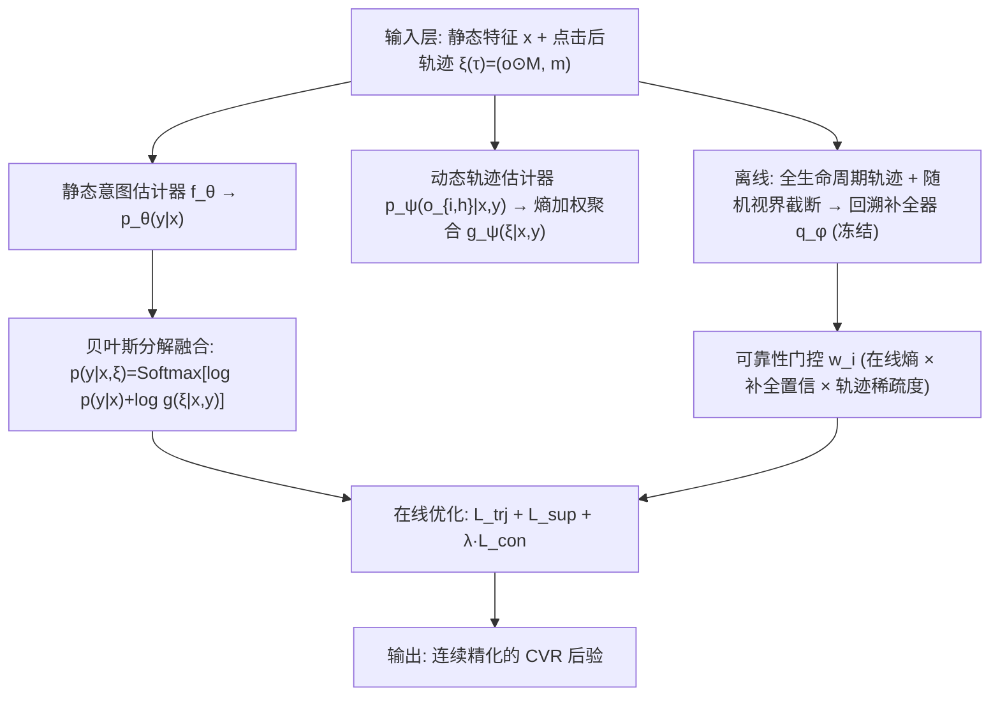
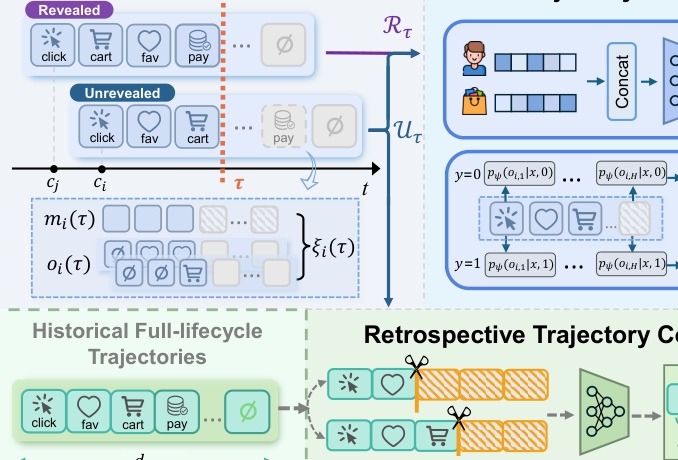
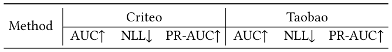
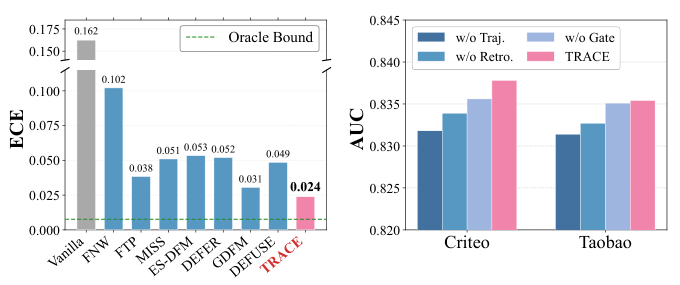
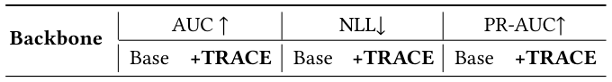

# Follow the TRACE: Exploiting Post-Click Trajectories for Online Delayed Conversion Rate Prediction (跟随轨迹：利用点击后轨迹进行在线延迟转化率预测)

- **会议/期刊**: SIGIR 2026 (Short Paper)
- **推荐链路定位**: 精排 (CTR/CVR Prediction)
- **研究方向**: CTR/CVR 预估与特征交叉 / 多任务学习与列表级重排（延迟反馈与流式训练）
- **论文原文**: [https://arxiv.org/abs/2604.23197v1](https://arxiv.org/abs/2604.23197v1)
- **开源代码**: [https://github.com/LunaZhangxy/TRACE](https://github.com/LunaZhangxy/TRACE)

## TL;DR (核心速览)

针对在线 CVR 预估中延迟反馈导致的"标签准确率 vs 数据新鲜度"两难，TRACE 将点击后行为在观测窗口内的累积演化形式化为**反馈轨迹**，用贝叶斯分解把静态意图 $p(y|\bm{x})$ 与动态轨迹似然 $g(\bm{\xi}|\bm{x},y)$ 融合，对未揭示样本做连续后验精化而非强打硬标签；并设计**可靠性门控的回溯轨迹补全器**（全生命周期数据 + 随机视界截断训练）缓解早期轨迹稀疏。在 Criteo / Taobao 流式模拟协议下，AUC 达 0.8382 / 0.8354，优于 DEFUSE、GDFM 等 SOTA，且作为即插即用模块平均带来 +1.20% AUC。

## Background & Motivation (背景与动机)

- **领域背景与主流范式**: 在线广告 CVR 预估中，点击即时到达而转化可能延迟数分钟到数天。流式训练时，近期曝光尚未走完归因窗口 $d_{\max}$，只能观测到截至当前时间戳 $\tau$ 的反馈。主流应对范式分三线：(1) **延迟建模**（参数化/非参数/离散化延迟分布，如 Chapelle 2014、ES-DFM）；(2) **无偏标签纠正**（重要性采样/样本重加权，如 FNW、DEFER、DEFUSE）；(3) **多视界流式融合**（FTP、MISS 等融合多观测窗口估计）。
- **现有方法局限**:
  1. 延迟建模与重加权方法把未转化样本当作一个"待纠正的负例"，**忽略了点击后行为在观测期内如何演化**这一过程性信息；
  2. 多视界方法（FTP/MISS）把各窗口估计视为可聚合的独立信号，**丢失了窗口之间的时序结构**；
  3. 行为感知方法 GDFM 虽引入点击后动作，但把每个动作当作**独立代理信号**，未刻画累积行为状态在观测窗口上的整体形态。
- **核心挑战 (Key Challenge)**: 早期阶段轨迹极度稀疏，未揭示正例与真负例在观测上几乎不可分，模型会退化为纯静态估计；简单地增加窗口数或拼接行为特征无法解决"信息缺失下的后验不确定性"问题。
- **核心洞察与切入点 (Key Insight)**: 阿里行为日志分析显示超过 50% 购买发生在前序交互后 1 小时内，且 CVR 随"动作-购买"间隔呈幂律衰减——说明**点击后经过时间与最终转化、标签可靠性内在相关**。因此作者主张：反馈轨迹本身是"观测完整度"的动态指示器，可用于区分"视界受限的未揭示正例"与"真负例"，从而在不等最终结果的前提下持续精化后验。

## Problem Formulation & Method (问题定义与方法架构)

### 1. 符号定义与输入表征 (Notations & Input Representations)

- 数据集 $\mathcal{D}=\{(\bm{x}_i, y_i)\}_{i=1}^{N}$，$\bm{x}_i$ 为特征，$y_i\in\{0,1\}$ 为转化标签。
- 每次交互 $i$ 关联点击时间戳 $c_i$ 与转化时间戳 $v_i$（$v_i=\infty$ 表示未转化）。真值标签：$y_i=\mathbb{I}(c_i < v_i \le c_i + d_{\max})$。
- 在线时刻 $\tau$ 的已过时间 $u_i(\tau)=\tau-c_i$，当前可观测标签 $y_i(\tau)=\mathbb{I}(c_i < v_i \le \tau)$。
- 将 $[0, d_{\max}]$ 离散为 $H$ 个窗口，**反馈轨迹**定义为部分视图 $\bm{\xi}_i(\tau)=(\bm{o}_i\odot \bm{M}_i(\tau), \bm{m}_i(\tau))$：
  - $\bm{m}_i(\tau)\in\{0,1\}^H$ 为可见性掩码，$\bm{M}_i(\tau)=\bm{m}_i(\tau)\bm{1}^\top_K\in\{0,1\}^{H\times K}$ 为行广播；
  - $\bm{o}_i\in\{0,1\}^{H\times K}$ 为全生命周期序列，由 $K$ 类点击后行为的窗口级累积状态向量 $o_{i,h}\in\{0,1\}^K$ 组成。
- 流式数据集 $\mathcal{D}_\tau=\{(\bm{x}_i,\bm{\xi}_i(\tau),z_i(\tau))\}_{i:c_i<\tau}$，$z_i(\tau)$ 为当前可观测监督（已揭示样本为 $y_i$，否则不可观测）。目标：从部分观测的 $\mathcal{D}_\tau$ 学习 $p(y=1|\bm{x},\bm{\xi})$。

### 2. 整体流水线 (Overall Architecture)

数据流：静态特征 $\bm{x}$ 经 MLP $f_\theta$ 得静态意图 $p_\theta(y|\bm{x})$；轨迹 $\bm{\xi}$ 经逐窗口 MLP $p_\psi(o_{i,h}|\bm{x},y)$ 得动态似然，按熵加权聚合为 $g_\psi(\bm{\xi}|\bm{x},y)$；二者经贝叶斯分解（Softmax 域相加）融合为 $p_\theta(y|\bm{x},\bm{\xi})$。离线侧用全生命周期轨迹 + 随机视界截断训练回溯补全器 $q_\phi$，在线冻结后经可靠性门控 $w_i$ 以一致性损失 $\mathcal{L}_{con}$ 引导未揭示样本。

<figure class="paper-figure" markdown="span">
  <figcaption>图1：我们提出的模型TRACE的整体架构。</figcaption>
</figure>

### 3. 核心模块设计与数学原理 (Key Designs & Formulations)

**(1) 轨迹条件估计（贝叶斯分解）**。核心公式：

$$p(y|\bm{x},\bm{\xi})=\mathrm{Softmax}_y\big[\log p(y|\bm{x})+\log g(\bm{\xi}|\bm{x},y)\big]$$

物理直觉：静态意图提供先验，轨迹似然提供"该轨迹形态在转化/未转化假设下的支持度"，二者在对数域相加等价于贝叶斯后验更新。轨迹似然按窗口聚合：

$$\log g_\psi(\bm{\xi}_i(\tau)|\bm{x}_i,y)=\sum_{h=1}^{H}\alpha_{i,h}\cdot\log p_\psi(o_{i,h}(\tau)|\bm{x}_i,y)$$

权重 $\alpha_{i,h}=\frac{m_{i,h}\cdot\eta_h}{\sum_t m_{i,t}\cdot\eta_t+\epsilon}$ 按样本归一化，其中 $\eta_h\propto (H-h+1)^{-1}\exp(-\frac{h}{H}-\beta\tilde{C}_h)$，$\tilde{C}_h=\mathrm{H}(y|o_h)/\max_k \mathrm{H}(y|o_k)$ 为训练熵比——**越靠后、判别熵越低的窗口权重越高**，$\beta=2$ 控制熵惩罚强度。

**(2) 边际化训练避免硬标签偏差**。对未揭示样本不强打负标签，而是对 $y$ 边缘化，逐窗口边际损失：

$$\ell_{i,h}=-\log\sum_{y}p_\theta(y|\bm{x}_i)\,p_\psi(o_{i,h}|\bm{x}_i,y)$$

轨迹损失 $\mathcal{L}_{trj}$ 为按 $W_{i,h}=m_{i,h}\eta_h$ 加权的 $\ell_{i,h}$ 均值；已揭示集合 $\mathcal{R}_\tau=\{i|y_i(\tau)=1\vee(\tau>c_i+d_{\max})\}$ 上用标准交叉熵 $\mathcal{L}_{sup}$。流式阶段只更新 $\theta$，$\psi$ 冻结。

**(3) 回溯轨迹补全 + 可靠性门控**。离线以随机视界截断 $k\sim\mathcal{U}\{1,\dots,H\}$ 构造模拟部分视图 $\bm{\xi}_{1:k}=(\bm{o}\odot\bm{m}(k),\bm{m}(k))$，训练 MLP $q_\phi$（拼接静态特征、$\bm{\xi}_{1:k}$、视界嵌入 $e_k$）：

$$\min_\phi\ \mathbb{E}_{(\bm{x},y,\bm{\xi})}\mathbb{E}_{k\sim\mathcal{U}\{1,\dots,H\}}\big[\mathrm{BCE}(q_\phi(y=1|\bm{x},\bm{\xi}_{1:k}),y)\big]$$

在线冻结 $q_\phi$，对未揭示集 $\mathcal{U}_\tau$ 用 stop-gradient 软目标做一致性约束：

$$\mathcal{L}_{con}(\theta;\tau)=\frac{1}{\sum_{i\in\mathcal{U}_\tau}w_i+\epsilon}\sum_{i\in\mathcal{U}_\tau}w_i\cdot\mathrm{BCE}\big(p_i,\ \mathrm{sg}(q_i)\big)$$

门控 $w_i\in[0,1]$ 由三路 sigmoid 输出相乘：在线熵 $\mathrm{H}(p_i)$、补全置信 $1-\mathrm{H}(q_i)$、轨迹可见度 $1-\kappa_i$（$\kappa_i=\frac{1}{H}\sum_h m_{i,h}$）——分别刻画当前信息稀缺度与回溯信号可靠性。

### 4. 训练目标、负采样与推理复杂度 (Optimization, Negative Sampling & Complexity)

- **总损失**：$\mathcal{L}_{total}(\theta;\tau)=\mathcal{L}_{trj}(\theta;\tau)+\mathcal{L}_{sup}(\theta;\tau)+\lambda\mathcal{L}_{con}(\theta;\tau)$，$\lambda=0.1$。模型无关接口形式：$\min_\theta \mathcal{L}_M(\theta;\tau)+\lambda\mathcal{L}_{con}(\theta;\tau)$，无需改动骨干架构。
- **负采样策略**：本文为 CVR 二分类流式训练，**不涉及召回式负采样**；未揭示样本通过边际化（式 7）与软目标一致性（式 11）处理，而非硬负标签。
- **复杂度**：静态估计器为 MLP（隐层 {256,256,128}）；轨迹估计器对 $H$ 个窗口各做一次 MLP 前向，复杂度 $O(H\cdot d^2)$，Criteo $H=6$、Taobao $H=5$，开销极小；补全器离线训练、在线仅前向一次。原文未报告具体训练耗时、推理延迟 (ms/request) 与峰值显存。

## Experimental Setup & Evaluation Protocol (实验设置与评估协议)

- **数据集统计与预处理**（原文未给出用户/物品/交互计数与稀疏度，仅给出时间跨度与窗口设置）：

| 数据集 (Dataset) | 用户数 (#Users) | 物品数 (#Items) | 交互数 (#Interactions) | 稀疏度/密度 (Sparsity) | 模态/辅助特征说明 |
| :--- | :---: | :---: | :---: | :---: | :--- |
| Criteo Conversion Logs | 原文未报告 | 原文未报告 | 60 天点击/转化日志 | 原文未报告 | $d_{\max}=30$ 天；$H=6$ 窗口 [6min, 15min, 1h, 1d, 7d, 30d]；$K=1$（仅购买） |
| Taobao | 原文未报告 | 原文未报告 | 9 天大规模用户行为日志 | 原文未报告 | $d_{\max}=3$ 天；$H=5$ 窗口 [2min, 10min, 2h, 1d, 3d]；$K=3$（加购、收藏、购买） |

- **数据划分方式 (Splitting Strategy)**: **全局时间戳切分 + 流式模拟**。Criteo 前 10 天预训练、后 50 天流式评估；Taobao 最后 7 天流式评估。遵循 [26] 的流式协议：按时间顺序划分预训练集与流式集，任意更新步 $\tau$ 仅可访问 $c\le\tau$ 的点击样本，且每个样本只考虑 $\tau$ 前到达的反馈；以固定滑动间隔 $\Delta$（Criteo 1h、Taobao 20min）执行"先预测下一区间 $(\tau,\tau+\Delta]$、再在 $\mathcal{D}_\tau$ 上更新"的 predict-then-update 流程。该协议严格按时间推进，**不存在未来信息泄露**。
- **排名评测协议 (Ranking Protocol)**: 非召回式排序任务，采用**流式全量样本的 AUC / NLL / PR-AUC / ECE** 评估，无负采样候选集构造。
- **评价指标与显著性检验**: AUC↑、NLL↓、PR-AUC↑、ECE↓（校准）。隐藏层统一 {256,256,128}、ReLU、L2=$10^{-6}$、Adam、lr=$10^{-3}$、batch=4096、$\lambda=0.1$、$\beta=2$。**原文未报告多随机种子方差与配对显著性检验**（短论文篇幅所限）。

## Key Experimental Results (核心实验结果)

### 1. 主实验对比 (Main Results)

<figure class="paper-figure" markdown="span">
  <figcaption>表1：在Criteo和Taobao数据集上的整体性能。</figcaption>
</figure>

| 数据集 | 指标 | 最强基线 (DEFUSE) | 本文方法 (TRACE) | Oracle 上界 | 相对提升 (Improv.) |
| :--- | :--- | :---: | :---: | :---: | :---: |
| Criteo | AUC↑ | 0.8335 | **0.8382** | 0.8430 | +0.56% |
| Criteo | NLL↓ | 0.3959 | **0.3919** | 0.3869 | -1.01% |
| Criteo | PR-AUC↑ | 0.6336 | **0.6370** | 0.6447 | +0.54% |
| Taobao | AUC↑ | 0.8325 (GDFM) | **0.8354** | 0.8398 | +0.35% |
| Taobao | NLL↓ | 0.0635 (GDFM) | **0.0610** | 0.0603 | -3.94% |
| Taobao | PR-AUC↑ | 0.4901 (DEFUSE) | **0.4911** | 0.4930 | +0.20% |

TRACE 在全部三项指标上一致领先，且与 Oracle（用真值标签训练的理想上界）差距很小（Criteo AUC 差 0.0048）。对多视界方法（FTP/MISS）的稳定领先说明：显式建模轨迹内时序结构比独立窗口聚合更具判别力；该优势在"仅购买"（Criteo）与"丰富点击后行为"（Taobao）两种设定下均成立。

### 2. 消融实验与控制变量分析 (Ablation Study)

<figure class="paper-figure" markdown="span">
  <figcaption>图2：进一步的比较与消融研究。</figcaption>
</figure>

图 2(b) 消融（Criteo/Taobao AUC）：
- **w/o Traj.**（移除轨迹似然估计器）性能下降最显著，直接验证核心假设——累积行为演化比孤立观测提供更强证据；
- **w/o Retro.**（移除回溯补全器）与 **w/o Gate**（移除可靠性门控）均带来退化，分别验证后验引导与门控的必要性。
- 原文未报告参数量对齐或图度数匹配等控制变量细节（本文无图结构）。

图 2(a) 校准对比：多个强基线存在"校准-判别"权衡（AUC 高但 ECE 明显偏高），TRACE 取得最低 ECE，缩小与 Oracle 的差距，对在线竞价至关重要。

### 3. 稀疏度/冷启动分桶与超参敏感度 (Sparsity Buckets & Hyperparameters)

- **交互频次分桶**: 原文未报告长尾/冷启动分桶实验。
- **关键超参数**: 原文仅给出 $\lambda=0.1$、$\beta=2$ 的取值，**未提供敏感度曲线**；窗口划分 $H$ 与 GDFM 对齐（Criteo $H=6$、Taobao $H=5$）以保证公平比较。
- **模型无关增强分析（表 2）**: 在 Criteo 上对 7 个延迟反馈骨干（FNW/FTP/MISS/ES-DFM/DEFER/GDFM/DEFUSE）套用 TRACE 的一致性损失，平均提升 **AUC +1.20%、NLL -2.74%、PR-AUC +1.69%**；弱骨干收益更大（FNW AUC +3.1%、NLL -10%），强骨干仍有小幅正收益（DEFER/DEFUSE AUC +0.2%），证实其作为即插即用增强器的普适性。

<figure class="paper-figure" markdown="span">
  <figcaption>表2：模型无关增强的分析。</figcaption>
</figure>

- **线上 A/B 测试**: 原文仅包含离线流式模拟实验，**未报告线上 A/B 结果**。

## Highlights, Limitations & Critiques (亮点、局限与审稿级批判)

- **核心亮点与可迁移性**:
  1. **"反馈轨迹"这一形式化**把延迟反馈从"标签纠正问题"重构为"部分观测下的后验精化问题"，边际化损失（式 7）避免硬标签偏差，思路可迁移到任何带延迟/删失标签的流式预估任务（如延迟成交的电商 GMV 预估、订阅续费预测）。
  2. **贝叶斯分解 + 对数域 Softmax 融合**结构简洁，静态/动态两路解耦，便于工程落地与增量上线。
  3. **模型无关接口**（式 13）设计优雅，表 2 的七骨干验证使其具备较强的工业复用价值；可靠性门控三因子（在线熵、补全置信、轨迹可见度）具有通用性。
- **局限性与审稿视角批判**:
  1. **评估协议局限**：仅两个公开数据集、无多随机种子方差与显著性检验（短论文），AUC 提升幅度（+0.2%~0.6%）在无方差报告时说服力受限；Taobao 上部分基线（如 FTP/MISS/DEFER）AUC 甚至低于 Vanilla，基线调参公平性存疑。
  2. **超参敏感度缺失**：$\lambda$、$\beta$、窗口划分 $H$ 均未做敏感度分析，而 $\eta_h$ 的熵加权形式含较多手工设计（幂律衰减 + 熵惩罚），其鲁棒性未验证。
  3. **回溯补全器的分布偏移风险**：$q_\phi$ 在历史全生命周期数据上训练、在线冻结，若线上流量分布漂移（如大促期间转化延迟分布突变），软目标可能引入系统性偏差；门控虽缓解但未做漂移场景实验。
  4. **效率数据缺失**：未报告训练/推理耗时与显存，工业落地成本无法评估；短论文亦未给出线上 A/B 的 CPA/GMV 收益。
  5. **理论-实现落差**：贝叶斯分解假设轨迹似然在各窗口条件独立（式 6 的乘积形式），与"轨迹时序相关"的动机存在一定张力，独立性假设的合理性缺少讨论。

## Rating (四维评分)

- **方法创新性 (Novelty)**: ⭐⭐⭐⭐（反馈轨迹形式化 + 边际化训练 + 模型无关回溯补全，视角新颖但组件多为已知技术的巧妙组合）
- **评估协议与实验扎实度 (Protocol & Experiments)**: ⭐⭐⭐（流式模拟协议严谨、含 Oracle 上界与七骨干兼容性分析，但缺方差/显著性检验与超参敏感度）
- **写作与数学规范度 (Clarity & Rigor)**: ⭐⭐⭐⭐（符号体系完整、公式推导清晰，贝叶斯分解与门控设计表述规范）
- **工业落地与复现价值 (Industrial & Practical Value)**: ⭐⭐⭐⭐（即插即用接口 + 开源代码 + 低额外开销，落地友好；缺线上验证与效率报告扣分）
