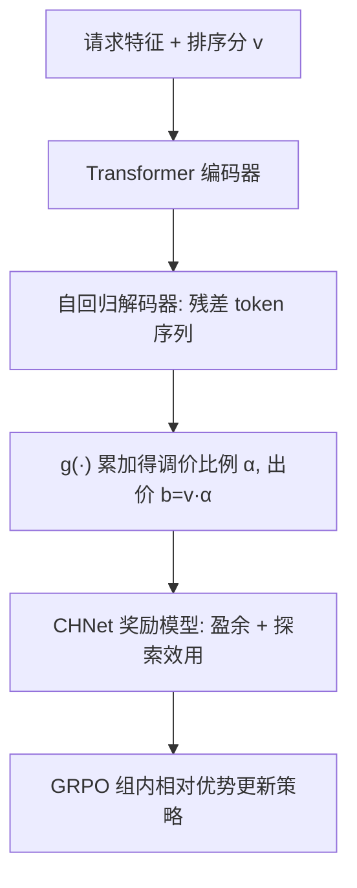

# Generative Bid Shading in Real-Time Bidding Advertising (实时竞价中的生成式出价调价)

- **会议/期刊**: SIGIR 2026
- **作者与机构**: Yinqiu Huang, Hao Ma, Wenshuai Chen, Zongwei Wang 等（美团 DSP + 重庆大学）
- **推荐链路定位**: 精排后出价决策（Bid Shading，端到端生成式）
- **研究方向**: CTR/CVR 预估与特征交叉 / 强化学习与动态探索推荐
- **论文原文**: [https://arxiv.org/abs/2508.06550v3](https://arxiv.org/abs/2508.06550v3)
- **开源代码**: 暂未开源

## TL;DR (1分钟核心速览)

实时竞价（RTB）中出价调价（bid shading）的主流两阶段范式「先估出价景观、再用运筹搜索最大化盈余」受制于单峰假设与级联误差，在非凸盈余曲线上易陷局部最优。本文提出 GBS：用自回归残差生成器逐步输出调价比例 token 序列，配合通道感知分层动态网络 CHNet 作为奖励模型，并以 GRPO 做盈余+探索双奖励偏好对齐。在 iPinYou 与美团私有数据上，盈余率 SR 分别达 60.48% / 41.74%（较最强基线 Post-CVAE 提升 3.34 / 5.11 个百分点），线上 A/B 中 ROI +3.4%、推理耗时 −37.6%。

## Background & Motivation (背景与核心矛盾)

- **主流范式**: 两阶段流水线——ML 阶段预测出价景观（winning price 分布），OR 阶段用二分/黄金分割搜索最大化期望盈余 $(v-c)\cdot Wr(b|x)$。
- **前人局限**: ① OR 求解器普遍假设盈余关于出价单峰，而美团真实数据（图 2）显示盈余曲线先升后降但存在多局部峰，搜索常收敛到局部最优；② 估计与优化解耦，第一阶段误差直接放大进第二阶段，形成级联误差；③ 离散化分类模型把各价格桶当独立标签，丢弃桶间依赖，丧失误差修正能力。
- **核心洞察 (Key Insight)**: 若把「生成多个候选 + 组内相对评估」替代「单点搜索 + 绝对目标」，即可用生成空间的广度绕开非凸陷阱；同时历史数据只覆盖获胜出价、存在样本选择偏差，需引入探索奖励。
- **本文切入点**: 用自回归残差生成调价比例（捕捉 token 间高阶依赖），再用 GRPO 以相对优势驱动策略跳出局部最优。

## Method (核心方法设计)

### 1. 整体框架 (Overall Architecture)

输入为请求特征（用户/上下文/媒体）与上游排序分（pre-shadow bid $v$），编码器做多头自注意力特征交互，解码器以 `<SOS>` 起始自回归生成调价比例 token 序列，经解码函数 $g(\cdot)$ 累加残差得 $\alpha$，最终出价 $b=v\cdot\alpha$。训练分两段：预训练用 SFT（NTP 交叉熵 + 盈余负对数似然，teacher forcing 门控衰减 + gumbel-softmax 保可微）；后训练用 CHNet 作奖励模型，以盈余奖励与探索效用奖励构造组内相对优势，经 GRPO 更新策略。

<figure class="paper-figure" markdown="span">
  <figcaption>图3：所提出的生成模型采用编码器-解码器架构自回归地预测 token 序列。它通过解码函数 𝑔(·) 确定每个 token 的具体值，然后累加这些值以获得最终的调整比例。此外，它利用 gumbel softmax 和 teacher forcing 策略来确保稳定性并加速收敛。</figcaption>
</figure>

### 2. 关键设计拆解 (Key Designs)

1. **自回归残差调价生成（Autoregressive Residual Shading）**：针对离散桶独立预测丢失区间依赖的痛点，将 $\alpha$ 编码为单调递减 token 序列 $s_i=\{s_i^1,\dots,s_i^L\}$，满足 $s_i^1\ge s_i^2\ge\cdots\ge s_i^L$，解码为 $\alpha_i=g(s_i)=\sum_{l=1}^{L}g(s_i^l)$。词表由动态分位数算法构建（保证 token 唯一且频次均匀）。逐步残差累加使每步只需拟合剩余量，天然具备误差修正能力，且序列长度 $L\le 5$ 即可高精度逼近连续值。

2. **CHNet 通道感知分层动态奖励模型**：媒体计费方式各异导致出价景观跨通道差异大。显式通道层用通道嵌入经 MLP+reshape 生成 FC 权重 $W_{exp},b_{exp}$ 实例化场景专属层：$e_{explicit}=FC(e_{global};W_{exp},b_{exp})$；隐式层用通道嵌入生成 $G$ 组注意力头权重，再重参数化出各头 FC 参数，拼接后 softmax 输出 PDF。损失为 $L=\lambda_1 L_{win}+\lambda_2 L_{lose}+\lambda_3 L_{ranknet}$，其中 $L_{ranknet}$ 用胜/负样本对的胜率差做 pairwise 排序约束，弥补 FPA 下成交价非最小获胜价的监督缺失。

3. **GRPO 双奖励偏好对齐与训练目标**：预训练损失 $L=L_{NTP}+\lambda L_{surplus}$；后训练对每请求采样 $m$ 个 $\alpha$，奖励 $r=r_{surplus}+\omega\cdot r_{exploration}$，其中 $r_{exploration}=\phi_E(x_i,b_i)/C(b_i)$（胜率熵除以成本），探索权重 $\omega_i=\cos(e_i,\bar{e})$ 按代表性自适应分配。优势 $A_i=\frac{r_i-\text{mean}(\{r\})}{\text{std}(\{r\})}$，目标为带 clip 与 KL 惩罚的 GRPO 式 (17)。负采样方面无需显式负采样，靠组内相对比较；推理时直接一次前向输出 $\alpha$，无搜索开销。

## Experimental Setup & Evaluation Protocol (实验设置与评估协议)

- **数据集与预处理**:

| 数据集 | #样本 | 胜率 | #特征 | 说明 |
| :--- | :---: | :---: | :---: | :--- |
| iPinYou | 10,577,061 | 29.7% | 18 | 公开二价拍卖，出价作真实价值、成交价作获胜价 |
| Private (美团) | 162,549,577 | 3.89% | 197 | 一个月竞价采样，仅测试集含最小获胜价 |

- **数据划分与防穿越**: 两数据集均按 **7/3 随机划分**；并将训练/测试各切 100 段模拟请求连续到达，逐轮用胜/负标签更新 CHNet 与生成模型，共 100 轮。
- **排名评测协议**: 非排序任务，采用业务指标 **盈余 Surplus $=\sum_i (v_i-b_i)\mathbb{I}(b_i>z_i)$** 与 **盈余率 SR $=\sum(v_i-b_i)\mathbb{I}(b_i>z_i)/\sum(v_i-z_i)$**（相对理论最优盈余的百分比）。
- **对比基线与超参**: 基线含两阶段 EDDN/WR/TSBS-DLF/TSBS-ADM、端到端 MEBS、生成式 CVAE/DF 及其后训练版 Post-CVAE/Post-DF。预训练 Adam，batch $2^{10}$，lr $1e{-4}$，$L=5$，TF 门控 $\eta=5000$，$\tau=0.2$；CHNet 损失权重 $\lambda_1,\lambda_2,\lambda_3=0.5,1,0.2$，GRPO KL 权重 $\beta=0.01$。

## Key Experimental Results (实验关键数据)

### 1. 主实验对比 (Main Results)

| Model | iPinYou SR | iPinYou Surplus | Private SR | Private Surplus |
| :--- | :---: | :---: | :---: | :---: |
| EDDN | 47.82% | 90,199,768 | 19.88% | 14,582,074 |
| WR | 54.90% | 103,560,851 | 26.13% | 19,164,882 |
| TSBS-ADM | 55.49% | 104,673,800 | 32.67% | 24,183,220 |
| MEBS | 54.46% | 102,716,112 | 31.45% | 23,041,120 |
| CVAE | 51.42% | 96,981,112 | 36.45% | 26,698,064 |
| Post-CVAE | 57.14% | 107,781,128 | 36.63% | 26,830,032 |
| Post-DF | 51.13% | 96,445,909 | 33.89% | 24,823,816 |
| **GBS** | **60.48%** | **114,068,392** | **41.74%** | **30,580,080** |
| Improv. (vs 最强基线) | +3.34pp | +5.83% | +5.11pp | +13.98% |

### 2. 消融实验 (Ablation Study)

| 变体 | iPinYou SR | Private SR | Private Surplus |
| :--- | :---: | :---: | :---: |
| w/o PostT | 56.22% | 36.91% | 27,041,464 |
| w/o PostT-EUA | 60.16% | 41.54% | 30,429,570 |
| w/o GM (换 CVAE) | 57.14% | 36.63% | 26,830,032 |
| w/o CHNet | 58.22% | 38.16% | 27,953,616 |
| **GBS** | **60.48%** | **41.74%** | **30,580,080** |

### 3. 关键实验发现 (Key Findings)

1. **后训练是最大增益源**：去掉 PostT 后私有集 SR 从 41.74% 跌至 36.91%（−4.83pp），远超其他单组件移除，说明纯 SFT 在非凸盈余上确实卡在局部最优，GRPO 的相对优势机制是破局关键。
2. **自回归残差生成优于 CVAE 先验**：w/o GM 换回 CVAE 使 SR 降 5.11pp，验证逐步残差输出对连续值精细逼近的必要性；而 CVAE 加后训练（Post-CVAE）仍落后 GBS 5.11pp，说明生成架构本身贡献独立于对齐。
3. **CHNet 与探索奖励互补**：w/o CHNet 降 3.58pp、w/o EUA 仅降 0.20pp，但 CHNet 的 AUC 从 0.8966（w/o EUA）升至 0.9005、BCE 从 0.1674 降至 0.1664，表明通道分层建模提升景观预测精度，探索模块主要缓解选择偏差、增益体现在泛化而非即时指标。

## Highlights, Limitations & Rating (亮点、对比与审稿评价)

- **与代表作对比 (vs. Prior Work)**: 相较 TSBS-ADM 等两阶段法，GBS 用端到端生成消除级联误差与单峰假设；相较 MEBS 的端到端监督，GBS 引入 RL 后训练跳出 SFT 局部最优；相较 CVAE/DF 生成式基线，GBS 的残差 token 序列显式建模区间依赖，且首次将 GRPO 用于出价调价。
- **可迁移亮点**: ① 单调残差 token 化 + 动态分位词表，可迁移到任意连续标量（如出价、预算、折扣）的生成式回归；② 用胜率熵/成本构造探索奖励并按样本代表性加权，是缓解竞价类选择偏差的通用技巧。
- **审稿级局限批判**: ① 词表构建依赖两阶段方法产出的伪标签，若上游景观估计本身偏差大，预训练天花板受限；② 线上仅报相对提升、未给绝对 ROI/CPM 与置信区间，且私有数据胜率仅 3.89%，长尾稀疏场景下 CHNet 校准稳定性存疑。
- **四维评分**: 创新性 ⭐⭐⭐⭐ | 实验扎实度 ⭐⭐⭐⭐ | 方法清晰度 ⭐⭐⭐⭐ | 落地价值 ⭐⭐⭐⭐⭐

