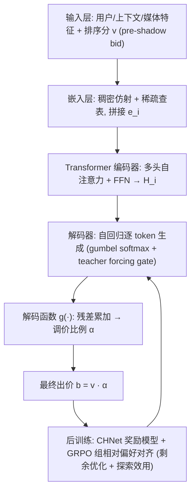
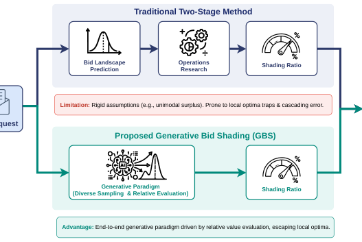
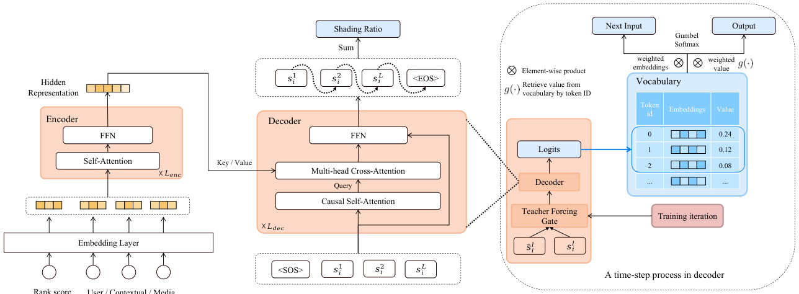
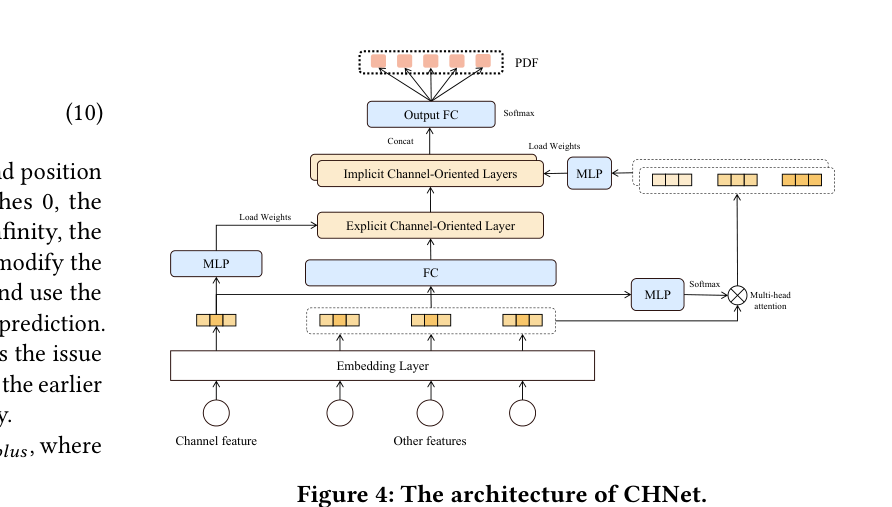
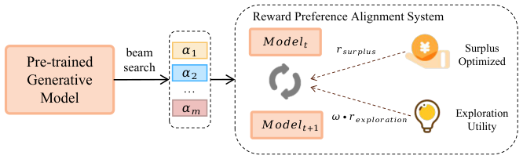
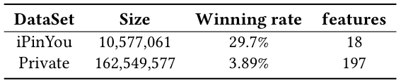
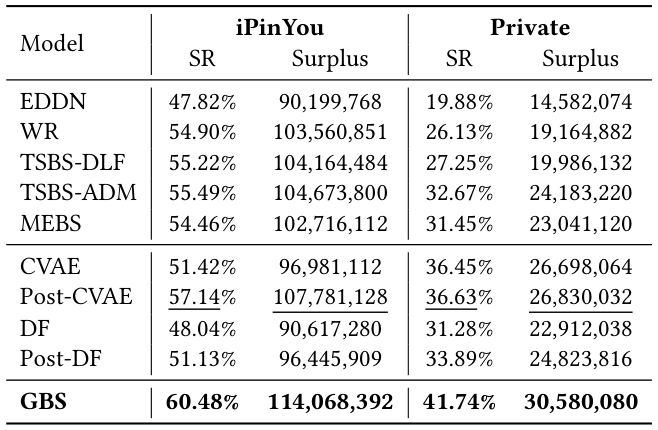
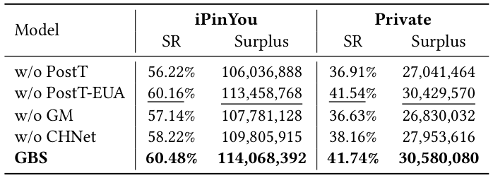
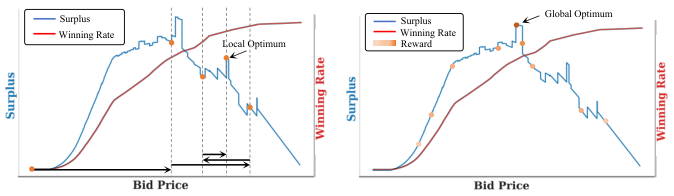

# Generative Bid Shading in Real-Time Bidding Advertising (实时竞价广告中的生成式出价调价)

- **会议/期刊**: SIGIR 2026 (Melbourne, VIC, Australia)
- **推荐链路定位**: 精排/出价决策 (Bidding Decision，位于排序打分 $v$ 之后、竞价提交之前的调价环节)
- **研究方向**: CTR预估与特征交叉 / 强化学习与动态探索推荐
- **论文原文**: [https://arxiv.org/abs/2508.06550v3](https://arxiv.org/abs/2508.06550v3)
- **开源代码**: 暂未开源（原文与预提取均未发现开源代码链接）

## TL;DR (核心速览)

针对 RTB 出价调价 (bid shading) 中两阶段方法"先估 bid landscape 再用运筹学搜索"的**单峰假设失效 + 级联误差**痛点，以及离散化建模忽略区间依赖、竞价样本选择偏差问题，本文提出 GBS：用**自回归生成式模型**逐步残差生成调价比例 $\alpha$，再以 **CHNet 奖励模型 + GRPO 组相对偏好对齐**（剩余优化 + 探索效用）做后训练。在 iPinYou 与美团私有数据集上，剩余率 SR 达 60.48% / 41.74%，线上 A/B ROI +3.4%、推理时延 -37.6%。

## Background & Motivation (背景与动机)

- **领域背景与主流范式**: RTB 从二价拍卖转向一价拍卖 (FPA) 后，赢家支付自身出价，直接按估值出价会系统性多付，因此需要 bid shading——将原始估值 $v$ 乘以调价比例 $\alpha$ 得到最终出价 $b=v\cdot\alpha$。主流范式是**两阶段流水线**：先预测 bid landscape（胜率曲线 $Wr(b|x)$），再用运筹学搜索（二分法、黄金分割法）最大化期望剩余。
- **现有方法局限 (Limitations of Prior Work)**:
  1. **单峰假设失效**：OR 求解器普遍假设剩余关于出价是单峰的，但真实 RTB 剩余曲线非凸、存在多个局部峰（图2 所示美团非理想二价拍卖数据），搜索易陷入局部最优；穷举所有候选出价在毫秒级时延下不可行。
  2. **级联误差**：估计与优化解耦，第一阶段 landscape 预测误差直接传入第二阶段并被放大。
  3. **离散化建模缺陷**：将连续调价比例离散成独立分类桶，忽略离散区间之间的条件依赖，丧失误差纠正能力；CVAE 类方法依赖刚性预设先验。
  4. **样本选择偏差**：历史数据仅来自固定出价策略下的获胜样本，只覆盖有限的反事实动作空间。
- **核心挑战 (Key Challenge)**: 简单的增加网络深度或常规监督学习无法跳出局部最优——因为监督信号本身来自两阶段方法的次优标签，且非凸剩余损失下梯度下降易停滞。
- **核心洞察与切入点 (Key Insight)**: 作者提出**生成式范式**——从生成模型采样多个候选出价并联合评估，用**相对优势比较**替代脆弱的绝对目标，从而近似更广的搜索空间、逃离局部极值（图2 对比：两阶段停在局部最优，GBS 收敛到全局最优）。实现上需解决可微性（gumbel softmax）、序列依赖（自回归残差）与偏差（探索效用奖励）三个非平凡问题。

## Problem Formulation & Method (问题定义与方法架构)

### 1. 符号定义与输入表征 (Notations & Input Representations)

- 竞价请求集 $\mathcal{X}=\{x_1,\dots,x_N\}$，$x_i$ 含用户/上下文/媒体特征；请求价值 $v=\{v_1,\dots,v_N\}$（由 CTR/CVR 等指标算出的 pre-shadow bid，即未调价出价）。
- 调价比例 $\alpha_i$，最终出价 $B=\{v_1\alpha_1,\dots,v_N\alpha_N\}$。
- 期望剩余：$surplus(x_i,b_i)=(v_i-c_i)\cdot Wr(b_i|x_i)$，FPA 下 $c_i=b_i$；最优出价 $b_i^*=\arg\max_{b_i\in(b_{min},b_{max})}(v_i-c_i)\cdot Wr(b_i|x_i)$。
- 获胜价 $z_i$ 对 DSP 不可见；胜负标签 $y_i^*=\mathbb{1}(b_i^*>z_i)$。
- 词表 $\mathcal{V}=\{w_j\}_{j=1}^V$，嵌入矩阵 $E\in\mathbb{R}^{V\times D}$；调价比例编码为 token 序列 $s_i=\{s_i^1,\dots,s_i^L\}$，解码函数 $\alpha_i=g(s_i)=\sum_{l=1}^{L}g(s_i^l)\in\mathbb{R}$（残差累加）。

### 2. 整体流水线 (Overall Architecture)

数据流：请求特征 $\to$ 嵌入层（稠密特征仿射变换、稀疏特征查表）$\to$ 拼接 $e_i\in\mathbb{R}^{f\times d}$ $\to$ Transformer 编码器（多头自注意力+FFN）得 $H_i$ $\to$ 解码器自回归逐 token 生成 $\hat{s}_i^l$ $\to$ 解码函数 $g(\cdot)$ 累加得 $\alpha_i$ $\to$ 出价 $b_i=v_i\alpha_i$。后训练阶段：预训练模型 beam search 采样 $m$ 个候选 $\to$ CHNet 奖励模型打分 $\to$ GRPO 组相对优势更新。

<figure class="paper-figure" markdown="span">
  <figcaption>图1：出价调价过程概览。</figcaption>
</figure>

<figure class="paper-figure" markdown="span">
  <figcaption>图3：所提出的生成模型采用编码器-解码器架构自回归预测 token 序列。它通过解码函数 𝑔(·) 确定每个 token 的具体值，再累加这些值得到最终的调价比例。此外，它采用 gumbel softmax 和 teacher forcing 策略以保证稳定性并加速收敛。</figcaption>
</figure>

### 3. 核心模块设计与数学原理 (Key Designs & Formulations)

**(1) 自回归残差生成式模型 (End-to-End Generative Model)**

将调价比例分解为多个分类子任务，利用步间依赖逐步逼近。词表构建遵循两性质：token 唯一、频率均匀；采用**动态百分位算法**（附录 B）从两阶段方法产出的调价比例自动构建词表。tokenization 遵循三原则：重构误差最小、序列长度 $L$ 最小、**单调性** $s_i^1\ge s_i^2\ge\dots\ge s_i^L$（贪心策略生成），使模型能增量输出残差结果。

嵌入层：稠密特征 $e_{ij}=W_j x_{ij}+b_j$，稀疏特征 $e_{ij}=\text{lookup}(E_j,e_{ij})$，拼接 $e_i\in\mathbb{R}^{f\times d}$。编码器 $H_i=(\dots FFN(SelfAttn(e_i)))$。解码器在时刻 $l$ 输出 $\hat{s}_i^l=\arg\max_{w\in\mathcal{V}}P_\theta(w|H_i,\hat{s}_i^{<l})$。

**可微性处理**：argmax 阻断梯度，故用 gumbel softmax。仅在最高 logit 邻域 $\mathcal{V}'$ 内计算（词表严格有序），对位置 $p$ 采样 $u_p\sim U(0,1)$，加噪 $n_p=-\log(-\log(u_p))$：

$$weight_p^l=\frac{\exp((l_p+n_p)/\tau)}{\sum_{j=1}^{V'}\exp((l_p+n_p)/\tau)}$$

$\tau\to 0$ 近似离散采样，$\tau\to\infty$ 近似均匀分布；用加权和嵌入 $\hat{s}_i^l$ 作为下一步输入，既解决可微性又降低前序位置误差影响。

**(2) CHNet 通道感知层次动态网络 (Reward Model)**

先等频分箱离散化价格 $0<b_1<\dots<b_T$，PDF $P(z=b|x)$，CDF $Wr(b_t|x)=P(z\le b_t|x)=\sum_{j\le t}P(z\in B_j)$。针对不同媒体计费方式差异导致的跨通道 landscape 差异，设计层次结构：
- **显式通道层**：公共特征 $e_{global}=MLP(e_o)$；由通道特征 $e_c$ 经 MLP+Reshape 重参数化生成权重 $W_{exp},b_{exp}$，得 $e_{explicit}=FC(e_{global};W_{exp},b_{exp})$。
- **隐式通道感知模块**：通道嵌入经 MLP 生成原始权重，softmax 归一化为 $G$ 组（$G$ 为注意力头数），与特征逐元素相乘 $e_{weight}=weight_{norm}\otimes e_o$，再重参数化生成各隐式层权重 $W_{imp}[g],b_{imp}[g]$，各层输出拼接后 softmax 预测 PDF。

<figure class="paper-figure" markdown="span">
  <figcaption>图4：CHNet 的架构。</figcaption>
</figure>

**(3) 双奖励偏好对齐 (Reward Preference Alignment)**

- **剩余优化对齐**：奖励 $r_{surplus}=(v-C(b))\cdot Wr(b|x)$，用 GRPO 优化。对每个请求采样 $m$ 个输出，组内相对优势 $A_i=\frac{r_i-\text{mean}(\{r_1,\dots,r_m\})}{\text{std}(\{r_1,\dots,r_m\})}$，目标含 clip 与 KL 惩罚（$\beta=0.01$）。
- **探索效用对齐**：用胜率熵量化不确定性 $\phi_E(x_i,b_i)=-(Wr_i\log Wr_i+(1-Wr_i)\log(1-Wr_i))$，探索奖励 $r_{exploration}=\phi_E(x_i,b_i)/C(b_i)$；最终奖励 $r=r_{surplus}+\omega\cdot r_{exploration}$，探索权重 $\omega_i=\cos(e_i,\frac{1}{N}\sum_j e_j)$（度量学习启发，代表性强的请求给更大探索权重），以对抗样本选择偏差。

<figure class="paper-figure" markdown="span">
  <figcaption>图5：使用 GRPO 进行后训练的架构。</figcaption>
</figure>

### 4. 训练目标、负采样与推理复杂度 (Optimization, Negative Sampling & Complexity)

- **预训练损失**：$\mathcal{L}=\mathcal{L}_{NTP}+\lambda\cdot\mathcal{L}_{surplus}$，其中
  - $\mathcal{L}_{NTP}=-\sum_{i=1}^{N}\sum_{l=1}^{L}\log P_\theta(\hat{s}_i^l|H_i,\hat{s}_i^{<l})$（标签来自两阶段方法，teacher forcing）；
  - $\mathcal{L}_{surplus}=-\sum_{i=1}^{N^+}\mathbb{E}(\log((v_i-C(v_i\alpha_i))\cdot Wr(v_i\alpha_i|x_i)))$（仅获胜数据 $N^+$）。
  - **TF 自适应门控**：$TF_{pro}=TF_{pro}\cdot\frac{\eta}{\eta+e^{(iteration/\eta)}}$，$\eta=5000$，随迭代降低 TF 概率以加速收敛并提升稳定性。
- **CHNet 损失**：$\mathcal{L}=\lambda_1\mathcal{L}_{win}+\lambda_2\mathcal{L}_{lose}+\lambda_3\mathcal{L}_{ranknet}$，$\lambda_1=0.5,\lambda_2=1,\lambda_3=0.2$；$\mathcal{L}_{win}$ 用实际获胜价 NLL（FPA 下不适用），$\mathcal{L}_{lose}$ 最大化右半 CDF，$\mathcal{L}_{ranknet}$ 为胜率 pairwise 排序损失。
- **负采样策略**：非传统负采样任务；后训练阶段对每个请求从旧策略采样 $m$ 个候选构成"组"，用组内相对优势替代绝对奖励（GRPO 免 critic）。探索效用奖励本身即用于缓解固定出价策略带来的样本选择偏差。
- **复杂度**：预训练 batch size $2^{10}$、学习率 $1e-4$、最大序列长度 $L=5$、gumbel 温度 $\tau=0.2$；后训练 KL 权重 $\beta=0.01$。推理阶段 GBS **直接输出调价比例**，无需两阶段的搜索迭代，线上推理时延较两阶段基线降低 37.6%（表4）。原文未报告峰值显存与单 epoch 训练耗时的具体数值。

## Experimental Setup & Evaluation Protocol (实验设置与评估协议)

- **数据集统计与预处理**:

<figure class="paper-figure" markdown="span">
  <figcaption>表1：数据集统计信息。</figcaption>
</figure>

| 数据集 (Dataset) | 用户数 (#Users) | 物品数 (#Items) | 交互数 (#Interactions) | 稀疏度/密度 (Sparsity) | 模态/辅助特征说明 |
| :--- | :---: | :---: | :---: | :---: | :--- |
| iPinYou | 原文未报告 | 原文未报告 | 10,577,061 | 胜率 29.7% | 18 维特征；二价拍卖设定，出价作实际价值、支付价作获胜价 |
| Private (Meituan DSP) | 原文未报告 | 原文未报告 | 162,549,577 | 胜率 3.89% | 197 维特征；一个月出价采样数据 |

- **数据划分方式 (Splitting Strategy)**: 两数据集均按 **7/3 随机划分**训练/测试；仅测试集含最低获胜价用于评估。为模拟在线请求连续到达，将训练/测试集各切为 **100 段**，逐轮计算剩余并收集胜负标签，用竞价数据更新 CHNet 与生成模型，重复 100 轮。**注意**：随机划分而非全局时间戳切分，存在一定时间穿越风险（原文未讨论）。
- **排名评测协议 (Ranking Protocol)**: 非传统 Top-K 排序任务；离线以**业务指标**评估——剩余 (Surplus) 与剩余率 $SR=\frac{\sum_i(v_i-b_i)I(b_i>z_i)}{\sum_i(v_i-z_i)}$（相对总最优剩余的百分比）。CHNet 评估用 **AUC** 与 **BCE**（胜率预测）。
- **评价指标与显著性检验**: 离线 Surplus / SR、CHNet 的 AUC/BCE；线上 ROI、CPM、CPC、推理时延 IT。原文**未报告**多随机种子方差或配对显著性检验。

## Key Experimental Results (核心实验结果)

### 1. 主实验对比 (Main Results)

<figure class="paper-figure" markdown="span">
  <figcaption>表2：整体离线实验结果。</figcaption>
</figure>

| 数据集 | 指标 | 两阶段最强基线 (TSBS-ADM) | 生成式最强基线 (Post-CVAE) | 本文方法 (GBS) | 相对提升 (Improv.) |
| :--- | :--- | :---: | :---: | :---: | :---: |
| iPinYou | SR | 55.49% | 57.14% | **60.48%** | +3.34pp (vs Post-CVAE) |
| iPinYou | Surplus | 104,673,800 | 107,781,128 | **114,068,392** | +5.83% |
| Private | SR | 32.67% | 36.63% | **41.74%** | +5.11pp (vs Post-CVAE) |
| Private | Surplus | 24,183,220 | 26,830,032 | **30,580,080** | +13.98% |

关键结论：① 两阶段方法在美团私有数据集上显著更差（复杂市场环境下粗粒度 landscape + 二分搜索难以适配）；② 传统生成模型经后训练均有提升，说明策略强化学习能抬高上限；③ GBS 全指标最优。

### 2. 消融实验与控制变量分析 (Ablation Study)

<figure class="paper-figure" markdown="span">
  <figcaption>表3：GBS 各组成部分的贡献。</figcaption>
</figure>

| 变体 | iPinYou SR | iPinYou Surplus | Private SR | Private Surplus |
| :--- | :---: | :---: | :---: | :---: |
| w/o PostT | 56.22% | 106,036,888 | 36.91% | 27,041,464 |
| w/o PostT-EUA | 60.16% | 113,458,768 | 41.54% | 30,429,570 |
| w/o GM (换 CVAE) | 57.14% | 107,781,128 | 36.63% | 26,830,032 |
| w/o CHNet | 58.22% | 109,805,915 | 38.16% | 27,953,616 |
| **GBS (完整)** | **60.48%** | **114,068,392** | **41.74%** | **30,580,080** |

- **去掉后训练 (w/o PostT) 性能下降最大**（Private SR 从 41.74% 降至 36.91%，-4.83pp），说明仅靠监督学习存在瓶颈，策略强化学习是突破关键。
- 去掉自回归生成模型（换 CVAE）次之（Private SR -5.11pp），印证残差逐步输出对精细出价生成的重要性。
- 去掉 CHNet（换二分类胜率模型）与去掉探索效用对齐均有明显下降，说明细粒度奖励模型与更广训练数据覆盖至关重要。
- 原文未明确报告消融是否严格控制参数量对齐。

### 3. 稀疏度/冷启动分桶与超参敏感度 (Sparsity Buckets & Hyperparameters)

- **CHNet 性能**（图6）：AUC 上 CHNet 0.9005 > ADM 0.8982 > CHNet-w/o EUA 0.8966 > DLF 0.8944 > CLM 0.8912；BCE 上 CHNet 0.1664 最低。去掉探索模块性能下降，暴露数据选择偏差，说明竞价探索对泛化能力必要。
- **关键超参**：$L=5$、$\eta=5000$、$\tau=0.2$、$\beta=0.01$、$\lambda_1/\lambda_2/\lambda_3=0.5/1/0.2$。原文未给出超参敏感度扫描曲线。
- **线上 A/B 测试 (Online A/B Test)**: 美团 DSP 部署，两周严格 A/B，GBS 占 30% 流量，基线为黄金分割搜索的两阶段方法，部分通道建模为非理想二价拍卖。

| 指标 | 基线 (两阶段) | GBS |
| :--- | :---: | :---: |
| ROI | 0.0% | **+3.4%** |
| CPM | 0.0% | **-4.1%** |
| CPC | 0.0% | **-4.9%** |
| 推理时延 IT | 0.0% | **-37.6%** |

GBS 已部署于美团 DSP，每日服务数十亿次竞价请求，是首个大规模在线生成式 bid shading 实现。

<figure class="paper-figure" markdown="span">
  <figcaption>图2：由美团非理想第二价格拍卖数据得出的中标率与剩余曲线。</figcaption>
</figure>

## Highlights, Limitations & Critiques (亮点、局限与审稿级批判)

- **核心亮点与可迁移性**:
  1. **生成式范式替代两阶段搜索**：用"多样采样 + 相对评估"跳出非凸剩余曲线的局部最优，这一思路可迁移到任何"估计+优化"解耦的决策任务（如预算分配、动态定价）。
  2. **自回归残差 + 单调 tokenization + gumbel softmax**：将连续标量生成转化为有序 token 序列的逐步残差累加，兼顾区间依赖与可微性，可迁移到观看时长、出价、价格等连续值预测。
  3. **CHNet 通道感知层次重参数化**：显式+隐式双层通道建模，对多场景/多通道推荐（如多业务场景联合建模）有直接借鉴价值。
  4. **探索效用奖励**：用胜率熵/成本构造探索奖励、以余弦相似度分配探索权重，是缓解竞价/曝光样本选择偏差的轻量方案。
- **局限性与审稿视角批判 (Critical Limitations)**:
  1. **评估协议**：7/3 随机划分而非全局时间戳切分，存在时间穿越风险；100 轮模拟在线虽缓解，但未报告多随机种子方差与显著性检验，提升幅度（如 iPinYou SR +3.34pp）的统计可靠性存疑。
  2. **标签来源循环依赖**：预训练标签来自两阶段方法，词表也由其调价比例构建，可能继承两阶段方法的偏差上限；后训练能否完全摆脱该先验缺乏理论保证。
  3. **CHNet 的 $\mathcal{L}_{win}$ 在 FPA 下不适用**，实际仅靠 $\mathcal{L}_{lose}$ 与 $\mathcal{L}_{ranknet}$，FPA 场景下 landscape 估计精度可能被高估。
  4. **超参敏感度缺失**：$\tau$、$\eta$、$\omega$、$m$（组采样数）等关键超参未做扫描，泛化性论证不足。
  5. **复现性**：未开源代码，私有数据集不可获取，iPinYou 上的特征工程细节（18 维）描述有限，复现门槛较高。
  6. **理论深度**：GRPO 用于连续出价决策的收敛性、探索奖励与剩余奖励的权衡缺乏理论分析，偏工程实证。

## Rating (四维评分)

- **方法创新性 (Novelty)**: ⭐⭐⭐⭐（首个将自回归生成式建模 + GRPO 偏好对齐用于 bid shading，范式迁移有开创性）
- **评估协议与实验扎实度 (Protocol & Experiments)**: ⭐⭐⭐⭐（离线+线上 A/B+大规模部署，但缺时间切分、方差与显著性检验）
- **写作与数学规范度 (Clarity & Rigor)**: ⭐⭐⭐⭐（公式与架构清晰，部分符号与超参细节可更完备）
- **工业落地与复现价值 (Industrial & Practical Value)**: ⭐⭐⭐⭐⭐（美团 DSP 日服务数十亿请求，推理时延降 37.6%，落地价值极高；但未开源降低复现性）
