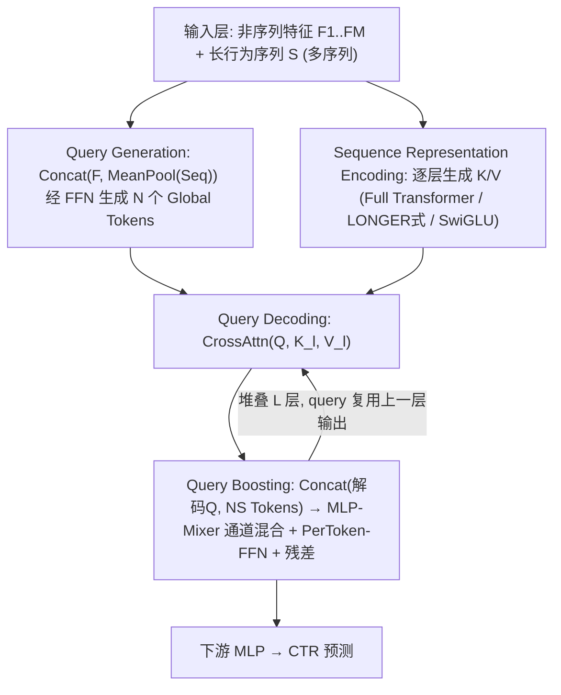
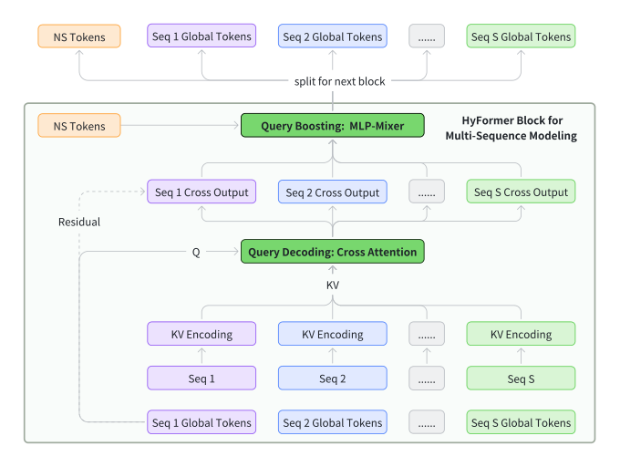
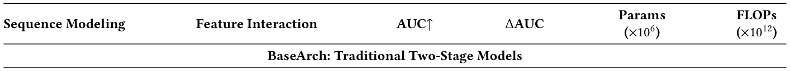
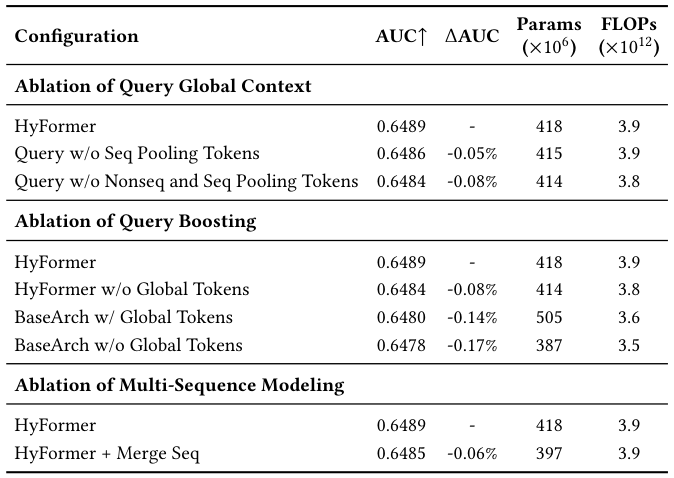
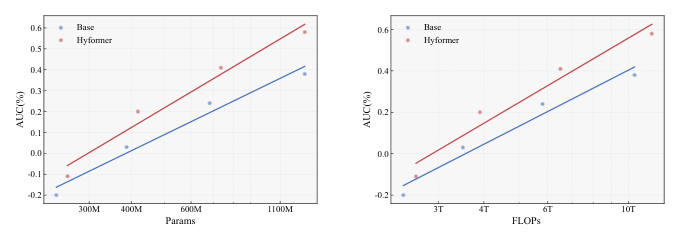
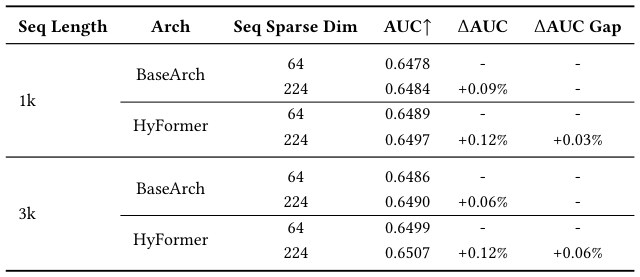

# HyFormer: Revisiting the Roles of Sequence Modeling and Feature Interaction in CTR Prediction (重新审视CTR预估中序列建模与特征交叉的角色)

- **会议/期刊**: SIGIR 2026（arXiv 预印本 v2，2026-01-23）
- **推荐链路定位**: 精排 (CTR Prediction / Ranking)
- **研究方向**: CTR预估与特征交叉 / 序列与会话推荐
- **论文原文**: [https://arxiv.org/abs/2601.12681v2](https://arxiv.org/abs/2601.12681v2)
- **开源代码**: 暂未开源（原文与预提取均未发现开源代码链接）

## TL;DR (核心速览)

针对工业大规模推荐模型（LRM）中"先长序列压缩（LONGER）后特征交叉（RankMixer）"的解耦流水线导致的查询表征贫弱、晚期单向融合与扩展效率低三大痛点，本文提出统一混合 Transformer 架构 HyFormer：以非序列特征+序列池化生成 Global Tokens，通过 Query Decoding（对逐层 K/V 做多查询交叉注意力）与 Query Boosting（MLP-Mixer 式 token mixing）逐层交替迭代，实现序列与异构特征的早期双向融合。在十亿级工业数据上，同等参数与 FLOPs 预算下稳定超越 LONGER 与 RankMixer 基线，并展现更优的 Scaling 行为；线上高流量 A/B 测试取得显著收益，已全量部署于字节跳动。

## Background & Motivation (背景与动机)

- **领域背景与主流范式**: 现代工业 LRM 已收敛到"分离式扩展范式"——先用专用序列 Transformer（SIM、ETA、TWIN、TransAct、LONGER）编码长行为序列并压缩为 query token，再经 token-mixing 模块（RankMixer、Wukong）与异构稠密特征融合。该"Long Sequence Modeling, Then Heterogeneous Feature Interaction"两阶段流水线是当前工业界扩展 LRM 的主流设计。
- **现有方法局限 (Limitations of Prior Work)**:
  1. **查询表征过简**：序列压缩所用的 query token 通常仅源自少量候选相关或全局特征，限制了长序列兴趣建模可用的上下文信息；而直接增加 query token 数量在 KV-Cache 与 M-Falcon 机制下会显著恶化服务效率。
  2. **晚期单向融合**：序列压缩 token 与异构非序列 token 的交互仅发生在模型后段，跨特征推理被推迟到序列压缩之后，交互浅且隐式，早期层表征无法受益于跨域上下文。
  3. **扩展效率低下**：交互模块仅作用于压缩后的序列表示，增加容量或序列长度主要提升孤立组件而非联合表征，导致 Scaling 效率随计算预算增加而递减。
- **核心挑战 (Key Challenge)**: 简单的特征拼接、加深网络或常规对比学习无法解决——问题根源在于架构层面的"解耦 + 晚期融合 + 单向信息流"，而非容量不足；MTGR/OneTrans 虽尝试统一，但将 query token 数量等同于全部非序列 token 数，实践中服务效率骤降，且统一 Transformer 结构对工业级 LRM 的特征交叉建模仍不充分。
- **核心洞察与切入点 (Key Insight)**: 作者主张不再把序列编码与 token mixing 视为两个松耦合阶段，而是引入一组 **global tokens** 作为长行为序列与异构特征之间的共享语义接口，通过堆叠层交替执行 Query Decoding 与 Query Boosting，实现序列建模与特征交叉之间**深层、早期、双向**的信息流动。

## Problem Formulation & Method (问题定义与方法架构)

### 1. 符号定义与输入表征 (Notations & Input Representations)

- 用户空间 $\mathcal{U}$、物品空间 $\mathcal{I}$；用户 $u\in\mathcal{U}$ 的原始行为历史 $S=[i_1^{(u)},\dots,i_K^{(u)}]$，$i_t^{(u)}\in\mathcal{I}$；非序列描述符 $u$（画像属性、上下文信号、交叉特征）。
- 候选物品 $v\in\mathcal{I}$，目标为估计交互概率 $P(y=1\mid S,u,v)\in[0,1]$，$y\in\{0,1\}$。
- 非序列特征向量 $F_1,\dots,F_M\in\mathbb{R}^{1\times D}$；Global Token 数 $N$；统一 query 表示维度 $T=N+M$，每个 token 维度 $D$，Query Boosting 中划分为 $T$ 个通道子空间，每子空间维度 $D/T$。
- 序列编码支持三种策略：Full Transformer（$O(L_S^2)$）、LONGER 式短序列交叉注意力（$O(L_H L_S)$，$L_H\ll L_S$）、Decoder 式无注意力 SwiGLU 轻量编码。

### 2. 整体流水线 (Overall Architecture)

数据流：非序列特征与序列池化摘要拼接 → MLP 生成 $N$ 个 Global Query Tokens → 对逐层序列 K/V 做多查询交叉注意力（Query Decoding）→ 解码 query 与非序列 token 拼接后做 MLP-Mixer 式 token mixing（Query Boosting）→ 残差回传作为下一层 query → 堆叠多层后经下游 MLP 输出 CTR 预测。多序列场景下每条行为序列独立维护专属 query 集合并独立解码，跨序列交互通过 query 级 token mixing 完成，不做序列拼接。

<figure class="paper-figure" markdown="span">
  <figcaption>图 1</figcaption>
</figure>
图 1: HyFormer 整体架构概览。新架构引入源自序列建模中"候选物品"的 global tokens，并通过基于 MLP-Mixer 的特征交叉增强长序列的 query 容量，重新审视长序列建模与特征交叉的角色；通过 Query Decoding 与 Query Boosting 的交替构成 LRM 建模任务的交替优化过程。

### 3. 核心模块设计与数学原理 (Key Designs & Formulations)

**(1) Query Generation（查询生成）**：将全部非序列特征与序列均值池化摘要拼接，经轻量 FFN 生成 $N$ 个语义 query：

$$
Q=\big[\mathrm{FFN}_1(\text{Global Info}),\dots,\mathrm{FFN}_N(\text{Global Info})\big]\in\mathbb{R}^{N\times D},\quad \text{Global Info}=\mathrm{Concat}\big(F_1,\dots,F_M,\mathrm{MeanPool}(Seq)\big)
$$

物理直觉：把"候选物品"从序列建模的 query 角色中解放出来，让全局异构上下文直接决定"向长序列问什么问题"；深层不再重新生成 query，而是复用上一层交叉注意力输出作为更新后的 query，实现语义逐层递进。为保服务效率，模块支持特征选择与可选 query 压缩，保持 query 数稳定。

**(2) Query Decoding（查询解码）**：对第 $l$ 层序列 K/V 做多头交叉注意力：

$$
\tilde{Q}^{(l)}=\mathrm{CrossAttn}\big(Q^{(l)},K^{(l)},V^{(l)}\big),\quad K_l=H_l W^K_l,\ V_l=H_l W^V_l
$$

其中 $H_l$ 由三种序列编码策略之一产生（式 5–7），K/V 逐层重算，使序列特征随解码深度共同演化。该步让全局非序列特征直接"注视"长行为序列，把上下文信号注入序列感知的 query 表示。

**(3) Query Boosting（查询增强）**：将解码 query 与非序列 token 拼接为 $Q=[\tilde{Q}^{(l)},F_1,\dots,F_M]\in\mathbb{R}^{T\times D}$，每个 token 切分为 $T$ 个通道子空间 $q_t=[q_t^{(1)}\|\cdots\|q_t^{(T)}]$，按子空间索引跨 token 位置拼接聚合：

$$
\tilde{q}_h=\mathrm{Concat}\big(q_1^{(h)},q_2^{(h)},\dots,q_T^{(h)}\big)\in\mathbb{R}^{D},\quad \hat{Q}=[\tilde{q}_1,\dots,\tilde{q}_T]\in\mathbb{R}^{T\times D}
$$

再经 PerToken-FFN 逐 token 精炼并加残差：$Q_{\text{boost}}=Q+\tilde{Q}$。物理直觉：MLP-Mixer 式通道混合以线性复杂度实现跨 query、跨序列的异构交互，弥补解码后 query 与静态非序列特征交互不足的问题。

**(4) HyFormer 层堆叠与多序列建模**：第 $l$ 层先 $\hat{Q}^{(l)}=\mathrm{CrossAttn}(Q^{(l-1)},K^{(l)},V^{(l)})$，再 $\tilde{Q}^{(l)}=\mathrm{QueryBoost}(\mathrm{Concat}(\hat{Q}^{(l)},\text{NS Tokens}))$，交替迭代。多序列场景下每条序列独立构造专属 query 并独立解码（图 2），保留序列特有语义，跨序列交互延后至 query 级 token mixing 完成——作者实证发现 MTGR/OneTrans 式的简单序列合并会显著掉点。

<figure class="paper-figure" markdown="span">
  <figcaption>图 2</figcaption>
</figure>
图 2: HyFormer 中的多序列建模。每条行为序列独立维护 query 集合与解码过程，跨序列交互通过 query 级 token mixing 实现。

### 4. 训练目标、负采样与推理复杂度 (Optimization, Negative Sampling & Complexity)

- **损失函数**: 标准二分类交叉熵（原文式 2）：

$$
\mathcal{L}=-\frac{1}{|\mathcal{D}|}\sum_{(S,u,v,y)\in\mathcal{D}}\big[y\log\hat{y}+(1-y)\log(1-\hat{y})\big],\quad \hat{y}=f_\theta(S,u,v)
$$

原文未报告额外的正则项、温度系数或辅助损失权重。
- **训练负采样策略**: 原文未报告显式负采样方案（CTR 精排场景通常直接使用曝光日志中的真实负反馈标签，属隐式/显式反馈混合监督，具体正负样本界定原文未展开）。
- **时间与空间复杂度**: 序列编码复杂度依策略而异——Full Transformer 为 $O(L_S^2)$，LONGER 式短序列交叉注意力降至 $O(L_H L_S)$，SwiGLU 轻量编码为线性；Query Decoding 为 $O(N\cdot L_S\cdot D)$ 量级的多查询交叉注意力；Query Boosting 的 MLP-Mixer 通道混合与 PerToken-FFN 均为线性复杂度。工程侧采用 GPU Pooling 处理超长序列特征以缓解 Host-to-Device 拷贝开销（原文 3.8 节，正文提取在此处截断，具体部署优化细节未完整呈现）。原文未报告单 epoch 训练耗时、单请求推理延迟（ms）与峰值显存的具体数值。

## Experimental Setup & Evaluation Protocol (实验设置与评估协议)

- **数据集统计与预处理**: 原文使用**十亿级（billion-scale）工业数据集**，但正文提取内容中未给出用户数、物品数、交互数、稀疏度及过滤规则的具体统计表，亦未说明是否采用 5-core/10-core 过滤。下表仅按原文可确认信息填写，未报告项明确标注：

| 数据集 (Dataset) | 用户数 (#Users) | 物品数 (#Items) | 交互数 (#Interactions) | 稀疏度/密度 (Sparsity) | 模态/辅助特征说明 |
| :--- | :---: | :---: | :---: | :---: | :--- |
| 工业数据集（字节跳动） | 原文未报告 | 原文未报告 | 十亿级（billion-scale） | 原文未报告 | 多行为序列（如视频观看、商品购买）+ 用户画像/上下文/交叉特征 |

- **数据划分方式 (Splitting Strategy)**: 原文提取内容未明确说明划分策略（未报告是否为 Global Temporal Split 或 Ratio Split），从工业 CTR 场景推断大概率为时间切分，但**原文未明示，存在信息缺失**。
- **排名评测协议 (Ranking Protocol)**: 原文未报告是否采用 Full-Ranking 或 Sampled Ranking；CTR 精排任务通常以逐样本打分评估 AUC/GAUC 类指标，但原文提取部分未列出具体指标定义。
- **评价指标与显著性检验**: 原文提取内容未明确列出离线指标名称（如 AUC/GAUC）与显著性检验方式；线上部分报告了大规模 A/B 测试相对已部署 SOTA 模型的"显著收益"，但具体指标数值在提取文本中未呈现。Embedding 维度 $D$、Global Token 数 $N$、层数 $L$ 等超参的具体取值原文提取部分未报告。

## Key Experimental Results (核心实验结果)

### 1. 主实验对比 (Main Results)

原文声明在**可比参数与 FLOPs 预算**下，HyFormer 在十亿级工业数据集上一致超越 LONGER 与 RankMixer 强基线，并展现更优的 Scaling 行为；线上高流量生产系统的大规模 A/B 测试相对已部署 SOTA 模型取得显著收益。但正文提取文本中**未包含主实验表格的具体数值**（表 1 内容未在提取文本中呈现），故无法给出逐数据集、逐指标的精确数值与提升比例。可确认的定性结论如下：

| 数据集 | 指标 | 传统/协同过滤基线 | 序列/图/多模态最强基线 | 本文方法 (Ours) | 相对提升 (Improv.) |
| :--- | :--- | :---: | :---: | :---: | :---: |
| 工业数据集 | 原文未报告具体指标名 | — | LONGER / RankMixer | **HyFormer** | 原文声明"一致超越"，具体数值未在提取文本中报告 |

<figure class="paper-figure" markdown="span">
  <figcaption>表 1</figcaption>
</figure>
表 1: 工业数据集上的整体性能对比。HyFormer 在可比参数与 FLOPs 预算下一致优于 LONGER 与 RankMixer 基线（具体数值见原文表 1）。

### 2. 消融实验与控制变量分析 (Ablation Study)

原文设有 HyFormer 组件消融实验（表 2），但提取文本未呈现具体消融数值。从方法论述可推断的消融维度包括：Query Decoding 与 Query Boosting 的各自贡献、多序列独立解码 vs. 序列合并（作者明确报告 MTGR/OneTrans 式简单序列合并会"显著掉点"）、不同序列编码策略（Full Transformer / LONGER 式 / SwiGLU）的容量-效率权衡。**各模块移除后的具体性能下降幅度原文提取部分未报告**，无法判断哪一模块贡献最大；消融是否严格控制参数量或图拓扑度数亦未在提取文本中说明。

<figure class="paper-figure" markdown="span">
  <figcaption>表 2</figcaption>
</figure>
表 2: HyFormer 各组件的消融实验。具体数值见原文表 2（提取文本未呈现）。

### 3. 稀疏度/冷启动分桶与超参敏感度 (Sparsity Buckets & Hyperparameters)

- **用户/物品交互频次分桶表现**: 原文提取内容未报告长尾物品或少交互冷启动用户的分桶实验。
- **关键超参数敏感度**: 原文未报告温度系数、损失权重、层数 $L$、Global Token 数 $N$ 等超参的敏感度分析；但提供了**序列稀疏维度（Sequence Sparse Dim）的 Scaling 实验**（表 3）以及**随 FLOPs 与模型参数变化的 Scaling 性能**（图 3），结论为 HyFormer 的 Scaling 效率优于解耦式基线——即性能随计算预算增长的斜率更陡，这正对应其"增加容量能转化为更丰富联合表征"的设计主张。

<figure class="paper-figure" markdown="span">
  <figcaption>图 3</figcaption>
</figure>
图 3: 随 FLOPs 与模型参数变化的 Scaling 性能。HyFormer 相比解耦式基线展现更优的扩展效率。

<figure class="paper-figure" markdown="span">
  <figcaption>表 3</figcaption>
</figure>
表 3: 序列稀疏维度上的 Scaling 实验。具体数值见原文表 3（提取文本未呈现）。

- **线上 A/B 测试结果 (Online A/B Test)**: 原文报告在字节跳动高流量生产系统开展大规模线上 A/B 测试，相对已部署 SOTA 模型取得显著收益，且 HyFormer 已**全量部署于字节跳动，每日服务数十亿用户**。但提取文本未给出实验周期、流量占比及 CTR/CVR/停留时长等具体线上指标数值。

## Highlights, Limitations & Critiques (亮点、局限与审稿级批判)

- **核心亮点与可迁移性**:
  1. **"Global Tokens 作为共享语义接口"的架构思想**具有强普适性：把非序列特征提升为"提问者"而非"被融合者"，可迁移到多模态推荐（视觉/文本 token 作为 query 去解码行为序列）、跨域推荐（源域特征作为 query 解码目标域序列）等场景。
  2. **Query Decoding + Query Boosting 交替迭代**以线性复杂度的 MLP-Mixer 实现跨 query/跨序列异构交互，避免了 MTGR/OneTrans 式"query 数 = 全部非序列 token 数"带来的服务效率崩塌，是工业可落地的关键折中。
  3. **多序列独立解码 + query 级混合**的设计避免了异构序列强行合并的语义污染，对多行为（观看/购买/搜索）建模具有直接借鉴价值。
  4. **Scaling 视角的论证**（同等 FLOPs 下更陡的性能曲线）为"统一架构优于解耦架构"提供了超越单点指标的论据。

- **局限性与审稿视角批判 (Critical Limitations)**:
  1. **实验可复现性存疑**：全文仅使用单一（未公开统计的）十亿级工业数据集，缺乏公开基准（如 Amazon、KuaiRec、Criteo）上的验证；无开源代码，审稿人难以核验"可比参数与 FLOPs 预算"的对齐细节。
  2. **评估协议披露不足**：数据划分策略、正负样本界定、离线指标定义、显著性检验均未在可见文本中明确，工业论文常见的"指标黑箱"问题突出。
  3. **效率论证不完整**：虽强调服务效率，但未报告单请求推理延迟（ms）、峰值显存与训练吞吐的具体数字；GPU Pooling 等部署优化细节在提取文本中被截断，难以评估真实工业开销。
  4. **与 MTGR/OneTrans 的对比缺失**：文中批评 MTGR/OneTrans 的 query 数膨胀问题，但主实验仅对比 LONGER 与 RankMixer，未给出与这两类统一架构的直接实验对照，削弱了"统一架构中本文最优"的论断。
  5. **理论深度有限**：交替优化的"交替"更多是架构层面的层间交替，缺乏收敛性或表征互信息的理论刻画，"交替优化过程"的表述略显包装。

## Rating (四维评分)

- **方法创新性 (Novelty)**: ⭐⭐⭐⭐（Global Tokens 语义接口 + 解码/增强交替的统一骨干设计扎实且工业味浓，但属对 MTGR/OneTrans/RankMixer 的工程化整合改良，范式突破有限）
- **评估协议与实验扎实度 (Protocol & Experiments)**: ⭐⭐⭐（有十亿级工业数据与线上 A/B 加持，但单数据集、协议披露不足、缺公开基准与关键基线对照）
- **写作与数学规范度 (Clarity & Rigor)**: ⭐⭐⭐⭐（公式与模块拆解清晰、动机三段论严谨，但实验章节数值呈现与超参披露不足）
- **工业落地与复现价值 (Industrial & Practical Value)**: ⭐⭐⭐⭐（已全量部署服务数十亿用户，架构折中务实；但无开源代码、依赖内部数据，复现门槛高）
