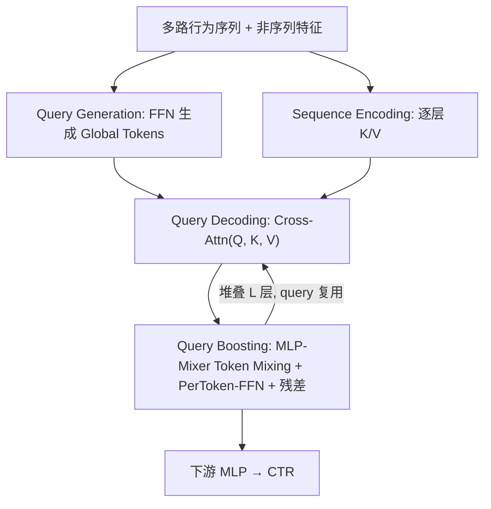
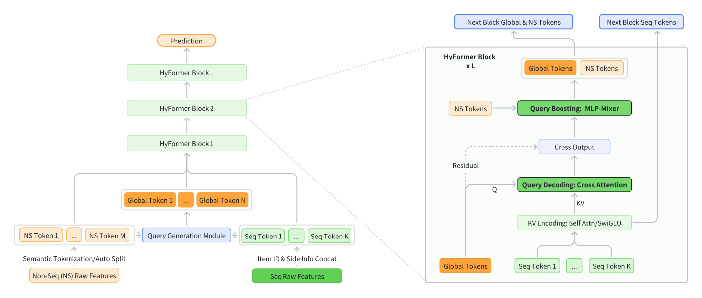

# HyFormer: Revisiting the Roles of Sequence Modeling and Feature Interaction in CTR Prediction (重新审视序列建模与特征交叉在 CTR 预估中的角色)

- **会议/期刊**: SIGIR 2026
- **作者与机构**: Yunwen Huang, Shiyong Hong, Xijun Xiao, Jinqiu Jin 等（字节跳动 AML / Search）
- **推荐链路定位**: 精排（CTR 预估）
- **研究方向**: CTR/CVR 预估与特征交叉 / 序列与会话推荐
- **论文原文**: [https://arxiv.org/abs/2601.12681v2](https://arxiv.org/abs/2601.12681v2)
- **开源代码**: 暂未开源

## TL;DR (1分钟核心速览)

工业 LRM 长期采用「先 LONGER 压缩长序列、再 RankMixer 做特征交叉」的解耦两段式流水线，导致 query token 语义贫乏、交叉仅发生在晚期且单向流动，扩展效率低。HyFormer 提出统一混合 Transformer：以非序列特征+序列池化生成 Global Tokens，交替执行 Query Decoding（对逐层 K/V 做 cross-attention）与 Query Boosting（MLP-Mixer 式 token 混合），形成双向共演化。在抖音搜索 30 亿样本工业数据上，Query-level AUC 达 0.6489（+0.17%），FLOPs 仅 3.9T，线上 A/B 人均观看时长 +0.293%、查询改写率 -0.236%。

## Background & Motivation (背景与核心矛盾)

- **主流范式**: 工业 LRM 收敛为「Long Sequence Modeling, Then Heterogeneous Feature Interaction」两段式——LONGER 类序列压缩器先产出压缩 token，再由 RankMixer/Wukong 等 token-mixing 模块与稠密特征融合。
- **前人局限**: 其一，序列压缩所用 query token 仅源自少量候选/全局特征，上下文信息受限，而直接增加 query 数在 KV-Cache 与 M-Falcon 机制下会显著拖垮 serving 效率；其二，序列 token 与非序列 token 的交叉被推迟到模型晚期，早期层无法受益于跨域上下文，且信息流单向。
- **核心洞察 (Key Insight)**: 由于交叉只在压缩表示上进行，加深网络或加长序列只提升孤立组件而非联合表示，导致 scaling 斜率偏缓——瓶颈在架构耦合方式而非容量本身。
- **本文切入点**: 引入 Global Tokens 作为序列与非序列特征间的共享语义接口，把「解码序列」与「增强 query」做成逐层交替的双向优化过程。

## Method (核心方法设计)

### 1. 整体框架 (Overall Architecture)

输入为多路行为序列（长期序列上限 3000、搜索序列 top-50、Feed 序列 top-50）与 13 个非序列 token。每层 HyFormer 先由 Query Generation 将非序列特征与各序列 MeanPool 拼接后经 FFN 生成 N 个 Global Tokens（实现中 3 个序列各 1 个，加 13 个 NS token 共 16 token，与 MLPMixer 输入对齐）；Query Decoding 用这些 query 对逐层重算的序列 K/V 做 multi-query cross-attention，把具体物品信息吸收进 Global Tokens；Query Boosting 再将解码结果与 NS token 拼接做 MLP-Mixer 式混合，强化跨 query、跨序列交互。两层机制堆叠 L 层后接下游 MLP 输出 CTR。深层不再用 MLP 重新生成 query，而是复用上一层输出作为更新后的 query，实现「用越来越丰富的语义反复拷问长序列」。

<figure class="paper-figure" markdown="span">
  <figcaption>图1：所提出的 HyFormer 架构概览。新架构引入了源自序列建模中原始“候选物品”的全局 token，并通过基于 MLP-Mixer 的特征交互提升长序列的查询能力，重新审视了长序列建模与特征交互的作用。它通过 Query Decoding 与 Query Boosting 模块的交替，将 LRM 建模任务构建为交替优化过程。</figcaption>
</figure>

### 2. 关键设计拆解 (Key Designs)

1. **Query Generation 与逐层 K/V 重算**：针对 query 语义贫乏的痛点，将全部非序列特征与序列池化摘要拼接后生成 query：$Q=[\mathrm{FFN}_1(\text{Global Info}),\dots,\mathrm{FFN}_N(\text{Global Info})]$，其中$\text{Global Info}=\mathrm{Concat}(F_1,\dots,F_M,\mathrm{MeanPool}(\text{Seq}))$。同时序列侧每层重算$K_l=H_l W^K_l,\ V_l=H_l W^V_l$，使序列表示随解码深度共同演化，而非一次性压缩后冻结。序列编码支持 Full Transformer、LONGER 式 cross-attention（复杂度从$O(L_S^2)$降至$O(L_H L_S)$）与无注意力的 SwiGLU 三种档位，便于按延迟预算裁剪。

2. **Query Decoding + Query Boosting 的交替优化**：解码步为 $\tilde{Q}^{(l)}=\mathrm{CrossAttn}(Q^{(l)},K^{(l)},V^{(l)})$，让全局上下文直接塑造序列感知表示；随后将$\tilde{Q}^{(l)}$与 NS token 拼接为$T=N+M$个 token，按通道切分为$T$个子空间后跨 token 位置拼接聚合$\tilde{q}_h=\mathrm{Concat}(q^{(h)}_1,\dots,q^{(h)}_T)$，经 PerToken-FFN 与残差得$Q_{\text{boost}}=Q+\tilde{Q}$。直觉上，解码负责「从序列取信息」，增强负责「在 query 间传信息」，二者交替即构成双向信息流，且 token mixing 保持线性复杂度，避免了 MTGR/OneTrans 用 Self-Attention 做交叉的高昂开销。

3. **多序列独立建模与训练部署优化**：不为多序列做维度对齐合并，而是每序列配独立 query 集分别解码，跨序列交互延后到 query 级 token mixing 完成，保留序列语义差异性并允许向重要序列倾斜更多 Global Tokens。训练目标为标准 BCE：$\mathcal{L}=-\frac{1}{|\mathcal{D}|}\sum y\log\hat{y}+(1-y)\log(1-\hat{y})$，无额外负采样设计。工程侧利用长序列中唯一特征 ID 仅约 25% 的稀疏性做 GPU 端去重重建以降低 H2D 传输与宿主内存，并采用异步 AllReduce 使第$k$步梯度同步与第$k+1$步计算重叠（稠密参数滞后一步$W_k=W_{k-1}+g_{k-1}$，稀疏参数即时更新）。

## Experimental Setup & Evaluation Protocol (实验设置与评估协议)

- **数据集与预处理**: 抖音搜索系统 70 天连续日志子集，共 30 亿样本，含用户/查询/文档/交叉特征与三路序列（长期序列上限 3000、搜索序列 top-50、Feed 序列 top-50）。原文未给出按 5-core 过滤的用户/物品统计表，属工业日志直接采样。

| 数据集 | #Users | #Items | #Interactions | 稀疏度/密度 | 特征/场景说明 |
| :--- | :---: | :---: | :---: | :---: | :--- |
| Douyin Search (工业) | 未披露 | 未披露 | 3B 样本 / 70 天 | 未披露 | 搜索场景 CTR，三路行为序列 + 稠密交叉特征 |

- **数据划分与防穿越 (Splitting Strategy)**: 按 70 天连续日志构建训练/评估样本，离线冷启动训练、线上用 checkpoint 热启；原文未显式声明 Leave-One-Out 或比例划分细节，属工业时间序列切分。
- **排名评测协议 (Ranking Protocol)**: 采用 Query-level AUC——先对每个 query 内样本算 AUC 再跨 query 平均，属全量样本打分而非采样负例排序；同时报告稠密参数量与训练 FLOPs（batch size 2048）。
- **对比基线与超参设置**: 基线分两类——两段式 BaseArch（LONGER 或 Full Transformer 序列建模 × RankMixer / Full Transformer / Wukong 交叉）与统一块 UniArch（MTGR/OneTrans 的 LONGER 版与 Full Transformer 版）。所有基线统一 batch 2048 与优化器设置，MLPMixer 输入 token 数对齐为 16，64 卡集群训练；未报告显著性检验。

## Key Experimental Results (实验关键数据)

### 1. 主实验对比 (Main Results)

| 架构 | 序列建模 | 特征交叉 | AUC↑ | ΔAUC | Params (×10⁶) | FLOPs (×10¹²) |
| :--- | :--- | :--- | :---: | :---: | :---: | :---: |
| BaseArch | LONGER | RankMixer | 0.6478 | – | 386 | 3.5 |
| BaseArch | LONGER | Full Transformer | 0.6472 | -0.09% | 416 | 6.2 |
| BaseArch | LONGER | Wukong | 0.6465 | -0.20% | 385 | 5.2 |
| BaseArch | Full Transformer | RankMixer | 0.6481 | +0.05% | 388 | 6.6 |
| BaseArch | Full Transformer | Full Transformer | 0.6474 | -0.06% | 418 | 9.3 |
| UniArch | MTGR/OneTrans (LONGER) | – | 0.6480 | +0.03% | 406 | 6.6 |
| UniArch | MTGR/OneTrans (Full Transformer) | – | 0.6483 | +0.08% | 450 | 21.9 |
| **HyFormer** | **Hybrid** | **Hybrid** | **0.6489** | **+0.17%** | 418 | **3.9** |

### 2. 消融实验 (Ablation Study)

| 配置 | AUC↑ | ΔAUC | Params (×10⁶) | FLOPs (×10¹²) |
| :--- | :---: | :---: | :---: | :---: |
| HyFormer 完整版 | 0.6489 | – | 418 | 3.9 |
| Query w/o Seq Pooling Tokens | 0.6486 | -0.05% | 415 | 3.9 |
| Query w/o Nonseq & Seq Pooling Tokens | 0.6484 | -0.08% | 414 | 3.8 |
| HyFormer w/o Global Tokens | 0.6484 | -0.08% | 414 | 3.8 |
| BaseArch w/ Global Tokens | 0.6480 | -0.14% | 505 | 3.6 |
| BaseArch w/o Global Tokens | 0.6478 | -0.17% | 387 | 3.5 |
| HyFormer + Merge Seq | 0.6485 | -0.06% | 397 | 3.9 |

### 3. 关键实验发现 (Key Findings)

1. **架构耦合比 query 信息量更关键**：把 Global Tokens 塞进两段式 BaseArch 只从 0.6478 升到 0.6480（+0.03%），而在 HyFormer 内扩展 query 信息带来 +0.08%——说明缺少逐层深度交互时，再丰富的 query 也无法兑现收益，验证了「交替优化」而非「更肥 query」才是主因。
2. **多序列合并是统一架构的隐性失分点**：HyFormer 改为合并序列并共享 query 后 AUC 掉 0.06%（0.6489→0.6485），作者据此推测 MTGR/OneTrans 的落后部分源于强制对齐不同序列的稀疏维度与语义，丢失了序列差异性。
3. **扩展效率与序列信息密度双重占优**：HyFormer 在 200M–1B+ 参数与 3T–10T FLOPs 区间均呈更陡的幂律斜率；序列稀疏维从 64 扩到 224 时，1k 长度下增益 0.12% vs 基线 0.09%，3k 长度下差距进一步拉大到 0.06%，说明更长的序列更能吃下丰富的 side information。线上 A/B 人均观看时长 +0.293%、完播次数 +1.111%、查询改写率 -0.236%。

## Highlights & Limitations (亮点、对比与审稿批判)

- **与代表作对比 (vs. Prior Work)**: 相较 LONGER+RankMixer 的单向晚期融合，HyFormer 把交叉提前到每一层并形成双向流；相较 MTGR/OneTrans 用 Self-Attention 做交叉且把 Global 与 Seq token 混作 K/V（导致 Global Token 更易 attend 自身），HyFormer 强制「先吸收具体序列信息、再做抽象 token 间交互」的两步分离，并以 MLP-Mixer 替代 Self-Attention，在 AUC 更高的同时 FLOPs 仅为 MTGR Full Transformer 版的约 1/5.6。
- **可迁移亮点**: (1) 逐层重算序列 K/V 使序列表示随解码深度共演化，可移植到任何 query-based 序列压缩器；(2) 多序列各配独立 query、跨序列交互延后到 token mixing 的设计，对多场景/多行为域建模具普适性。
- **审稿级局限批判**: 其一，实验仅限字节内部抖音搜索单一数据集，缺乏公开基准（如 Taobao、Criteo）复现，且未报告显著性检验，0.03%–0.08% 量级的 ΔAUC 在工业噪声下稳健性存疑；其二，异步 AllReduce 引入稠密/稀疏参数一步时滞，虽称经验上无损收敛，但缺少收敛曲线与理论分析，且 Global Token 数量、序列编码档位等关键超参的敏感度分析缺失。

## Rating (四维评分)

- **方法创新性 (Novelty)**: ⭐⭐⭐⭐ （把 LRM 重构为 Query Decoding/Boosting 交替优化，视角新颖，但组件本身均为已有模块的组合）
- **评估协议与实验扎实度 (Protocol & Experiments)**: ⭐⭐⭐ （30 亿样本与线上 A/B 有说服力，但单数据集、无公开基准、无显著性检验）
- **写作与数学规范度 (Clarity & Rigor)**: ⭐⭐⭐⭐ （公式与模块职责清晰，三种序列编码档位的复杂度交代到位，缺收敛与复杂度定量分析）
- **工业落地与复现价值 (Industrial & Practical Value)**: ⭐⭐⭐⭐ （已在抖音全量部署，GPU 去重与异步 AllReduce 工程价值高，但未开源、依赖内部数据难复现）
