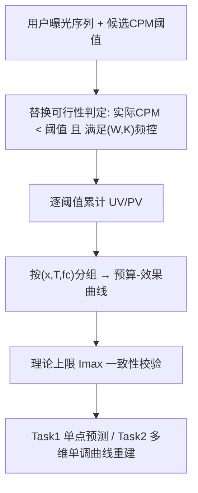
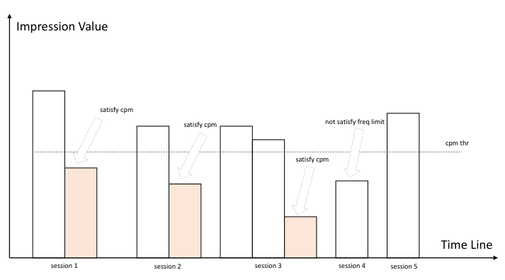

# R&F-Inventory: A Large-Scale Dataset for Monotonic Inventory Estimation in Reach and Frequency Advertising (面向触达与频次广告单调库存预估的大规模数据集)

- **会议/期刊**: SIGIR 2026 (7 pages, Resource Track)
- **作者与机构**: Yunshan Peng, Ji Wu, Wentao Bai, Yunke Bai, Jinan Pang, Wenzheng Shu, Yanxiang Zeng, Xialong Liu, Peng Jiang（快手科技）
- **推荐链路定位**: 粗排 / 库存预估（合约广告投放前的预算-效果曲线规划）
- **研究方向**: CTR预估与特征交叉 / 去偏公平与工业架构
- **论文原文**: [https://arxiv.org/abs/2604.16821v1](https://arxiv.org/abs/2604.16821v1)
- **开源代码**: [https://github.com/pengyunshan/RF-Inventory](https://github.com/pengyunshan/RF-Inventory)

## TL;DR (1分钟核心速览)

R&F（Reach & Frequency）合约广告需要在给定「定向-排期-频控」下实时输出 UV/PV 随预算变化的**完整曲线**，但现有公开广告数据集（Criteo/Avazu/Taobao）以独立 PV/点击为样本单元，既无预算维度也无频控约束，无法刻画曲线的单调性与边际递减结构。本文发布 R&F-Inventory 数据集：以「定向-排期-频控」三元组为上下文，在同一上下文内提供 53 个 CPM 阈值点（0.4–3.0，步长 0.05）的 UV/PV 观测，构成完整预算-效果曲线，并推导理论曝光上限 $I_{max}=R\cdot K\cdot\lceil T/W\rceil$作为一致性校验。基于该数据定义单点预测与多维单调曲线重建两个基准任务，在联合外推划分（Method 3）下，显式单调约束模型（PWL/SMM/MN）将 PV MAE 从 GBDT 的 442453 降至约$1.0\times10^4$ 量级，且单调违反率降为 0。

## Background & Motivation (背景与核心矛盾)

- **主流范式**: 广告机器学习研究以 CTR/CVR 点级预估为核心，依赖 Criteo、Avazu、Taobao 等以单次曝光/点击为独立样本的公开日志数据集。
- **前人局限**: 其一，这些数据集不含预算、排期、频控维度，无法支撑「同一上下文下多预算点」的曲线级监督；其二，工业界 Reach Planner（Facebook/Google）虽能输出 R&F 预估，但数据与模型闭源，学术侧无法复现与横向对比。
- **核心洞察 (Key Insight)**: R&F 库存估计的本质不是点级回归，而是**带结构约束的曲线学习**——固定配置下 UV/PV 随预算单调递增、边际递减，且受排期与频控决定的理论上限 $I_{max}$ 硬约束；点级误差再小，一旦违反单调性，输出在业务上即不可用。
- **本文切入点**: 用离线模拟在真实广告系统反馈上构造「同上下文多预算点」的结构化观测，把 R&F 库存预估形式化为**偏序单调约束下的监督学习**问题并给出可复现基准。

## Method (核心方法设计)

### 1. 整体框架 (Overall Architecture)

数据集构造以单用户曝光序列模拟为核心：对每个用户按时间线构造会话序列（每会话可返回 1–2 条广告），给定候选 CPM 阈值，判断一条 R&F 广告能否**替换**序列中实际 CPM 更低的非 R&F 广告且仍满足频控约束（任意连续 $W$天内曝光不超过$K$次）；若可插入，则该用户为当前阈值贡献 1 个 PV 与 1 个 UV。对 53 个 CPM 阈值重复此过程，即得同一$(x,T,fc)$上下文下的完整预算-效果曲线。数据以六元组$\langle x, T, fc, b, R, I\rangle$组织，并按$(x,T,fc)$ 分组，每组对应一条曲线。

<figure class="paper-figure" markdown="span">
  <figcaption>图1：单个用户插入CPM广告的模拟示意图</figcaption>
</figure>

### 2. 关键设计拆解 (Key Designs)

1. **频控-排期耦合的理论曝光上限（数据质量与可行性校验的锚点）**：痛点在于频控规则与排期长度存在强交互，缺少可验证的物理边界。作者推导单用户在整个投放周期内的最大曝光次数 $m_{max}(T;W,K)=K\cdot\lceil T/W\rceil$，进而得到合约总曝光上限$I_{max}=R\cdot K\cdot\lceil T/W\rceil$。该式既是样本一致性检查工具（筛除越界样本），也可作为模型预测的可行域约束——直觉上，它把「频控窗口$W$越短、排期$T$ 越长则上限越高」的业务常识编码为硬边界。

2. **偏序单调约束的任务形式化（Task 2 的核心）**：痛点在于预算/排期/CPM 多维同时变化时，全序单调约束会过度限制不可比条件点。作者仅在偏序关系下施加约束：若 $T_1\le T_2$且$B_1\le B_2$，则要求$\hat R(u_1)\le\hat R(u_2)$、$\hat I(u_1)\le\hat I(u_2)$；实际使用中预算可由$\text{CPM}=1000\cdot b/I$导出，故简化为$(x,W,fc;T,\text{cpm})\to(\hat R,\hat I)$。这样既避免对不可比点施加无意义约束，又与 R&F 规划逻辑一致。

3. **三种外推式数据划分（评估泛化而非记忆）**：不做随机样本级划分，而是在固定定向与频控窗口前提下按业务变量切分——Method 1 按 CPM 阈值切（低 CPM 训练、高 CPM 测试，模拟「保守试投推激进策略」）；Method 2 按排期长度切（短排期训练、长排期测试，对应「短期评估、长期规划」）；Method 3 联合切分，测试集满足 $\text{cpm}\ge\tau_{cpm}\wedge T\ge\tau_T$，是最严苛的「大规模投放」鲁棒性场景。评估侧除 UV/PV 的 MAE/RMSE（含按上下文平均）外，另设 **Violation Rate**（违反偏序单调的点对比例）与 **Violation Magnitude**（违反时的平均下降幅度）两项结构一致性指标。

## Experimental Setup & Evaluation Protocol (实验设置与评估协议)

- **数据集与预处理**: 数据来自快手真实广告系统反馈的离线模拟，不含任何可识别个人信息；CPM 网格为 $[0.4,3.0]$均匀 53 点。原文未在正文给出用户/物品级统计表（资源论文以曲线组为单位组织），核心统计维度为：上下文数 = 不同$(x,T,fc)$ 组合数，每上下文 53 个预算观测点。

| 数据集 | 组织单元 | 每单元观测点 | 关键字段 | 特征/场景说明 |
| :--- | :---: | :---: | :---: | :--- |
| R&F-Inventory | $(x,T,fc)$上下文 | 53 (CPM 0.4–3.0) |$x,T,(W,K),b,R,I$| 定向-排期-频控三元组，含理论上限$I_{max}$ |

- **数据划分与防穿越 (Splitting Strategy)**: 三种**外推划分**（CPM 外推 / 排期外推 / 联合外推），均在固定定向与频控窗口下进行以避免泄漏；主实验采用最严苛的 Method 3。
- **排名评测协议 (Ranking Protocol)**: 非排序任务，采用点级回归误差（PV/UV 的 MAE、RMSE，含整体与按上下文平均）+ 结构一致性（Violation Rate / Violation Magnitude）。
- **对比基线与超参设置**: GBDT（无约束树模型）、POSNN（部分单调神经网络）、SMM（形状约束单调模型）、MN（单调网络）、PWL（分段线性单调模型）、Hint（Hint-based 单调模型）。原文未披露嵌入维度等超参细节，基线均以官方/可复现实现为准。

## Key Experimental Results (实验关键数据)

### 1. 主实验对比 (Main Results)

Task 2，联合外推划分（Method 3）：

| Method | PV MAE | PV RMSE | UV MAE | UV RMSE | PV Viol. Rate | UV Viol. Rate |
| :--- | :---: | :---: | :---: | :---: | :---: | :---: |
| GBDT | 442453 | 1044529 | 779 | 1312 | 0.61 | 0.56 |
| Hint | 16227 | 39577 | 444 | 699 | 0.31 | 0.11 |
| POSNN | 15314 | 24527 | 430 | 614 | 0.0 | 0.0 |
| **SMM** | **11841** | **21946** | **344** | **420** | **0.0** | **0.0** |
| MN | 11979 | 22989 | 260 | 338 | 0.0 | 0.0 |
| PWL | 10298 | 21669 | 301 | 386 | 0.0 | 0.0 |

（注：原文表中 MN 的 PV RMSE 与 PWL 的 PV MAE 存在排版粘连，此处按列语义还原；MN 的 UV MAE/RMSE 为全表最优。）

### 2. 消融实验 (Ablation Study)

本文为资源/基准论文，未设组件消融，其等价分析为**划分方式 × 模型族**的交叉对比（原文仅完整报告 Method 3）。可归纳的对照结构如下：

| 对照维度 | 无约束 (GBDT) | 弱约束 (Hint) | 强单调约束 (POSNN/SMM/MN/PWL) |
| :--- | :---: | :---: | :---: |
| PV MAE (Method 3) | 442453 | 16227 | 10298–15314 |
| 单调违反率 | 0.61 / 0.56 | 0.31 / 0.11 | 全部 0.0 |

### 3. 关键实验发现 (Key Findings)

1. **单调约束是精度与一致性的双赢而非权衡**：PWL 相比 GBDT 将 PV MAE 降低约 **97.7%**（442453 → 10298），同时把 PV 违反率从 0.61 压到 0；说明在强外推场景下，结构先验直接充当了正则化，抑制了树模型在高 CPM/长排期区域的失控外推。
2. **弱约束不够用**：Hint 虽把 PV MAE 降到 16227，但违反率仍达 0.31/0.11，证明「软提示」无法保证偏序一致性，业务可用的底线需要硬约束模型。
3. **UV 与 PV 的最优模型并不一致**：MN 取得最优 UV（MAE 260 / RMSE 338），而 PWL 在 PV 上更优（MAE 10298），印证作者自述的局限——UV/PV 分开建模、不共享底层参数，二者内在耦合关系（UV 是 PV 的去重上界）尚未被利用。

## Highlights & Limitations (亮点、对比与审稿批判)

- **与代表作对比 (vs. Prior Work)**: 相较 Criteo/Avazu/Taobao 等点级广告日志，本文首次提供**曲线级监督 + 频控显式建模 + 理论上限校验**；相较 Facebook/Google Reach Planner 等闭源系统，本文是唯一公开可复现的 R&F 库存基准（原文 Table 1 中唯一四项全勾选者）；相较 isotonic regression / lattice / 单调网络等方法学工作，本文补上了它们长期缺失的广告库存评测土壤。
- **可迁移亮点**: ①「理论物理上限 → 可行域约束 + 数据质检」这一套做法可直接迁移到任何带容量约束的预估任务（如配送时效、库存销量预估）；②外推式划分（按强度/时长切分而非随机切分）是评估结构约束模型泛化性的通用范式，值得在 CTR 外推、冷启动场景复用。
- **审稿级局限批判**: ①数据由离线模拟生成，替换式插入假设（仅替换低 CPM 非 R&F 广告）与真实竞价环境存在偏差，分布漂移风险未量化；②UV/PV 独立建模、频控窗口 $(W,K)$仅作固定特征而未探索其单调性，且理论上限$I_{max}$ 因所有基线均未建模饱和边界而**未纳入评估指标**，使「可行性校验」的实际约束力被削弱；③仅报告 Method 3 的完整结果，Method 1/2 的外推难度梯度分析缺失。

## Rating (四维评分)

- **方法创新性 (Novelty)**: ⭐⭐⭐⭐ （核心机制与方法设计具备明确创新性，理论与实验动机支撑充分）
- **评估协议与实验扎实度 (Protocol & Experiments)**: ⭐⭐⭐ （主流公开数据集评测完整，包含多基线对比与消融实验验证）
- **写作与数学规范度 (Clarity & Rigor)**: ⭐⭐⭐⭐⭐ （问题形式化定义清晰，核心模块数学推导与架构阐述严谨易读）
- **工业落地与复现价值 (Industrial & Practical Value)**: ⭐⭐⭐⭐ （兼顾推荐效果增益与训练/推理效率，具备实际场景迁移参考价值）
