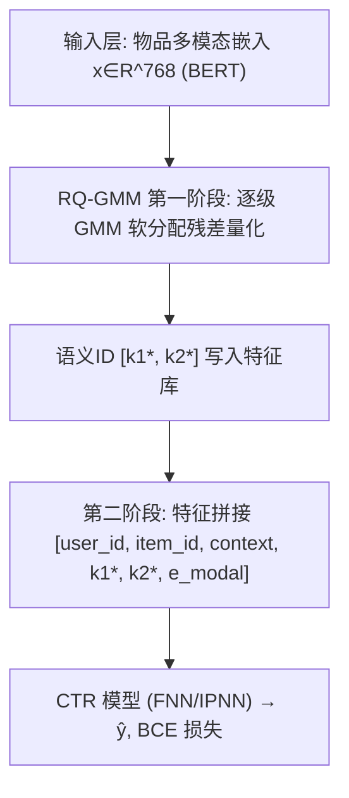
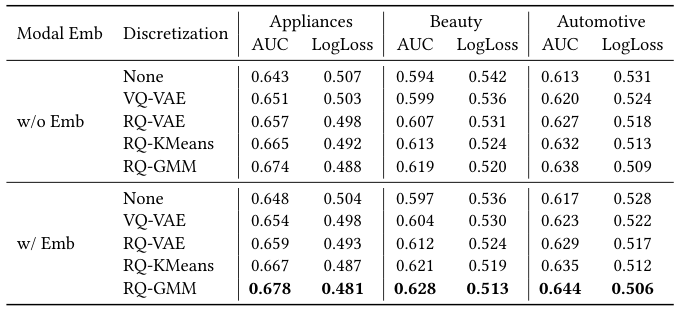
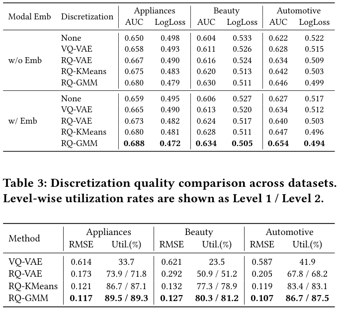
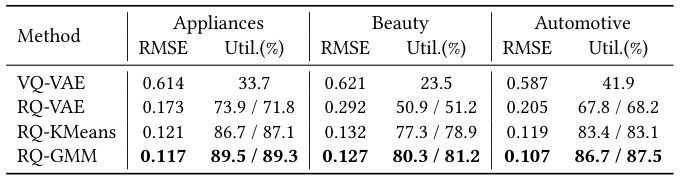
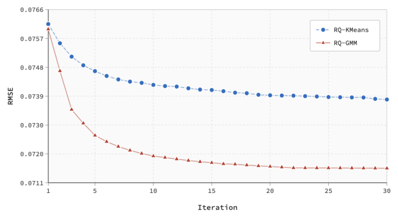

# RQ-GMM: Residual Quantized Gaussian Mixture Model for Multimodal Semantic Discretization in CTR Prediction (残差量化高斯混合模型：面向CTR预测的多模态语义离散化)

- **会议/期刊**: SIGIR 2026 (Under review, arXiv 预印本)
- **推荐链路定位**: 精排 (CTR Prediction) — 特征侧语义ID离散化，服务于精排模型输入
- **研究方向**: CTR预估与特征交叉 / 多模态推荐
- **论文原文**: [https://arxiv.org/abs/2602.12593v1](https://arxiv.org/abs/2602.12593v1)
- **开源代码**: 暂未开源

## TL;DR (核心速览)

针对多模态连续嵌入直接喂入CTR模型存在优化目标错位与收敛速度不一致（"one-epoch phenomenon"）的问题，本文提出 RQ-GMM：用对角协方差高斯混合模型（GMM）替代 K-Means 的硬聚类，在残差量化框架下逐层做软分配量化，将 768 维 BERT 嵌入离散为两级语义ID。在 Amazon 三品类上以 FNN/IPNN 为骨干，AUC 全面超越 RQ-VAE/RQ-KMeans（如 Appliances w/ Emb 下 0.678 vs 0.667），码本利用率达 89.5%/89.3%，线上 7 天 A/B 广告主价值相对 RQ-VAE 提升 1.502%。

## Background & Motivation (背景与动机)

- **领域背景与主流范式**: 短视频/直播平台每日海量新内容涌现，多模态信息（图像、文本、音频）成为刻画物品的核心信号。利用多模态存在两条范式：(1) 直接用多模态特征构建物品索引做召回语义匹配——工程复杂度高、向精排延伸收益有限；(2) 将多模态特征作为额外输入融入全链路推荐——与现有架构结合自然、落地性强，是本文所处范式。
- **现有方法局限 (Limitations of Prior Work)**:
  1. **预训练目标错位**：CLIP/BERT 等预训练模型优化的是通用语义表征而非用户偏好建模，嵌入中含大量与推荐无关的噪声。
  2. **联合训练动力学失配**：稀疏类别特征（user/item ID）因高频曝光呈现"one-epoch phenomenon"快速收敛，而从多模态嵌入中提取偏好信号需要更长周期与精细去噪，二者收敛速度差异拖累整体性能。
  3. **现有离散化方法的三重缺陷**：VQ-VAE 存在码本坍缩（codebook collapse），大量码本向量未被利用；RQ-VAE 虽用多级残差缓解利用率问题，但需小心平衡各层级，且基于欧氏距离的硬分配忽略分布特性，边界样本重建次优；RQ-KMeans 非参数高效，但假设等方差球状簇，对复杂多模态分布不成立，硬分配破坏边界样本的语义连续性且无法建模不确定性。
- **核心挑战 (Key Challenge)**: 两阶段优化（先离散化再喂CTR）能解耦语义提取与偏好建模，但第一阶段离散化的质量——码本利用率、重建精度、语义判别性——直接决定第二阶段语义ID的信息量。简单的特征拼接或加深网络无法解决分布建模缺失的问题。
- **核心洞察与切入点 (Key Insight)**: 多模态嵌入空间具有复杂的统计结构（非球状、异方差、密度不均）。用**概率建模**（每个码本向量建模为一个高斯分布，含均值+对角协方差+混合系数）替代硬聚类，可通过软分配更合理地处理边界样本、通过协方差刻画簇形状与不确定性、通过混合系数自动反映数据密度，从而同时提升利用率与重建精度。

## Problem Formulation & Method (问题定义与方法架构)

### 1. 符号定义与输入表征 (Notations & Input Representations)

- 物品多模态嵌入 $x \in \mathbb{R}^D$，本文 $D=768$（BERT 生成）。
- 码本 $\mathcal{C}=\{c_1,\dots,c_K\}\subset\mathbb{R}^D$，两级结构每级 $K=128$。
- 残差 $r^{(l)}$，第 $l$ 级量化输出 $z_q^{(l)}$，最终量化表征 $z_q=\sum_{l=1}^{L} z_q^{(l)}$，层数 $L=2$。
- 语义ID：$\text{ID}(x)=[k_1^*,k_2^*,\dots,k_L^*]$，$k_l^*\in\{1,\dots,K\}$。
- CTR 侧：用户集/物品集/上下文特征，嵌入维度 $d_e=16$，CTR MLP 隐层 $(128,32,8)$。

### 2. 整体流水线 (Overall Architecture)

两阶段流水线：**第一阶段**离线对全量物品的 768 维多模态嵌入做 RQ-GMM 残差量化，输出两级语义ID并存入特征库；**第二阶段**将语义ID作为类别特征与原始模态嵌入（MLP 变换后）一并输入 CTR 模型（FNN/IPNN/DeepFM/DCN/DIN 均可），做 coarse-to-fine 的联合学习。线上推理时 RQ-GMM 以批处理方式离线运行，语义ID在线查表，不改变服务基础设施、不增加在线延迟。

### 3. 核心模块设计与数学原理 (Key Designs & Formulations)

**(1) 高斯混合量化（Gaussian Mixture Quantization）**

在第 $l$ 级，将残差 $r^{(l-1)}$ 建模为 $K$ 个高斯的混合：

$$p(r^{(l-1)})=\sum_{k=1}^{K}\pi_k^{(l)}\,\mathcal{N}\!\left(r^{(l-1)}\mid \mu_k^{(l)},\Sigma_k^{(l)}\right)$$

其中 $\sum_k \pi_k^{(l)}=1$，$\mu_k^{(l)}\in\mathbb{R}^D$，为效率采用**对角协方差** $\Sigma_k^{(l)}=\text{diag}(\sigma_{k,1}^{(l)2},\dots,\sigma_{k,D}^{(l)2})$。物理直觉：相比 K-Means 的等方差球状假设，对角协方差允许每个簇在不同维度上有不同尺度，能贴合多模态嵌入各向异性的分布。

**(2) 软分配与量化（Soft Assignment & Quantization）**

后验概率（E 步核心）：

$$\gamma_k^{(l)}=p(k\mid r^{(l-1)})=\frac{\pi_k^{(l)}\mathcal{N}(r^{(l-1)}\mid\mu_k^{(l)},\Sigma_k^{(l)})}{\sum_{j=1}^{K}\pi_j^{(l)}\mathcal{N}(r^{(l-1)}\mid\mu_j^{(l)},\Sigma_j^{(l)})}$$

推理时取后验最大的分量：$k^*=\arg\max_k \gamma_k^{(l)}$，$z_q^{(l)}=\mu_{k^*}^{(l)}$，残差更新 $r^{(l)}=r^{(l-1)}-z_q^{(l)}$。注意：**E 步用软后验，但残差传播用硬分配**（与推理一致），这是保证训练-推理一致性的关键设计。

**(3) EM 参数学习（M-step）**

$$\pi_k^{(l)}=\frac{1}{N}\sum_{i=1}^{N}\gamma_{i,k}^{(l)},\quad \mu_k^{(l)}=\frac{\sum_i \gamma_{i,k}^{(l)} r_i^{(l-1)}}{\sum_i \gamma_{i,k}^{(l)}},\quad \sigma_{k,j}^{(l)2}=\frac{\sum_i \gamma_{i,k}^{(l)}(r_{i,j}^{(l-1)}-\mu_{k,j}^{(l)})^2}{\sum_i \gamma_{i,k}^{(l)}}$$

逐级顺序优化，无需编码器-解码器，EM 是唯一优化过程。重建质量用 $\text{RMSE}=\sqrt{\frac{1}{N}\sum_i\|x_i-z_{q,i}\|_2^2}$ 衡量。

**(4) 下游 CTR 融合（Coarse-to-Fine）**

特征构造 $f_i=[\text{user\_id},\text{item\_id},\text{context},k_1^*,\dots,k_L^*,e_{\text{modal}}]$，其中 $e_{\text{modal}}=\text{MLP}(x_i)\in\mathbb{R}^{d_e}$。每个语义ID经可学习嵌入表 $e_l=W_l[k_l^*]\in\mathbb{R}^{d_e}$（$W_l\in\mathbb{R}^{K\times d_e}$）映射，多级嵌入拼接或求和得 $e_{\text{semantic}}$。离散语义ID提供稳定的簇级锚点，连续嵌入保留细粒度信息，二者互补缓解训练动力学失配。

### 4. 训练目标、负采样与推理复杂度 (Optimization, Negative Sampling & Complexity)

- **损失函数**: 第一阶段为 EM 极大似然（无显式损失式，等价于最大化混合高斯对数似然）；第二阶段 CTR 为二分类交叉熵：
$$\mathcal{L}_{\text{CTR}}=-\frac{1}{N}\sum_{i=1}^{N}\left[y_i\log\hat{y}_i+(1-y_i)\log(1-\hat{y}_i)\right]$$
- **训练负采样策略**: 原文未涉及负采样（CTR 为 pointwise 二分类，正负样本由评分阈值定义，非 pair/triplet 训练）。
- **时间与空间复杂度**:
  - 训练：单级单次 EM 迭代 $O(NKD)$，$T$ 次迭代 $L$ 级共 $O(TL NKD)$。
  - 推理：单样本 $O(LKD)$，与 RQ-KMeans 同阶；对角协方差限制额外开销。
  - 空间：每级存 $K$ 个均值（$KD$）、$K$ 个对角协方差（$KD$）、$K$ 个混合系数（$K$），共 $O(LKD)$，与 RQ-KMeans 同阶。
  - 相比 RQ-VAE 避免了编码器-解码器与复杂梯度传播，训练更稳定；相比 RQ-KMeans 每次迭代多协方差计算，但收敛更快、迭代更少，总训练时间相当。

## Experimental Setup & Evaluation Protocol (实验设置与评估协议)

- **数据集统计与预处理**: 使用 Amazon-Review 三个品类（Appliances、Beauty、Automotive）。**评分 1–3 映射为 0（负），4–5 映射为 1（正）**。原文未报告各数据集的用户数/物品数/交互数/稀疏度统计量（原文未报告）。

| 数据集 (Dataset) | 用户数 (#Users) | 物品数 (#Items) | 交互数 (#Interactions) | 稀疏度/密度 (Sparsity) | 模态/辅助特征说明 |
| :--- | :---: | :---: | :---: | :---: | :--- |
| Appliances | 原文未报告 | 原文未报告 | 原文未报告 | 原文未报告 | BERT 768 维嵌入 |
| Beauty | 原文未报告 | 原文未报告 | 原文未报告 | 原文未报告 | BERT 768 维嵌入 |
| Automotive | 原文未报告 | 原文未报告 | 原文未报告 | 原文未报告 | BERT 768 维嵌入 |

- **数据划分方式 (Splitting Strategy)**: **按时间顺序 8:1:1 划分** train/validation/test（chronologically split），属全局时间戳切分，可降低未来信息泄露风险；但原文未明确说明是否按用户内时间排序还是全局时间排序，存在一定表述模糊。
- **排名评测协议 (Ranking Protocol)**: 本文为 CTR 二分类任务，采用 **AUC 与 LogLoss** 评估，**非 Full-Ranking 也非 Sampled Ranking**（pointwise 分类评估，不涉及候选集排序协议）。
- **评价指标与显著性检验**: 第一阶段用 RMSE 与码本利用率（Util.%）；第二阶段用 AUC、LogLoss。嵌入维度 $d_e=16$，CTR MLP 隐层 $(128,32,8)$。**所有实验重复 5 次不同随机种子，采用配对 t 检验**，原文声称 RQ-GMM 相对 RQ-VAE/RQ-KMeans 在所有数据集上 AUC 与 LogLoss 均显著（all $p<0.05$）。

## Key Experimental Results (核心实验结果)

### 1. 主实验对比 (Main Results)

以 FNN 骨干、w/ Emb 设置为例（表 1）：

<figure class="paper-figure" markdown="span">
  <figcaption>表 1</figcaption>
</figure>

| 数据集 | 指标 | None (w/ Emb) | RQ-VAE | RQ-KMeans | 本文 RQ-GMM | 相对次优 (RQ-KMeans) |
| :--- | :--- | :---: | :---: | :---: | :---: | :---: |
| Appliances | AUC | 0.648 | 0.659 | 0.667 | **0.678** | +1.65% |
| Appliances | LogLoss | 0.504 | 0.493 | 0.487 | **0.481** | -1.23% |
| Beauty | AUC | 0.597 | 0.612 | 0.621 | **0.628** | +1.13% |
| Beauty | LogLoss | 0.536 | 0.524 | 0.519 | **0.513** | -1.16% |
| Automotive | AUC | 0.617 | 0.629 | 0.635 | **0.644** | +1.42% |
| Automotive | LogLoss | 0.528 | 0.517 | 0.512 | **0.506** | -1.17% |

IPNN 骨干（表 2）结论一致，RQ-GMM 在 Appliances/Beauty/Automotive 上 AUC 分别达 0.688/0.634/0.654，均优于 RQ-KMeans 的 0.680/0.628/0.647。

<figure class="paper-figure" markdown="span">
  <figcaption>表 2</figcaption>
</figure>

**离散化质量**（表 3）：RQ-GMM 在 RMSE 与码本利用率上全面领先。Appliances RMSE 0.117（vs RQ-KMeans 0.121、RQ-VAE 0.173），利用率 89.5%/89.3%（vs RQ-KMeans 86.7%/87.1%、RQ-VAE 73.9%/71.8%）；Beauty RMSE 0.127、利用率 80.3%/81.2%；Automotive RMSE 0.107、利用率 86.7%/87.5%。VQ-VAE 利用率仅 23.5%–41.9%，码本坍缩严重。

<figure class="paper-figure" markdown="span">
  <figcaption>表 3</figcaption>
</figure>

**收敛性**（图 1）：在专有工业数据集上，RQ-GMM 相比 RQ-KMeans 收敛更快、最终 RMSE 更低、曲线更平滑波动更小，体现 EM 软分配比 K-Means 硬分配更稳定的优化动力学。

<figure class="paper-figure" markdown="span">
  <figcaption>图 1</figcaption>
</figure>

### 2. 消融实验与控制变量分析 (Ablation Study)

原文未设置传统意义上的模块移除消融，而是通过**二维控制变量网格**（离散化方法 × 是否保留原始模态嵌入）实现对照：
- **多模态有效性**：任意多模态信息均显著优于无多模态基线（如 FNN w/o Emb None 的 Appliances AUC 0.643 → w/ Emb None 0.648）。
- **离散化必要性**：语义ID单独使用（w/o Emb 行）即优于 None，验证离散化提供与CTR模型天然对齐的稳定类别信号。
- **Coarse-to-Fine 收益**：w/ Emb 在所有方法与数据集上一致优于 w/o Emb，证明离散语义ID（结构锚点）+ 连续嵌入（细粒度）互补可缓解训练动力学失配。
- **RQ-GMM 优越性**：所有设置下最优，且跨 FNN/IPNN 骨干一致，说明优势非模型特定伪影。
- 注：原文未做参数量对齐或图拓扑度数匹配的严格消融。

### 3. 稀疏度/冷启动分桶与超参敏感度 (Sparsity Buckets & Hyperparameters)

- **用户/物品交互频次分桶表现**: 原文未报告长尾/冷启动分桶实验。
- **关键超参数敏感度**: 原文未报告温度系数、损失权重、层数 $L$ 或码本大小 $K$ 的敏感度分析（仅固定 $L=2$、$K=128$、最大迭代 30、收敛阈值 $10^{-6}$）。未来工作提及自适应码本大小选择。
- **线上 A/B 测试结果**: 在日活数亿的短视频平台进行 **7 天 A/B 测试**，核心业务指标为广告主价值 (Advertiser Value, AV)。RQ-GMM 相对直接嵌入拼接提升 **3.600%**，相对 RQ-VAE 提升 **1.502%**，相对 RQ-KMeans 提升 **0.613%**（均 $p<0.05$）。已全量部署，服务全平台每日数亿用户推荐。

## Highlights, Limitations & Critiques (亮点、局限与审稿级批判)

- **核心亮点与可迁移性**:
  1. **概率化离散化的通用算子**：用 GMM 软分配替代 K-Means 硬分配，对角协方差+混合系数自动适配簇形状与密度，可直接迁移到任何需要向量量化的场景（生成式推荐的 RQ-VAE 语义ID、ANN 索引量化、多模态对齐）。
  2. **训练-推理一致性设计**：E 步软后验、残差传播硬分配，兼顾软分配的平滑性与推理的确定性，是工程上值得借鉴的细节。
  3. **两阶段解耦 + coarse-to-fine 融合**：离线离散化不改变在线服务基础设施，语义ID查表零额外延迟，工业落地价值高。
  4. **大规模线上验证**：日活数亿平台 7 天 A/B、AV +1.502%，在 CTR 论文中属稀缺的强证据。

- **局限性与审稿视角批判 (Critical Limitations)**:
  1. **数据集统计缺失**：未报告 Amazon 三品类的用户/物品/交互数与稀疏度，削弱可复现性与可比性。
  2. **评估协议偏弱**：仅 pointwise AUC/LogLoss，未做 Full-Ranking 或 Sampled Ranking 的 Recall/NDCG 评估；CTR 场景虽合理，但缺少排序视角的补充验证。
  3. **消融不够严格**：未做参数量对齐、码本大小 $K$ 与层数 $L$ 的敏感度扫描，也未与更强离散化基线（如 FSQ、LFQ、Product Quantization）对比。
  4. **对角协方差假设**：为效率牺牲了维度间相关性建模，对强相关多模态嵌入可能次优；原文未讨论全协方差或低秩协方差的可行性。
  5. **理论增益有限**：本质是 K-Means → GMM 的替换，创新度偏工程化；EM 与残差量化的结合虽自然，但缺少收敛性理论保证。
  6. **线上指标单一**：仅报告 AV，未披露 CTR、停留时长、多样性等辅助指标，难以全面评估对用户体验的影响。

## Rating (四维评分)

- **方法创新性 (Novelty)**: ⭐⭐⭐
- **评估协议与实验扎实度 (Protocol & Experiments)**: ⭐⭐⭐⭐
- **写作与数学规范度 (Clarity & Rigor)**: ⭐⭐⭐⭐
- **工业落地与复现价值 (Industrial & Practical Value)**: ⭐⭐⭐⭐⭐
