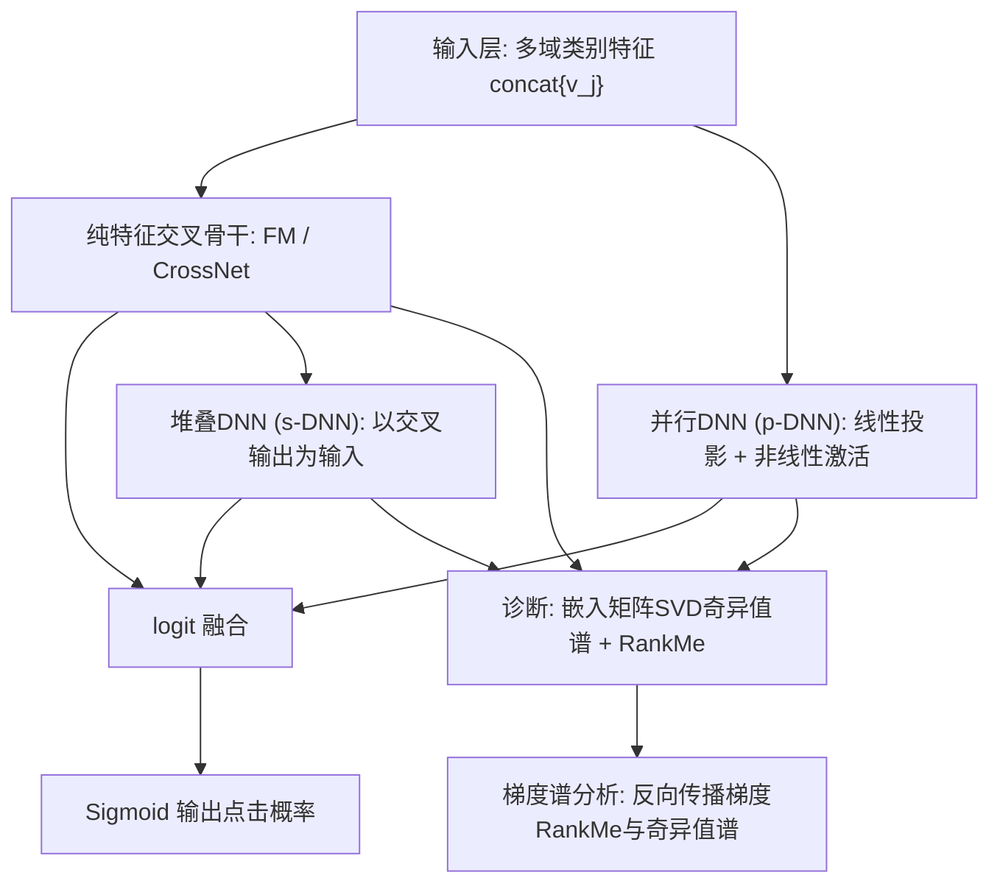
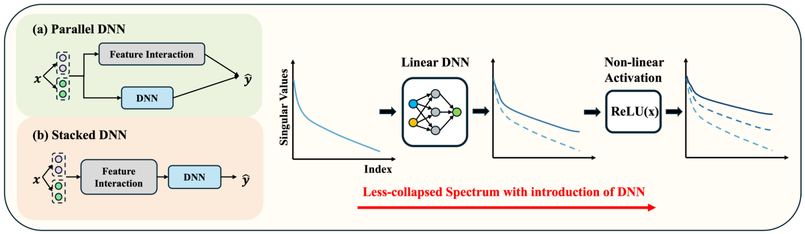
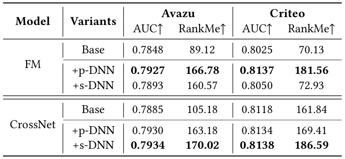
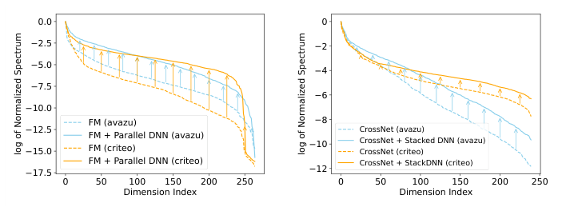
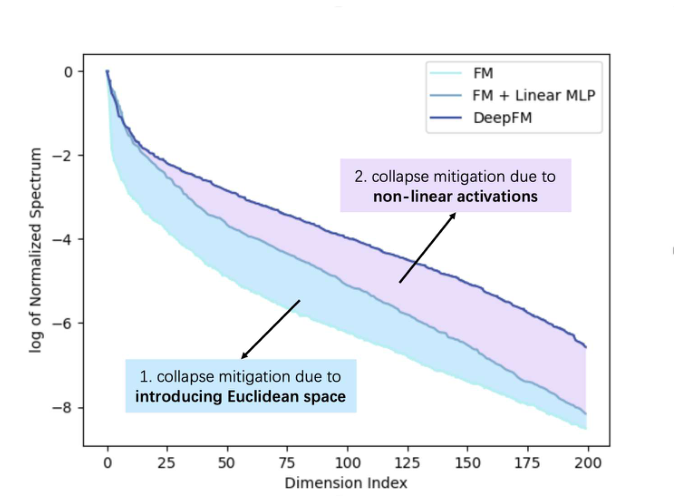

# Understanding DNNs in Feature Interaction Models: A Dimensional Collapse Perspective (从维度坍缩视角理解特征交叉模型中的DNN)

- **会议/期刊**: SIGIR 2026 (6 pages, short paper)
- **推荐链路定位**: 精排 (CTR Prediction / Ranking)
- **研究方向**: CTR预估与特征交叉 (主) / 表征学习与维度坍缩分析
- **论文原文**: [https://arxiv.org/abs/2604.26489v1](https://arxiv.org/abs/2604.26489v1)
- **开源代码**: [https://github.com/USTC-StarTeam/Dimensional-Collapse-Analysis](https://github.com/USTC-StarTeam/Dimensional-Collapse-Analysis)

## TL;DR (核心速览)

本文针对CTR特征交叉模型中DNN作用长期存在争议（"隐式高阶交叉" vs "难以学习点积"）的痛点，提出从**嵌入维度坍缩**视角重新解释DNN的有效性。作者在Avazu与Criteo上系统实验FM/CrossNet的并行DNN(p-DNN)与堆叠DNN(s-DNN)变体，发现二者均显著展平奇异值谱、提升RankMe（如FM在Avazu上RankMe从89.12升至166.78），并通过基于梯度的理论分析揭示DNN通过引入正交梯度分量与维度感知加权来缓解坍缩。这是一篇分析型短文，不提出新模型，而是提供新的机理解释。

## Background & Motivation (背景与动机)

- **领域背景与主流范式**: CTR预估中，特征交叉是核心挑战。主流范式分为显式交叉（FM、CrossNet等）与"显式交叉+DNN"混合范式（DeepFM、NFM、DCNv2等）。DNN通常以两种方式集成：与交叉模块**并行**（p-DNN，如DeepFM）或**堆叠**在交叉模块输出之上（s-DNN，如NFM）。
- **现有方法局限 (Limitations of Prior Work)**:
  1. **作用机理争议**：多数工作声称DNN负责"隐式捕获高阶特征交叉"，但已有研究（如MLP难以学习点积、DCNv2发现ReLU-DNN可劣于显式高阶交叉）对该假设提出质疑。
  2. **缺乏表征层面的解释**：DNN为何在经验上有效，其底层原因"insufficiently understood"。
  3. **维度坍缩未被纳入分析框架**：表征学习中维度坍缩（嵌入退化到低维子空间、奇异值快速衰减）已被视为限制表征表达力的关键瓶颈，但尚未被用于解释特征交叉模型中DNN的作用。
- **核心挑战 (Key Challenge)**: 为什么简单的"增加网络深度/拼接特征"无法解释DNN的收益？因为若DNN仅做隐式交叉，其学习点积的能力本身受限；需要从**表征几何（奇异值谱）** 与**梯度动力学**层面寻找新解释。
- **核心洞察与切入点 (Key Insight)**: 作者观察到纯交叉模型（FM/CrossNet）的嵌入矩阵奇异值谱急剧衰减（严重维度坍缩），而加入DNN后谱显著展平（图1）。由此提出：DNN的有效性部分源于其对**表征维度鲁棒性**的改善，而非仅隐式高阶交叉。

## Problem Formulation & Method (问题定义与方法架构)

### 1. 符号定义与输入表征 (Notations & Input Representations)

- CTR问题定义为 $\{X, Y\}$，$X$ 为多类别（multi-field categorical）特征集，$Y\in\{0,1\}$ 为点击标签。
- 每个特征域 $i$ 的特征映射为嵌入向量 $v_i \in \mathbb{R}^k$，$k$ 为嵌入维度（Avazu $d=16$，Criteo $d=10$）。
- 特征域集合记为 $\mathcal{F}_x$，拼接嵌入为 $\text{concat}\{v_j\}_{j\in\mathcal{F}_x}$。
- 模型输出经 sigmoid：$p=\sigma(\Phi)$，$\Phi$ 为 logit，训练用 BCE 损失 $\mathcal{L}$。
- 嵌入矩阵 $Z\in\mathbb{R}^{B\times D}$ 在测试集上收集（$B$ 为 batch size，$D$ 为嵌入维度），用于谱分析。

### 2. 整体流水线 (Overall Architecture)

本文为分析型工作，核心"流水线"是对比两种DNN集成架构并做谱/梯度诊断：

图2展示了两种集成结构：(a) 并行DNN接收与交叉模块相同输入并并行运算；(b) 堆叠DNN置于交叉模块之上、以其输出为输入。

<figure class="paper-figure" markdown="span">
  <figcaption>图 2</figcaption>
</figure>

### 3. 核心模块设计与数学原理 (Key Designs & Formulations)

**(1) 维度坍缩的评估协议（诊断工具）**

- **奇异值谱**：对嵌入矩阵 $Z$ 的协方差矩阵 $C=\frac{1}{B}\sum_{i=1}^{B}(z_i-\bar{z})(z_i-\bar{z})^T$ 做SVD，得到降序奇异值 $\sigma=\{\sigma_1,\dots,\sigma_d\}$。谱快速衰减意味着信息集中于少数维度，即表征坍缩到低维子空间。
- **RankMe**：矩阵秩的平滑估计，定义为归一化奇异值的Shannon熵：
$$\text{RankMe}(Z)=\exp\left(-\sum_{k=1}^{\min(N,K)} p_k \log p_k\right),\quad p_k=\frac{\sigma_k(Z)}{\|\sigma(Z)\|_1}$$
RankMe越高表示表征越鲁棒、坍缩越轻。

**(2) 组件级消融的公式化（RQ2）**

将p-DNN分解为线性MLP与非线性激活，逐步增强FM：

- 仅线性模块：
$$\Phi_{\text{Linear p-DNN}}=\Phi_{FM}+w_{out}\cdot W_{in}\cdot\text{concat}\{v_j\}_{j\in\mathcal{F}_x}$$
- 完整p-DNN（加非线性激活 $f(\cdot)$）：
$$\Phi_{\text{p-DNN}}=\Phi_{FM}+w_{out}\cdot f(W_{in}\cdot\text{concat}\{v_j\}_{j\in\mathcal{F}_x})$$

物理直觉：线性投影先扩展有效嵌入维度（抬升前150个奇异值，尤其前25个），非线性激活进一步重塑谱（主要抬升索引25–200的中大奇异分量），二者**逐步**缓解坍缩。

**(3) 基于梯度的机理分析（核心理论贡献）**

- **纯FM的梯度**：$\Phi_{FM}=\sum_{i<j\in\mathcal{I}_x}\langle v_i\cdot v_j\rangle$，对 $v_i$ 的梯度为
$$\frac{\partial\Phi_{FM}}{\partial v_i}=\sum_{j\in\mathcal{F}_x,j\neq i}v_j$$
该梯度**严格限制在交互特征嵌入张成的子空间内**，与Interaction-Collapse Theory一致，导致表征空间逐步被拉向低秩子空间——这正是谱分析中观察到的坍缩。

- **并行DNN的梯度**：
$$\frac{\partial\Phi_{p\text{-}DNN}}{\partial v_i}=\underbrace{\sum_{j\in\mathcal{F}_x,j\neq i}v_j}_{\text{FM梯度}}+\underbrace{g_{DNN}(v_i;\mathcal{F}_x)}_{\text{DNN梯度}}$$
其中 $g_{DNN}(v_i;\mathcal{F}_x)=(w_{out}\cdot D\cdot W_{in})\cdot P_i$，$D=\text{diag}(\mathbb{I}(W\cdot\text{concat}\{v_j\}+b>0))$，$P_i$ 为从拼接向量中抽取 $v_i$ 的选择矩阵。**关键**：$g_{DNN}$ 引入高度非线性项，提供FM梯度中不存在的**正交梯度分量**，使嵌入能逃逸低维流形、在更广向量空间中更新。

- **堆叠DNN的梯度**：
$$\frac{\partial\Phi_{s\text{-}DNN}}{\partial v_i}=g_{DNN}\cdot\sum_{j\in\mathcal{F}_x,j\neq i}\text{diag}(v_j)$$
其中 $g_{DNN}=w_{out}\cdot\text{diag}(\mathbb{I}(W_{in}\cdot\Phi_{FM}+b>0))\cdot W_{in}$。$g_{DNN}$ 作为**维度感知的加权向量**，用各维不同的非线性信号调制梯度每一维，解耦维度依赖，防止各维收敛到低秩子空间主导的方向，从而保持维度多样性、产生更平坦的谱。

### 4. 训练目标、负采样与推理复杂度 (Optimization, Negative Sampling & Complexity)

- **损失函数**: 标准BCE损失 $\mathcal{L}$（CTR二分类），无额外正则项或对比损失；本文不引入新训练目标。
- **训练负采样策略**: 不适用——CTR预估为逐样本二分类（点击/未点击标签），非召回式负采样任务；原文未涉及负采样设计。
- **时间与空间复杂度**: 原文未报告具体训练/推理耗时或显存开销。方法层面，p-DNN与s-DNN均为标准MLP，复杂度与既有DeepFM/NFM/DCNv2一致；本文主要开销在于**离线诊断**（对测试集5万样本做SVD与RankMe计算）。原文未报告在线推理延迟。

## Experimental Setup & Evaluation Protocol (实验设置与评估协议)

- **数据集统计与预处理**: 使用两个公开CTR数据集Avazu与Criteo。原文**未报告**用户数/物品数/交互数/稀疏度等详细统计量（CTR数据集为多域类别特征，非用户-物品交互矩阵形式），故下表仅列原文明确信息：

| 数据集 (Dataset) | 用户数 (#Users) | 物品数 (#Items) | 交互数 (#Interactions) | 稀疏度/密度 (Sparsity) | 模态/辅助特征说明 |
| :--- | :---: | :---: | :---: | :---: | :--- |
| Avazu | 原文未报告 | 原文未报告 | 原文未报告 | 原文未报告 | 多域类别特征；嵌入维度 $d=16$ |
| Criteo | 原文未报告 | 原文未报告 | 原文未报告 | 原文未报告 | 多域类别特征；嵌入维度 $d=10$ |

- **数据划分方式 (Splitting Strategy)**: 原文**未明确说明**训练/验证/测试划分细节（仅提及在验证集上随机采集50000样本做谱分析）。依FuxiCTR基准惯例推测为按时间或比例划分，但原文未报告，存在信息缺失。
- **排名评测协议 (Ranking Protocol)**: 不适用——CTR预估采用逐样本AUC评估，非全库排序或采样排序协议。
- **评价指标与显著性检验**: 采用 **AUC**（预测性能）与 **RankMe**（维度坍缩程度）。嵌入维度 $d$：Avazu为16、Criteo为10。DNN配置：Avazu上p-DNN为4层MLP、2000隐藏单元；s-DNN为3层MLP、400单元。所有配置严格遵循FuxiCTR推荐的最优设置。原文**未报告**多随机种子方差或配对显著性检验。

## Key Experimental Results (核心实验结果)

### 1. 主实验对比 (Main Results)

表1报告了在FM与CrossNet上集成p-DNN/s-DNN的AUC与RankMe：

<figure class="paper-figure" markdown="span">
  <figcaption>表 1</figcaption>
</figure>

| 数据集 | 指标 | FM (Base) | FM+p-DNN | FM+s-DNN | CrossNet (Base) | CrossNet+p-DNN | CrossNet+s-DNN |
| :--- | :--- | :---: | :---: | :---: | :---: | :---: | :---: |
| Avazu | AUC↑ | 0.7848 | 0.7927 | 0.7893 | 0.7885 | 0.7930 | **0.7934** |
| Avazu | RankMe↑ | 89.12 | **166.78** | 160.57 | 105.18 | 163.18 | 170.02 |
| Criteo | AUC↑ | 0.8025 | **0.8137** | 0.8050 | 0.8118 | 0.8134 | 0.8138 |
| Criteo | RankMe↑ | 70.13 | 181.56 | 72.93 | 161.84 | 169.41 | **186.59** |

关键观察：
- 加入DNN后AUC在两个数据集上**一致提升**；p-DNN在FM上AUC更高，s-DNN在CrossNet上更优，与既有基准（DeepFM、DCNv2）结论一致。
- RankMe提升**显著**：FM在Avazu上从89.12升至166.78（p-DNN）与160.57（s-DNN）；Criteo上p-DNN使FM的RankMe提升**158%**，将模型从低秩状态"救出"。
- 谱可视化（图1）显示纯FM/CrossNet谱急剧衰减，加入p-DNN或s-DNN后谱显著展平，前260个索引的归一化奇异值一致更高；p-DNN在Avazu上平均提升约 $10^5$、Criteo上约 $10^3$（原文表述）。

<figure class="paper-figure" markdown="span">
  <figcaption>图 1</figcaption>
</figure>

### 2. 消融实验与控制变量分析 (Ablation Study)

组件级消融（图3，以FM+p-DNN为例）：
- **仅引入线性DNN**：前150个奇异值显著抬升，尤其前25个分量增益最明显，说明线性投影单独即可扩展有效嵌入维度、部分缓解坍缩。
- **进一步加入非线性激活**：相对线性DNN，奇异值在索引25–200区间被一致抬升，增强中-大奇异分量的表达力。
- 结论：线性投影与非线性激活**逐步、互补**地缓解维度坍缩。

<figure class="paper-figure" markdown="span">
  <figcaption>图 3</figcaption>
</figure>

**控制变量说明**：原文未明确报告参数量对齐或图拓扑度数匹配等控制变量消融；消融为"逐步增强"式（FM → FM+线性DNN → FM+完整p-DNN），属于结构递进对照而非严格参数量对齐。

### 3. 稀疏度/冷启动分桶与超参敏感度 (Sparsity Buckets & Hyperparameters)

- **用户/物品交互频次分桶表现**: 原文**未报告**长尾/冷启动分桶实验（CTR数据集非交互矩阵形式，不适用该分析）。
- **关键超参数敏感度**: 原文**未报告**温度系数、损失权重、层数或码本大小的敏感度分析；嵌入维度固定为Avazu $d=16$、Criteo $d=10$，DNN层数与隐藏单元按FuxiCTR最优配置设定，未做扫描。
- **梯度实证分析（图4）**: 在Avazu上追踪训练过程中反向传播梯度的RankMe与奇异值谱。FM的梯度RankMe最低且近乎平稳，梯度更新高度集中于前30个奇异分量；s-DNN通过维度加权部分缓解约束；p-DNN最显著地提升RankMe并抬升所有维度奇异值，使模型在更广嵌入空间中优化。

- **线上 A/B 测试结果**: 原文仅包含离线实验，**无线上A/B测试**。

## Highlights, Limitations & Critiques (亮点、局限与审稿级批判)

- **核心亮点与可迁移性**:
  1. **视角新颖**：首次从维度坍缩角度解释特征交叉模型中DNN的作用，将表征学习中的坍缩理论引入CTR领域，提供了"隐式高阶交叉"之外的第二解释。
  2. **诊断工具可迁移**：奇异值谱+RankMe+梯度谱分析构成一套轻量、通用的表征诊断流程，可直接迁移到其他推荐模型（如序列模型、图推荐）的嵌入健康度监测。
  3. **理论-实证闭环**：梯度推导（正交分量、维度感知加权）与梯度谱实证（图4）相互印证，逻辑自洽。
  4. **工程友好**：结论不改变模型结构，仅提供理解与诊断，落地零成本。

- **局限性与审稿视角批判 (Critical Limitations)**:
  1. **分析范围偏窄**：仅覆盖FM与CrossNet两个骨干、Avazu/Criteo两个数据集，未涉及更复杂的工业模型（如DIN、AutoInt、DCNv3）或更大规模数据，结论的普适性有待验证。
  2. **因果性存疑**：观察到"DNN→谱展平→AUC提升"的相关性，但未做严格因果隔离（如控制参数量、固定谱后比较AUC），无法排除DNN收益部分来自其他因素（如额外容量、正则效应）。
  3. **评估协议信息缺失**：数据划分、随机种子方差、显著性检验均未报告，削弱实验严谨度；作为6页短文，实验深度受限。
  4. **理论分析的简化**：梯度分析基于单样本、单层ReLU的简化推导，未讨论多层堆叠、BatchNorm、Dropout等实际组件对梯度谱的影响；"正交梯度分量"的定量刻画不足。
  5. **缺乏与坍缩缓解方法的对比**：未与显式正则化（如谱正则、对比学习去坍缩）方法对比，难以说明DNN作为"隐式去坍缩器"的相对效率。
  6. **实用指导有限**：未给出"如何设计DNN以最优缓解坍缩"的可操作准则（如层数/宽度与谱展平的定量关系）。

## Rating (四维评分)

- **方法创新性 (Novelty)**: ⭐⭐⭐⭐ （视角新颖，将维度坍缩引入CTR特征交叉解释，但非新模型）
- **评估协议与实验扎实度 (Protocol & Experiments)**: ⭐⭐⭐ （诊断分析扎实，但数据集/骨干有限，缺方差与显著性检验，划分细节缺失）
- **写作与数学规范度 (Clarity & Rigor)**: ⭐⭐⭐⭐ （梯度推导清晰、图表直观，6页短文结构紧凑；部分实证表述如"$10^5$提升"需谨慎解读）
- **工业落地与复现价值 (Industrial & Practical Value)**: ⭐⭐⭐⭐ （诊断工具零成本可迁移，代码开源，对理解与监控嵌入健康度有实用价值）
