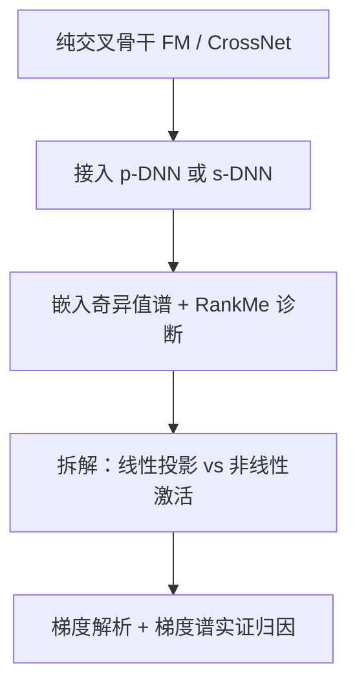

# Understanding DNNs in Feature Interaction Models: A Dimensional Collapse Perspective (从维度坍缩视角理解特征交叉模型中的 DNN)

- **会议/期刊**: SIGIR 2026
- **作者与机构**: Jiancheng Wang, Mingjia Yin, Hao Wang, Enhong Chen（中国科学技术大学 & 认知智能全国重点实验室）
- **推荐链路定位**: 精排（CTR 预估）
- **研究方向**: CTR/CVR 预估与特征交叉
- **论文原文**: [https://arxiv.org/abs/2604.26489v1](https://arxiv.org/abs/2604.26489v1)
- **开源代码**: [https://github.com/USTC-StarTeam/Dimensional-Collapse-Analysis](https://github.com/USTC-StarTeam/Dimensional-Collapse-Analysis)

## TL;DR (1分钟核心速览)

本文跳出"DNN 用于隐式高阶特征交叉"这一长期争议，提出一个全新解释视角：DNN 的真正价值在于**缓解特征嵌入的维度坍缩**。作者在 Avazu/Criteo 两个 CTR 数据集上，对 FM、CrossNet 分别接入并行 DNN（p-DNN）与堆叠 DNN（s-DNN），用奇异值谱与 RankMe 量化表征鲁棒性。结果显示 FM 在 Avazu 上 RankMe 从 89.12 提升至 166.78（+87%），Criteo 上 p-DNN 使 FM 的 RankMe 提升 158%；AUC 同步稳定提升。作者进一步用梯度分析揭示：DNN 通过引入正交梯度分量（p-DNN）或维度级加权（s-DNN），使嵌入更新逃离低秩子空间。

## Background & Motivation (背景与核心矛盾)

- **主流范式**: CTR 模型普遍在显式特征交叉模块（FM 的二阶内积、CrossNet 的高阶交叉）之上并行或堆叠 DNN，业界默认其作用是"隐式捕获高阶特征交叉"。
- **前人局限**: 一方面，已有工作指出 MLP 学习点积（二阶交叉）本身就很困难，遑论高阶；另一方面，DCNv2 发现 ReLU-DNN 甚至不如 CrossNet 这类显式高阶模块。DNN 为何有效始终缺乏统一解释。
- **核心洞察 (Key Insight)**: 表征学习领域的"维度坍缩"现象——嵌入矩阵奇异值快速衰减、信息挤入低秩子空间——同样存在于纯特征交叉模型中。作者发现纯 FM/CrossNet 的奇异值谱衰减极陡，而一旦接入 DNN，谱显著平坦化。
- **本文切入点**: 将 DNN 的作用重新定义为"维度鲁棒性正则器"，并用奇异值谱 + RankMe + 梯度谱三重证据支撑这一新解释。

## Method (核心方法设计)

### 1. 整体框架 (Overall Architecture)

本文是一篇**分析型工作**，不提出新模型，而是构建一套"诊断—分解—归因"的分析框架。诊断层：在测试集上采集嵌入矩阵 $Z\in\mathbb{R}^{B\times D}$，对其协方差矩阵做 SVD 得到奇异值谱，并用 RankMe（归一化奇异值的 Shannon 熵指数）量化坍缩程度。分解层：把 DNN 拆成"线性投影模块"与"非线性激活"两级，逐步注入 FM 观察谱变化。归因层：推导 p-DNN / s-DNN 下嵌入梯度的解析形式，并用训练过程中反向梯度的 RankMe 演化与梯度谱做实证验证。

<figure class="paper-figure" markdown="span">
  <figcaption>图 1：我们从一种新颖的嵌入维度坍缩缓解视角研究 DNN 在特征交互模型中的作用：并行 DNN 与堆叠 DNN 均能改善奇异值谱（纵轴），从而缓解模型 FM 与 CrossNet 在两个 CTR 数据集上的维度坍缩。</figcaption>
</figure>

### 2. 关键设计拆解 (Key Designs)

1. **维度坍缩的量化诊断协议（RankMe + 谱）**：痛点在于 AUC 无法反映表征是否退化。作者采用 RankMe 作为矩阵秩的光滑估计：$RankMe(Z)=\exp\!\big(-\sum_{k=1}^{\min(N,K)}p_k\log p_k\big),\ p_k=\frac{\sigma_k(Z)}{\|\sigma(Z)\|_1}$。谱越平坦、RankMe 越高，表征越鲁棒。该指标把"DNN 是否有用"从预测精度问题转化为可观测的几何问题。

2. **DNN 组件的逐步分解（线性 vs 非线性）**：为定位坍缩缓解的来源，作者先只加线性投影 $\Phi_{\text{Linear p-DNN}}=\Phi_{FM}+w_{out}\cdot W_{in}\cdot\text{concat}\{v_j\}$，再加入非线性$f(\cdot)$ 得到完整 p-DNN。实验显示线性投影主要抬升前 25 个奇异值（扩展有效维度），非线性激活进一步抬升索引 25–200 的中大奇异分量，二者呈"阶梯式"缓解。

3. **基于梯度的机理归因**：纯 FM 的梯度 $\frac{\partial\Phi_{FM}}{\partial v_i}=\sum_{j\neq i}v_j$被严格限制在交互特征张成的子空间内，长期迭代必然把表征拉向低秩。p-DNN 的梯度为$\frac{\partial\Phi_{p\text{-}DNN}}{\partial v_i}=\sum_{j\neq i}v_j+g_{DNN}(v_i;\mathcal{F}_x)$，其中$g_{DNN}=(w_{out}\cdot D\cdot W_{in})\cdot P_i$引入与 FM 梯度正交的非线性分量，使嵌入可在更广空间更新；s-DNN 的梯度$g_{DNN}\cdot\sum_{j\neq i}\text{diag}(v_j)$ 则以维度级权重调制各维更新，阻止各维收敛到同一低秩方向。

## Experimental Setup & Evaluation Protocol (实验设置与评估协议)

- **数据集与预处理**: 采用两个公开 CTR 基准，未额外做 5-core 过滤（沿用 FuxiCTR 标准配置）：

| 数据集 | #Users | #Items | #Interactions | 稀疏度/密度 | 特征/场景说明 |
| :--- | :---: | :---: | :---: | :---: | :--- |
| Avazu | 未报告 | 未报告 | 未报告 | 高基数多域类别特征 | 移动广告点击，嵌入维度 $d=16$ |
| Criteo | 未报告 | 未报告 | 未报告 | 高基数多域类别特征 | 展示广告点击，嵌入维度 $d=10$ |

- **数据划分与防穿越 (Splitting Strategy)**: 沿用 FuxiCTR 基准的默认划分（训练/验证/测试比例切分），谱分析从验证集随机采样 50,000 条样本。
- **排名评测协议 (Ranking Protocol)**: 本文为 CTR 预估任务，采用 **AUC** 作为预测指标，**RankMe** 作为表征鲁棒性指标，不涉及 Full-Ranking / Sampled Ranking 召回评测。
- **对比基线与超参设置**: 基线为纯交叉骨干 FM、CrossNet，及其 DNN 增强变体 DeepFM（FM+p-DNN）、NFM（FM+s-DNN）、并行/堆叠 DCNv2。Avazu 上 p-DNN 为 4 层 2000 隐单元 MLP，s-DNN 为 3 层 400 单元；Criteo 配置类似。

## Key Experimental Results (实验关键数据)

### 1. 主实验对比 (Main Results)

| 模型变体 | Avazu AUC↑ | Avazu RankMe↑ | Criteo AUC↑ | Criteo RankMe↑ |
| :--- | :---: | :---: | :---: | :---: |
| FM (Base) | 0.7848 | 89.12 | 0.8025 | 70.13 |
| FM + p-DNN (DeepFM) | **0.7927** | **166.78** | **0.8137** | **181.56** |
| FM + s-DNN (NFM) | 0.7893 | 160.57 | 0.8050 | 72.93 |
| CrossNet (Base) | 0.7885 | 105.18 | 0.8118 | 161.84 |
| CrossNet + p-DNN | 0.7930 | 163.18 | 0.8134 | 169.41 |
| CrossNet + s-DNN (DCNv2) | **0.7934** | **170.02** | **0.8138** | **186.59** |

### 2. 消融实验 (Ablation Study)

以 FM + p-DNN 在 Avazu 上的组件逐步注入为例（谱层面定性 + RankMe 定量）：

| 变体 | 谱形态变化 | RankMe 趋势 |
| :--- | :--- | :---: |
| FM（纯交叉） | 谱陡降，前 30 维集中绝大部分能量 | 89.12（最低） |
| FM + 线性 DNN | 前 150 个奇异值抬升，前 25 维增益最显著 | 明显上升 |
| FM + 完整 p-DNN（含非线性） | 索引 25–200 的中大奇异分量进一步抬升 | 166.78（最高） |
| FM + s-DNN | 谱整体平坦化但幅度弱于 p-DNN | 160.57 |

### 3. 关键实验发现 (Key Findings)

1. **DNN 的收益主要来自表征几何而非"高阶交叉"**：FM 在 Criteo 上接入 p-DNN 后 RankMe 提升 158%（70.13→181.56），而 AUC 仅从 0.8025 升至 0.8137；表征鲁棒性的跃升幅度远大于精度增益，说明 DNN 更像"防坍缩正则器"。
2. **线性与非线性分工明确**：线性投影负责抬升前 25 个主奇异值（扩展有效秩），非线性激活负责抬升 25–200 的中大分量（平坦化尾部），二者缺一不可，共同构成阶梯式缓解。
3. **梯度谱实证与理论一致**：训练全程 FM 的反向梯度 RankMe 最低且近乎停滞，更新能量集中在前 30 个奇异分量；p-DNN 显著抬升全维梯度奇异值，s-DNN 居中，与解析梯度中"正交分量 / 维度级加权"的预测完全吻合。

## Highlights & Limitations (亮点、对比与审稿批判)

- **与代表作对比 (vs. Prior Work)**: 相较 DeepFM/NFM/DCNv2 等"提出新结构并归因于高阶交叉"的工作，本文不新增模块，而是给出统一的事后解释框架；相较对比学习中的维度坍缩研究（如 SGL/SimGCL 系），本文首次把该视角迁移到纯特征交叉骨干与 DNN 集成方式上，指出 DNN 本身即是一种隐式防坍缩机制。
- **可迁移亮点**: (1) 把 RankMe 作为精排模型嵌入层的常规监控指标，可在训练中早期发现表征退化；(2) "线性投影扩展有效秩 + 非线性平坦化尾部"的分解思路，可直接用于诊断其他 MLP 组件（如多任务塔、序列编码器）的作用。
- **审稿级局限批判**: (1) 实验仅覆盖 Avazu/Criteo 两个数据集与 FM/CrossNet 两个骨干，未验证在 DCNv2 之外的工业级结构（如多任务 MMoE、序列模型）上结论是否成立；(2) 全文以 AUC 与 RankMe 的相关性作为论据，缺少"提升 RankMe 是否因果性带来 AUC 增益"的干预实验（如显式正则化对照），且未报告训练/推理开销与显著性检验。

## Rating (四维评分)

- **方法创新性 (Novelty)**: ⭐⭐⭐⭐ （视角新颖，把维度坍缩引入特征交叉模型分析，但本质是解释性工作而非新模型）
- **评估协议与实验扎实度 (Protocol & Experiments)**: ⭐⭐⭐ （双数据集 + 谱/RankMe/梯度三重证据较完整，但缺显著性检验、数据集统计与更多骨干验证）
- **写作与数学规范度 (Clarity & Rigor)**: ⭐⭐⭐⭐ （梯度推导清晰，p-DNN/s-DNN 梯度形式区分明确，符号统一）
- **工业落地与复现价值 (Industrial & Practical Value)**: ⭐⭐⭐⭐ （代码开源，RankMe 监控成本低、可直接嵌入现有精排训练管线）

