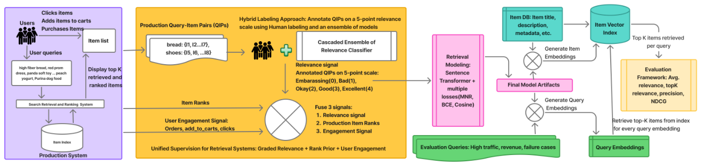
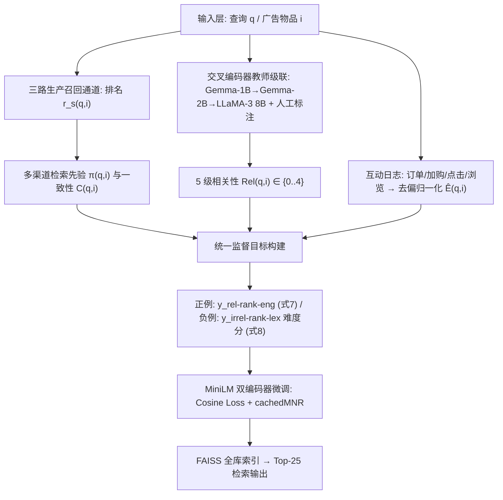
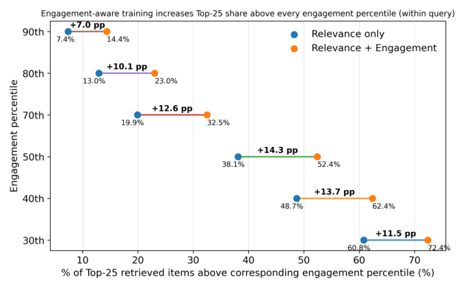
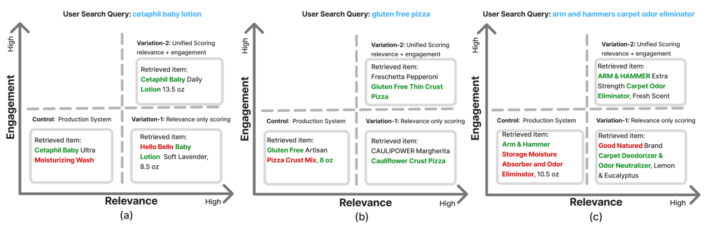

# Unified Supervision for Walmart's Sponsored Search Retrieval via Joint Semantic Relevance and Behavioral Engagement Modeling (沃尔玛赞助搜索检索的统一监督：语义相关性与行为互动的联合建模)

- **会议/期刊**: SIGIR 2026 (Industry Track)
- **推荐链路定位**: 召回 (Retrieval) — 大规模电商赞助搜索第一阶段双编码器检索
- **研究方向**: CTR预估与特征交叉 / 协同过滤与双塔召回
- **论文原文**: [https://arxiv.org/abs/2604.07930v5](https://arxiv.org/abs/2604.07930v5)
- **开源代码**: 暂未开源（原文与预提取均未发现开源代码链接）

## TL;DR (核心速览)

针对沃尔玛赞助搜索中"互动信号既噪声大又结构性稀疏（受广告位拍卖、竞价、预算限制）"的痛点，本文提出统一监督框架：以交叉编码器教师级联产出的 5 级语义相关性为主监督，叠加多渠道检索先验（排名+渠道一致性）与去偏互动信号（仅作用于相关物品内做偏好精修），构建连续 QIP 监督目标微调 MiniLM 双编码器。在 30,303 条查询的 FAISS 全库 Top-25 检索评估中，P@25 相对生产系统 +10.5%、NDCG@25 +5.7%、平均相关性 +7.8%，线上 A/B 广告曝光 +0.60%（p=0.03）、加购率 +0.99%（p=0.009）。

## Background & Motivation (背景与动机)

- **领域背景与主流范式**: 现代电商搜索依赖低延迟双编码器（bi-encoder）做第一阶段召回，工业界普遍直接用点击/下单等互动日志做大规模监督（Que2Engage、Taobao EBR、Etsy Unified Embedding 等），因为互动信号零标注成本、持续可得。
- **现有方法局限 (Limitations of Prior Work)**:
  1. **互动 ≠ 相关性**：物品可能因流行度、促销、吸睛主图、标题或低价获得互动，但语义相关性弱，导致检索器被系统性噪声带偏。
  2. **互动信号结构性稀疏**：在赞助搜索场景，广告是否曝光取决于广告主是否在投、广告位拍卖结果、竞价竞争力与预算，**即使高度相关的 query–ad 对也可能因曝光不足而无稳定互动**；且搜索页广告位数量少于自然结果位，进一步压缩互动覆盖。
  3. **既有"相关性+互动"方案中相关性仅作次级过滤**（如用相关性阈值过滤互动正样本），训练对仍由互动定义，学习目标依旧被互动驱动。
- **核心挑战 (Key Challenge)**: 简单地把相关性分数拼进特征或加深网络无法解决——因为问题在于**监督信号的定义方式**：互动既不能作为正样本定义者（噪声+稀疏），也不能完全丢弃（它承载了促销、物流、卖家评分等下游排序真正关心的偏好信息）。
- **核心洞察与切入点 (Key Insight)**: 作者提出一条简洁原则——**"用相关性定义什么有资格被召回，用互动在相关候选内部精修排序"**。同时把生产系统多渠道的排名位置转化为先验分数，既强化高置信正例，又把"高排名但不相关"的候选识别为难负例，直接针对生产系统的失败模式做难负例挖掘。

## Problem Formulation & Method (问题定义与方法架构)

### 1. 符号定义与输入表征 (Notations & Input Representations)

- 查询–物品对记为 QIP $(q, i)$；查询集 $\mathcal{Q}$，物品（广告）全集 $\mathcal{I}$，候选集 $\mathcal{C}(q)$。
- 检索通道集合 $\mathcal{S}$，$|\mathcal{S}|=3$（本文生产环境三路召回）。
- 相关性等级 $Rel(q,i)\in\{0,1,2,3,4\}$（0=Embarrassing, 1=Bad, 2=Okay, 3=Good, 4=Excellent）。
- 互动计数：订单 $O(q,i)$、加购 $A(q,i)$、点击 $C(q,i)$、浏览 $V(q,i)$。
- 模型：MiniLM 双编码器，查询与物品独立编码为向量，输出余弦相似度打分；原文未报告具体 embedding 维度 $d$ 与最大序列截断长度 $L$（**原文未报告**）。

### 2. 整体流水线 (Overall Architecture)

数据流：三路生产召回通道产出候选与排名 → 交叉编码器教师级联（Gemma-1B → Gemma-2B → LLaMA-3 8B）产出 5 级相关性标签 → 排名先验与渠道一致性分数 → 去偏互动分数 → 融合为统一 QIP 监督目标 → 以 Cosine Similarity Loss + cachedMNR 对比损失微调 MiniLM 双编码器 → FAISS 全库建索引在线 Top-25 检索。

<figure class="paper-figure" markdown="span">
  <figcaption>图1：大规模电商检索统一监督框架概览。该系统整合人工与相关性交叉编码器标注的相关性分数、现有检索渠道的商品排名以及用户互动信号，生成上下文丰富的监督目标以训练双编码器模型。</figcaption>
</figure>

### 3. 核心模块设计与数学原理 (Key Designs & Formulations)

**(1) 分级相关性标签与归一化（主监督信号）**

每个 QIP 由人工标注 + 教师级联（按计算代价从低到高依次 Gemma-1B、Gemma-2B、LLaMA-3 8B）产出 5 级序数评分。级联采用**早退机制**：某阶段置信度超过阶段阈值即接受；未早退则跑完全部阶段取多数票，平票用末阶段预测打破。归一化到 $[0,1]$：

$$rel\_score(q,i) = \frac{Rel(q,i) - 2}{2} \in [-1, 1]$$

物理直觉：以"Okay=2"为零点，使 Good/Excellent 为正、Bad/Embarrassing 为负，天然适配余弦相似度损失的目标区间。

**(2) 多渠道检索先验与渠道一致性（难负例挖掘的关键）**

对每个通道 $s$，记录物品排名 $r_s(q,i)$，用通道特定最大排名 $R_s$ 做对数压缩归一化：

$$\pi_s(q,i) = \max\left(0,\ 1 - \frac{\log(\max(1, r_s(q,i)))}{\log(R_s)}\right) \in [0,1]$$

跨通道聚合取最大：$\pi(q,i) = \max_{s: i \in \mathcal{R}_s(q)} \pi_s(q,i)$。渠道一致性 $C(q,i) = c(q,i)/|\mathcal{S}|$，其中 $c(q,i)$ 为召回该物品的通道数。

物理直觉：对数压缩使排名从 1 到 10 的分数落差远大于从 100 到 1000，符合"头部排名信息量更大"的经验；取 max 而非平均，避免多通道弱召回稀释强通道的高置信信号。**对负例而言，高 $\pi$ 即"生产系统排得高但不相关"的难负例**。

**(3) 去偏互动信号（仅作相关物品内偏好精修）**

加权对数压缩聚合四类行为：

$$E_{raw}(q,i) = \log\left(1 + \lambda_1 O + \lambda_2 A + \lambda_3 C + \lambda_4 V\right)$$

其中 $(\lambda_1,\lambda_2,\lambda_3,\lambda_4)=(1.5, 0.3, 0.1, 0.01)$（交叉验证调优），体现订单 ≫ 加购 ≫ 点击 ≫ 浏览的漏斗价值递减。随后做**查询内 max 归一化**（消除查询间热度量纲差异）并施加中心在 0.5 的 sigmoid 平滑（$k=8$）：

$$\tilde{E}(q,i) = \sigma\left(8 \cdot (E(q,i) - 0.5)\right)$$

**(4) 统一 QIP 打分：正负例非对称设计**

正例（$Rel \in \{3,4\}$）先融合相关性、排名先验与渠道一致性：

$$y_{rel\text{-}rank}(q,i) = \alpha \cdot rel\_score + \beta \cdot \pi(q,i) + \gamma \cdot C(q,i)$$

$(\alpha,\beta,\gamma)=(0.6, 0.3, 0.1)$，再叠加互动增强并裁剪：

$$y_{rel\text{-}rank\text{-}eng}(q,i) = \text{clip}\left(\mu_{rel}\cdot y_{rel\text{-}rank} + \lambda_{eng}\cdot \tilde{E}(q,i),\ 0,\ 1\right)$$

$(\mu_{rel}, \lambda_{eng})=(0.85, 0.15)$。**互动权重仅 0.15，从数值上保证"相关性主导、互动微调"的设计承诺**。

负例（$Rel \le 2$）定义难度分：

$$y_{irrel\text{-}rank\text{-}lex}(q,i) = \kappa_1 \cdot \pi(q,i) + \kappa_2 \cdot token\_sim(q,i)$$

即"生产系统排得高"（排名先验）或"词面重叠高"（token 相似度）的负例更难，用于课程式加权采样。原文未报告 $\kappa_1,\kappa_2$ 的具体取值（**原文未报告**）。

### 4. 训练目标、负采样与推理复杂度 (Optimization, Negative Sampling & Complexity)

- **损失函数**: 采用 Cosine Similarity Loss（以式 7 的统一分数为正例目标、以式 1 归一化相关性为负例目标）+ **Cached Multiple Negatives Ranking (cachedMNR) Loss** 做对比学习。原文未给出损失函数的显式公式与温度系数 $\tau$ 取值（**原文未报告**）。
- **训练负采样策略**: 基于式 8 的负例难度分做**课程式加权采样（curriculum-based weighting sampling）**，即优先采样高排名先验/高词面重叠的难负例；同时 cachedMNR 提供批内负例（in-batch negatives），通过梯度缓存支持大 batch。
- **时间与空间复杂度**: 双编码器支持查询/物品独立编码 + FAISS ANN 检索，在线复杂度与标准 DPR 类双塔一致（原文未报告具体 ms/request 延迟与峰值显存，**原文未报告**）。教师级联（Gemma-1B/2B + LLaMA-3 8B）为离线一次性标注开销，早退机制用于控制该成本；原文未报告具体标注耗时。

## Experimental Setup & Evaluation Protocol (实验设置与评估协议)

- **数据集统计与预处理**: 本文使用沃尔玛内部电商赞助搜索数据，**未公开用户数/物品数/交互数等统计量**（原文未报告）。可获取的规模信息为：离线评测集 **30,303 条查询**，覆盖 (i) 高流量段、(ii) 高营收段、(iii) 长尾查询、(iv) 历史表现不佳查询四类流量区间；物品索引基于**全量物品库存**用 FAISS 构建。

| 数据集 (Dataset) | 用户数 (#Users) | 物品数 (#Items) | 交互数 (#Interactions) | 稀疏度/密度 (Sparsity) | 模态/辅助特征说明 |
| :--- | :---: | :---: | :---: | :---: | :--- |
| Walmart 内部赞助搜索（离线评测集） | 原文未报告 | 全量库存（数量未报告） | 原文未报告 | 原文未报告 | 查询文本、广告物品文本；三路生产召回排名；订单/加购/点击/浏览互动计数；5 级人工+模型相关性标注 |

- **数据划分方式 (Splitting Strategy)**: 原文未明确说明训练/验证/测试的时间或比例划分细节；超参（$\lambda$、$\alpha/\beta/\gamma$、$\mu_{rel}/\lambda_{eng}$）在**验证集**上交叉验证调优，测试集为独立采样的 30,303 条查询。**未采用 LOO 或 8:1:1 等公开基准划分**，属工业内部协议，存在不可复现性风险。
- **排名评测协议 (Ranking Protocol)**: **全库排序（Full-Ranking）**——对全量物品库存建 FAISS 索引，为每条查询检索 Top-25 候选（$K=25$ 对应赞助搜索页固定广告位数）。相关性判定采用**混合标注**：(i) 可得的人工标注 + (ii) 对无人工标签的 pair 使用内部微调的强 DeBERTa 交叉编码器相关性模型标注。**注意：评测标注模型与训练教师级联同源（均为内部相关性模型），存在一定循环论证风险**。
- **评价指标与显著性检验**: 平均相关性 Avg relevance@25、Precision@25、NDCG@25（5 级 graded 标签计算）；线上 A/B 报告各业务指标的 lift 与 **p-value**（部分指标达统计显著）。离线实验未报告多随机种子方差或配对显著性检验（**原文未报告**）。

## Key Experimental Results (核心实验结果)

### 1. 主实验对比 (Main Results)

离线检索评估（$K=25$，30,303 条查询，相对生产系统 Control 计算增益）：

| 数据集 | 指标 | Control (生产系统) | Var-1 (仅相关性) | Var-2 (相关性+互动，Ours) | 相对提升 (vs Control) |
| :--- | :--- | :---: | :---: | :---: | :---: |
| Walmart 离线评测集 | Avg relevance@25 | 3.040 | 3.263 (+7.3%) | **3.277** | **+7.8%** |
| Walmart 离线评测集 | P@25 | 0.794 | 0.873 (+10.0%) | **0.877** | **+10.5%** |
| Walmart 离线评测集 | NDCG@25 | 0.867 | 0.913 (+5.4%) | **0.916** | **+5.7%** |

线上 A/B 测试（业务与广告互动指标）：

| 指标 | Lift | p-value | 显著性 |
| :--- | :---: | :---: | :---: |
| 赞助广告曝光 (Sponsored Ad Impressions) | +0.60% | 0.03 | 显著 |
| 赞助广告浏览 (Sponsored Ad Views) | +0.49% | 0.09 | 边缘 |
| 赞助广告营收 (Sponsored Ad Revenue) | +0.45% | 0.33 | 不显著 |
| 加购率 (Add to Cart Rate) | +0.99% | 0.009 | 显著 |
| GMV | +0.37% | 0.63 | 不显著 |
| 转化率 (Conversion Rate) | +0.13% | 0.64 | 不显著 |
| 每会话总搜索页浏览 | +0.63% | 0.03 | 显著 |
| 每会话总购物车页浏览 | +0.87% | 0.02 | 显著 |

**关键观察**：Var-2 相对 Var-1 的离线增益很小（P@25 +0.4pp、NDCG@25 +0.3pp、Avg rel +0.014），说明互动信号的作用是"在已相关物品内重排"，而非扩大相关性上界——这与设计意图高度自洽，但也意味着**互动模块的独立贡献在离线指标上难以被强有力证明**。

### 2. 消融实验与控制变量分析 (Ablation Study)

原文**未提供标准逐模块消融表**，但通过 Var-1 / Var-2 的对照可读出两点：

- **相关性+排名先验（Var-1）贡献了绝大部分增益**：相对 Control 的 P@25 +10.0%、NDCG@25 +5.4%，说明"以相关性定义正例 + 多渠道先验做难负例挖掘"是主要收益来源。
- **互动信号（Var-2 相对 Var-1）贡献边际但一致**：三项离线指标均小幅正向，且图 3 显示高互动物品占比显著提升（50 分位阈值 +14.3pp，90 分位阈值 +7.0pp），证明互动模块确实在"不损害相关性前提下提升互动覆盖"。
- **未做参数量对齐、图度数匹配等控制变量实验**（本文非图模型，但亦未报告教师级联不同配置的消融）。

<figure class="paper-figure" markdown="span">
  <figcaption>图3：互动监督提高了Top 25检索集中高互动商品的比例，且未降低相关性。对于每个查询，我们将互动量转换为查询内百分位数，并报告Top-25商品中高于各百分位截断值（y轴）的百分比。标签报告以百分点（pp）计的绝对增益。</figcaption>
</figure>

### 3. 稀疏度/冷启动分桶与超参敏感度 (Sparsity Buckets & Hyperparameters)

- **流量分桶**: 评测集显式覆盖高流量、高营收、长尾查询、历史低效查询四类区间，但**原文未按分桶分别报告指标**，无法判断长尾查询上的增益是否更大（**原文未报告**）。
- **关键超参数**: 互动权重 $(\lambda_1,\lambda_2,\lambda_3,\lambda_4)=(1.5,0.3,0.1,0.01)$、$(\alpha,\beta,\gamma)=(0.6,0.3,0.1)$、$(\mu_{rel},\lambda_{eng})=(0.85,0.15)$、sigmoid 陡度 $k=8$ 均由交叉验证确定，但**未报告敏感度曲线**（**原文未报告**）。
- **定性结果**: 图 2 显示统一监督（Var-2）能为每个查询检索到"相关且热门（互动量前 1%）"的商品，而仅相关性监督（Var-1）会检索到"相关但不热门（互动量后 10%）"的商品——直观印证互动模块的偏好精修作用。

<figure class="paper-figure" markdown="span">
  <figcaption>图2：定性结果：绿色文本突出与用户意图一致的短语，红色文本显示失败案例。与生产系统（Control）相比，统一监督（Variation-2）为每个查询检索到相关且热门（互动量前1%）的商品，而仅相关性评分（Variation-1）检索到相关但不热门（互动量后10%）的商品。</figcaption>
</figure>

- **线上 A/B 测试结果**: 已在表 2 列出。显著指标集中在**曝光类与站内行为类**（曝光 +0.60%、加购率 +0.99%、搜索页/购物车页浏览 +0.63%/+0.87%），而**营收、GMV、转化率均不显著**（p=0.33/0.63/0.64），说明检索层改进主要作用于漏斗上游，尚未传导至成交端。

## Highlights, Limitations & Critiques (亮点、局限与审稿级批判)

- **核心亮点与可迁移性**:
  1. **"相关性定义资格、互动精修排序"的非对称监督范式**极具普适性，可直接迁移到任何互动稀疏/曝光有偏的召回场景（冷启动推荐、长尾内容检索、广告召回）。
  2. **多渠道排名先验的对数压缩 + max 聚合**是一个轻量、无需额外训练的难负例挖掘算子，任何拥有多路召回的工业系统都可零成本复用。
  3. **正负例非对称打分设计**（正例融合相关性+先验+互动，负例用先验+词面重叠定义难度）在工程上简洁且解释性强。
  4. 完整的离线 + 线上 A/B 闭环验证，工业落地价值明确。

- **局限性与审稿视角批判 (Critical Limitations)**:
  1. **评估协议存在循环论证风险**：离线评测的相关性标签部分由内部 DeBERTa 交叉编码器生成，而训练监督来自同源的 Gemma/LLaMA 教师级联——"用相关性模型评相关性模型蒸馏出的检索器"可能系统性高估相关性增益。缺少纯人工标注子集上的独立验证。
  2. **互动模块的独立贡献证据偏弱**：Var-2 相对 Var-1 的离线增益（P@25 +0.4pp、NDCG@25 +0.3pp）未报告显著性检验，且线上营收/GMV/转化率均不显著，难以支撑"互动监督带来实质业务收益"的强结论。
  3. **可复现性不足**：无公开数据集、无开源代码、无数据统计量、无 embedding 维度/序列长度/损失函数公式/温度系数等关键实现细节，工业 track 可接受但学术复现价值受限。
  4. **超参敏感度与分桶分析缺失**：四组超参均称"交叉验证最优"但无敏感度曲线；长尾/头部查询的分桶增益未拆分报告，无法验证方法在稀疏场景的真实鲁棒性。
  5. **教师级联成本未量化**：Gemma-1B/2B + LLaMA-3 8B 三级级联的离线标注开销、早退命中率均未报告，削弱了"工业可落地"论证的完整性。
  6. **A/B 实验细节缺失**：未报告实验周期、流量占比、样本量，p-value 的可信度难以独立评估。

## Rating (四维评分)

- **方法创新性 (Novelty)**: ⭐⭐⭐（监督信号融合思路清晰但组件均为已知技术，创新在于"相关性主导+互动精修"的非对称组合范式）
- **评估协议与实验扎实度 (Protocol & Experiments)**: ⭐⭐⭐（有完整离线+线上闭环，但标注同源循环风险、缺显著性检验与分桶分析）
- **写作与数学规范度 (Clarity & Rigor)**: ⭐⭐⭐⭐（公式推导清晰、超参取值完整，但缺损失函数显式形式与关键实现细节）
- **工业落地与复现价值 (Industrial & Practical Value)**: ⭐⭐⭐⭐（线上 A/B 验证充分、算子可迁移性强，但无开源代码与公开数据，复现门槛高）
