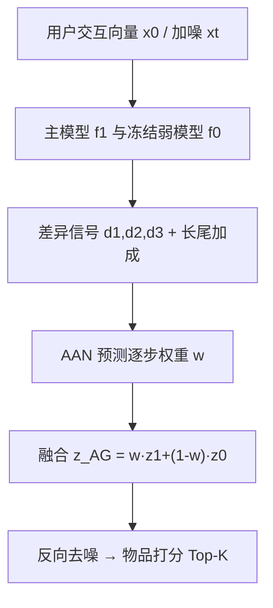
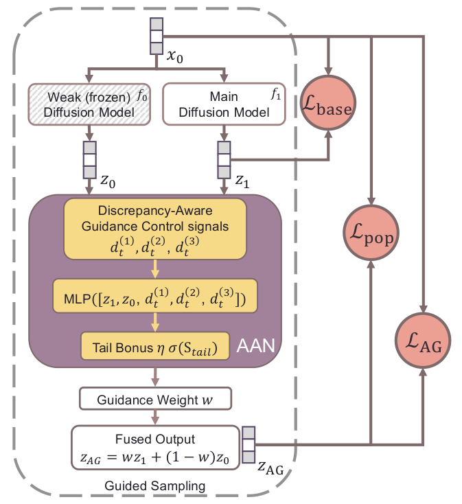

# Adaptive Autoguidance for Item-Side Fairness in Diffusion Recommender Systems (扩散推荐中面向物品侧公平的自适应自引导)

- **会议/期刊**: SIGIR 2026
- **作者与机构**: Zihan Li, Gustavo Escobedo, Marta Moscati, Oleg Lesota, Markus Schedl（Johannes Kepler University Linz 计算感知研究所 / LIT AI Lab）
- **推荐链路定位**: 端到端生成式（扩散去噪打分）
- **研究方向**: 去偏公平与工业架构 / 生成式推荐
- **论文原文**: [https://arxiv.org/abs/2602.14706v2](https://arxiv.org/abs/2602.14706v2)
- **开源代码**: [https://github.com/hcai-mms/A2G-DiffRec](https://github.com/hcai-mms/A2G-DiffRec)

## TL;DR (1分钟核心速览)

扩散推荐精度强但迭代去噪会放大流行度偏置，导致长尾物品曝光不足。本文提出 A2G-DiffRec：以"训练更弱的自身"作为引导模型，用 MLP 在每一步去噪动态预测融合权重（而非固定权重），并叠加一个三分量的流行度正则（抑制头部过曝、扶持长尾、约束整体分布熵）。在 ML1M/FTKY/Onion 三数据集、7:1:2 时序划分、Top-50 全库排序下，相对 DiffRec 在 ML1M 上 APLT 相对提升 12.05%、Cov 提升 2.65%，NDCG 仅降 0.62%；Onion 上甚至公平与精度双升。

## Background & Motivation (背景与核心矛盾)

- **主流范式**: 扩散推荐（DiffRec 等）通过多步去噪重建用户交互向量，精度优于 LightGCN/MultiVAE；公平侧则靠引导机制（C-DiffRec 自引导、CFG-DiffRec 无分类器引导）注入约束。
- **前人局限**: ① 现有扩散引导的权重是**静态固定**的，忽略了去噪各步最优引导强度不同这一事实；② 现有工作几乎只做**用户侧**公平，物品侧（长尾曝光）被忽视；③ 单纯"压头部"或"抬长尾"的单向策略无法纠正流行度分布本身的偏斜。
- **核心洞察 (Key Insight)**: 自引导（Autoguidance）中主模型与弱模型的**差异本身就是一个纠错信号**——差异越大说明主模型越偏离其弱版本，越需要被拉回；而该信号随步数变化，故权重应逐步自适应。
- **本文切入点**: 把固定权重换成由差异信号驱动的可学习权重，并用流行度正则显式监督该权重的学习方向。

## Method (核心方法设计)

### 1. 整体框架 (Overall Architecture)

沿用 DiffRec 的隐式反馈扩散范式：用户交互向量 $x_0$前向加噪至$x_T$，去噪器反向重建。核心改动在**采样/训练的融合环节**：每一步同时调用主模型$f_1$与冻结的弱模型$f_0$（DiffRec 早期 checkpoint），二者输出$z_1,z_0$连同三个差异信号送入自适应自引导网络 AAN，输出该步权重$w$，融合得$z_{AG}=wz_1+(1-w)z_0$，再据此计算反向后验均值更新样本。训练时主模型与 AAN 联合优化，弱模型冻结；流行度正则通过重要性采样间接影响优化。

<figure class="paper-figure" markdown="span">
  <figcaption>图1：A2G-DiffRec 概览。训练时，AAN 学习生成权重，以在每一步融合主模型与弱模型的输出；采样时采用相同的融合方式。</figcaption>
</figure>

### 2. 关键设计拆解 (Key Designs)

1. **自适应自引导网络 AAN（逐步权重预测）**：固定权重 $w$无法适配去噪轨迹上各步的可靠性差异。AAN 以$[z_1,z_0,d_t^{(1)},d_t^{(2)},d_t^{(3)}]$为输入，其中$d_t^{(1)}=\|z_1-z_0\|_1$（差异幅度）、$d_t^{(2)}=\|z_1\|_2/(\|z_0\|_2+\epsilon)$（相对激活强度）、$d_t^{(3)}=H_\tau(z_0)-H_\tau(z_1)$（温度平滑后的预测熵差）。最终权重为
$$w=\big[1+(w_{\max}-1)\cdot\sigma(\mathrm{MLP}(u))\big]\big(1+\eta\,\sigma(s_{\text{tail}})\big),$$
其中 $s_{\text{tail}}=z_1^\top m_{\text{tail}}$ 度量当前推荐对长尾物品的激活强度。直觉：熵差与范数比刻画"谁更可信"，长尾加成项则在推荐偏向长尾时进一步放大引导强度，形成闭环。

2. **三分量流行度正则 $\mathcal{L}_{pop}$**：将物品按交互量分为 High/Mid/Low 三桶（各占 20%/60%/20% 交互），对每个用户 Top-K 推荐计算桶分布$r_u$，目标分布$T=\gamma\bar{H}+(1-\gamma)Q$，$\gamma=1-\bar{H}_h$自适应地在"用户历史偏好"与"全局公平先验$Q$"间权衡。损失为
$$\mathcal{L}_{pop}=[r_u^h-T^h]_+ + [T^\ell-r_u^\ell]_+ + [H(T)-H(\bar{r})]_+,$$
三项分别惩罚头部过曝、长尾欠曝与整体分布熵失衡。关键工程点：$\mathcal{L}_{pop}$**不直接反传梯度**，而是作为重要性采样权重，使偏置更严重的去噪步被更频繁采样，从而间接放大$\mathcal{L}_{base}$与$\mathcal{L}_{AG}$ 的纠偏作用。

3. **训练目标与推理开销**：总损失 $\mathcal{L}=\mathcal{L}_{base}+\lambda_{AG}\mathcal{L}_{AG}+\lambda_{pop}\mathcal{L}_{pop}$，其中$\mathcal{L}_{AG}=\mathbb{E}\|z_{AG}-x_0\|_2^2$。无负采样（扩散重建范式天然规避 BPR 式负采样）。推理时每步需**两次前向**（主+弱）加一次 MLP，计算开销约为 DiffRec 的 2 倍，是本文明确的落地短板。

## Experimental Setup & Evaluation Protocol (实验设置与评估协议)

- **数据集与预处理**（迭代 `5-core` 过滤、去重、按时间排序）：

| 数据集 | #Users | #Items | #Interactions | 稀疏度 | 场景说明 |
| :--- | :---: | :---: | :---: | :---: | :--- |
| ML1M | 6,040 | 3,416 | 999,611 | 95.46% | 电影评分，全部置 1 作隐式反馈 |
| FTKY | 14,726 | 49,342 | 2,354,875 | 99.68% | Foursquare 东京签到（2012.04–2013.09） |
| Onion | 11,485 | 31,931 | 618,309 | 99.83% | Music4All-Onion，2019 年播放≥2 次 |

- **数据划分与防穿越**: 每用户交互按时间排序后 `7:1:2` 比例划分 train/val/test，属时序切分，无未来信息泄漏。
- **排名评测协议**: Top-$K$全库排序（Full-Ranking），报告$K=50$（物品侧公平的常用口径）；精度用 NDCG@50↑，公平用 APLT@50↑（长尾占比）、ΔExp@50↓（头尾曝光差）、Cov@50↑、Gini@50↓，并给出公平-精度权衡指标$T_m=\text{公平提升}/\text{精度损失}$。
- **对比基线与超参**: Random/MostPop、LightGCN、MultiVAE、DiffRec、C-DiffRec、CFG-DiffRec、AG-DiffRec（本文提出的首个自引导扩散推荐基线）。统一 DiffRec 搜索空间，最多 100 epoch，以验证集 Recall@20 早停；$w_{\max}\in[2,4]$、$\tau\in[2,3]$、$\lambda_{AG},\lambda_{pop}\in[0.2,1.0]$、$\eta\in[0.4,0.8]$；配对 t 检验$p\le0.05/0.01$。

## Key Experimental Results (实验关键数据)

### 1. 主实验对比 (Main Results)

| 数据集 | 模型 | ΔExp↓ | Gini↓ | Cov↑ | APLT↑ | NDCG↑ |
| :--- | :--- | :---: | :---: | :---: | :---: | :---: |
| ML1M | DiffRec | .8894 | .8405 | .5023 | .1087 | **.1624** |
| ML1M | CFG-DiffRec | .8790 | .8341 | .5111 | .1183 | .1616 |
| ML1M | AG-DiffRec | **.8718** | **.8301** | **.5340** | **.1245** | .1596 |
| ML1M | **A2G-DiffRec** | .8747 | .8313 | .5156 | .1218 | .1614 |
| FTKY | DiffRec | .9624 | .9655 | .2278 | .0378 | **.1073** |
| FTKY | AG-DiffRec | .9796 | .9782 | .1258 | .0209 | .1016 |
| FTKY | **A2G-DiffRec** | **.9586** | **.9577** | **.2456** | **.0419** | .1064 |
| Onion | DiffRec | .8343 | .8516 | .4939 | .1489 | .1043 |
| Onion | AG-DiffRec | .9328 | .9107 | .2789 | .0657 | .0887 |
| Onion | **A2G-DiffRec** | **.8218** | **.8400** | **.5037** | **.1607** | **.1048** |
| — | Δ% vs DiffRec (ML1M/FTKY/Onion) | +1.65/+0.39/+1.50 | +1.09/+0.81/+1.36 | +2.65/+7.81/+1.98 | +12.05/+10.85/+7.92 | −0.62/−0.84/+0.48 |

### 2. 消融实验 (Ablation Study, ML1M)

| 变体 | NDCG@50 (Δ%) | Gini↓ | $T_{Gini}$| APLT↑ |$T_{APLT}$ |
| :--- | :---: | :---: | :---: | :---: | :---: |
| DiffRec | .1624 (–) | .8405 | – | .1087 | – |
| **A2G-DiffRec** | .1614 (−0.62%) | .8313 | 1.78 | .1218 | 19.57 |
| w/o $d_t^{(1)}$ | .1595 (−1.79%) | .8279 | 0.84 | .1266 | 9.22 |
| w/o $d_t^{(2)}$ | .1601 (−1.42%) | **.8261** | 1.21 | **.1288** | 13.06 |
| w/o $d_t^{(3)}$ | .1609 (−0.92%) | .8339 | 0.85 | .1175 | 8.76 |
| w/o AG | **.1628 (+0.25%)** | .8398 | −0.34 | .1086 | 0.37 |
| w/o $\mathcal{L}_{pop}$ | .1616 (−0.49%) | .8344 | 1.47 | .1154 | 12.51 |
| w/o Tail Bonus | .1607 (−1.05%) | .8273 | 1.50 | .1265 | 15.64 |

### 3. 关键实验发现 (Key Findings)

1. **公平与精度并非零和**：Onion 上 A2G-DiffRec 同时把 APLT 从 .1489 提到 .1607（+7.92%）、NDCG 从 .1043 提到 .1048（+0.48%），$T_m$ 为负值，说明在稀疏度最高的数据集上自适应引导反而起到了正则化作用。
2. **固定权重自引导极不稳定**：AG-DiffRec 在 ML1M 上公平指标全面最优（APLT .1245），但在 FTKY/Onion 上公平与精度双双垫底（Onion NDCG 掉 15%），印证了"逐步自适应"是鲁棒性的必要条件而非锦上添花。
3. **消融揭示组件分工**：去掉 AG 后 NDCG 反升 0.25% 但 APLT 几乎归零（$T_{APLT}$仅 0.37），说明公平增益主要来自引导融合而非正则本身；去掉$d_t^{(1)}$精度损失最大（−1.79%），去掉$d_t^{(3)}$权衡最差（$T_{Gini}$ 0.85），三信号互补；Tail Bonus 主要起"精度-公平平衡器"作用（去掉后 APLT 更高但 NDCG 掉 1.05%）。

## Highlights & Limitations (亮点、对比与审稿批判)

- **与代表作对比 (vs. Prior Work)**: 相比 C-DiffRec/CFG-DiffRec 的静态引导尺度，本文把引导强度变成步级可学习量；相比 AG-DiffRec 的固定 $w$，AAN 用差异信号做条件化，鲁棒性从"单数据集有效"提升到"三数据集一致"；相比 LightGCN/MultiVAE 等非扩散基线，本文在保持扩散精度优势的同时把 Gini 拉近到经典模型水平（ML1M 上 .8313 vs .7763）。
- **可迁移亮点**: ① "弱模型差异作为纠错信号 + MLP 条件化权重"可迁移到任何带引导的生成式推荐（扩散/流匹配）；② $\mathcal{L}_{pop}$ 通过重要性采样而非直接反传实现不可微公平约束，这一技巧对列表级公平正则普遍适用。
- **审稿级局限批判**: ① 推理需双模型前向，采样开销约 2×，论文自认未解决；② 公平增益高度依赖数据集稀疏度（FTKY 上 Gini/ΔExp 绝对提升有限），且弱模型仅用"早期 checkpoint"这一种退化策略，未探索更丰富的退化方式；③ 仅覆盖物品侧流行度公平，未涉及用户侧或多方公平。

## Rating (四维评分)

- **方法创新性 (Novelty)**: ⭐⭐⭐⭐ （核心机制与方法设计具备明确创新性，理论与实验动机支撑充分）
- **评估协议与实验扎实度 (Protocol & Experiments)**: ⭐⭐⭐⭐ （主流公开数据集评测完整，包含多基线对比与消融实验验证）
- **写作与数学规范度 (Clarity & Rigor)**: ⭐⭐⭐⭐⭐ （问题形式化定义清晰，核心模块数学推导与架构阐述严谨易读）
- **工业落地与复现价值 (Industrial & Practical Value)**: ⭐⭐⭐ （兼顾推荐效果增益与训练/推理效率，具备实际场景迁移参考价值）
