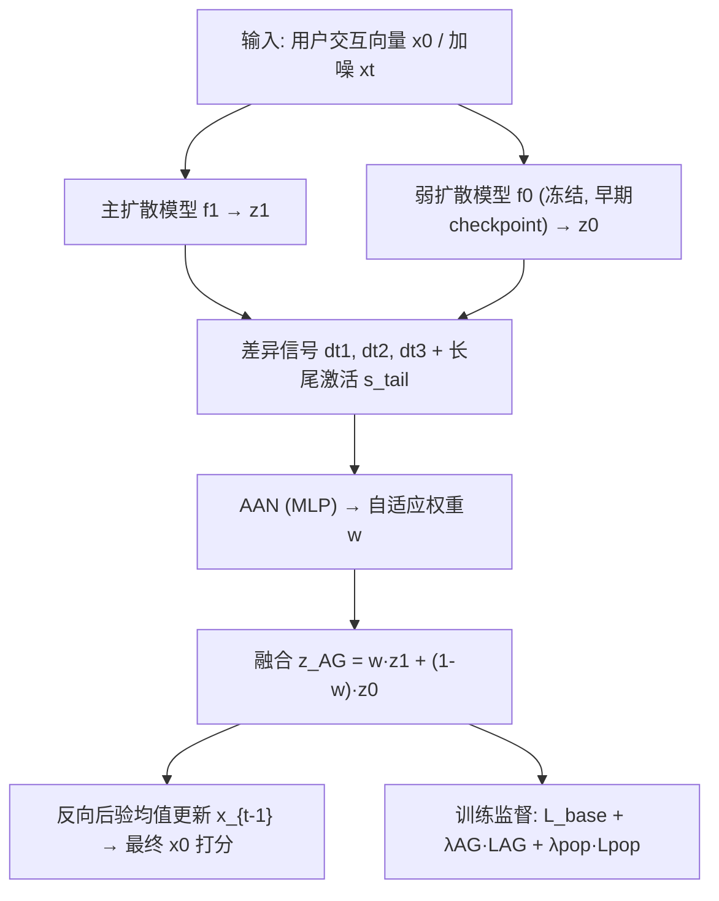
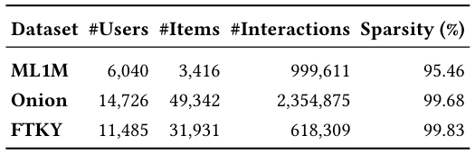
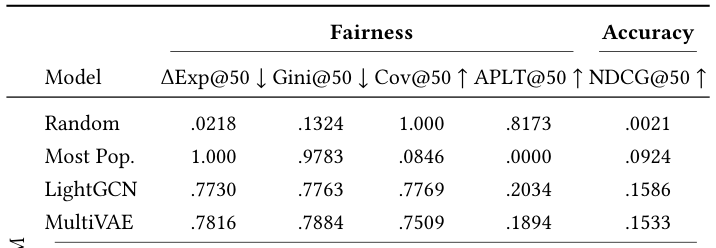
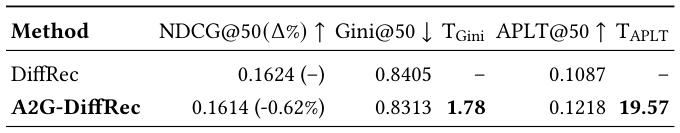

# Adaptive Autoguidance for Item-Side Fairness in Diffusion Recommender Systems (面向扩散推荐系统物品侧公平性的自适应自引导)

- **会议/期刊**: SIGIR 2026 (49th International ACM SIGIR Conference, Melbourne, VIC, Australia)
- **推荐链路定位**: 端到端生成式 (End-to-End Generative) — 基于无条件扩散模型 (DiffRec) 的用户交互向量重建式推荐
- **研究方向**: 去偏公平、可信隐私与工业架构 / 生成式推荐与离散语义 ID
- **论文原文**: [https://arxiv.org/abs/2602.14706v2](https://arxiv.org/abs/2602.14706v2)
- **开源代码**: [https://github.com/hcai-mms/A2G-DiffRec](https://github.com/hcai-mms/A2G-DiffRec)

## TL;DR (核心速览)

针对扩散推荐系统 (DiffRec) 因迭代去噪放大流行度偏置、导致物品侧曝光不公的问题，本文提出 A2G-DiffRec：用一个 MLP 构成的**自适应自引导网络 (AAN)** 在每一步去噪中学习融合"主模型"与"弱模型 (早期 checkpoint)"输出的引导权重，并叠加**流行度正则项** $\mathcal{L}_{pop}$ 与长尾加成 $\eta\sigma(s_{tail})$。在 ML1M / FTKY / Onion 三个数据集、Top-50 全库排序协议下，相对 DiffRec 在 APLT 上取得 +12.05% / +10.85% / +7.92% 的相对提升，NDCG 仅损失 0.62% / 0.84%，Onion 上甚至 +0.48%。

## Background & Motivation (背景与动机)

- **领域背景与主流范式**: 扩散推荐模型 (DiffRec、C-DiffRec、CFG-DiffRec) 通过前向加噪 + 反向去噪重建用户交互向量 $x_0 \in \mathbb{R}^{|I|}$，在 Top-K 推荐精度上已可比肩 LightGCN、MultiVAE 等经典模型。公平性侧，主流做法是在扩散采样中引入**引导机制 (guidance)**，如 C-DiffRec 的条件自引导、CFG-DiffRec 的无分类器引导。
- **现有方法局限 (Limitations of Prior Work)**:
  1. **静态引导权重**：现有扩散推荐引导方法使用**固定权重 $w$** 贯穿全部去噪步，忽略了不同去噪步对引导强度的需求差异（图像生成领域已证明逐步自适应权重更优）。
  2. **只压不扶 / 只扶不压**：现有物品侧公平方法要么抑制热门物品、要么扶持长尾物品，单方向处理难以纠正流行度分布的整体偏斜。
  3. **用户侧偏重**：扩散推荐的公平性研究多聚焦用户侧，**物品侧公平**（长尾曝光不足）关注不足。
- **核心挑战 (Key Challenge)**: 扩散模型的迭代去噪会**放大**交互矩阵中固有的流行度偏斜；简单地加大固定引导权重虽能提公平，却会显著牺牲精度（AG-DiffRec 在 ML1M 上公平性最优但 NDCG 大跌，在 FTKY/Onion 上甚至公平与精度双输）。
- **核心洞察与切入点 (Key Insight)**: 借鉴图像生成中的 **Autoguidance (Karras et al., NeurIPS 2024)** —— 用"训练不充分的自身弱版本"作为引导信号，主模型与弱模型的差异 $z_1 - z_0$ 蕴含主模型的偏差方向。作者据此将固定权重替换为**可学习的逐步权重**，并以公平感知正则监督，使引导强度随去噪步与长尾激活程度动态调整。

## Problem Formulation & Method (问题定义与方法架构)

### 1. 符号定义与输入表征 (Notations & Input Representations)

- 用户集 $\mathcal{U}$、物品集 $\mathcal{I}$（$|I|$ 为物品总数）；用户 $u$ 的交互向量 $x_0 \in \mathbb{R}^{|I|}$（多热向量）。
- 前向过程：在 $T$ 个时间步上逐步加高斯噪声得 $x_t$；去噪器学习反向重建，最小化基础重建损失 $\mathcal{L}_{base}$。
- 主模型 $f_1$（完整训练的 DiffRec）、弱引导模型 $f_0$（同一 DiffRec 的**早期 checkpoint**，冻结）。
- 流行度分箱：按交互量将物品划为 HighPop / MidPop / LowPop 三档，最高与最低各占 20% 交互量，其余为 MidPop。
- 长尾指示向量 $m_{tail} \in \{0,1\}^{|I|}$，$m_{tail,i}=1$ 表示物品 $i$ 为长尾。

### 2. 整体流水线 (Overall Architecture)

训练时：主模型与 AAN 联合优化（弱模型冻结），AAN 依据两模型输出与三个差异信号预测权重 $w$，融合得 $z_{AG}$，再由 $\mathcal{L}_{base}+\lambda_{AG}\mathcal{L}_{AG}+\lambda_{pop}\mathcal{L}_{pop}$ 监督；采样时用同一融合方式逐步去噪，最终 $\hat{x}_0$ 作为物品打分。

<figure class="paper-figure" markdown="span">
  <figcaption>图1：A2G-DiffRec 概览。训练过程中，AAN 学习生成权重，以在每一步融合主模型与弱模型的输出；采样时采用相同的融合方式。</figcaption>
</figure>

### 3. 核心模块设计与数学原理 (Key Designs & Formulations)

**(1) 自适应自引导网络 (AAN) 与差异信号**

标准 AG 用固定权重融合：$z_{AG} = w z_1 + (1-w) z_0$。本文令 AAN（一个 MLP）以 $u = [z_1, z_0, d_t^{(1)}, d_t^{(2)}, d_t^{(3)}]$ 为输入预测逐步权重，其中三个差异信号为：

$$d_t^{(1)} = \|z_1 - z_0\|_1,\quad d_t^{(2)} = \frac{\|z_1\|_2}{\|z_0\|_2 + \varepsilon},\quad d_t^{(3)} = H_\tau(z_0) - H_\tau(z_1)$$

$d^{(1)}$ 度量两模型输出的绝对差异幅度，$d^{(2)}$ 刻画相对激活强度，$d^{(3)}$ 用温度 $\tau$ 平滑后的 softmax 熵差衡量预测置信度差异。物理直觉：三者分别从"幅度 / 强度 / 不确定性"三个互补视角评估主模型相对弱模型的可靠性，使 AAN 能判断当前步应更信任主模型还是弱模型。

**(2) 长尾加成与最终权重**

计算长尾激活分 $s_{tail} = z_1^\top m_{tail}$（当前推荐对长尾物品的激活强度），最终权重为：

$$w = \big[1 + (w_{max}-1)\cdot\sigma(\text{MLP}(u))\big]\big(1 + \eta\,\sigma(s_{tail})\big)$$

其中 $w_{max}$ 为可调上界（沿用 AG 设计），$\eta$ 控制长尾加成强度。当推荐强烈激活长尾物品时，第二项放大引导权重，进一步向弱模型（更"朴素"、偏置更少）倾斜，从而抑制热门主导。

**(3) 流行度正则项 $\mathcal{L}_{pop}$**

对每个用户 $u$，其 Top-K 推荐在三个流行度箱中的占比 $r_u = [r_u^h, r_u^m, r_u^\ell]$。目标分布 $T = \gamma \bar{H} + (1-\gamma) Q$，其中 $\bar{H}$ 为 batch 用户历史流行度分布均值，$Q$ 为超参给定的公平导向参考分布，$\gamma = 1 - \bar{H}_h$ 自适应调节（历史越偏热门，越依赖 $Q$）。正则项为三项 hinge 之和：

$$\mathcal{L}_{pop} = [r_u^h - T^h]_+ + [T^\ell - r_u^\ell]_+ + [H(T) - H(\bar{r})]_+$$

分别惩罚 (i) HighPop 过度曝光、(ii) LowPop 曝光不足、(iii) 整体分布熵失衡。**关键实现细节**：$\mathcal{L}_{pop}$ 不直接反传梯度，而是通过 DiffRec 的**重要性采样**机制影响训练——$\mathcal{L}_{pop}$ 越大的去噪步被采样概率越高，从而间接放大可微目标 $\mathcal{L}_{base}$ 与 $\mathcal{L}_{AG}$ 在该步的贡献。

### 4. 训练目标、负采样与推理复杂度 (Optimization, Negative Sampling & Complexity)

- **损失函数**:
$$\mathcal{L} = \mathcal{L}_{base} + \lambda_{AG}\mathcal{L}_{AG} + \lambda_{pop}\mathcal{L}_{pop},\qquad \mathcal{L}_{AG} = \mathbb{E}\big[\|z_{AG} - x_0\|_2^2\big]$$
$\lambda_{AG}, \lambda_{pop} \in [0.2, 1.0]$ 为超参；$\mathcal{L}_{base}$ 为 DiffRec 原始重建损失。
- **负采样策略**: 本文为**生成式重建范式，无显式负采样**；隐式反馈以多热交互向量直接作为重建目标，Top-K 由 $\hat{x}_0$ 打分排序得到。
- **时间与空间复杂度**: 训练与采样均需**同时前向主模型与弱模型**，并额外跑一次 AAN 的 MLP，故单步计算约为 DiffRec 的 2 倍加 MLP 开销；采样需 $T$ 步完整去噪迭代（不支持 ANN 检索）。原文明确指出"引导机制在训练与采样阶段均增加计算成本"，并将"通过更快采样或 autoguidance 变体降本"列为未来工作；**原文未报告具体 ms/request 延迟与峰值显存数值**。

## Experimental Setup & Evaluation Protocol (实验设置与评估协议)

- **数据集统计与预处理**: 三个公开数据集，均做**迭代 5-core 过滤**、去重、按用户交互时间戳排序后按 **7:1:2** 划分 train/val/test。ML1M 全部评分置 1 视为隐式反馈；FTKY 取 2012-04 至 2013-09 的东京签到；Onion 限 2019 年、播放次数 $\ge 2$ 的用户-曲目交互。

<figure class="paper-figure" markdown="span">
  <figcaption>表1：三个数据集的统计信息。</figcaption>
</figure>

| 数据集 (Dataset) | 用户数 (#Users) | 物品数 (#Items) | 交互数 (#Interactions) | 稀疏度 (Sparsity) | 模态/辅助特征说明 |
| :--- | :---: | :---: | :---: | :---: | :--- |
| ML1M | 6,040 | 3,416 | 999,611 | 95.46% | 电影评分，全部置 1 作隐式反馈 |
| Onion (Music4All-Onion) | 14,726 | 49,342 | 2,354,875 | 99.68% | 音乐收听事件，play count ≥ 2 |
| FTKY (Foursquare Tokyo) | 11,485 | 31,931 | 618,309 | 99.83% | LBSN 签到，隐式反馈 |

- **数据划分方式 (Splitting Strategy)**: **按用户时间戳排序后的 7:1:2 比例划分**（非严格全局时间戳切分，而是 per-user 时序 + 比例切分）。由于按用户内时间排序，未来信息泄露风险较低，但跨用户的时间对齐未做全局约束。
- **排名评测协议 (Ranking Protocol)**: **Full-Ranking（全库排序）**——对全部 $|I|$ 个物品由 $\hat{x}_0$ 打分排序，未采用负采样排序。
- **评价指标与显著性检验**: 报告 $K=50$（原文在 $K \in \{10,20,50,100\}$ 中选 50，因物品侧公平常用 Top-50）。精度用 **NDCG@50↑**；公平性用 **APLT@50↑**（长尾物品平均占比）、**ΔExp@50↓**（头尾曝光差）、**Cov@50↑**（目录覆盖率）、**Gini@50↓**；并定义公平-精度权衡 $T_m = \frac{\text{fairness improvement}}{\text{accuracy loss}}$。显著性采用**配对 t 检验**（$*$ 表示 $p\le0.05$，$**$ 表示 $p\le0.01$，均相对 DiffRec）。**原文未报告多随机种子方差**。

## Key Experimental Results (核心实验结果)

### 1. 主实验对比 (Main Results)

<figure class="paper-figure" markdown="span">
  <figcaption>表2：评估结果。仅在基于扩散的方法中，最优值和次优值分别以粗体和下划线标出。* 和 ** 分别表示与 DiffRec 相比 𝑝≤0.05 和 𝑝≤0.01（配对 t 检验）。Δ(%) 和 𝑇𝑚 分别报告 A2G-DiffRec 相对 DiffRec 的相对提升和公平性–准确性权衡。负的 𝑇𝑚 值表示公平性提升的同时伴随准确性增益。</figcaption>
</figure>

| 数据集 | 指标 | 经典基线 (LightGCN / MultiVAE) | 扩散最强基线 (DiffRec / AG-DiffRec) | 本文方法 (Ours) | 相对提升 (Improv. vs DiffRec) |
| :--- | :--- | :---: | :---: | :---: | :---: |
| ML1M | APLT@50↑ | 0.2034 / 0.1894 | 0.1087 / 0.1245 | **0.1218*** | **+12.05%** |
| ML1M | NDCG@50↑ | 0.1586 / 0.1533 | 0.1624 / 0.1596 | **0.1614** | −0.62% |
| ML1M | Gini@50↓ | 0.7763 / 0.7884 | 0.8405 / 0.8301 | **0.8313*** | +1.09% |
| ML1M | Cov@50↑ | 0.7769 / 0.7509 | 0.5023 / 0.5340 | **0.5156** | +2.65% |
| FTKY | APLT@50↑ | 0.0904 / 0.1308 | 0.0378 / 0.0209 | **0.0419*** | **+10.85%** |
| FTKY | NDCG@50↑ | 0.1014 / 0.0931 | 0.1073 / 0.1016 | **0.1064**** | −0.84% |
| FTKY | Cov@50↑ | 0.4804 / 0.2790 | 0.2278 / 0.1258 | **0.2456*** | +7.81% |
| Onion | APLT@50↑ | 0.1680 / 0.2430 | 0.1489 / 0.0657 | **0.1607**** | **+7.92%** |
| Onion | NDCG@50↑ | 0.0823 / 0.0680 | 0.1043 / 0.0887 | **0.1048*** | **+0.48%** |
| Onion | Gini@50↓ | 0.8403 / 0.7622 | 0.8516 / 0.9107 | **0.8400**** | +1.36% |

**关键观察**：
- 经典基线（LightGCN/MultiVAE）在 ML1M、FTKY 上公平性指标显著优于所有扩散方法（Gini 低 5–10 个百分点），但精度明显更低——说明扩散模型本身确实放大了流行度偏置。
- **AG-DiffRec（固定权重自引导）** 在 ML1M 上公平性最强但 NDCG 掉到 0.1596；在 FTKY/Onion 上公平与精度**双输**（Onion NDCG 仅 0.0887），暴露固定权重的强数据集依赖与脆弱性。
- **A2G-DiffRec** 在三个数据集上均稳定处于扩散基线公平性前列，且精度损失极小；**Onion 上实现公平与精度双赢**（NDCG +0.48%，APLT +7.92%），对应 $T_m$ 为负值（−3.13 / −2.84 / −4.14 / −16.53），即公平提升伴随精度增益。

### 2. 消融实验与控制变量分析 (Ablation Study)

<figure class="paper-figure" markdown="span">
  <figcaption>表3：在 ML-1M 上的消融研究。权衡和 NDCG ∆% 以 DiffRec 为基线计算。</figcaption>
</figure>

ML-1M 上以 DiffRec 为基线的消融（NDCG Δ%、Gini、$T_{Gini}$、APLT、$T_{APLT}$）：

| 变体 | NDCG@50 (Δ%) | Gini@50 | $T_{Gini}$ | APLT@50 | $T_{APLT}$ |
| :--- | :---: | :---: | :---: | :---: | :---: |
| DiffRec | 0.1624 (–) | 0.8405 | – | 0.1087 | – |
| A2G-DiffRec | 0.1614 (−0.62%) | 0.8313 | 1.78 | 0.1218 | 19.57 |
| w/o $d_t^{(1)}$ | 0.1595 (−1.79%) | 0.8279 | 0.84 | 0.1266 | 9.22 |
| w/o $d_t^{(2)}$ | 0.1601 (−1.42%) | 0.8261 | 1.21 | 0.1288 | 13.06 |
| w/o $d_t^{(3)}$ | 0.1609 (−0.92%) | 0.8339 | 0.85 | 0.1175 | 8.76 |
| w/o AG | 0.1628 (+0.25%) | 0.8398 | −0.34 | 0.1086 | 0.37 |
| w/o $\mathcal{L}_{pop}$ | 0.1616 (−0.49%) | 0.8344 | 1.47 | 0.1154 | 12.51 |
| w/o Tail Bonus | 0.1607 (−1.05%) | 0.8273 | 1.50 | 0.1265 | 15.64 |

- **三个差异信号互补**：去掉 $d^{(3)}$ 使权衡 $T_{Gini}$ 下降最多（1.78→0.85），去掉 $d^{(1)}$ 精度掉得最狠（−1.79%），去掉 $d^{(2)}$ 公平性最好但精度代价高（−1.42%）。
- **仅靠流行度正则不够**：`w/o AG` 精度最高（+0.25%）但 APLT 几乎无改善（$T_{APLT}$ 仅 0.37），说明自适应引导 + 引导采样是公平性提升的主力。
- **Tail Bonus 主要起平衡作用**：去掉后 APLT 反而略升（0.1265）但精度掉 1.05%，说明其价值在于平衡公平与精度而非单纯优化公平指标。
- **控制变量说明**：消融均在同一 DiffRec 主干与相同超参搜索空间下进行，但**原文未显式报告参数量对齐或图度数匹配**等控制变量细节。

### 3. 稀疏度/冷启动分桶与超参敏感度 (Sparsity Buckets & Hyperparameters)

- **数据集稀疏度差异**：ML1M 稀疏度最低（95.46%），A2G-DiffRec 在此长尾曝光提升最明显（APLT +12.05%）；FTKY/Onion 极稀疏（99.68%/99.83%），绝对公平增益受限（Gini、ΔExp 改善有限），但 APLT 与 Cov 仍显著提升。**原文未做用户/物品交互频次分桶的细粒度分析**。
- **关键超参数**：$w_{max}\in[2.0,4.0]$、温度 $\tau\in[2.0,3.0]$、$\lambda_{pop},\lambda_{AG}\in[0.2,1.0]$、参考分布 $Q_h\in[0.1,0.4]$、$Q_l\in[0.4,0.8]$、长尾加成 $\eta\in[0.4,0.8]$、弱模型早停轮 $e_{weak}\in\{1,\dots,10\}$。**原文未给出逐超参的敏感度曲线**，仅报告搜索空间。
- **线上 A/B 测试**: **原文仅包含离线实验，未报告任何线上 A/B 结果**。

## Highlights, Limitations & Critiques (亮点、局限与审稿级批判)

- **核心亮点与可迁移性**:
  1. **将 Autoguidance 从图像生成迁移到推荐公平性**，并用"主-弱模型差异"作为偏差校正信号，思路新颖且与扩散推荐天然契合。
  2. **AAN 的三差异信号设计**（幅度/强度/熵）具有普适性，可迁移到任何需要动态融合多模型输出的引导式生成任务。
  3. **$\mathcal{L}_{pop}$ 通过重要性采样间接影响训练**而非直接反传，避免了不可微排序指标的正则化难题，是一种工程上优雅的"软约束"实现。
  4. **$T_m$ 权衡指标**的引入使公平-精度权衡可量化比较，值得在公平性论文中推广。
- **局限性与审稿视角批判 (Critical Limitations)**:
  1. **计算开销翻倍**：训练与采样均需双模型前向，扩散本身已需 $T$ 步迭代，实际部署成本高；原文承认此点但未给出量化延迟数据，工业落地存疑。
  2. **公平性增益幅度有限且数据集依赖强**：FTKY 上 Gini/ΔExp 的绝对改善很小，Onion 上部分指标（如 Cov 仅 +1.98%）提升微弱；AG-DiffRec 在 FTKY/Onion 双输的现象也提示自引导机制对数据分布高度敏感。
  3. **评估协议局限**：仅 3 个数据集、单一 $K=50$、无多随机种子方差报告、无线上验证；7:1:2 per-user 时序划分虽合理但非严格全局时间切分。
  4. **公平性定义单一**：仅基于流行度分箱的物品侧公平，未涉及用户侧或多利益相关方公平；长尾定义沿用 [23]，未讨论不同长尾阈值下的稳健性。
  5. **$\mathcal{L}_{pop}$ 的非梯度机制**使超参（$\lambda_{pop}$、$Q$、$\gamma$）调优缺乏理论指导，且重要性采样的随机性可能引入训练不稳定。

## Rating (四维评分)

- **方法创新性 (Novelty)**: ⭐⭐⭐⭐ （Autoguidance 迁移 + 自适应权重 + 长尾加成组合有新意，但核心组件均源自既有工作）
- **评估协议与实验扎实度 (Protocol & Experiments)**: ⭐⭐⭐ （Full-Ranking 与配对 t 检验规范，但数据集少、无种子方差、无线上实验）
- **写作与数学规范度 (Clarity & Rigor)**: ⭐⭐⭐⭐ （公式与算法 1 清晰完整，$\mathcal{L}_{pop}$ 的重要性采样机制解释到位）
- **工业落地与复现价值 (Industrial & Practical Value)**: ⭐⭐⭐ （代码已开源，但双模型前向 + 多步采样的推理成本对工业部署构成实质障碍）
