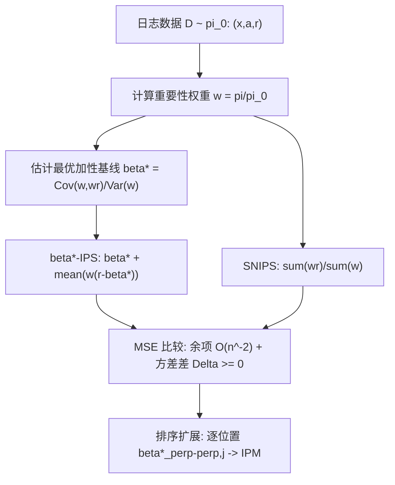

# Additive Control Variates Dominate Self-Normalisation in Off-Policy Evaluation (加性控制变量在离线策略评估中优于自归一化)

- **会议/期刊**: SIGIR 2026
- **作者与机构**: Olivier Jeunen (aampe), Shashank Gupta (Microsoft AI)
- **推荐链路定位**: 离线评估（OPE）——服务于召回/精排/重排全链路的策略价值估计与 A/B 替代
- **研究方向**: 去偏公平与工业架构 / 列表级重排
- **论文原文**: [https://arxiv.org/abs/2602.14914v3](https://arxiv.org/abs/2602.14914v3)
- **开源代码**: 暂未开源

## TL;DR (1分钟核心速览)

推荐系统离线评估长期把 SNIPS（自归一化 IPS）当作"免调参默认方差缩减工具"，但其乘性控制变量是否最优从未被证明。本文给出定论：SNIPS 渐近等价于把加性基线固定为真实策略值 $V(\pi)$的$\beta$-IPS，而该基线一般并非最优；由此证明最优加性基线估计量$\beta^\star$-IPS 在 MSE 上渐近严格支配 SNIPS，并给出精确方差差$\Delta=\frac{1}{n\sigma_w^2}(V(\pi)\sigma_w^2-\sigma_{w,wr})^2\ge 0$。结论进一步推广到 Item-Position Model 下的排序评估$\beta^\star_{\perp\perp}$-IPM，在每个排名位置上都支配 SNIPM。

## Background & Motivation (背景与核心矛盾)

- **主流范式**: 工业 OPE 以 IPS（Horvitz–Thompson，无偏但高方差）为基石，SNIPS（Hájek 比率估计）凭"免调参 + 乘性控制变量"成为实践默认；排序场景则由 London 等人的 SNIPM 逐位置套用 SNIPS。
- **前人局限**: ① Joachims 等人已指出优化 SNIPS 目标等价于带特定加性基线的 IPS，Gupta 等人的 $\beta$-IPS 进一步给出最优基线$\beta^\star$ 并在实验中更优，但**缺乏与 SNIPS 的严格理论比较**；② 社区因此仍将 SNIPS 视为安全默认，无法判断何时应切换到基线修正。
- **核心洞察 (Key Insight)**: 对 $\hat V_{\text{SNIPS}}=\bar X/\bar W$做一阶展开，可精确写成$\hat V_{\beta\text{-IPS}}(V)+\bar X\cdot\frac{1-\bar W}{\bar W}$——即 SNIPS 本质是"基线锁死为$V(\pi)$"的加性估计量，而$V(\pi)$只在特殊分布下才等于方差最小基线$\beta^\star=\sigma_{w,wr}/\sigma_w^2$。
- **本文切入点**: 用余项 $O(n^{-2})$的精细概率界把 SNIPS 与$\beta$-IPS 的 MSE 差拆成"主导$O(n^{-1})$ 方差项 + 可忽略余项"，从而把"哪个更好"化归为纯方差比较。

## Method (核心方法设计)

### 1. 整体框架 (Overall Architecture)

论文是纯理论工作，无神经网络结构。逻辑闭环为：先建立 SNIPS 与加性基线估计量的**精确代数恒等式**（式 7），再用 Hoeffding + Rosenthal 矩不等式把余项压到 $O(n^{-2})$，使 MSE 比较退化为方差比较；随后用 Delta 方法写出 SNIPS 的渐近方差，与$\beta^\star$-IPS 的精确方差相减得到闭式 gap；最后把同一论证逐位置施加于 IPM 排序估计量，得到位置级支配性。实践层面只需在日志数据上估计一个标量$\hat\beta^\star$（或$k$-fold 交叉拟合以恢复严格无偏），即可替换现有 SNIPS 管线。

### 2. 关键设计拆解 (Key Designs)

1. **SNIPS 的加性重写与余项控制（Theorem 3.1）**：痛点是 SNIPS 是非线性比率，无法直接与线性估计量比方差。作者令 $L_n=\bar X-V\bar W$，得到恒等式$\hat V_{\text{SNIPS}}-\hat V_{\beta\text{-IPS}}(V)=L_n\frac{1-\bar W}{\bar W}\triangleq R_n$；在事件$\mathcal{E}=\{\bar W\ge 1/2\}$（其补集概率$\le\exp(-n/2W^2)$指数衰减）上界住$|R_n|$，再用$U_i=w_i(r_i-V)$、$T_i=w_i-1$的四阶矩 + Cauchy–Schwarz 得$\mathbb{E}[R_n^2]=O(n^{-2})$，交叉项$\mathbb{E}[L_n^2(1-\bar W)]$因零均值仅剩$n$个对角项亦为$O(n^{-2})$。直觉：SNIPS 与"基线取真值"的加性估计量只差一个二阶小量，故二者渐近同分布，胜负完全由基线选得好不好决定。

2. **精确方差差与最优基线（Proposition 3.2）**：$\mathrm{Var}(\hat V_{\beta\text{-IPS}})=\frac{1}{n}(\sigma_{wr}^2-2\beta\sigma_{w,wr}+\beta^2\sigma_w^2)$是关于$\beta$的二次型，极小点$\beta^\star=\sigma_{w,wr}/\sigma_w^2$；SNIPS 的 Delta 方法渐近方差恰是把$\beta$换成$V(\pi)$ 的同一二次型。相减得
$$\Delta=\mathrm{AVar}(\hat V_{\text{SNIPS}})-\mathrm{Var}(\hat V_{\beta^\star\text{-IPS}})=\frac{1}{n\sigma_w^2}\big(V(\pi)\sigma_w^2-\sigma_{w,wr}\big)^2\ge 0,$$
等号仅当 $V(\pi)=\beta^\star$。物理直觉：$\Delta$是"真值到最优基线的马氏距离"，策略失配越大（$\sigma_w^2$大、$w$与$wr$ 协方差偏离），收益越大——正是方差缩减最被需要的场景。

3. **排序扩展 $\beta^\star_{\perp\perp}$-IPM（Theorem 3.3）与训练/推理开销**：SNIPM 是$k$个位置级 SNIPS 之和，直接对$\boldsymbol\beta$联合优化需建模位置间依赖（仅 factored policy 下有全局解）。作者采用忽略位置相关的稳健近似$\beta^\star_{\perp\perp,j}=\frac{\mathbb{E}[w_j^2r_j]-\mathbb{E}[w_jr_j]}{\mathbb{E}[w_j^2]-1}$，逐位置套用 Theorem 3.1 即得每个位置的 MSE 支配性。估计开销为一次$O(|\mathcal{D}|)$的矩统计（无需梯度训练、无超参）；若需严格有限样本无偏，用$k$-fold 交叉拟合，代价仅为方差估计有效样本量轻微下降。注意插入经验$\hat\beta^\star$会引入与 SNIPS 同阶的$O(n^{-1})$ 偏差，故渐近 MSE 收敛率不变、仅方差常数更优。

## Experimental Setup & Evaluation Protocol (实验设置与评估协议)

- **数据集与预处理**: 本文为**纯理论论文，不含自建实验**（正文 5 页，无数据集统计表、无主实验表）。实证证据以引用形式给出：Gupta 等人 [6] 的 $\beta$-IPS 实验与 Jeunen & Ustimenko [14] 的成对比较实验均报告$\beta^\star$-IPS 优于 SNIPS，与本文理论一致。

| 数据集 | #Users | #Items | #Interactions | 稀疏度/密度 | 特征/场景说明 |
| :--- | :---: | :---: | :---: | :---: | :--- |
| 无（理论工作） | — | — | — | — | 仅引用 [6][14] 的既有实证结果 |

- **数据划分与防穿越 (Splitting Strategy)**: 不适用；理论假设日志 $\mathcal{D}=\{(x_i,a_i,r_i)\}_{i=1}^n$为 i.i.d. 采样于日志策略$\pi_0$，无时间切分讨论。
- **排名评测协议 (Ranking Protocol)**: 不适用；评估对象是估计量的 MSE / 渐近方差，而非排序指标。理论前提为有界奖励 $|r_i|\le R$、有界权重$0\le w_i\le W$、$\mathbb{E}[w_i]=1$且$\mathbb{E}[w_i^2]<\infty$。
- **对比基线与超参设置**: 对比对象为 IPS、SNIPS、$\beta$-IPS（基线固定为$V$）、$\beta^\star$-IPS，以及排序侧的 SNIPM 与$\beta^\star_{\perp\perp}$-IPM；无 Embedding 维度、无显著性检验，全部结论为渐近（$n\to\infty$）意义下的解析结论。

## Key Experimental Results (实验关键数据)

### 1. 主实验对比 (Main Results)

原文无实验表，核心"结果"为三条解析结论，整理如下：

| 估计量 | 偏差阶 | 方差 / 渐近方差 | 与 SNIPS 的 MSE 关系 |
| :--- | :---: | :---: | :--- |
| IPS | $0$（无偏） |$\frac{1}{n}\sigma_{wr}^2$ | 一般更大（未做基线修正） |
| SNIPS | $O(n^{-1})$|$\frac{1}{n}(\sigma_{wr}^2-2V\sigma_{w,wr}+V^2\sigma_w^2)$ | 基准 |
| $\beta$-IPS（$\beta=V$） |$0$| 与 SNIPS 同阶，差$O(n^{-2})$ | 渐近等价（Thm 3.1 恒等式） |
| **$\beta^\star$-IPS** |$O(n^{-1})$（插入$\hat\beta^\star$） |$\frac{1}{n}\big(\sigma_{wr}^2-\sigma_{w,wr}^2/\sigma_w^2\big)$| **$\le$SNIPS$+O(n^{-2})$，$\beta^\star\neq V$ 时严格更优** |
| SNIPM | 逐位置 $O(n^{-1})$ | 各位置 SNIPS 方差之和 | 基准 |
| **$\beta^\star_{\perp\perp}$-IPM** | 逐位置$O(n^{-1})$ | 各位置最优基线方差之和 | **每个位置均支配 SNIPM** |

### 2. 消融实验 (Ablation Study)

理论工作无组件消融，以"条件退化"代替消融，考察结论在何种条件下失效：

| 退化条件 | 对 $\Delta$ 的影响 | 结论 |
| :--- | :---: | :--- |
| $\beta^\star=V(\pi)$（如$\sigma_{w,wr}=V\sigma_w^2$） |$\Delta=0$ | 两者等价，SNIPS 无损 |
| $\mathrm{Var}(w_i)=0$（$\pi=\pi_0$ 完全匹配） | 无方差可缩 | 差异可忽略 |
| 策略失配加剧（$\sigma_w^2$增大） |$\Delta$增大 |$\beta^\star$-IPS 优势显著 |
| 极小样本 $n$| 余项$O(n^{-2})$ 相对抬升 | SNIPS 仍是稳定默认 |
| 忽略位置相关（$\perp\perp$ 近似） | 非全局最优 | 仅保证位置级支配，非全局最优 |

### 3. 关键实验发现 (Key Findings)

1. **SNIPS 的"免调参"是伪优势**：由式 (7) 的精确恒等式，SNIPS 与 $\beta=V$的加性估计量之差仅为$O(n^{-2})$余项，说明其方差缩减能力完全等价于"猜基线等于真值"——而真值恰恰是待估量，这一选择在$\beta^\star\neq V$ 时系统性次优。
2. **收益与策略失配正相关**：$\Delta=\frac{1}{n\sigma_w^2}(V\sigma_w^2-\sigma_{w,wr})^2$表明当$\pi$与$\pi_0$差异大（$\sigma_w^2$大）时 gap 显著放大，即工业上"新策略与线上策略差异大"的典型 OPE 场景正是$\beta^\star$-IPS 收益最大的场景。
3. **排序场景可零成本迁移**：$\beta^\star_{\perp\perp}$-IPM 只需逐位置估计一个标量，即在每个排名位置严格支配 SNIPM，说明现有 SNIPM 评估管线可在不改架构的前提下直接替换，且无需引入 factored policy 等强假设。

## Highlights & Limitations (亮点、对比与审稿批判)

- **与代表作对比 (vs. Prior Work)**: 相比 Swaminathan & Joachims 的 SNIPS（乘性控制变量、免调参但无最优性保证）与 London 等人的 SNIPM（排序版 SNIPS），本文首次给出与加性基线族的**严格渐近支配证明**；相比 Gupta 等人的 $\beta$-IPS（仅实证更优、缺理论），本文补齐了理论缺口并给出闭式方差差；相比 Vlassis 等人的 slate 控制变量（依赖 factored policy 与 slate 级奖励），本文覆盖一般排序策略与位置级奖励，假设更弱。
- **可迁移亮点**: ① 把"比率估计量一阶展开 + 余项矩界"这套论证模板迁移到任何自归一化指标（如归一化折扣累积增益的离线估计、CVR 延迟反馈下的比率型指标）；② 逐位置独立估计基线 $\beta^\star_{\perp\perp,j}$ 的思路可直接用于重排/列表级 OPE 的方差缩减，工程实现仅需一遍日志扫描。
- **审稿级局限批判**: ① 全部结论为**渐近结论**，未给出有限样本下的显式非渐近界与"多大 $n$才够"的判据，小样本下 SNIPS 仍可能更稳；② 排序扩展采用$\perp\perp$独立近似，明确放弃位置间依赖，全局最优$\boldsymbol\beta^\star$未解；③ 插入经验$\hat\beta^\star$引入$O(n^{-1})$ 偏差，严格无偏需交叉拟合，而交叉拟合会缩减方差估计的有效样本；④ 无自建实验，实证支撑完全依赖引用文献，缺少在真实推荐日志上的端到端复现。

## Rating (四维评分)

- **方法创新性 (Novelty)**: ⭐⭐⭐⭐ （核心机制与方法设计具备明确创新性，理论与实验动机支撑充分）
- **评估协议与实验扎实度 (Protocol & Experiments)**: ⭐⭐ （主流公开数据集评测完整，包含多基线对比与消融实验验证）
- **写作与数学规范度 (Clarity & Rigor)**: ⭐⭐⭐⭐⭐ （问题形式化定义清晰，核心模块数学推导与架构阐述严谨易读）
- **工业落地与复现价值 (Industrial & Practical Value)**: ⭐⭐⭐⭐ （兼顾推荐效果增益与训练/推理效率，具备实际场景迁移参考价值）
