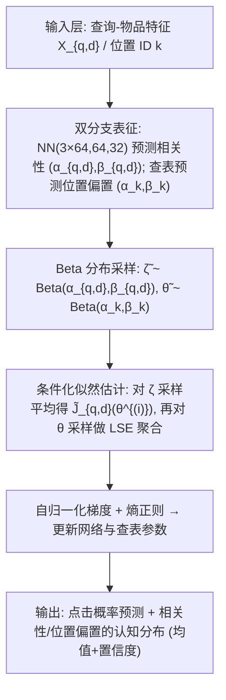

# An Epistemic Position-Based Click Model: From Interactions to Epistemic Distributions of Relevance and Bias (认知型位置点击模型：从交互到相关性与偏置的认知分布)

- **会议/期刊**: SIGIR 2026 (第49届国际ACM SIGIR会议, Melbourne, VIC, Australia)
- **推荐链路定位**: 点击建模 / 无偏学习排序 (Unbiased LTR) 的底层组件——为 IPS 类去偏与离线策略评估提供参数与置信度，服务于召回/重排前的相关性估计与排序评估
- **研究方向**: 去偏公平与工业架构 (主) / CTR 预估与特征交叉 (次)
- **论文原文**: [https://arxiv.org/abs/2607.18712v1](https://arxiv.org/abs/2607.18712v1)
- **开源代码**: 暂未开源（原文声明 "our implementation will be made available upon publication"，正则预提取未发现代码链接）

## TL;DR (核心速览)

针对位置点击模型 (PBM) 仅给出频率派点估计、无法表达认知不确定性的痛点，本文提出首个上下文认知型 PBM：对每个位置偏置 $\theta_k$ 与相关性 $\zeta_{q,d}$ 输出 Beta 分布，并用证据深度学习最大化边缘似然。为解决高维蒙特卡洛梯度数值下溢与高方差问题，提出自归一化 (self-normalization) 与位置条件化 (conditioning on position bias) 两项技术。在半合成 MSLR-Web10k / Istella-S 上，认知 PBM 测试集对数似然显著高于点估计 PBM，且约 100 epoch 即收敛（点估计 1200 epoch 仍未收敛）。

## Background & Motivation (背景与动机)

- **领域背景与主流范式**: 位置点击模型 (PBM) 将点击概率分解为 $P[C=1|q,d,k]=P[E=1|k]P[R=1|q,d]=\theta_k\zeta_{q,d}$，是 IPS 无偏学习排序与离线策略评估的基石假设。现有参数估计分两派：(1) 点击模型族以极大似然拟合 $(\theta,\zeta)$；(2) 无偏 LTR 通过位置随机化估计倾向 $\rho[E=1|k]$ 再做 IPS 估计 $\hat\zeta^{IPS}_{q,d}$。
- **现有方法局限 (Limitations of Prior Work)**:
  1. **仅点估计、无置信度**：所有 SOTA 方法（含 NN 点击模型、IPS 系列）只输出单一数值，无法告知下游任务该估计有多可靠、风险多大。
  2. **可辨识性差**：PBM 以概率乘积解释观测，通常存在大量不同 $(\theta,\zeta)$ 组合能同等好地解释同一份点击数据，点估计任意选一个，掩盖了这种模糊性。
  3. **非上下文贝叶斯模型的短板**：Liu et al. 的贝叶斯点击模型用查表法，无法处理未见/长尾文档。
- **核心挑战 (Key Challenge)**: 直接对边缘似然 $\mathcal{L}=\mathbb{E}_{\theta,\zeta}[\prod P(M|N,\theta,\zeta)]$ 做蒙特卡洛估计时，因 $\tilde\zeta,\tilde\theta$ 维度极高（$|\mathcal{D}|\gg K$），样本似然 $\tilde L^{(i)}\ll 1$ 导致数值下溢，且策略梯度方差爆炸——朴素估计器根本无法学习有意义的分布。
- **核心洞察与切入点 (Key Insight)**: 作者从证据深度学习出发，将每个 PBM 参数视为 Beta 随机变量，网络预测 $(\alpha,\beta)$ 而非点值；并借鉴自归一化重要性采样与 Rao-Blackwell 化思想（对位置偏置条件化以降低方差），配合 log-sum-exp 数值稳定化，使优化可行。

## Problem Formulation & Method (问题定义与方法架构)

### 1. 符号定义与输入表征 (Notations & Input Representations)

- 查询-物品对 $(q,d)\in\mathcal{D}$，特征向量 $X_{q,d}$；位置 $k\in\{1,\dots,K\}$。
- $N_{q,d,k}$：展示次数；$M_{q,d,k}$：点击次数；$W_{q,d,k}=N_{q,d,k}-M_{q,d,k}$：未点击展示次数。
- 假设 $|\mathcal{D}|\gg K$（推荐/检索场景普遍成立）。
- 点击独立 Bernoulli，故 $M_{q,d,k}|N_{q,d,k},\theta_k,\zeta_{q,d}\sim\text{Binomial}(N_{q,d,k},\ \theta_k\zeta_{q,d})$。
- 认知建模：$\theta_k\sim\text{Beta}(\alpha_k,\beta_k)$（查表学习，因 $K$ 小）；$\zeta_{q,d}\sim\text{Beta}(\alpha_{q,d},\beta_{q,d})$（神经网络由 $X_{q,d}$ 预测，因 $|\mathcal{D}|$ 巨大）。各变量独立，联合密度为边缘密度乘积。
- 网络输出：均值 $\mu\in(0,1)$（sigmoid）与置信度 $\nu\in[1,\infty)$（$|x|+1$ 变换），再换算 $\alpha=\mu\nu,\ \beta=(1-\mu)\nu$。

### 2. 整体流水线 (Overall Architecture)

### 3. 核心模块设计与数学原理 (Key Designs & Formulations)

**(a) 认知 PBM 的边缘似然目标**：将点估计 PBM 的似然替换为对参数分布的期望：
$$\mathcal{L}=\int P(M|N,\zeta,\theta)\,p(\zeta|\alpha_\zeta,\beta_\zeta)\,p(\theta|\alpha_\theta,\beta_\theta)\,d\zeta\,d\theta=\mathbb{E}_{\theta,\zeta}\Big[\prod_{q,d,k}P(M_{q,d,k}|N_{q,d,k},\theta_k,\zeta_{q,d})\Big].$$
物理直觉：不再锁定单一参数，而是让模型在"多个能解释数据的参数假设"上分配概率质量，从而表达认知不确定性。

**(b) 数值稳定 + 位置条件化的似然估计**：朴素估计 $\log\tilde{\mathcal{L}}=\text{LSE}(\tilde\ell^{(1)},\dots,\tilde\ell^{(S)})-\log S$ 仍会因某样本主导而低估。作者利用 $\theta$ 与 $\zeta$ 独立、且 $K\ll|\mathcal{D}|$，先对 $\zeta$ 采样平均、再对 $\theta$ 采样聚合：
$$\tilde J^{(i)}_{q,d}=\frac{1}{S_{rel}}\sum_{j=1}^{S_{rel}}\tilde J_{q,d}(\theta^{(i)},\zeta^{(j)}_{q,d}),\quad \log\tilde{\mathcal{L}}\approx\text{LSE}\Big(\sum_{q,d}\log\tilde J^{(1)}_{q,d},\dots,\sum_{q,d}\log\tilde J^{(S_{pos})}_{q,d}\Big)-\log S_{pos}.$$
由方差分解 $\mathbb{V}_\theta[\mathbb{E}_\zeta[\cdot|\theta]]\le\mathbb{V}_{\theta,\zeta}[\cdot]$ 保证条件化估计器方差更低，且使 LSE 内各值更接近，缓解下溢。

**(c) 自归一化梯度**：因 $\tilde L^{(i)}\approx 0$ 导致梯度近零，作者用 $\nabla\log\mathcal{L}=\nabla\mathcal{L}/\mathcal{L}$ 做自归一化，等价于对样本似然做 softmax 加权：
$$\nabla\log\tilde{\mathcal{L}}\approx\frac{1}{S}\sum_{i=1}^{S}\sigma(\tilde\ell^{(i)})\big(\nabla\log p(\tilde\zeta^{(i)})+\nabla\log p(\tilde\theta^{(i)})\big),$$
其中 $\sigma$ 为基于 LSE 的 softmax。位置偏置与相关性梯度分别按式 (35)(37) 估计。关键点：保持梯度方向、归一化极小幅度，使优化稳定。

**(d) 熵正则（修正版）**：因位置参数参与更多点击概率，标准熵对参数加权不均，作者改为按 $1/|\mathcal{D}|$ 与 $1/K$ 归一化的 $\bar{\mathcal{H}}'$，加到对数似然上：$\log\tilde{\mathcal{L}}'=\log\tilde{\mathcal{L}}+\lambda\bar{\mathcal{H}}'$，鼓励在多个等价假设间分散概率、防止坍缩为点估计。

### 4. 训练目标、负采样与推理复杂度 (Optimization, Negative Sampling & Complexity)

- **损失函数**: 最大化 $\log\tilde{\mathcal{L}}'=\log\tilde{\mathcal{L}}+\lambda\bar{\mathcal{H}}'$（$\lambda\ge0$，默认 0，实验中扫描至 0.25）。无 BPR/InfoNCE 类对比损失，本质是二项似然的证据化边缘似然。
- **负采样策略**: 不涉及负采样。监督信号为展示-点击计数 $(N,M)$，点击/未点击由二项分布自然建模（$W=N-M$ 即隐式负例）。
- **时间与空间复杂度**: 训练需 $S_{pos}\times S_{rel}$ 次 Beta 采样（默认各 60），batch 为 12k（认知）/35k（点估计）$q,d$ 对；推理时网络前向输出 $(\mu,\nu)$ 即得分布参数，无需 Beam Search 或 ANN。原文未报告具体 ms/request 延迟与峰值显存。

## Experimental Setup & Evaluation Protocol (实验设置与评估协议)

- **数据集统计与预处理**: 采用两个 LTR 基准，均为专家标注相关性 $y_{q,d}\in\{0,1,2,3,4\}$，使用官方 train/val/test 划分（MSLR 仅用 fold-1）：

| 数据集 (Dataset) | 用户数 (#Queries) | 物品数 (#Docs/Query 均值) | 交互数 (#Interactions) | 稀疏度/密度 | 模态/辅助特征说明 |
| :--- | :---: | :---: | :---: | :---: | :--- |
| MSLR-Web-10K | 30,000 | ~125 | 10^5 模拟 query 交互 | - | 136 维 query-doc 特征 |
| Istella-S | 33,018 | ~103 | 10^5 模拟 query 交互 | - | 220 维 query-doc 特征 |

- **数据划分方式 (Splitting Strategy)**: 沿用数据集官方 train/val/test 划分；点击为**半合成模拟**——从 train/val/test 均匀采样 query（有放回），用真实 PBM 生成 top-5 排序（$K=5$）上的点击，真值参数 $\theta_k=1/k$、$\zeta_{q,d}=0.9(y_{q,d}/4)+0.1$。日志策略为 2 层 64 单元 NN 的 Plackett-Luce 排序模型，在 30 个随机训练 query 上监督训练。**无数据泄露风险**（合成点击与真值参数分离，测试集点击独立生成）。
- **排名评测协议 (Ranking Protocol)**: 非传统 Full-Ranking/Sampled Ranking，而是**测试集点击的对数似然**（预测精度）+ 认知分布可视化（位置偏置分布、相关性 $\mu/\nu$ 统计）+ 下游排序器期望点击数预测（分布偏移场景）。
- **评价指标与显著性检验**: 主指标为测试集点击平均对数似然；15 次独立运行，95% 置信区间用 Student's $t$ 分布（14 自由度），作者称方法间差异"统计显著"。网络结构 3 层 (64,64,32)，训练 1500 epoch。

## Key Experimental Results (核心实验结果)

### 1. 主实验对比 (Main Results)

原文主结果为对数似然学习曲线（图 2），非传统表格。关键结论（15 次运行，95% CI）：

| 数据集 | 指标 | 点估计 PBM | 朴素 MC + 基线校正 | 自归一化+条件化 (Ours) | 相对表现 |
| :--- | :--- | :---: | :---: | :---: | :---: |
| Istella-S | 测试集对数似然 | 收敛慢（1200 epoch 未收敛） | 几乎不提升 | **最高，~100 epoch 收敛** | 显著更高 |
| MSLR-Web10k | 测试集对数似然 | 收敛慢 | 几乎不提升 | **最高，~100 epoch 收敛** | 显著更高 |

- 自归一化单独使用可提升似然，但**基线校正反而降低其收敛点**；自归一化+条件化（无论是否加基线校正）取得最高似然。
- 认知 PBM 不仅未牺牲精度，反而**收敛更快、似然更高**；作者归因于 $\nu$ 参数带来的中性初始化（初始近均匀分布），避免点估计模型"自信地锁定随机初值"。

### 2. 消融实验与控制变量分析 (Ablation Study)

- **梯度估计技术消融**（图 2/3/4）：朴素估计 → 分布极平坦、$\mu$ 标准差近零（所有文档同值），完全失败；仅自归一化 → 分布过窄、系统性低估所有参数；自归一化+条件化 → 分布集中于真值附近，$\mu_{q,d}$ 与 $\nu_{q,d}$ 标准差高（能区分不同 query-doc），最合理。**条件化是捕获正确分布形状的关键贡献项**。
- **熵正则消融**（图 5/6）：$\lambda\le10^{-3}$ 几乎不损似然但降低平均置信度 $\nu$；$\lambda=0.25$ 导致似然与置信度大幅下降、位置偏置分布过宽不可用。结论：适度正则可维持近最优似然，极端正则会失效。
- 消融对照未显式做参数量对齐，但点估计与认知模型共享相同网络骨架（仅输出头不同），属较严格控制。

### 3. 稀疏度/冷启动分桶与超参敏感度 (Sparsity Buckets & Hyperparameters)

- **未见数据泛化**：认知 PBM 在测试集（未见 query-doc）上仍能给出合理不确定性，而查表式贝叶斯模型无法处理未见/长尾文档（定性对比，原文未做分桶数值表）。
- **关键超参**：熵正则权重 $\lambda$（0 → 0.25 扫描，$10^{-3}$ 为温和有效区间）；采样数 $S=60$（条件化时 $S_{pos}=S_{rel}=60$）；训练 epoch 1500。
- **下游任务（排序器评估，图 7）**：对三个单特征排序器预测期望点击数，认知分布多数质量落在真值附近，精度与点估计相当，但额外提供误差范围指示；点估计个体预测误差较大且无置信度。
- **线上 A/B 测试**: 原文仅包含半合成离线实验，无线上 A/B。

## Highlights, Limitations & Critiques (亮点、局限与审稿级批判)

- **核心亮点与可迁移性**:
  1. 首个上下文认知型点击模型，将证据深度学习引入 PBM，为 IPS 去偏与离线策略评估提供"带置信度的倾向/相关性"，可直接迁移到推荐系统的无偏评估与探索-利用。
  2. 自归一化 + 位置条件化梯度估计是通用技巧，可迁移到任何高维潜变量边缘似然的蒙特卡洛优化（如贝叶斯双塔、生成式推荐的潜变量训练）。
  3. 中性初始化带来的收敛加速是一个有价值的经验发现。
- **局限性与审稿视角批判 (Critical Limitations)**:
  1. **理论收敛缺陷**：作者自承证据深度学习的最优解会坍缩为 Dirac delta（引 Bengs et al.、Juergens et al.），本文目标同样存在此问题，仅靠熵正则+早停作启发式缓解，缺乏理论保证。
  2. **评估主观性**：认知分布"形状是否正确"无客观指标，仅靠可视化目测；半合成设置虽可控，但真值 PBM 假设与真实点击行为存在差距，泛化性存疑。
  3. **缺少效率报告**：未报告训练/推理耗时、显存，60×60 采样在 $|\mathcal{D}|$ 巨大时的可扩展性未量化。
  4. **无真实工业数据/线上验证**，下游排序器评估仅 3 个单特征排序器，规模有限。
  5. 与点估计 PBM 的似然对比未完全排除初始化差异这一混淆因素（作者亦承认是"speculate"）。

## Rating (四维评分)

- **方法创新性 (Novelty)**: ⭐⭐⭐⭐ （首个认知型点击模型，问题切入新颖；但证据深度学习框架本身非首创）
- **评估协议与实验扎实度 (Protocol & Experiments)**: ⭐⭐⭐ （半合成可控、15 次运行带 CI，但缺客观不确定性度量与效率报告，无真实数据）
- **写作与数学规范度 (Clarity & Rigor)**: ⭐⭐⭐⭐ （推导完整、诚实讨论理论缺陷，符号略密）
- **工业落地与复现价值 (Industrial & Practical Value)**: ⭐⭐⭐ （为无偏评估提供置信度有实用潜力，但采样开销与理论缺陷限制直接落地；代码暂未开源）
